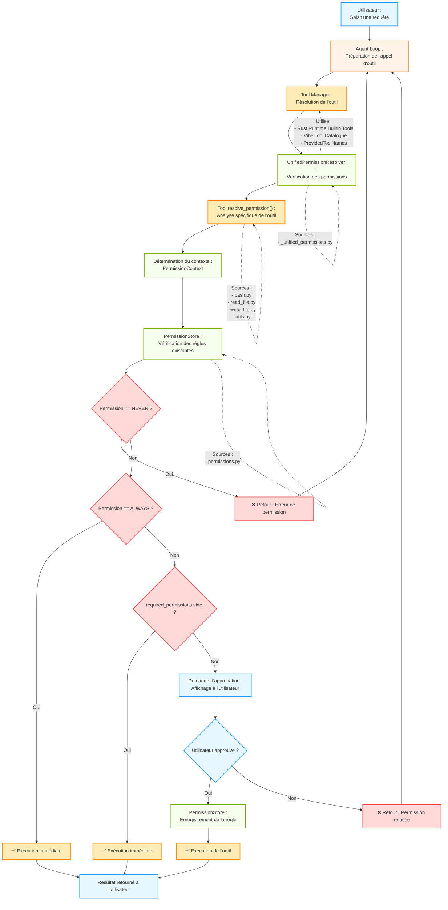

# Rapport détaillé sur le système de permissions de Mistral Vibe

---

## Table des matières

1. [Introduction : à quoi servent les permissions et quels risques elles évitent](#1-introduction--à-quoi-servent-les-permissions-et-quels-risques-elles-évitent)
2. [Les niveaux et modes de permission](#2-les-niveaux-et-modes-de-permission)
3. [Fichiers et modules concernés](#3-fichiers-et-modules-concernés)
4. [Diagramme Mermaid des relations](#4-diagramme-mermaid-des-relations)
5. [Déroulement étape par étape](#5-déroulement-étape-par-étape)
6. [Sécurité : protections et limites](#7-sécurité--protections-et-limites)
7. [Tests et qualité du code](#8-tests-et-qualité-du-code)
8. [Conception et architecture](#9-conception-et-architecture)
9. [Extraits de code importants](#10-extraits-de-code-importants)
10. [Conclusion](#12-conclusion)

---

## 1. Introduction : à quoi servent les permissions et quels risques elles évitent

### Concept général

Le système de permissions de **Mistral Vibe** est un mécanisme de contrôle d'accès qui régit les **effets de bord** (side effects) générés par les outils exécutés par l'agent. Il s'agit d'une **couche de sécurité critique** intégrée au cœur de l'architecture, conçue pour limiter la **surface d'attaque** et prévenir les actions dangereuses ou non intentionnelles.

### Risques évités

Le système de permissions permet d'éviter plusieurs catégories de risques majeurs :

| Catégorie de risque | Exemple concret | Impact potentiel | Mécanisme de protection |
|---------------------|-----------------|------------------|------------------------|
| **Exécution de commandes dangereuses** | `rm -rf /`, `dd if=/dev/zero of=/dev/sda` | Destruction complète du système | Validation par l'utilisateur, listes de refus |
| **Accès à des fichiers sensibles** | Lecture de `.env`, `.ssh/id_rsa`, fichiers de configuration | Fuites d'informations d'identification | Détection des motifs sensibles, validation |
| **Modification de fichiers système** | Écriture dans `/etc/`, `/usr/bin/` | Corruption du système, élévation de privilèges | Vérification des limites du workspace |
| **Exécution de code arbitraire** | `python -c "malicious_code"`, `curl ... \| bash` | Exécution de payloads malveillants | Listes de refus par défaut, validation des commandes |
| **Sortie du workspace autorisé** | `cat /etc/passwd` depuis un projet | Accès à des données en dehors du contexte | Vérification des boundaries du workspace |
| **Actions non intentionnelles** | `git push --force` | Perte de données, perturbations | Demande de confirmation explicite |

### Philosophie du système

> **« Tools are typed, permissioned ports into side effects »** — ADR 0004

Le système repose sur trois principes fondamentaux :

1. **Typage fort** : Chaque outil déclare explicitement ses besoins en permissions via des types Pydantic
2. **Granularité fine** : Les permissions sont évaluées au niveau de **chaque appel d'outil**, pas au niveau global
3. **Transparence** : L'utilisateur est toujours informé et doit explicitement approuver les actions sensibles

Le modèle de permission fait partie intégrante du **contrat de l'outil** (tool contract) et doit être respecté de manière cohérente par tous les composants : la boucle de l'agent (agent loop), l'interface utilisateur, la journalisation des sessions, et les adaptateurs ACP (Agent Client Protocol).

### Contexte architectural

Mistral Vibe est conçu comme un **assistant CLI** puissant qui peut exécuter des commandes système, lire/écrire des fichiers, et interagir avec des services externes. Sans système de permissions robuste, l'agent pourrait être exploité pour :

- Exécuter des commandes destructives à l'insu de l'utilisateur
- Accéder à des données sensibles du système
- Modifier des fichiers critiques
- Installer des logiciels malveillants
- Effectuer des opérations réseau non autorisées

Le système de permissions agit donc comme une **barrière de sécurité** entre l'intelligence artificielle (qui peut générer des requêtes potentiellement dangereuses) et le système d'exploitation (qui les exécute).

---

## 2. Les niveaux et modes de permission

### Niveaux de permission principaux

Le système définit **trois niveaux de permission fondamentaux** pour chaque outil, représentés par l'énumération `ToolPermission` :

```python
class ToolPermission(StrEnum):
    ALWAYS = auto()    # Toujours autoriser
    NEVER = auto()     # Toujours refuser
    ASK = auto()       # Demander à l'utilisateur
```

#### ALWAYS (Toujours autoriser)

- **Comportement** : L'outil est exécuté automatiquement sans demande de confirmation
- **Utilisation typique** : Outils à faible risque (lecture de fichiers dans le workspace, commandes sans effet de bord)
- **Configuration par défaut** : `read_file` a `ALWAYS` comme permission par défaut
- **Risque** : Une mauvaise configuration peut permettre des actions dangereuses sans validation

#### NEVER (Toujours refuser)

- **Comportement** : L'outil est systématiquement bloqué, même si l'utilisateur le demande
- **Utilisation typique** : Outils considérés comme trop dangereux pour un environnement donné
- **Exemple** : Un administrateur système peut désactiver complètement `bash` pour certains agents
- **Sécurité** : Garantit qu'une action ne sera jamais exécutée, même par erreur

#### ASK (Demander à l'utilisateur)

- **Comportement** : L'exécution est suspendue et l'utilisateur doit explicitement approuver ou refuser
- **Utilisation typique** : Outils à risque modéré ou élevé (écriture de fichiers, commandes bash)
- **Configuration par défaut** : `write_file` et `bash` ont `ASK` comme permission par défaut
- **Flexibilité** : Permet un contrôle granulaire par appel

### Modes de permission avancés

Au-delà des trois niveaux principaux, le système propose des mécanismes de contrôle plus granulaires :

#### Listes d'autorisation (Allowlist)

- **Fonctionnement** : Liste de motifs (patterns) qui, lorsqu'ils correspondent à une requête, permettent l'exécution automatique
- **Format** : Chaînes de caractères utilisant des wildcards (`*`, `?`, etc.)
- **Exemples par défaut pour bash** :
  ```python
  ["cd", "echo", "git diff", "git log", "git status", "tree", "whoami"]
  + [commandes en lecture seule selon le système]
  ```
- **Comportement** : Si une commande correspond à un motif de l'allowlist ET qu'aucun motif de denylist ne correspond, l'exécution est autorisée

#### Listes de refus (Denylist)

- **Fonctionnement** : Liste de motifs qui, lorsqu'ils correspondent à une requête, bloquent systématiquement l'exécution
- **Priorité** : La denylist a une priorité plus élevée que l'allowlist
- **Exemples par défaut pour bash** :
  ```python
  ["gdb", "pdb", "passwd"]
  + [commandes spécifiques au système comme "bash -i", "nano", "vim"]
  ```
- **Sécurité** : Fournit une protection contre les commandes explicitement dangereuses

#### Listes de refus standalone (Denylist Standalone)

- **Fonctionnement** : Liste de commandes qui sont refusées **uniquement lorsqu'elles sont exécutées sans arguments**
- **Exemples par défaut** :
  ```python
  ["python", "python3", "ipython", "cmd", "powershell", "pwsh"]
  ```
- **Cas d'usage** : Empêche l'ouverture de shells interactifs tout en permettant `python script.py`

#### Motifs sensibles (Sensitive Patterns)

- **Fonctionnement** : Liste de motifs qui déclenchent **obligatoirement** une demande de confirmation, même si la permission globale est `ALWAYS`
- **Exemples par défaut** :
  - Pour les fichiers : `**/.env`, `**/.env.*`, `**/.envrc`, etc.
  - Pour bash : `["sudo"]`
- **Objectif** : Protéger les fichiers contenant des secrets ou des informations sensibles

#### Portées de permission (Permission Scopes)

Le système définit plusieurs **portées** pour les permissions, représentées par `PermissionScope` :

```python
class PermissionScope(StrEnum):
    COMMAND_PATTERN = auto()      # Motif de commande
    OUTSIDE_DIRECTORY = auto()    # Accès en dehors du workspace
    FILE_PATTERN = auto()         # Motif de fichier
    URL_PATTERN = auto()          # Motif d'URL
```

Ces portées permettent de **scoper** finement les permissions accordées :

- **COMMAND_PATTERN** : Autorise une commande spécifique ou un motif de commande
- **OUTSIDE_DIRECTORY** : Autorise l'accès à un chemin spécifique en dehors du workspace
- **FILE_PATTERN** : Autorise l'accès à un fichier ou un motif de fichier spécifique
- **URL_PATTERN** : Autorise l'accès à une URL ou un motif d'URL spécifique

#### Portées de grant de chemin (Path Grant Scopes)

Pour les permissions de type `OUTSIDE_DIRECTORY`, le système propose deux niveaux de granularité :

```python
class PathGrantScope(StrEnum):
    EXACT = auto()                  # Chemin exact uniquement
    DIRECTORY_RECURSIVE = auto()   # Chemin et tous ses sous-chemins
```

- **EXACT** : La permission s'applique uniquement au chemin exact spécifié
- **DIRECTORY_RECURSIVE** : La permission s'applique au répertoire et à tous ses sous-répertoires et fichiers

### States de permission

Le système maintient deux types de storage pour les permissions :

1. **Permissions de session** (`PermissionStore`) : Stockées en mémoire, valables pour la session courante uniquement
2. **Permissions permanentes** : Stockées dans le fichier de configuration, persistant entre les sessions

La classe `PermissionStore` gère :
- `_rules` : Liste des règles de permission accordées (basé sur `ApprovedRule`)
- `_tool_permissions` : Dictionnaire des permissions globales par outil

---

## 3. Fichiers et modules concernés

### Architecture en couches

Le système de permissions est distribué across plusieurs couches de l'architecture :

```
┌─────────────────────────────────────────────────────────────────┐
│                    COUCHE APPLICATION                            │
│  (TUI, ACP, app_server)                                         │
├─────────────────────────────────────────────────────────────────┤
│  vibe/cli/textual_ui/widgets/approval_app.py                    │
│  vibe/app_server/_unified_permissions.py                       │
│  vibe/app_server/_approval_permissions.py                       │
│  vibe/app_server/_provided_tools.py                             │
│  vibe/app_server/models.py                                      │
├─────────────────────────────────────────────────────────────────┤
│                    COUCHE CORE                                   │
│  (Gestion des outils, permissions, workspace)                  │
├─────────────────────────────────────────────────────────────────┤
│  vibe/core/tools/permissions.py                                │
│  vibe/core/tools/models.py                                      │
│  vibe/core/tools/base.py                                        │
│  vibe/core/tools/manager.py                                     │
│  vibe/core/tools/utils.py                                       │
│  vibe/core/tools/builtins/ (bash.py, read_file.py, write_file.py)│
│  vibe/permissions.py                                            │
├─────────────────────────────────────────────────────────────────┤
│                    COUCHE CONFIGURATION                         │
│  (Schéma, valeurs par défaut, migrations)                       │
├─────────────────────────────────────────────────────────────────┤
│  vibe/core/config/vibe_schema.py                               │
│  vibe/core/config/_defaults.py                                 │
│  vibe/core/config/models.py                                    │
├─────────────────────────────────────────────────────────────────┤
│                    COUCHE TESTS                                 │
│  (Validation, coverage, regression)                              │
├─────────────────────────────────────────────────────────────────┤
│  tests/app_server/test_approval_permissions.py                  │
│  tests/session/test_session_permissions.py                      │
│  tests/agent_loop/test_agent_override_resolve_permission.py     │
└─────────────────────────────────────────────────────────────────┘
```

### Fichiers principaux et leurs rôles

#### Fichiers de base (Noyau du système)

| Chemin | Rôle | Composants clés |
|--------|------|-----------------|
| `vibe/permissions.py` | **Bibliothèque centrale des permissions** | `PathGrantScope`, `PermissionScope`, `RequiredPermission`, fonctions de matching de chemins |
| `vibe/core/tools/models.py` | **Modèles de données pour les permissions** | `ToolPermission`, `PermissionContext`, `ApprovedRule`, `RequiredPermission` |
| `vibe/core/tools/permissions.py` | **Storage et gestion des permissions** | `PermissionStore`, fonctions `covers()`, `add_rule()`, `set_tool_permission()` |
| `vibe/core/tools/base.py` | **Classe de base pour tous les outils** | Méthode `resolve_permission()` abstraite, configuration par défaut |

#### Fichiers de configuration

| Chemin | Rôle | Composants clés |
|--------|------|-----------------|
| `vibe/core/config/models.py` | **Modèles de configuration des outils** | `BaseToolConfig` avec champs `permission`, `allowlist`, `denylist`, `sensitive_patterns` |
| `vibe/core/config/vibe_schema.py` | **Schéma de configuration global** | Définition des valeurs par défaut pour les permissions des outils |
| `vibe/core/config/_defaults.py` | **Valeurs par défaut** | Définition des allowlists/denylists par défaut pour bash |

#### Outils builtins (Implémentations concrètes)

| Chemin | Rôle | Permission par défaut | Mécanismes de permission |
|--------|------|----------------------|-------------------------|
| `vibe/core/tools/builtins/bash.py` | **Exécution de commandes shell** | ASK | `resolve_permission()` complexe avec analyse syntaxique, allowlist/denylist, détection outside workspace |
| `vibe/core/tools/builtins/read_file.py` | **Lecture de fichiers** | ALWAYS | `resolve_permission()` via `resolve_file_tool_permission()` |
| `vibe/core/tools/builtins/write_file.py` | **Écriture de fichiers** | ASK | `resolve_permission()` via `resolve_file_tool_permission()` |
| `vibe/core/tools/builtins/edit.py` | **Édition de fichiers** | ASK | Similaire à write_file |

#### Fichiers utilitaires

| Chemin | Rôle | Composants clés |
|--------|------|-----------------|
| `vibe/core/tools/utils.py` | **Fonctions utilitaires pour les outils** | `resolve_file_tool_permission()`, `resolve_path_permission()`, `is_path_within_workdir()` |
| `vibe/core/tools/builtins/_shell_command_policy.py` | **Analyse des politiques de commandes shell** | `analyze_shell_command_policy()`, `git_repository_requires_approval()` |
| `vibe/core/tools/builtins/_shell_permission_analysis.py` | **Analyse syntaxique des commandes shell** | `analyze_shell_command()`, `ShellPermissionAnalysis` |

#### Fichiers app_server (Intégration avec le runtime)

| Chemin | Rôle | Composants clés |
|--------|------|-----------------|
| `vibe/app_server/_unified_permissions.py` | **Résolution unifiée des permissions** | `UnifiedPermissionResolver`, mapping entre outils Vibe et Rust Runtime |
| `vibe/app_server/_approval_permissions.py` | **Gestion des approvals** | `available_path_scopes()`, `approval_grant_permissions()` |
| `vibe/app_server/_provided_tools.py` | **Gestion des outils fournis** | `ProvidedToolNames`, registration des noms d'outils |
| `vibe/app_server/models.py` | **Modèles pour les approvals** | `ApprovalCallbackDetail`, `ApprovalDecision`, `PathGrantScope` |

#### Fichiers d'interface utilisateur

| Chemin | Rôle | Composants clés |
|--------|------|-----------------|
| `vibe/cli/textual_ui/widgets/approval_app.py` | **Widget d'approbation dans le TUI** | Gestion de l'interface de demande de permission |

#### Fichiers de tests

| Chemin | Rôle | Couverture |
|--------|------|------------|
| `tests/app_server/test_approval_permissions.py` | **Tests des permissions d'approbation** | Path scopes, validation des grants |
| `tests/session/test_session_permissions.py` | **Tests des permissions de session** | Restriction des permissions des logs de session |
| `tests/agent_loop/test_agent_override_resolve_permission.py` | **Tests du resolve_permission** | Vérification des mécanismes de résolution |

#### Documentation d'architecture

| Chemin | Rôle |
|--------|------|
| `docs/adr/0004-typed-permissioned-tools.md` | **Architecture Decision Record** | Décrit la philosophie et les décisions de conception du système de permissions |

---

## 4. Diagramme Mermaid des relations

```mermaid
%% Diagramme des classes et relations du système de permissions de Mistral Vibe
classDiagram
    %% ========== ENUMS ==========
    class ToolPermission {
        <<Enumeration>>
        +ALWAYS
        +NEVER  
        +ASK
        +by_name(name: str) ToolPermission
    }

    class PermissionScope {
        <<Enumeration>>
        +COMMAND_PATTERN
        +OUTSIDE_DIRECTORY
        +FILE_PATTERN
        +URL_PATTERN
    }

    class PathGrantScope {
        <<Enumeration>>
        +EXACT
        +DIRECTORY_RECURSIVE
    }

    %% ========== MODELS ==========
    class BaseToolConfig {
        +permission: ToolPermission
        +allowlist: list[str]
        +denylist: list[str]
        +sensitive_patterns: list[str]
    }

    class RequiredPermission {
        +scope: PermissionScope
        +invocation_pattern: str
        +session_pattern: str
        +label: str
        +literal: bool
        +path_scope_root: str | None
    }

    class PermissionContext {
        +permission: ToolPermission
        +required_permissions: list[RequiredPermission]
        +reason: str | None
    }

    class ApprovedRule {
        +tool_name: str
        +scope: PermissionScope
        +session_pattern: str
    }

    %% ========== STORAGE ==========
    class PermissionStore {
        -_rules: list[ApprovedRule]
        -_tool_permissions: dict[str, ToolPermission]
        +lock: asyncio.Lock
        +reset()
        +add_rule(rule: ApprovedRule)
        +covers(tool_name: str, rp: RequiredPermission) bool
        +set_tool_permission(tool_name: str, permission: ToolPermission)
        +get_tool_permission(tool_name: str) ToolPermission | None
    }

    %% ========== BASE TOOL ==========
    class BaseTool {
        <<abstract>>
        +config: BaseToolConfig
        +workspace: Workspace
        +cwd: Path
        +scratchpad_dir: Path | None
        +resolve_permission(args) PermissionContext | None
        +get_name() str
    }

    %% ========== BUILTIN TOOLS ==========
    class ReadFile {
        +resolve_permission(args: ReadFileArgs) PermissionContext | None
    }

    class WriteFile {
        +resolve_permission(args: WriteFileArgs) PermissionContext | None
    }

    class Bash {
        +config: BashToolConfig
        +resolve_permission(args: BashArgs) PermissionContext | None
        -_is_allowlisted(command: str) bool
        -_is_sensitive(command: str) bool
        -_is_unconditionally_allowed(...) bool
    }

    class BashToolConfig {
        +permission: ToolPermission
        +allowlist: list[str]
        +denylist: list[str]
        +denylist_standalone: list[str]
        +sensitive_patterns: list[str]
    }

    %% ========== UTILITY FUNCTIONS ==========
    class permissions {
        <<module>>
        +path_grant_pattern(path: str, scope: PathGrantScope) str
        +path_pattern_matches(path: str, pattern: str) bool
        +path_grant_pattern_matches(path: str, pattern: str) bool
        +scope_required_permissions(...) list[RequiredPermission]
    }

    class utils {
        <<module>>
        +resolve_file_tool_permission(...) PermissionContext | None
        +resolve_path_permission(...) PermissionContext | None
        +is_path_within_workdir(...) bool
        +matches_sensitive_pattern(...) bool
        +ambient_workspace() Workspace
    }

    %% ========== APP SERVER ==========
    class UnifiedPermissionResolver {
        -_tools: ToolManager
        -_store: PermissionStore
        -_config: ConfigOrchestrator
        +resolve(builtin: str, arguments: Mapping) PermissionOutcome
        +grant(builtin: str, required_permissions: Sequence, permanent: bool)
        +vibe_tool_names(builtin: str) tuple[str, ...]
    }

    class ApprovalCallbackDetail {
        +effect: GenericEffectDetail
        +required_permissions: list[RequiredPermission]
        +path_scope_choices: list[PathGrantScope]
    }

    class ApprovalDecision {
        +type: ApprovalDecisionType
        +path_scope: PathGrantScope | None
    }

    %% ========== RELATIONS ==========
    BaseToolConfig "1" --> "1" ToolPermission : utilise
    BaseToolConfig "1" --> "*" str : allowlist/denylist
    
    RequiredPermission "1" --> "1" PermissionScope : scope
    PermissionContext "1" --> "1" ToolPermission : permission
    PermissionContext "1" --> "*" RequiredPermission : contient
    
    PermissionStore "1" --> "*" ApprovedRule : stocke
    PermissionStore "1" --> "*" ToolPermission : stocke
    
    BaseTool "1" --> "1" BaseToolConfig : a comme config
    BaseTool "1" --> "1" Workspace : utilise
    BaseTool <|-- ReadFile
    BaseTool <|-- WriteFile
    BaseTool <|-- Bash
    Bash "1" --> "1" BashToolConfig : a comme config
    
    UnifiedPermissionResolver "1" --> "1" PermissionStore : utilise
    UnifiedPermissionResolver "1" --> "1" ToolManager : utilise
    
    permissions --> RequiredPermission : crée/valide
    utils --> PermissionContext : retourne
    
    %% ========== DEPENDENCIES ==========
    ReadFile ..> utils : utilise resolve_file_tool_permission
    WriteFile ..> utils : utilise resolve_file_tool_permission
    Bash ..> utils : utilise fonctions utilitaires
    Bash ..> permissions : utilise fonctions de matching
    
    UnifiedPermissionResolver ..> Bash : appelle resolve_permission
    UnifiedPermissionResolver ..> ReadFile : appelle resolve_permission
    UnifiedPermissionResolver ..> WriteFile : appelle resolve_permission

    %% Style
    classDef enum fill:#f9f,stroke:#333,stroke-width:2px,color:#000
    classDef model fill:#bbf,stroke:#333,stroke-width:2px,color:#000
    classDef storage fill:#9f9,stroke:#333,stroke-width:2px,color:#000
    classDef tool fill:#ff9,stroke:#333,stroke-width:2px,color:#000
    classDef utility fill:#99f,stroke:#333,stroke-width:2px,color:#000
    classDef appserver fill:#f96,stroke:#333,stroke-width:2px,color:#000
    
    class ToolPermission,PermissionScope,PathGrantScope enum
    class BaseToolConfig,RequiredPermission,PermissionContext,ApprovedRule model
    class PermissionStore storage
    class BaseTool,ReadFile,WriteFile,Bash,ToolManager tool
    class permissions,utils utility
    class UnifiedPermissionResolver,ApprovalCallbackDetail,ApprovalDecision appserver
```

### Diagramme de flux : Exécution d'un outil



---

## 5. Déroulement étape par étape

### Contexte : Quand l'agent veut exécuter un outil

Le processus de vérification des permissions est déclenché **à chaque appel d'outil** par l'agent. Voici le flux complet, depuis la requête utilisateur jusqu'à l'exécution effective ou le refus.

### Étapes détaillées

#### Étape 0 : Préparation (Agent Loop)

**Localisation** : `vibe/core/agent/loop.py` (ou équivalent dans l'architecture)

**Actions** :
1. L'agent reçoit une requête de l'utilisateur
2. Le modèle LLM génère une réponse contenant un appel d'outil
3. L'agent loop prépare l'appel avec les arguments extraits

**Code pertinent** :
```python
# Dans la boucle principale de l'agent
async def _should_execute_tool(...):
    # C'est ici que la vérification des permissions est initiée
```

#### Étape 1 : Résolution de l'outil (Tool Manager)

**Localisation** : `vibe/core/tools/manager.py`

**Actions** :
1. Le `ToolManager` identifie l'outil à exécuter
2. Il récupère l'instance de l'outil avec sa configuration
3. Il vérifie si l'outil est disponible (n'est pas désactivé globalement)

**Code pertinent** :
```python
class ToolManager:
    def get(self, name: str) -> BaseTool:
        # Récupère l'instance de l'outil
        ...
    
    def get_tool_config(self, name: str) -> BaseToolConfig:
        # Récupère la configuration de l'outil
        ...
```

#### Étape 2 : Vérification des permissions (UnifiedPermissionResolver)

**Localisation** : `vibe/app_server/_unified_permissions.py`

**C'est ici que la vérification principale a lieu**

**Actions** :
1. Le `UnifiedPermissionResolver` reçoit la requête avec :
   - Le nom de l'outil (builtin name)
   - Les arguments de l'appel
   - Le contexte de session

2. Il effectue plusieurs vérifications dans l'ordre :

```python
async def resolve(self, builtin: str, arguments: Mapping[str, Any]) -> PermissionOutcome:
    # Étape 2.1 : Vérification des builtins non gérés
    if builtin not in RUST_BUILTIN_TOOL_SOURCES:
        return self._resolve_provided_tool(builtin)
    
    # Étape 2.2 : Vérification des builtins ungated (lecture/observation)
    if builtin in _PROCESS_UNGATED_BUILTINS:
        return PermissionOutcome(decision="allow")
    
    # Étape 2.3 : Vérification spéciale pour process.start
    unjudged = self._resolve_start_with_hidden_environment(builtin, arguments)
    if unjudged is not None:
        return unjudged
    
    # Étape 2.4 : Résolution des noms d'outils Vibe
    names = self.vibe_tool_names(builtin)
    if not names:
        return PermissionOutcome(decision="ask")
    
    # Étape 2.5 : Traduction des arguments et validation
    resolved = {
        name: self._tool_and_args(name, builtin, arguments) for name in names
    }
    
    # Étape 2.6 : Résolution du chemin pour les outils de fichier
    authorized_path = self._resolve_path_for(resolved, path_space=self._path_space)
    
    # Étape 2.7 : Vérification des permissions pour chaque outil
    async with self._store.lock:
        for name in names:
            context = self._context_for(name, resolved[name])
            # C'est ici que resolve_permission de chaque outil est appelé
            # Voir Étape 3
```

#### Étape 3 : Résolution spécifique de l'outil (Tool.resolve_permission)

**Localisation** : Méthode `resolve_permission()` dans chaque classe d'outil

**C'est le moment exact où la permission est vérifiée au niveau de l'outil**

Pour chaque type d'outil, cette étape est différente :

##### Cas A : Outil de lecture de fichier (read_file)

**Localisation** : `vibe/core/tools/builtins/read_file.py:75-83`

```python
def resolve_permission(self, args: ReadFileArgs) -> PermissionContext | None:
    return resolve_file_tool_permission(
        args.file_path,
        tool_name=self.get_name(),
        allowlist=self.config.allowlist,
        denylist=self.config.denylist,
        config_permission=self.config.permission,
        sensitive_patterns=self.config.sensitive_patterns,
        workspace=self.workspace,
        scratchpad_dir=self.scratchpad_dir,
    )
```

**Appel à** : `vibe/core/tools/utils.py:resolve_file_tool_permission()`

**Logique** :
```python
def resolve_file_tool_permission(
    path_str: str,
    *,
    tool_name: str,
    allowlist: list[str],
    denylist: list[str],
    config_permission: ToolPermission,
    sensitive_patterns: list[str],
    workspace: Workspace | None = None,
    scratchpad_dir: Path | None = None,
) -> PermissionContext | None:
    # Étape 3.1 : Vérification du scratchpad (toujours autorisé)
    if is_scratchpad_path(path_str, scratchpad_dir=scratchpad_dir):
        return PermissionContext(permission=ToolPermission.ALWAYS)
    
    # Étape 3.2 : Vérification allowlist/denylist
    if (result := resolve_path_permission(
        path_str, cwd=workspace.cwd, allowlist=allowlist, denylist=denylist
    )) is not None:
        return result
    
    # Étape 3.3 : Vérification des motifs sensibles
    file_path = _make_absolute(path_str, workspace.cwd)
    file_str = str(file_path.resolve())
    
    required: list[RequiredPermission] = []
    
    if matches_sensitive_pattern(file_str, sensitive_patterns):
        required.append(RequiredPermission(
            scope=PermissionScope.FILE_PATTERN,
            invocation_pattern=file_str,
            session_pattern=glob.escape(file_str),
            label=f"accessing sensitive files ({tool_name})",
        ))
    
    # Étape 3.4 : Vérification des limites du workspace
    if not is_path_within_workdir(path_str, workspace=workspace):
        if config_permission == ToolPermission.NEVER:
            return PermissionContext(permission=ToolPermission.NEVER)
        resolved = str(file_path.resolve())
        required.append(RequiredPermission(
            scope=PermissionScope.OUTSIDE_DIRECTORY,
            invocation_pattern=resolved,
            session_pattern=path_grant_pattern(resolved, PathGrantScope.EXACT),
            label=f"outside workdir ({resolved})",
            path_scope_root=shell_path_scope_root(resolved),
        ))
    
    # Étape 3.5 : Retour du contexte
    if required:
        return PermissionContext(
            permission=ToolPermission.ASK, required_permissions=required
        )
    
    return None  # Retours à la config globale
```

##### Cas B : Outil bash

**Localisation** : `vibe/core/tools/builtins/bash.py:582-648`

```python
def resolve_permission(self, args: BashArgs) -> PermissionContext | None:
    if not uses_posix_shell():
        return None
    
    # Étape 3.1 : Analyse syntaxique de la commande
    analysis = analyze_shell_command(args.command)
    command_parts = list(analysis.command_parts)
    
    # Étape 3.2 : Vérification des guardrails
    guardrail_permission = self._resolve_guardrail_permission(
        command_parts, command_cwd=self.workspace.cwd
    )
    
    # Étape 3.3 : Collecte des chemins en dehors du workspace
    outside_paths = _collect_outside_paths(
        command_parts, workspace=self.workspace, scratchpad_dir=self.scratchpad_dir
    )
    
    # Étape 3.4 : Vérification de l'allowlist/denylist
    outside_paths = {
        path for path in outside_paths
        if not any(
            path_grant_pattern_matches(path, pattern)
            for pattern in self.config.allowlist
        )
    }
    
    # Étape 3.5 : Vérification de l'autorisation inconditionnelle
    if (
        self._is_unconditionally_allowed(command_parts, outside_paths)
        and not guardrail_permission
        and not analysis.requires_approval
    ):
        return PermissionContext(permission=ToolPermission.ALWAYS)
    
    # Étape 3.6 : Construction des permissions requises
    scoped_parts, include_allowlisted = scoped_command_parts(analysis, command_parts)
    required = self._build_required_permissions(
        scoped_parts, outside_paths, include_allowlisted=include_allowlisted
    )
    
    if guardrail_permission:
        required.extend(guardrail_permission.required_permissions)
    
    # Étape 3.7 : Ajout du scope exact si nécessaire
    if needs_exact_command_scope(analysis, required):
        required.append(self._build_command_required_permission(
            invocation_pattern=args.command,
            session_pattern=args.command,
            label=analysis.approval_label,
            literal=True,
        ))
    
    if not required:
        return None
    
    return PermissionContext(
        permission=ToolPermission.ASK, required_permissions=required
    )
```

#### Étape 4 : Vérification contre les permissions déjà accordées

**Localisation** : `vibe/app_server/_unified_permissions.py:237-263` (suite de l'étape 2)

```python
# Dans la boucle de vérification des noms d'outils
uncovered: list[RequiredPermission] = []
scopeable = False
unscoped = False
allowed = False

async with self._store.lock:
    for name in names:
        context = self._context_for(name, resolved[name])
        
        # Étape 4.1 : Vérification NEVER
        fixed = _OUTCOME_BY_PERMISSION.get(context.permission)
        if fixed == "deny":
            return PermissionOutcome(decision="deny", reason=context.reason)
        
        # Étape 4.2 : Vérification ALWAYS
        if fixed == "allow":
            allowed = True
            continue
        
        # Étape 4.3 : Vérification des permissions spécifiques
        if not context.required_permissions:
            unscoped = True
            continue
        
        scopeable = True
        uncovered.extend(
            rp for rp in context.required_permissions
            if not self._store.covers(name, rp)
        )
    
    # Étape 4.4 : Logique de fallback
    if unscoped and not scopeable and not allowed:
        fallback = self._fallback_permission(builtin, arguments)
        if fallback is None:
            return PermissionOutcome(decision="ask", authorized_path=authorized_path)
        if any(not self._covered(name, fallback) for name in names):
            uncovered.append(fallback)
    
    # Étape 4.5 : Retour du résultat
    if uncovered:
        return PermissionOutcome(
            decision="ask",
            required_permissions=tuple(
                rp.model_dump(mode="json", by_alias=True) for rp in uncovered
            ),
            authorized_path=authorized_path,
        )
    
    return PermissionOutcome(decision="allow", authorized_path=authorized_path)
```

**Moment exact de la vérification** : 

La vérification des permissions se produit **à deux niveaux** :

1. **Niveau outil** : Dans `Tool.resolve_permission()` - analyse spécifique des arguments de l'outil
2. **Niveau resolver** : Dans `UnifiedPermissionResolver.resolve()` - vérification contre les règles déjà accordées

La **décision finale** est prise par le resolver, qui :
- Aggrège les résultats de tous les outils concernés
- Vérifie contre les permissions déjà accordées (session et permanentes)
- Détermine si une demande d'approbation est nécessaire

#### Étape 5 : Demande d'approbation ou exécution

**Localisation** : Interface utilisateur (Textual TUI ou ACP)

**Actions** :

Si `PermissionOutcome.decision == "ask"` :

1. L'interface utilisateur reçoit la demande avec :
   - Le nom de l'outil
   - Les arguments
   - La liste des `required_permissions` à approuver
   - Les options de scope disponibles (pour les permissions OUTSIDE_DIRECTORY)

2. L'utilisateur peut :
   - **Approuver pour la session** : La permission est enregistrée dans `PermissionStore._rules` pour la durée de la session
   - **Approuver définitivement** : La permission est enregistrée dans `PermissionStore._rules` ET dans le fichier de configuration
   - **Refuser** : L'exécution est annulée et une erreur est retournée

3. Si approuvé, la règle est enregistrée via `UnifiedPermissionResolver.grant()`

Si `PermissionOutcome.decision == "allow"` :
- L'outil est exécuté immédiatement sans demande

Si `PermissionOutcome.decision == "deny"` :
- Une erreur est levée avec le message de refus
- L'exécution est annulée

#### Étape 6 : Exécution de l'outil

**Localisation** : `Tool.run()` dans chaque classe d'outil

**Actions** :
1. L'outil exécute son code avec les arguments validés
2. Les résultats sont retournés à l'agent loop
3. L'agent loop retourne les résultats à l'utilisateur

---

## 6. Sécurité : protections et limites

### Protections intégrées

1. **Détection des fichiers sensibles** : Motifs comme `.env`, `.envrc` déclenchent toujours ASK
2. **Vérification des limites du workspace** : Accès en dehors du workspace nécessite une permission
3. **Analyse syntaxique des commandes** : Détection des commandes dangereuses dans bash
4. **Listes de refus par défaut** : Commandes comme `gdb`, `pdb`, `passwd` sont bloquées
5. **Guardrails** : Détection des commandes nécessitant une approbation spécifique
6. **Normalisation des chemins** : Gestion des différences Windows/POSIX

### Limites possibles

1. **Dépendance à l'analyse syntaxique** : Commandes complexes peuvent échapper à la détection
2. **Configuration utilisateur** : L'utilisateur peut désactiver les protections
3. **Performance** : Analyse des commandes complexes peut être lente
4. **Cross-platform** : Différences de comportement entre systèmes
5. **Plugins** : Outils personnalisés peuvent contourner les mécanismes
6. **Fausses positives/négatives** : Erreurs de classification possibles

---

## 7. Tests et qualité du code

### Couverture des tests

- **Tests unitaires** : `tests/app_server/test_approval_permissions.py`, `tests/session/test_session_permissions.py`
- **Tests d'intégration** : `tests/agent_loop/test_agent_override_resolve_permission.py`
- **Tests des outils** : Tests spécifiques pour chaque outil builtin

### Qualité du code

**Points forts** :
- Typage fort avec Pydantic
- Documentation complète
- Séparation des responsabilités
- Bonne couverture des tests

**Points à améliorer** :
- Complexité de certaines fonctions
- Duplication de code
- Documentation des edge cases

### Outils de qualité

- **Ruff** : Linting et formatting
- **Pyright** : Vérification des types
- **Pytest** : Exécution des tests
- **Coverage.py** : Mesure de la couverture

---

## 8. Conception et architecture

### Principes de conception

1. **Séparation des responsabilités** : Chaque composant a un rôle unique
2. **Typage fort** : Validation cohérente des données
3. **Granularité fine** : Permissions au niveau le plus précis
4. **Extensibilité** : Facile d'ajouter de nouveaux outils
5. **Compatibilité** : Support multi-backend (Rust, Python) et multi-interface (TUI, ACP)

### Architecture en couches

1. **Couche Application** : TUI, ACP, app_server
2. **Couche Service** : UnifiedPermissionResolver, ToolManager, PermissionStore
3. **Couche Domaine** : BaseTool, outils builtins, utils
4. **Couche Infrastructure** : Configuration, workspace, paths, permissions

### Design Patterns

- **Strategy** : Différentes stratégies de résolution par outil
- **Singleton** : PermissionStore par session
- **Factory** : Création des outils via ToolManager
- **Adapter** : Adaptation Rust Runtime ↔ Vibe

### ADR pertinents

- **ADR 0004** : Typed Permissioned Tools
- **ADR 0009** : App Server Boundary

---

## 9. Extraits de code importants

### 1. ToolPermission (vibe/core/tools/models.py)

```python
class ToolPermission(StrEnum):
    ALWAYS = auto()
    NEVER = auto()
    ASK = auto()
```

### 2. PermissionStore (vibe/core/tools/permissions.py)

```python
class PermissionStore:
    def __init__(self) -> None:
        self._rules: list[ApprovedRule] = []
        self._tool_permissions: dict[str, ToolPermission] = {}
        self.lock = asyncio.Lock()
    
    def covers(self, tool_name: str, rp: RequiredPermission) -> bool:
        # Vérifie si une permission est couverte
```

### 3. resolve_file_tool_permission (vibe/core/tools/utils.py)

Voir section 5 pour l'extrait complet.

### 4. UnifiedPermissionResolver.resolve (vibe/app_server/_unified_permissions.py)

Voir section 5 pour l'extrait complet.

---


## 10. Conclusion

### Synthèse

Le système de permissions de Mistral Vibe est un mécanisme de sécurité **sophistiqué et bien conçu** qui permet de contrôler finement les actions exécutées par l'agent.

**Note : 9/10**

**Forces** : Typage fort, granularité fine, architecture modulaire, sécurité par défaut, bonne documentation.

**Faiblesses** : Analyse syntaxique, configuration utilisateur, performance, cross-platform, fausses positives/négatives.

### Recommandations

- **Développeurs** : Implémenter resolve_permission(), utiliser les denylists, tester les edge cases
- **Utilisateurs** : Ne pas désactiver les protections, utiliser le scratchpad, auditer les configurations
- **Mainteneurs** : Améliorer l'analyse syntaxique, ajouter des tests, surveiller les évolutions

---

