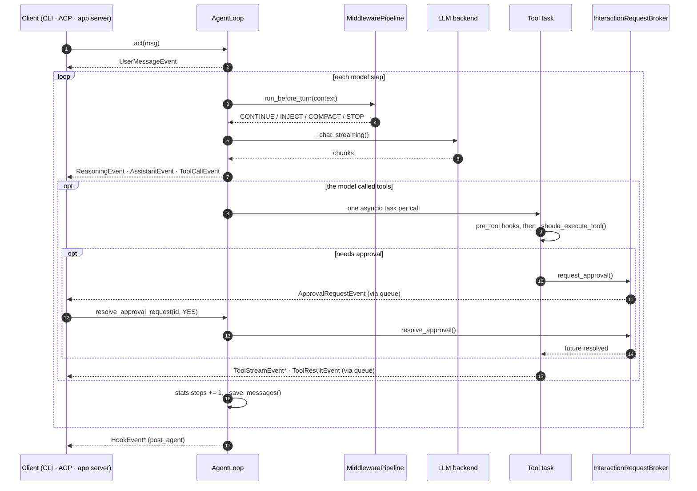
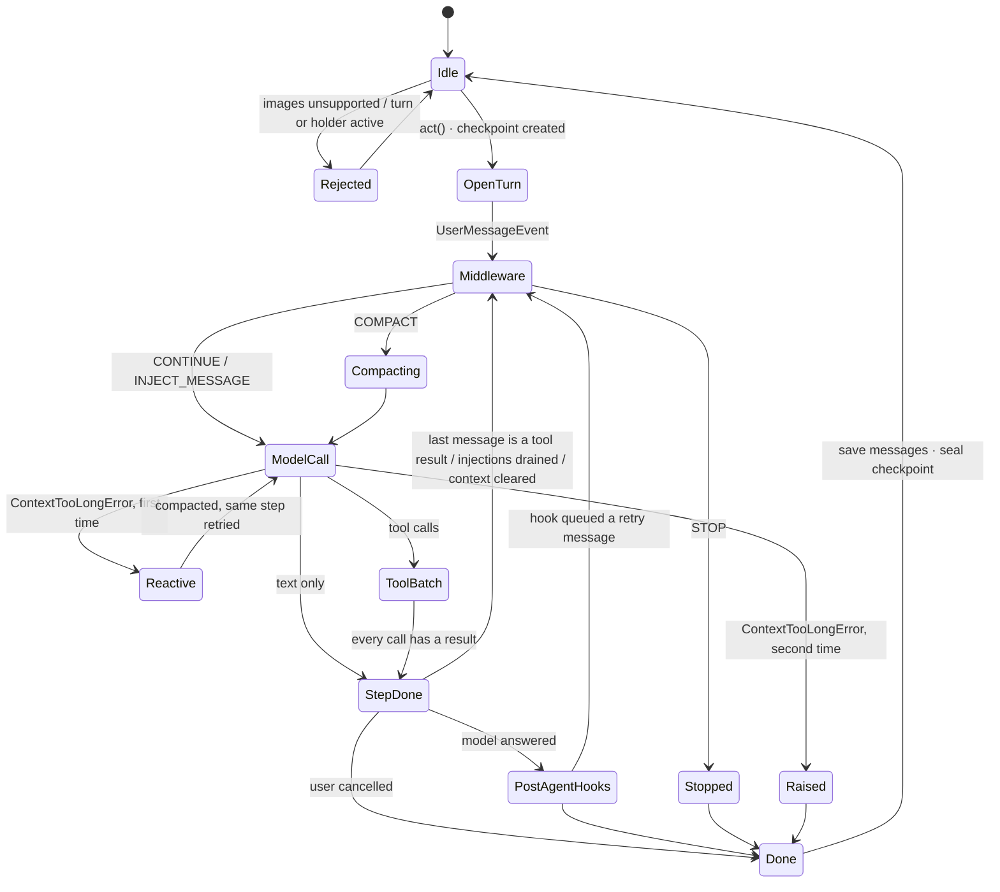
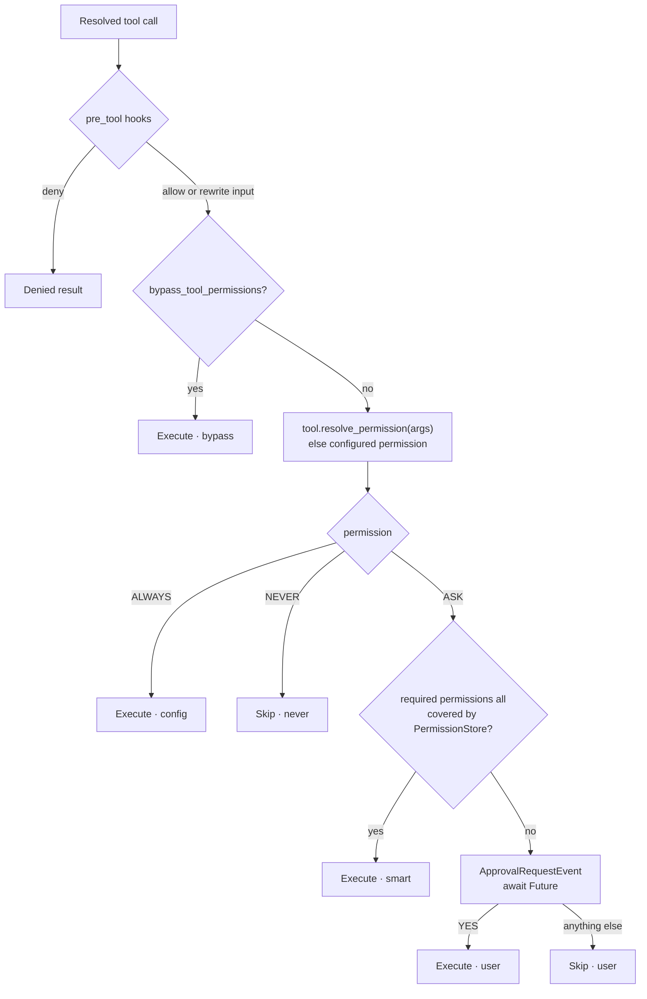
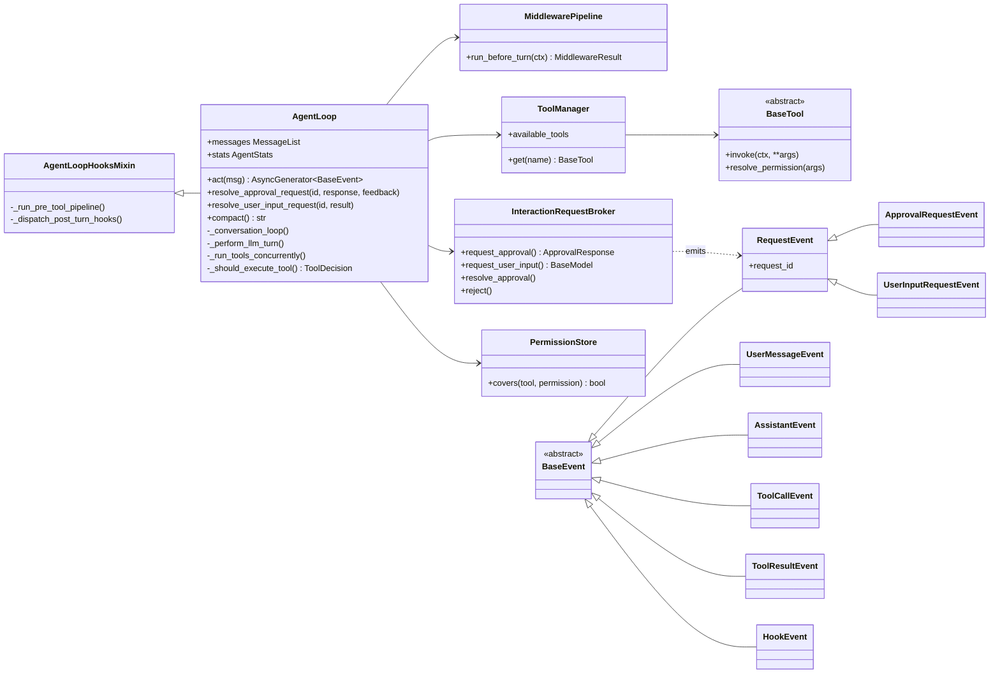

# Agent Loop Feature Report

> An interactive version of this report, with one page per chapter, rendered diagrams and filterable tables, is in [`agent-loop.html`](agent-loop.html). Open it in a browser.
>
> All line references point to commit `9ebde8f2` of `rrobbes/mistral-vibe` and were checked by hand against the source.

---

## 1. Overview

The agent loop (`vibe/core/agent_loop/`) is the engine of Mistral Vibe. It takes a user message, calls the model, runs the tools the model asks for, and repeats until the model answers in plain text. Each change of state becomes a typed event that it yields to whoever is listening: the Textual CLI, the Rust TUI through the app server, ACP clients, or a test.

ADR 0003 splits responsibilities: the loop owns model and tool execution, the app server owns session lifecycle and delivery.

> "Typed events keep UI rendering, protocol translation, logging, and tests from reaching into agent-loop internals." (ADR 0003)

The only entry point is `AgentLoop.act()` (`vibe/core/agent_loop/_loop.py:1676-1739`), which returns `AsyncGenerator[BaseEvent, None]`. Inside one call it:

- keeps the conversation in `self.messages` and saves it after every model step;
- runs the middleware pipeline that enforces turn, price and token limits and triggers compaction;
- executes tool calls concurrently and decides, per call, whether it may run;
- pauses on approvals and questions, one prompt at a time, while tools already running carry on;
- records a checkpoint so the turn can be rewound.

| Figure | Value                                                   |
| ------ | ------------------------------------------------------- |
| 4,084  | lines in `_loop.py`, almost all in one class            |
| 16     | event types the loop yields, plus the hook event family |
| 6      | middleware types checked before every model call (3 only when a limit is set) |
| 440    | test functions across 32 agent-loop test files          |

---

## 2. Codebase Map

| Path                                      | Role                                                                                         | Key symbols                                                 | Lines |
| ----------------------------------------- | -------------------------------------------------------------------------------------------- | ----------------------------------------------------------- | ----- |
| `vibe/core/agent_loop/_loop.py`           | The engine: turn guards, conversation loop, streaming, tool batch, permissions, compaction   | `AgentLoop`, `act()`, `_conversation_loop()`, error classes | 4,084 |
| `vibe/core/agent_loop/_request_broker.py` | Turns approval and user-input requests into events and waits for the answer                  | `InteractionRequestBroker`                                  | 106   |
| `vibe/core/agent_loop/_title_cadence.py`  | Decides when to (re)generate the session title                                               | `TitleCadence`, `TitleGenTicket`                            | 90    |
| `vibe/core/agent_loop/__init__.py`        | Public exports                                                                               | `__all__`                                                   | 33    |
| `vibe/core/agent_loop_hooks.py`           | Mixin that runs pre-tool, post-tool and post-agent hooks                                     | `AgentLoopHooksMixin`                                       | 467   |
| `vibe/core/middleware.py`                 | Checks run before every model call                                                           | `MiddlewarePipeline` + 6 middlewares                        | 256   |
| `vibe/core/types.py`                      | Event and message models                                                                     | `BaseEvent` and subclasses, `LLMMessage`, `AgentStats`      | 797   |
| `vibe/core/llm/format.py`                 | Parses model output and resolves tool calls                                                  | `APIToolFormatHandler`, `ResolvedToolCall`                  | –     |
| `vibe/core/llm/backend/factory.py`        | Creates the Mistral or generic backend                                                       | `create_backend()`                                          | 72    |
| `vibe/core/tools/manager.py:117`          | Discovers, configures and instantiates tools                                                 | `ToolManager`                                               | –     |
| `vibe/core/tools/permissions.py`          | Session-scoped approvals                                                                     | `PermissionStore`                                           | 56    |
| `vibe/core/tools/base.py`                 | Tool contract and invocation context                                                         | `BaseTool`, `InvokeContext`, `ToolPermission`, `ToolError`  | –     |
| `vibe/core/subagents.py`                  | Port the `task` tool uses to run a child loop                                                | `SubagentRunnerPort`, `SubagentRunAccumulator`              | 88    |
| `vibe/core/hooks/models.py:291`           | Hook configuration and hook events                                                           | `HookType`, `HookEvent`                                     | –     |
| `vibe/core/compaction/`                   | Summarises old messages when context runs out                                                | `CompactionManager`                                         | –     |
| `vibe/core/session/`                      | Session log, checkpoints, rewind                                                             | `SessionLogger`, `CheckpointRecorder`                       | –     |
| `vibe/core/telemetry/`                    | Analytics events                                                                             | `TelemetryClient`                                           | –     |
| `vibe/core/config/`                       | Layered configuration                                                                        | `VibeConfigSchema`, `ConfigOrchestrator`                    | –     |

---

## 3. Turn Lifecycle

A turn starts with one user message and ends when the model replies without calling a tool. In between, the loop runs as many _model steps_ as the model needs: each step is one model call followed by the tools it requested.

1. **Guard the entry** (`act()`, `_loop.py:1676-1739`)
   - Images sent to a model without image support raise `ImagesNotSupportedError` (`_loop.py:1697-1700`).
   - A second concurrent turn raises `AgentLoopStateError` (`_loop.py:1701-1702`).
   - A running holder, such as a directory relocation, also blocks the turn (`_loop.py:1707-1710`).
   - Backends whose close was deferred during the previous turn are closed (`_loop.py:1713`).
   - An `_ActiveTurn` records the turn-scoped subagent runner, tool I/O and retry sink (`_loop.py:1715-1719`).
   - History is cleaned and a checkpoint is created (`_loop.py:1721-1722`).
   - Nested `finally` blocks seal the checkpoint and clear `_active_turn` however the turn ends (`_loop.py:1736-1739`).

2. **Open the user turn** (`_open_user_turn()`, `_loop.py:2059-2125`)
   - The message is appended and `stats.steps` is incremented (`_loop.py:2098-2099`).
   - Emits `UserMessageEvent` (`_loop.py:2105-2111`).
   - Injects an invoked skill (`_loop.py:2113`) and `@`-mentioned files (`_loop.py:2116`).
   - Applies a client-supplied auto-title once and emits `SessionTitleUpdatedEvent` (`_loop.py:2119-2122`).
   - An injected message (a retry queued by a hook) is appended silently, with no event.

3. **Check middleware** (`_loop.py:2157-2163`), at the top of **every** model step
   - `STOP`: emit an `AssistantEvent` with `stopped_by_middleware=True`, then return.
   - `COMPACT`: run compaction, then carry on with the model call.
   - `INJECT_MESSAGE`: append a hidden user message.
   - Handled by `_handle_middleware_result()` (`_loop.py:1943-1965`).

4. **Call the model** (`_perform_llm_turn()`, `_loop.py:2549-2574`)
   - Streaming: `_stream_assistant_events()` (`_loop.py:2603-2631`) emits `ReasoningEvent`, `AssistantEvent` and an early `ToolCallEvent` per known tool, de-duplicated by id.
   - Non-streaming: `_get_assistant_event()` (`_loop.py:2633-2638`) emits one `AssistantEvent` if it has content.
   - A `ContextTooLongError` may trigger reactive compaction (`_loop.py:2173-2179`).

5. **Resolve tool calls** (`_loop.py:2558-2564`)
   - The last message is parsed and calls are matched against the `ToolManager`, giving valid `tool_calls` and `failed_calls`.
   - If both are empty, the step ends.
   - `_handle_tool_calls()` (`_loop.py:2640-2666`) reports each failed call as an error `ToolResultEvent`, then emits the final `ToolCallEvent` (with arguments) for each valid call.

6. **Run the tool batch** (`_run_tools_concurrently()`, `_loop.py:2695-2741`)
   - Refuses to start if a batch is already active (`_loop.py:2700`).
   - Creates one `asyncio.Queue` and binds the interaction broker to it (`_loop.py:2699-2703`).
   - Starts one task per call (`_loop.py:2705-2708`) and a monitor that pushes a `None` sentinel when all are done.
   - Yields events in completion order. On `GeneratorExit` or cancellation, unfinished tasks are cancelled (`_loop.py:2724-2741`).

7. **Execute one tool** (`_execute_tool_call()`, `_loop.py:2761-2911`)
   1. Instantiate the tool (`_loop.py:2764-2769`).
   2. Serialise the input for hooks.
   3. Pre-tool hooks can deny or rewrite the call (`agent_loop_hooks.py:258-294`).
   4. `_should_execute_tool()` returns a `ToolDecision`; a skip ends here.
   5. `_invoke_tool()` (`_loop.py:2913-3023`) snapshots affected files into the checkpoint, iterates `tool.invoke()` (emitting `ToolStreamEvent`s), then emits `ToolResultEvent` with duration, decision and approval source.
   6. Post-tool hooks may replace the text the model sees; the tool response message is appended.

8. **Close the step** (`_loop.py:2180-2204`)
   - Plan-mode calls emit `PlanReviewRequestedEvent` / `PlanReviewEndedEvent`; a profile switch emits `AgentProfileChangedEvent` (`_loop.py:2566-2574`).
   - `stats.steps` is incremented (`_loop.py:2183`). A step retried after overflow never reaches this line, so it is not counted.
   - Messages are saved (`_loop.py:2187`).
   - Title generation is scheduled after each step, because one tool-heavy turn can run for minutes (`_loop.py:2190-2198`).
   - If a plan was just accepted, the context is cleared and the loop continues (`_loop.py:2200-2204`).

9. **Continue or stop** (`_loop.py:2206-2217`)
   - `should_break_loop = last_message.role != Role.tool and not drained`: the loop continues when the last message is a tool result or when pending injected messages were just drained. At the pinned commit the only source of those is plan review: if the user edited the plan file while reviewing it, its new content is queued as a hidden message (`_loop.py:2519-2536`).
   - Returns immediately if a tool result in this step was marked `cancelled`, which is what `is_user_cancellation_event()` checks (`vibe/core/utils/tags.py:77-80`). That happens when the user interrupts at an approval prompt.
   - Before breaking, post-agent hooks run (`agent_loop_hooks.py:448-467`); a hook can return a user message that starts another step.
   - The outer `finally` saves messages one last time (`_loop.py:2218-2219`).

**What "turn" means in the counters.** `stats.steps` goes up once for the user message and once per completed model step. `TurnLimitMiddleware` stops when `steps - 1 >= max_turns`, so `max_turns` caps model steps, not user messages.

---

## 4. Diagrams

### 4.1 Sequence: one turn with one tool that needs approval

Every event shown going to the client is yielded through `act()`; the arrows show where it originates.

### 4.2 State machine

Compaction happens before a model call (middleware) or after it fails (reactive), never after saving. Reactive recovery is allowed once per turn.

### 4.3 Permission flow

The label on each outcome is the `approval_source` written to the result event.

### 4.4 Types

---

## 5. Event Vocabulary

All events subclass `BaseEvent` (`vibe/core/types.py:522`), a Pydantic model. Clients branch on the class.

| Event                      | Family      | When                                                                          | Fields                                                                                                                                           | Yielded from                                               |
| -------------------------- | ----------- | ----------------------------------------------------------------------------- | ------------------------------------------------------------------------------------------------------------------------------------------------ | ---------------------------------------------------------- |
| `UserMessageEvent`         | User        | The user message has been appended                                            | `content`, `message_id`, `images`, `resources`, `user_display_content`                                                                           | `_loop.py:2105`                                            |
| `ReasoningEvent`           | Model       | A reasoning chunk arrives (streaming only)                                    | `content`, `message_id`                                                                                                                          | `_loop.py:2617`                                            |
| `AssistantEvent`           | Model       | An answer chunk arrives, the non-streamed answer completes, or middleware stops | `content`, `message_id`, `stopped_by_middleware`                                                                                               | `_loop.py:2623`, `_loop.py:2633`, `_loop.py:1947`          |
| `ToolCallEvent`            | Tool        | Early while streaming (no args), then once resolved (with args)               | `tool_call_id`, `tool_name`, `tool_class`, `tool_call_index`, `args`, `presentation`                                                             | `_loop.py:2576-2601`, `_loop.py:2648-2663`                 |
| `ToolStreamEvent`          | Tool        | A running tool reports progress                                               | `tool_name`, `message`, `tool_call_id`                                                                                                           | `_loop.py:2937-2963`                                       |
| `ToolResultEvent`          | Tool        | A call ends: success, error, skip, denial or cancellation                     | `result`, `error`, `error_display`, `skipped`, `skip_reason`, `cancelled`, `duration`, `decision`, `approval_type`, `approval_source`, `presentation` | `_loop.py:2978-3000`, `agent_loop_hooks.py:369-398`        |
| `ApprovalRequestEvent`     | Interaction | A tool needs the user's permission                                            | `request_id`, `tool_name`, `tool_args`, `tool_call_id`, `required_permissions`                                                                   | `_request_broker.py:41-67`                                 |
| `UserInputRequestEvent`    | Interaction | A tool asks the user a question                                               | `request_id`, `args`, `tool_call_id`                                                                                                             | `_request_broker.py:70-85`                                 |
| `CompactStartEvent`        | Session     | Compaction begins                                                             | `current_context_tokens`, `threshold`, `tool_call_id`                                                                                            | `_loop.py:1975`                                            |
| `CompactEndEvent`          | Session     | Compaction succeeded; at the pinned commit both session ids are equal         | `summary_length`, `old_session_id`, `new_session_id`, `tool_call_id`                                                                             | `_loop.py:1999`                                            |
| `PlanReviewRequestedEvent` | Session     | The model called `exit_plan_mode`                                             | `file_path`                                                                                                                                      | `_loop.py:2538-2541`                                       |
| `PlanReviewEndedEvent`     | Session     | That call returned                                                            | none                                                                                                                                             | `_loop.py:2543-2545`                                       |
| `ContextClearedEvent`      | Session     | History was cleared after a plan was accepted                                 | `plan_file_path`                                                                                                                                 | `_loop.py:3733-3762`                                       |
| `AgentProfileChangedEvent` | Session     | A tool switched the agent profile                                             | `agent_name`                                                                                                                                     | `_loop.py:2573-2574`                                       |
| `SessionTitleUpdatedEvent` | Session     | A title was set by the client or generated                                    | `title`, `session_id`                                                                                                                            | `_loop.py:2122`, `_generate_title_task()` (`_loop.py:2307`) |
| `BackgroundWorkEvent`      | Session     | Title generation started or finished                                          | `work_id`, `kind`, `phase`, `session_id`                                                                                                         | `_loop.py:2228-2306`                                       |
| `HookEvent`                | Hooks       | Base of `HookRunStartEvent`, `HookRunEndEvent`, `HookStartEvent`, `HookEndEvent` | per subclass                                                                                                                                  | `hooks/models.py:291-319`                                  |

**Defined but not yielded by the loop:**

- `WaitingForInputEvent` (`types.py:585-588`) is created only by the app server projector (`vibe/app_server/_projector.py:142`). It belongs to the delivery layer.
- `TokenUsageUpdatedEvent` (`types.py:607-609`) is not constructed anywhere under `vibe/` at the pinned commit. It is a candidate for removal.

---

## 6. Permissions and Limits

Middleware decides whether the model may be called again. Tool permissions decide whether each tool call may run. Neither layer knows about the other.

### 6.1 Tool permissions: first match wins

Pre-tool hooks run first and can deny the call. Then `_should_execute_tool()` (`_loop.py:3025-3072`) walks this ladder under the permission store's lock:

| #   | Check                                                                                               | Outcome          | `approval_source` |
| --- | --------------------------------------------------------------------------------------------------- | ---------------- | ----------------- |
| 1   | `bypass_tool_permissions` is set                                                                    | execute          | `bypass`          |
| 2   | `tool.resolve_permission(args)`, else the configured permission for the tool                        | (no outcome yet) |                   |
| 3   | Permission is `ALWAYS`                                                                              | execute          | `config`          |
| 4   | Permission is `NEVER`                                                                               | skip             | `never`           |
| 5   | The call lists required permissions and the session `PermissionStore` covers all of them            | execute          | `smart`           |
| 6   | Otherwise `_ask_approval()` (`_loop.py:3074-3094`) asks for the uncovered ones; anything but `YES` skips | execute or skip  | `user`            |

**Approval round-trip.** The broker creates a `request_id` and an `asyncio.Future`, and puts an `ApprovalRequestEvent` on the batch queue (`_request_broker.py:41-67`). The tool task awaits the future; tools that already passed their permission check keep running. The client answers with `resolve_approval_request()` (`_loop.py:1147-1150`); `reject_request()` sets an exception instead, which the app server uses when it cancels its pending callbacks (`vibe/app_server/_turns.py:1152-1162`).

**One prompt at a time.** `_should_execute_tool()` holds the `PermissionStore` lock while it waits for the user. Approval prompts in a batch are therefore serialised, and a tool that reaches its permission check while a prompt is open waits too, even one that would be auto-approved. `test_parallel_approval_requests_are_serialized` asserts this (`tests/agent_loop/test_agent_tool_call.py:790-818`). Only `bypass_tool_permissions` skips the lock. Outside a batch, `request_approval()` returns `NO` and `request_user_input()` raises `ToolError`.

### 6.2 Middleware

Built in `_setup_middleware()` (`_loop.py:1911-1941`) in this order. The first three exist only when their limit is set.

| Middleware                 | Condition                                                                        | Action           | Source                   |
| -------------------------- | -------------------------------------------------------------------------------- | ---------------- | ------------------------ |
| `TurnLimitMiddleware`      | `stats.steps - 1 >= max_turns`                                                   | `STOP`           | `middleware.py:49-62`    |
| `PriceLimitMiddleware`     | `stats.session_cost > max_price`                                                 | `STOP`           | `middleware.py:65-78`    |
| `TokenLimitMiddleware`     | `stats.session_total_llm_tokens > max_session_tokens`                            | `STOP`           | `middleware.py:81-97`    |
| `AutoCompactMiddleware`    | `threshold > 0` and `context_tokens >= threshold`                                | `COMPACT`        | `middleware.py:100-109`  |
| `ContextWarningMiddleware` | Context reaches 50% of the compaction threshold, once; only if `context_warnings` | `INJECT_MESSAGE` | `middleware.py:112-142`  |
| `ReadOnlyAgentMiddleware`  | The `plan` agent becomes active (inject plan rules) or inactive (inject exit notice) | `INJECT_MESSAGE` | `middleware.py:183-224`  |

**Combination rule** (`middleware.py:242-256`): the first `STOP` or `COMPACT` is returned immediately; injected messages from the others are joined into one hidden user message. A limit always wins over a warning.

---

## 7. Errors and Recovery

Problems with a request are raised to the caller before anything changes. Problems with a tool become results the model can read.

| Failure                          | Where                         | What happens                                                                         | Turn         |
| -------------------------------- | ----------------------------- | ------------------------------------------------------------------------------------ | ------------ |
| `ImagesNotSupportedError`        | `_loop.py:1697-1700`          | Raised before the message is appended                                                | never starts |
| `AgentLoopStateError`            | `_loop.py:1701-1710`          | A turn or holder is already active                                                   | never starts |
| `ContextTooLongError`            | `_loop.py:2173-2179`          | Compaction, then the same step is retried; once per turn; re-raised in strict mode   | recovers     |
| Unknown tool or bad arguments    | `_loop.py:2677-2693`          | Error result plus a tool response so the model can correct itself                    | continues    |
| Tool cannot be instantiated      | `_loop.py:2764-2769`          | Error result                                                                         | continues    |
| Pre-tool hook denial             | `agent_loop_hooks.py:347-367` | Denial result; the tool never runs                                                   | continues    |
| `ToolPermissionError`            | `_loop.py:2863-2870`          | Error result; the call moves from _agreed_ to _rejected_ in the stats                | continues    |
| `ToolError`, any `Exception`     | `_loop.py:2859-2911`          | Error result with a separate `error_display`; post-tool hooks still run              | continues    |
| `asyncio.CancelledError`         | `_loop.py:2817-2857`          | Result with `cancelled=True`, cleanup via `_finalize_cancelled_tool()`, re-raised    | aborts       |

**Reactive compaction.** `_should_self_heal()` (`_loop.py:2022-2027`) requires that recovery has not been used in this turn and that `raise_on_compaction_failure` is off. The flag is reset at the start of each turn (`_loop.py:2154`), so a second overflow in the same turn propagates.

**Cancellation points.**

- Interrupt at an approval prompt: the answer carries a cancellation message, so the skipped result has `cancelled=True`. The loop saves the step and returns without calling the model again (`test_act_handles_user_cancellation_during_streaming`).
- Plain denial: a skipped result without `cancelled`; the model is called again and sees the refusal.
- Task cancelled by the client: `asyncio.CancelledError` reaches the tools, each yields a cancelled result, and the error propagates out of `act()` through the `finally` blocks that save and seal.

**Consistency.** The checkpoint is created at entry and sealed in `finally`; files a tool will change are snapshotted before it runs; messages are saved after every step and again in `finally`; every tool call gets a tool response, even on failure, so the history stays valid for the next model call.

---

## 8. Integration

### 8.1 What a tool receives

`InvokeContext` is built per call in `_invoke_tool()` (`_loop.py:2937-2961`):

| Field                                            | Lets a tool…                                        |
| ------------------------------------------------ | --------------------------------------------------- |
| `interaction_requests`                           | ask for approval or user input (the broker)         |
| `subagent_runner`                                | run a child agent loop (the `task` tool)            |
| `switch_agent_callback`                          | change the active agent profile                     |
| `request_clear_context_callback`                 | clear history after a plan is accepted              |
| `sampling_callback`                              | call the model itself (MCP sampling)                |
| `permission_store`                               | read and record session approvals                   |
| `skill_manager`, `is_skill_loaded`               | load skills without duplicating them                |
| `mcp_pool`, `tool_io`                            | reach MCP servers and client-provided I/O           |
| `session_dir`, `scratchpad_dir`, `plan_file_path` | know where to write                                |

### 8.2 Subsystems

- **Subagents.** The `task` tool receives a `SubagentRunnerPort` (`subagents.py:34-39`) and runs another `AgentLoop`. `SubagentRunAccumulator` (`subagents.py:41`) turns the child's events into `ToolStreamEvent`s and builds the `TaskResult`. Subagents inherit the parent's session approvals and share its approval lock (`tests/test_permission_store.py:169-250`).
- **Hooks.** Three `HookType`s (`hooks/models.py:20-23`): `pre_tool` can deny or rewrite input (events are buffered), `post_tool` can replace the text the model sees, `post_agent` runs when the turn would end and can return a user message that starts another step.
- **Compaction.** `compact()` (`_loop.py:3709`) delegates to `CompactionManager`, which appends the summary as a hidden user message marked `context_boundary="compaction"` and resets `context_tokens` (`compaction/manager.py:99-110`). The full history stays in the session; only what follows the boundary is sent to the model. The session id does not change, so the two ids on `CompactEndEvent` are equal. Telemetry records the outcome in a `finally`.
- **Sessions and rewind.** `SessionLogger` persists messages and stats. `CheckpointRecorder` brackets each turn and collects file snapshots, which lets rewind restore files as well as messages.
- **Configuration.** Layered `VibeConfigSchema` through `ConfigOrchestrator`. `max_turns`, `max_price` and `max_session_tokens` are constructor arguments that feed the middlewares; `max_tokens` is passed to the backend as the per-response limit. `set_max_turns()` rebuilds the pipeline.
- **Telemetry and experiments.** `new_session`, `ready`, `session_closed`, `auto_compact_triggered`, `request_sent` and `tool_call_finished` events; an `agent_span` per turn and a `tool_span` per tool for tracing. Feature flags come from `ExperimentManager`, whose attributes also decide `user_plan`.

---

## 9. Tests and Quality

32 test files with 440 test functions and about 10,700 lines cover the loop directly (`tests/agent_loop/`, `tests/agent_loop/e2e/`, `tests/core/agent_loop/`). Middleware and permissions have their own suites.

| File                                                         | Covers                                                                         |
| ------------------------------------------------------------ | ------------------------------------------------------------------------------ |
| `tests/agent_loop/test_agent_tool_call.py`                   | Single and concurrent calls, approval, denial, cancellation timing with hooks  |
| `tests/agent_loop/test_agent_auto_compact.py`                | Auto and reactive compaction, strict mode, turn budget after overflow          |
| `tests/agent_loop/test_agent_observer_streaming.py`          | Streamed events, cancellation during streaming                                 |
| `tests/agent_loop/test_agent_auto_title.py`                  | Title cadence and background work events                                       |
| `tests/agent_loop/test_agent_backend.py`                     | Request headers and metadata, token accounting, MCP sampling, refusal errors   |
| `tests/agent_loop/test_agent_stats.py`                       | Tokens, cost, step counting, config reload                                     |
| `tests/agent_loop/test_agent_override_resolve_permission.py` | Plan mode allows `write_file` and `edit` only on the plan file                 |
| `tests/agent_loop/test_approve_always_permanent.py`          | Persisting "always allow"                                                      |
| `tests/agent_loop/test_agent_steer_tool_call.py`             | Steering messages during tool calls                                            |
| `tests/agent_loop/test_agent_clear_context_on_plan_accept.py` | Clearing context when a plan is accepted                                      |
| `tests/agent_loop/test_agent_skill_injection.py`             | Skill invocation                                                               |
| `tests/agent_loop/test_agent_file_injection.py`              | `@`-mentioned files                                                            |
| `tests/agent_loop/test_agent_loop_images.py`                 | Image attachments and model support                                            |
| `tests/agent_loop/test_agent_loop_refresh_system_prompt.py`  | System prompt refresh                                                          |
| `tests/agent_loop/test_agents.py`                            | Agent profiles and switching                                                   |
| `tests/agent_loop/test_deferred_init.py`                     | Deferred MCP/connector discovery and experiments init                          |
| `tests/agent_loop/test_hook_reload.py`                       | Hook configuration reload                                                      |
| `tests/agent_loop/test_registry_skills_sync.py`              | Registry skills sync                                                           |
| `tests/agent_loop/test_relocate.py`                          | Moving a session to another directory                                          |
| `tests/agent_loop/test_title_cadence.py`                     | `TitleCadence` unit tests                                                      |
| `tests/agent_loop/test_user_plan_snapshot.py`                | `user_plan` derivation                                                         |
| `tests/agent_loop/e2e/`                                      | 9 end-to-end files: loop, bash, compaction, connectors, fork and plan, hooks, provider APIs, teleport, tools |
| `tests/core/agent_loop/`                                     | Last user message, model catalog                                               |
| `tests/test_middleware.py`                                   | 33 tests, mostly `ReadOnlyAgentMiddleware` (plan mode) and the token limit     |
| `tests/core/test_middleware.py`                              | 9 tests for auto-compaction and context warnings                               |
| `tests/test_permission_store.py`                             | Session approvals, including subagent inheritance                              |

**Covered:** tool execution paths, including parallel batches with serialised approvals; reactive compaction including strict mode (`test_reactive_compaction_disabled_in_strict_mode`) and the turn budget after overflow; interrupting at an approval prompt and cancellation around tool execution; plan-mode middleware, auto-compaction, context warnings and the token limit; `reject_request()` from the app server side; plan mode, hooks and teleport end to end.

**Thinner:**

- A second overflow in the same turn (the "once per turn" rule): every reactive test overflows only once.
- `PriceLimitMiddleware` has no unit test; `TurnLimitMiddleware` is only exercised inside a compaction test.
- The pipeline's combination rule (first `STOP`/`COMPACT` wins, injections are joined) is not tested with several middlewares at once.
- An auto-approved tool waiting on the permission lock while another tool's prompt is open.

**Strengths:** strict typing throughout (Pydantic events, `ToolDecision`, literal approval sources); comments that explain why; structural cleanup (nested `finally`, queue unbinding, task cancellation); ports that keep tools testable without a loop.

**Weaknesses:**

- `AgentLoop` is a 3,500-line class whose `noqa: PLR0904` (too many public methods) admits it. Plan mode, teleport and title generation could be collaborators.
- Turn state is spread over `_active_turn`, `_holders`, `_tool_event_queue` and flags like `_reactive_recovery_used`; an explicit state object would make invariants checkable.
- `_conversation_loop()` needs `noqa: PLR0912` (too many branches).
- An unused event type (`TokenUsageUpdatedEvent`) remains in the public vocabulary.

---

## 10. Design Decisions

### 10.1 An async generator as the only interface

The caller pulls events at its own pace, so the CLI, ACP and tests consume the same stream. Cancelling the consumer cancels the turn, because `GeneratorExit` propagates into the tool batch.

- Pro: one interface for every surface; natural backpressure.
- Con: answering approvals needs a side channel (`resolve_approval_request()`); every exit path must clean up in `finally`.

### 10.2 Typed events instead of callbacks

> "Prefer adding or extending typed events over adding surface-specific callbacks into the agent loop." (ADR 0003)

- Pro: clients cannot reach into internals; tests assert on event sequences.
- Con: unused events linger; compaction rides on `tool_call_id` as an ACP workaround.

### 10.3 Concurrent tools through one queue

Tool calls in one response are usually independent reads, so running them in parallel cuts latency. The single queue also carries approval requests to the client. Permission checks, however, run under one lock, so the user answers one prompt at a time.

- Pro: lower latency for independent calls; never two approval prompts at once.
- Con: results arrive in completion order; an open prompt also delays tools that would be auto-approved; two calls that touch the same file are not serialised by the loop.

### 10.4 Middleware for limits and reminders

Each concern is a small class with one `before_turn()`; the loop only interprets four actions. Plan mode reuses the mechanism to inject its rules.

- Pro: easy to add a limit; unit-testable in isolation.
- Con: runs before model calls only, never before a tool; order matters but is implicit in `_setup_middleware()`.

### 10.5 Reactive compaction, once per turn

Token estimates can be wrong, so proactive compaction alone is not enough. When the provider still rejects the context, compacting and retrying keeps the conversation alive.

- Pro: overflow is invisible to the user; a retried step does not consume turn budget.
- Con: detail is lost in the summary; the step costs an extra model call.

---

## 11. Open Questions

The first draft of this report listed ten open questions. Reading the code answered three of them.

1. **Is `TokenUsageUpdatedEvent` used?** Answered: no, nothing under `vibe/` constructs it (`types.py:607-609`).
2. **How does `WaitingForInputEvent` relate to the loop?** Answered: it is built by the app server projector (`_projector.py:142`), not by the loop.
3. **When does reactive compaction run?** Answered: when recovery has not been used in the current turn and `raise_on_compaction_failure` is off (`_loop.py:2022-2027`).
4. **How does the session lease interact with turns?** Open. `SessionLease` is passed to the constructor; its use during a turn was not traced.
5. **What happens to `self.messages` when a stream fails midway?** Open. It depends on `_chat_streaming()` (`_loop.py:3341`), which was not read in full.
6. **Are concurrent writes to the same file safe?** Open. The loop runs all calls of a step in parallel without ordering them.
7. **How does teleport fit the turn lifecycle?** Open. `teleport_to_vibe_code()` (`_loop.py:1758`) was not traced.
8. **Are backend closes bounded in long sessions?** Open. The module-level `_pending_close_tasks` set (`_loop.py:333-353`) looks self-cleaning; its behaviour under a failing close was not checked.
9. **What are the semantics of a checkpoint while streaming?** Open.
10. **When do the experimental flags graduate?** Open. `experimental_enable_registry_skills` and `experimental_enable_model_catalog` have no visible roadmap.

---

## 12. References

| Symbol                                 | Location                                  |
| -------------------------------------- | ----------------------------------------- |
| `class AgentLoop`                      | `vibe/core/agent_loop/_loop.py:534`       |
| `resolve_approval_request()`           | `vibe/core/agent_loop/_loop.py:1147-1150` |
| `act()`                                | `vibe/core/agent_loop/_loop.py:1676-1739` |
| `teleport_to_vibe_code()`              | `vibe/core/agent_loop/_loop.py:1758`      |
| `_setup_middleware()`                  | `vibe/core/agent_loop/_loop.py:1911-1941` |
| `_handle_middleware_result()`          | `vibe/core/agent_loop/_loop.py:1943-1965` |
| `_run_compaction()`                    | `vibe/core/agent_loop/_loop.py:1967-2004` |
| `_should_self_heal()`                  | `vibe/core/agent_loop/_loop.py:2022-2027` |
| `_open_user_turn()`                    | `vibe/core/agent_loop/_loop.py:2059-2125` |
| `_conversation_loop()`                 | `vibe/core/agent_loop/_loop.py:2127-2219` |
| `_perform_llm_turn()`                  | `vibe/core/agent_loop/_loop.py:2549-2574` |
| `_stream_assistant_events()`           | `vibe/core/agent_loop/_loop.py:2603-2631` |
| `_handle_tool_calls()`                 | `vibe/core/agent_loop/_loop.py:2640-2666` |
| `_run_tools_concurrently()`            | `vibe/core/agent_loop/_loop.py:2695-2741` |
| `_execute_tool_call()`                 | `vibe/core/agent_loop/_loop.py:2761-2911` |
| `_invoke_tool()`                       | `vibe/core/agent_loop/_loop.py:2913-3023` |
| `_should_execute_tool()`               | `vibe/core/agent_loop/_loop.py:3025-3072` |
| `_ask_approval()`                      | `vibe/core/agent_loop/_loop.py:3074-3094` |
| `compact()`                            | `vibe/core/agent_loop/_loop.py:3709`      |
| `InteractionRequestBroker`             | `vibe/core/agent_loop/_request_broker.py:25-106` |
| `TitleCadence`                         | `vibe/core/agent_loop/_title_cadence.py:14` |
| `_run_pre_tool_pipeline()`             | `vibe/core/agent_loop_hooks.py:258-294`   |
| `_dispatch_post_turn_hooks()`          | `vibe/core/agent_loop_hooks.py:448-467`   |
| `MiddlewarePipeline.run_before_turn()` | `vibe/core/middleware.py:242-256`         |
| `class BaseEvent`                      | `vibe/core/types.py:522`                  |
| `class ToolManager`                    | `vibe/core/tools/manager.py:117`          |
| `class PermissionStore`                | `vibe/core/tools/permissions.py:25`       |

**Method.** Drafted with Mistral Vibe: a broad exploration first, then targeted questions on each part. Every claim and line reference was then checked by hand against the pinned commit. A first pass corrected about fifteen line numbers, added `ReadOnlyAgentMiddleware`, redrew the state diagram, and answered three open questions. A second pass checked behaviour against the code and the tests. It corrected five claims: compaction keeps the session id, approval prompts are serialised, user cancellation is detected from a cancelled tool result, drained injections come from plan review only, and several test descriptions.

**Related ADRs:** `docs/adr/0002-core-engine-and-delivery-surfaces.md`, `docs/adr/0003-event-driven-agent-loop.md`, `docs/adr/0004-typed-permissioned-tools.md`, `docs/adr/0009-app-server-boundary.md`.
