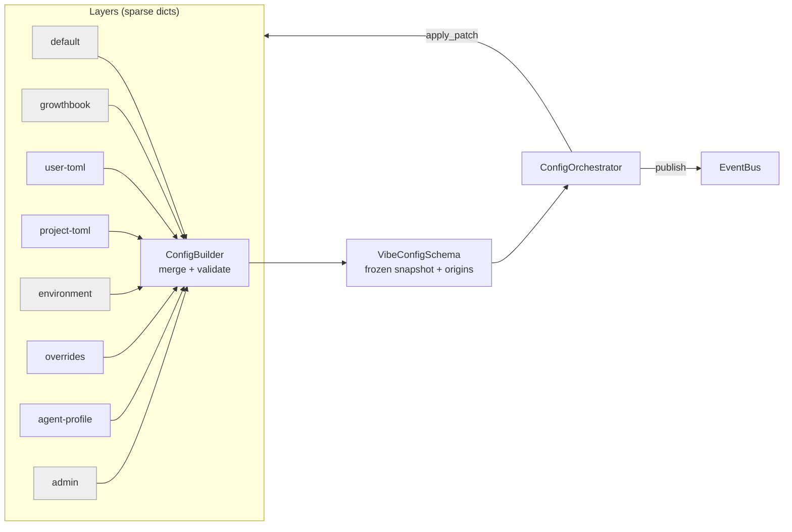
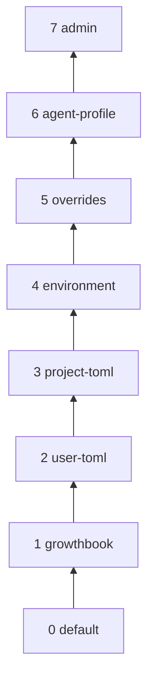
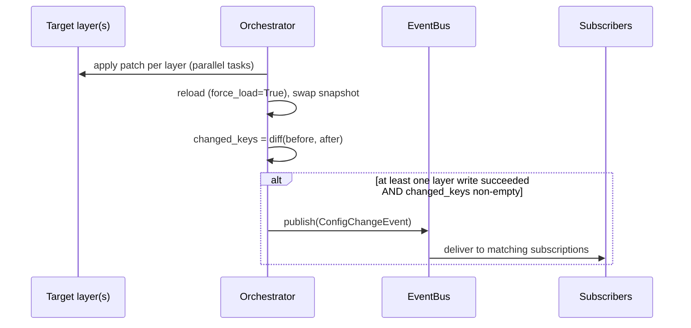
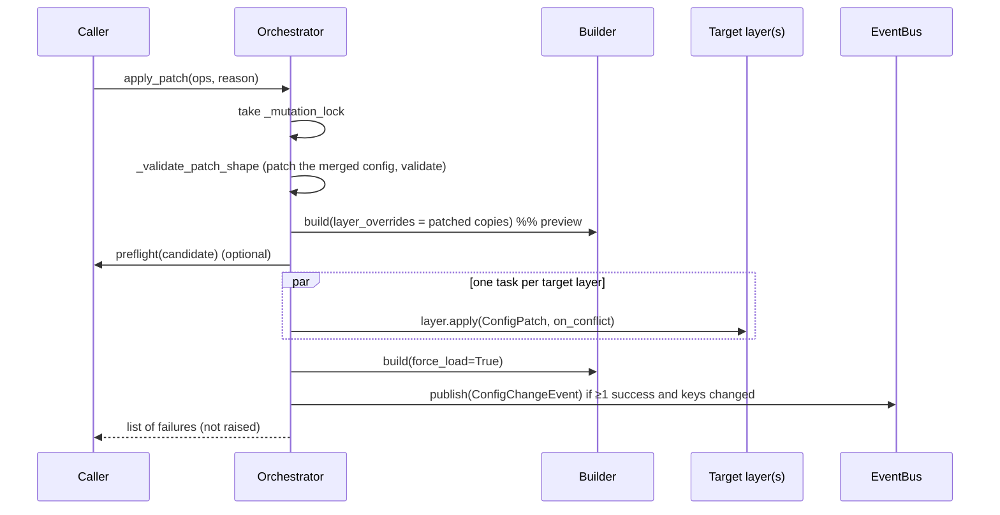

# Vibe Configuration System

Detailed report on how configuration works in `vibe/core/config`: layered architecture, merge strategies, runtime mutation, persistence, and the design decisions behind them.

> **Method.** First draft produced with an AI agent, then **checked line by line against the source** (`vibe/core/config/*`, `vibe/core/config/layers/*`, `vibe/core/utils/merge.py`, `tests/core/config/*`, ADR 0005). Section 12 lists what the first draft got wrong.

---

## Table of Contents

1. [Overview](#1-overview)
2. [Layer stack](#2-layer-stack)
3. [Core components](#3-core-components)
4. [Merge strategies](#4-merge-strategies)
5. [Schema and per-field strategies](#5-schema-and-per-field-strategies)
6. [Lifecycle: build, mutate, reload](#6-lifecycle-build-mutate-reload)
7. [Persistence and concurrency](#7-persistence-and-concurrency)
8. [Special layers](#8-special-layers-growthbook-environment-agent-profile-admin)
9. [Design principles](#9-design-principles)
10. [Code quality and tests](#10-code-quality-and-tests)
11. [Limits and gotchas](#11-limits-and-gotchas)
12. [Corrections to the first draft](#12-corrections-to-the-first-draft)
13. [File map](#13-file-map)

---

## 1. Overview

Configuration is **layered, schema-driven and snapshot-based** (see [ADR 0005](../../../adr/0005-layered-configuration.md)):

- Several **layers** (TOML files, env vars, in-memory dicts, remote experiments) each produce a *sparse* dictionary.
- A **builder** merges them with an explicit **per-field merge strategy**, records which layer last contributed each field, and validates the result with Pydantic.
- A **orchestrator** holds the current merged snapshot and is the only way to change it at runtime (JSON-Patch-based writes, optimistic concurrency, change events).
- The merged config (`VibeConfigSchema`) is a **frozen** Pydantic model: it is replaced, not edited.



*Grey = read-only layers (writes raise `NotImplementedError`).*

For an attached session, the **app server** owns the orchestrator. TUI / ACP / programmatic clients use typed app-server resources and never touch `config.toml` or the live config object (ADR 0005).

---

## 2. Layer stack

Order is fixed in `build_default_orchestrator()` (`default_orchestrator.py`). **Later = higher priority.**

| # | Layer class | `name` | Source | Persisted write? | Trusted? |
|---|---|---|---|---|---|
| 0 | `DefaultConfigLayer` | `default` | `VibeConfigSchema.model_construct()` defaults | No (raises) | Always |
| 1 | `GrowthbookLayer` | `growthbook` | Remote experiment variants, via a mapping table | No (raises) | Always |
| 2 | `UserConfigLayer` | `user-toml` | `~/.vibe/config.toml` (or `VIBE_HOME`) | Yes (TOML) | Always |
| 3 | `ProjectConfigLayer` | `project-toml` | Nearest `.vibe/config.toml` found walking up from cwd | Yes (TOML) | Only if the folder is in the trust store (or no file exists) |
| 4 | `EnvironmentLayer` | `environment` | `VIBE_*` env vars | No (raises) | Always |
| 5 | `OverridesLayer` | `overrides` | Dict passed by CLI / ACP entry points | In memory only | Always |
| 6 | `AgentProfileLayer` | `agent-profile` | Active agent's overrides (slot filled by `AgentManager`) | In memory only | Always |
| 7 | `AdminConfigLayer` | `admin` | Org-managed TOML fetched from the Vibe server | No (raises) | Always |

Notes:

- The user and project layers are only added if their **source** is enabled in the `HarnessFilesManager`.
- A **`DiscoveredConfigLayer`** (`name="discovered"`, in-memory, for runtime discovery such as tools) exists in `layers/` but is **not** part of the default stack.
- Higher layers *shadow* lower ones **according to each field's merge strategy**; "higher wins" is only literally true for `REPLACE`.



---

## 3. Core components

### 3.1 `ConfigLayer` (`layer.py`)

Abstract base class. A subclass implements three things; the base class does the rest.

| Hook | Role |
|---|---|
| `_check_trust() -> bool` | Should this layer be read at all? Default is `False`. |
| `_build_config_snapshot() -> LayerConfigSnapshot` | Read the backing store; return `data` + `fingerprint`. |
| `_save_to_store(next_config) -> str` | Persist the full new data; return the new fingerprint. |

**State machine.** Layer state (`is_trusted`, `data`, `fingerprint`) lives in a frozen dataclass `_LayerState`. Every operation is a small action object (`_ResolveTrust`, `_Load`, `_InvalidateCache`, `_ApplyPatch`) dispatched through `_dispatch()`, which takes an `asyncio.Lock` and swaps in the new state. This serialises all mutations of one layer.

```python
async def resolve_trust(self) -> bool
async def load(self, *, force: bool = False) -> S          # returns a deep copy
async def apply(self, patch, *, on_conflict=ConflictStrategy.CANCEL) -> None
async def invalidate_cache(self) -> None
```

Behaviour worth knowing:

- `load()` on an **untrusted** layer raises `UntrustedLayerError`; with no data it raises `EmptyLayerError`. The builder catches both and **skips the layer**.
- Backing-store `OSError`s are wrapped in `ConfigStorageError`; other failures in a subclass hook become `LayerImplementationError`.
- `apply()` order: check loaded → check conflict → apply JSON Patch to the cached data (after `ensure_parent_paths`) → validate against `output_schema` → `_save_to_store` → cache new data and fingerprint.
- `ConflictStrategy.CANCEL` (default) aborts with `ConcurrencyConflictError` if the patch's fingerprint differs from the layer's; `REPLACE` skips that check and overwrites.

### 3.2 `ConfigBuilder` (`builder.py`)

Holds an ordered list of layers (`add_layer(s)`, `insert_layer`, `remove_layer`, `copy`) and implements `build()`:

1. For each layer (under an `asyncio.Lock`): use `layer_overrides[layer.name]` if given (a *preview* that never touches the layer), otherwise `layer.load(force=force_load)`.
2. Skip untrusted layers, and layers whose data dumps to an empty dict.
3. `_merge_fields`: for each key that exists in the schema, apply that field's `MergeStrategy` against the accumulated value, and record `origins[key] = layer.name`.
4. `schema.validate_merged(merged, origins=origins)`.

Shape clashes (e.g. `mcp_servers` written as a table instead of `[[mcp_servers]]`) are reported as user-facing `ConfigMergeError` / `ValueError` naming the field and layer, not as tracebacks.

### 3.3 `ConfigOrchestrator` (`orchestrator.py`)

"Single entry point for config management". See [section 6](#6-lifecycle-build-mutate-reload).

| Method | Purpose |
|---|---|
| `create(schema, layers, default_layer_resolver)` | Build the builder and first snapshot |
| `config` | Current frozen snapshot |
| `reload(preflight=None)` | Force-reload every layer, replace snapshot |
| `rebuild()` | **Synchronous** re-merge (via `run_sync`) — used when `AgentManager` swaps the agent-profile layer |
| `set_field`, `set_field_or_warn`, `mutate_field`, `upsert_field`, `apply_patch` | Writes |
| `insert_layer`, `remove_layer`, `replace_or_append_layer`, `get_layer`, `layers` | Stack management |
| `subscribe(callback, keys=None)` | Change events; returns an *unsubscribe* callable |
| `copy()` | Independent in-memory copy (deep-copied layers, fresh event bus) |
| `writable_layer_name` | Where implicit writes go |

**Default write target** (resolver built in `default_orchestrator.py`):

1. the **user** layer if the user source is enabled (even when a project config exists: a project file found by walking up parents is "rarely the scope the user meant in a monorepo");
2. else the **project** layer if it is trusted;
3. else the **overrides** layer (ephemeral).

### 3.4 `EventBus` (`event_bus.py`) — the publisher/subscriber channel

Change notification in the config system is a small **in-process pub/sub bus** owned by the orchestrator: the orchestrator publishes, subscribers register with optional key filters.

**Event model** (`types.py`). The payload is a frozen dataclass:

```python
@dataclass(frozen=True, slots=True)
class ConfigChangeEvent:
    changed_keys: frozenset[str]  # slash-separated leaf paths that differ
    before: dict[str, Any]        # full snapshot (model_dump(mode="json")) before the write
    after: dict[str, Any]         # full snapshot after the write
    reason: str                   # free-text cause, carried from the write call

type ConfigChangeCallback = Callable[[ConfigChangeEvent], None]
```

**Bus mechanics** (`event_bus.py`):

- Subscriptions live in a `dict[int, Subscription]` keyed by an `itertools.count()` id; `Subscription` is a frozen dataclass `(keys: frozenset[str] | None, callback)`.
- `subscribe(callback, *, keys=None)` registers a listener and returns an `unsubscribe()` closure that pops its id (`dict.pop(id, None)` — safe to call twice).
- `publish(event)` (not `emit`) iterates over `list(self._subscribers.values())` — a **snapshot copy** — so a callback that unsubscribes (itself or another subscriber) during delivery cannot corrupt the iteration. Delivery is **synchronous**, in registration order, on the publisher's task.

**Key filtering.** `keys` are slash-separated config paths; a subscription fires when `_key_matches` matches any of its keys against any entry of `event.changed_keys`. Matching is segment-wise and bidirectional along the path:

| subscription key | changed key | match? |
|---|---|---|
| `models` | `models/mistral/api_key` | yes (descendant) |
| `models/mistral` | `models` | yes (ancestor) |
| `model` | `models` | **no** — not a string prefix, only whole segments |
| `models/mistral` | `models/llamacpp` | no (siblings) |

`keys=None` is the wildcard: every event is delivered.

**Who publishes, and when.** The orchestrator is the only publisher — `self._bus.publish(...)` appears exactly once, at the end of `apply_patch`:



- `changed_keys` comes from `_changed_keys_between(before, after)`, a recursive diff over the two full JSON dumps: dicts are recursed key by key, and the first level where values differ is reported as one slash path. A changed nested field is therefore a leaf path (`tools/bash/timeout`), while a changed list is reported as a single key (`enabled_tools`).
- **Only `apply_patch` publishes.** `reload()` and `rebuild()` swap the snapshot silently — an external edit to `config.toml` picked up by a reload never emits an event. Subscribers only learn about writes that went through the orchestrator.
- A patch that changes nothing (empty `changed_keys`) or whose layer writes all failed publishes nothing.
- `ConfigOrchestrator.subscribe(callback, keys=...)` is a thin delegate to the bus and returns the same unsubscribe callable.
- `copy()` gives the copy a **fresh bus** (`bus=None`): the original's subscribers are not inherited.

**Consumers across the app-server boundary.** Clients never touch the core bus (ADR 0005 / 0009). The app server exposes its own pub/sub in `ConfigResource` (`vibe/app_server/_runtime_resources.py`):

- `subscribe(callback)` appends to a local list and returns an unsubscribe closure; `publish_change(previous)` is a **no-op when the view did not change** (`previous == self.current`) and otherwise calls every subscriber with the new `ConfigView`.
- It is driven by `_apply_runtime(RuntimeSnapshot)`: when the server pushes a new runtime snapshot to the client, the resource applies it and publishes the change.
- The Python TUI uses exactly this hook — `vibe/cli/textual_ui/app.py` subscribes `self._on_config_changed` at mount, which live-applies `theme`, `cursor_blink` and `log_level`, and refreshes the banner, context progress and subagent list.

**Tests** (`tests/core/config/test_config_bus.py`, 7 tests): wildcard delivery, keyed filtering, bidirectional ancestor/descendant matching, partial-segment non-match, sibling non-match, unsubscribe stops delivery, unsubscribe-during-publish is safe.

---

## 4. Merge strategies

Defined in `vibe/core/utils/merge.py` (`MergeStrategy.apply(base, override, key_fn=...)`).

| Strategy | Marker | Behaviour |
|---|---|---|
| `REPLACE` | `WithReplaceMerge()` | Override replaces base |
| `CONCAT` | `WithConcatMerge()` | `base + override` (lists) |
| `UNION` | `WithUnionMerge(merge_key="name")` | Lists merged by key; the later item **replaces** the earlier one with the same key |
| `MERGE` | `WithShallowMerge()` | `{**base, **override}` — top-level keys only |
| `DEEP_MERGE` | `WithDeepMerge()` | Recursive dict merge; non-dict values are replaced |
| `CONFLICT` | `WithConflictMerge()` | `MergeConflictError` if two layers both provide a value |

Edge-case rules (all in `merge.py`):

- **`None` on either side is "absent"**: the other side is used as-is (for every strategy).
- For `CONCAT` and `UNION`, an **empty dict is treated as absent**. An empty TOML table (e.g. `[installed_agents]`) arrives as `{}` through the permissive `RawConfig` and would otherwise crash a list strategy.
- `UNION` requires a `merge_key`; `WithUnionMerge` raises `TypeError` at definition time without one, and a missing key in an item raises `MergeKeyError`.
- Operands of the wrong shape raise `TypeError`, which the builder converts into a readable `ValueError`.

**Example — `UNION` by name**

```python
base     = [{"name": "mistral", "api": "A"}, {"name": "llamacpp", "api": "B"}]
override = [{"name": "mistral", "api": "C"}]
# → [{"name": "mistral", "api": "C"}, {"name": "llamacpp", "api": "B"}]
#   (position of first occurrence kept, value from the later layer)
```

**Example — `DEEP_MERGE` on `tools`**

```toml
# user
[tools.bash]
enabled = true
# project
[tools.bash]
timeout = 30
[tools.git]
enabled = false
```
→ `{"bash": {"enabled": true, "timeout": 30}, "git": {"enabled": false}}`

---

## 5. Schema and per-field strategies

### 5.1 `ConfigSchema` / `ConfigFragment` (`schema.py`)

- `ConfigSchema` is a **frozen** Pydantic model with a private `_origins` dict and `origin_of(key)`.
- At class-definition time (`__pydantic_on_complete__`) it **fails fast** if any field has no merge marker (unless it is a `ConfigFragment`), if a fragment field also has a marker, or if a field has two markers (`DuplicateMergeMetadataError`).
- `ConfigFragment` is a group of sub-fields where *each sub-field* declares its own strategy; the builder merges fragments field by field. **`VibeConfigSchema` does not currently use any `ConfigFragment`** — they appear only in tests. The nested groups (`session_logging`, `project_context`, `experiments`) are plain `BaseSettings` classes merged with `WithShallowMerge()`.

### 5.2 `VibeConfigSchema` (`vibe_schema.py`, ~1180 lines)

Verified strategies (selection):

| Field | Strategy | Notes |
|---|---|---|
| `active_model`, `routed_default_model`, `default_agent`, `theme`, most booleans/ints/floats/URLs | `REPLACE` | |
| `providers` | `UNION` by `name` | |
| `models` | `DEEP_MERGE` | `dict[alias → ModelConfig]` internally; TOML arrays are normalised on read |
| `allowed_models`, `enabled_tools`, `routed_extra_models` | `REPLACE` | |
| `compaction_model`, `vision_model`, `utility_models` | `SHALLOW` | |
| `tools` | `DEEP_MERGE` | |
| `tool_paths`, `agent_paths`, `skill_paths` | `CONCAT` | paths expanded by a `BeforeValidator` |
| `disabled_tools`, `enabled_agents`, `disabled_agents`, `installed_agents`, `enabled_skills`, `disabled_skills`, `applied_migrations` | `CONCAT` | |
| `mcp_servers`, `connectors` | `UNION` by `name` | `mcp_servers` also checked by `_unique_by("name")` |
| `tts_providers` | `UNION` by `name` | |
| `tts_models` | `UNION` by `alias` | transcribe fields follow the same pattern (not individually re-verified) |
| `session_logging`, `project_context`, `experiments` | `SHALLOW` | `BaseSettings` groups |

Two points that surprise people:

- **`enabled_tools` is `REPLACE` but `disabled_tools` is `CONCAT`.** A higher layer can *redefine* the allowlist, but denylists *accumulate* across layers.
- **No field in `VibeConfigSchema` that I found uses `CONFLICT`**; the strategy exists and is tested but is not used by the main schema.

`VibeConfigSchema.validate_merged` adds two admin-specific rules:

1. If `allowed_models` comes from the admin layer and matches no configured model → `ValueError`.
2. If `auto_compact_threshold` comes from admin, it is copied onto every model in `models`.

---

## 6. Lifecycle: build, mutate, reload

### 6.1 Startup (`build_default_orchestrator`)

1. Create layers (user / project only if their source is enabled).
2. `migrate_config_layers(layers)` — migrations over the whole stack.
3. `ConfigOrchestrator.create(...)` → `ConfigBuilder.build()` → first snapshot.
4. Configure the SSL context from the merged `enable_system_trust_store`.

`build_user_config_orchestrator()` builds a **user-layer-only** orchestrator for configuration management tools.

### 6.2 Runtime write (`apply_patch`)



Key properties:

- Operations carry an optional `target_layer_name`; operations without one go to the default write target.
- **Writes are not atomic across layers.** The preview is "a cheap sanity check only"; per-layer failures are *returned* as a list of exceptions, while an invalid patch shape raises `ConfigPatchValidationError`.
- After the writes the orchestrator **always reloads** (`force_load=True`), then diffs `before`/`after` (`_changed_keys_between`) to build `changed_keys`. The `ConfigChangeEvent` is published only when at least one layer write succeeded **and** `changed_keys` is non-empty; a bare `reload()` never publishes. See [3.4](#34-eventbus-event_buspy--the-publishersubscriber-channel) for the full publisher/subscriber semantics.
- `mutate_field` (read-modify-write of one field under the lock) and `upsert_field` (insert-or-replace in a keyed list via `resolve_upsert_op`) are conveniences built on the same machinery.
- `set_field_or_warn` exists because `set_field` *returns* errors; callers that ignore the return value could otherwise lose failures silently.

### 6.3 Patch model (`patch.py`)

```python
class ConfigPatch:                      # plain class, not a dataclass
    operations: list[PatchOp]
    fingerprint: str                    # layer fingerprint the patch was built on
    reason: str

PatchOp = AddOperationPatch | ReplaceOperationPatch | RemoveOperationPatch
# each: frozen Pydantic model with `path` (validated JSON Pointer)
#       and optional `target_layer_name`
```

`ensure_parent_paths` auto-creates missing intermediate dicts so `/tools/bash/allowlist` can be added on a config with no `[tools.bash]` table.

---

## 7. Persistence and concurrency

**TOML layers** (`layers/_base.py`, `BaseTomlConfigLayer`): `tomllib` to read, `tomli_w` to write; reads happen in `asyncio.to_thread`.

**Atomic write** (`_write_toml_snapshot`):

1. create a temp file in the **same directory** (`.config.toml.*.tmp`);
2. dump TOML, `flush`, `fsync`;
3. compute the fingerprint **from the temp file's descriptor**;
4. `tmp_path.replace(path)` (atomic rename); the temp file is removed on failure.

**Fingerprints** (`fingerprint.py`):

- File: `"{st_dev}:{st_ino}:{st_mtime_ns}:{st_size}"` from `fstat` on an open descriptor.
- Dict: SHA-256 of canonical JSON (sorted keys).
- Because the temp file *becomes* the config file on rename, the fingerprint computed before the rename is the one a later read will compute — no read-after-write mismatch.
- Reads use `open_fingerprinted_file`: data and fingerprint come from the **same descriptor**, so a concurrent atomic rename cannot pair new data with an old fingerprint.
- A missing file yields `EMPTY_CONFIG_SNAPSHOT` with the sentinel fingerprint `vibe:missing-backing-store-data`.

**Legacy format.** Models are stored on disk as `[[models]]` arrays (`serialize_model_configs`) but held internally as an alias-keyed map (`normalize_model_configs`) so patches can address `/models/<alias>/...`.

**Project discovery.** `ProjectConfigLayer` walks from the root up through parents, looking for `.vibe/config.toml`, stopping at the parent of `VIBE_HOME`. Trust is `True` if no file is found, otherwise decided by `TrustedFoldersManager`. `reroot(path)` re-targets the layer in place (the default-layer resolver closes over the object) and **re-resolves trust** so an old verdict cannot leak to a new directory.

---

## 8. Special layers (growthbook, environment, agent-profile, admin)

**`GrowthbookLayer`.** Receives variants via `set_variants()` and translates them with `GROWTHBOOK_CONFIG_MAPPINGS`:

| Experiment | Config field(s) |
|---|---|
| `SYSTEM_PROMPT` | `system_prompt_id` (only if the prompt exists) |
| `CLI_MODEL_ROUTING` | `routed_default_model`, `routed_model_config` |
| `CLI_EXTRA_MODELS` | `routed_extra_models` |
| `MANAGED_SHELL_TOOLS` | `managed_shell_tools_enabled` |
| `SMART_APPROVE` / `SMART_APPROVE_DEFAULT` | `smart_approve_available` / `smart_approve_default` |
| `REGISTRY_SKILLS` | `experimental_enable_registry_skills` |

Routed models are also exposed through the canonical deep-merged `models` field, so user layers can override them sparsely.

**`EnvironmentLayer`.** Dynamically builds a `pydantic-settings` class from the schema's fields with `env_prefix="VIBE_"`, `env_nested_delimiter="__"`, case-insensitive, empty values ignored; only **explicitly set** values are emitted (`exclude_unset`). Example: `VIBE_API_TIMEOUT=60`.

**`AgentProfileLayer`.** In-memory. It **strips protected fields** (`vibe_base_url`, `console_base_url`, `vibe_code_sessions_base_url`) with a warning: those URLs receive the API key, so an agent profile from an untrusted checkout could otherwise redirect credentials to an attacker.

**`AdminConfigLayer`.** In-memory, highest priority; "that precedence is the whole enforcement mechanism". Populated from a TOML document served at `{vibe_base_url}/api/v1/code/managed-config` (`admin_config.py`): 2 s timeout, 3 attempts with exponential backoff, and on any failure the layer simply stays empty. Outcomes are modelled by `AdminConfigOutcome` (`APPLIED`, `DISABLED`, `NO_API_KEY`, `FETCH_FAILED`, `PARSE_FAILED`, `APPLY_FAILED`). `enforced_keys` lists what it sets.

---

## 9. Design principles

1. **Single source of truth.** One orchestrator per session, owned by the app server.
2. **Every field declares how it merges**, enforced at class-definition time, not at runtime.
3. **Sparse layers, full validation.** Layers hold only what they set; validation happens once on the merged result (and per-layer via `output_schema`).
4. **Snapshot immutability.** The config is replaced atomically after each reload; subscribers get `before`/`after` diffs.
5. **Optimistic concurrency** (fingerprints + `CANCEL`) instead of file locks.
6. **Security by layering.** Untrusted project config is skipped; credential-routing URLs cannot be overridden by profiles; admin always wins.
7. **Fail with a user-readable message** for shape clashes in user-written TOML.
8. **Backward compatibility.** Unknown keys are ignored; models keep their legacy on-disk format; migrations run across the whole stack at startup.

---

## 10. Code quality and tests

- `tests/core/config/` contains **~730 test functions** across ~30 files. Heaviest: `test_config_orchestrator.py` (41), `test_config_layer.py` (38), `test_config_builder.py` (23), `test_project_config_layer.py` (18).
- Dedicated files for each special layer (`test_admin_layer.py`, `test_admin_config.py`, `test_growthbook_layer.py`, `test_environment_layer.py`, `test_overrides_layer.py`), for fingerprints, patch ops, the event bus (`test_config_bus.py`), project re-rooting, and a TOML end-to-end test.
- Code style: fully typed, PEP 695 generics (`class ConfigLayer[S: BaseModel]`), frozen dataclasses/models for state and operations, small typed exception hierarchy rooted at `ConfigLayerError`.
- Comments in the source explain *why* (race conditions, security rationale, issue references such as VIBE-4041), which makes the code unusually self-documenting.

---

## 11. Limits and gotchas

- **`origin_of` is last-contributor, not full provenance.** For `CONCAT`/`UNION`/`DEEP_MERGE` fields the value is a combination, but the origin is just the last layer that supplied the field.
- **"Immutable" is by convention at one spot:** `validate_merged` uses `object.__setattr__` to rewrite `models` for the admin `auto_compact_threshold` case.
- **Environment, default, growthbook, admin layers are not writable**; a patch that targets them fails with `NotImplementedError` (returned in the failure list).
- **`OverridesLayer`'s docstring says "read-only"** but its `_save_to_store` stores the data in memory; the code is the truth.
- **Cross-layer writes are non-atomic** (see 6.2).
- **`rebuild()` is a sync bridge** over the async builder (`run_sync`), used for agent profile switches; everything else is async.
- **Higher priority ≠ "wins"** for `CONCAT`/`UNION`/`MERGE`/`DEEP_MERGE` fields.

---

## 12. Corrections to the first draft

| First draft said | Reality in the code |
|---|---|
| `EventBus.emit(event)`, `subscribe(callback)` | `publish(event)`; `subscribe(callback, *, keys=None)` returns an unsubscribe function; key-path filtering |
| `ConfigPatch` is a frozen dataclass with `operations` + `fingerprint` | Regular class with `operations`, `fingerprint`, **`reason`**; ops are frozen Pydantic models with `target_layer_name` |
| `models` merged by `UNION` (table) | `DEEP_MERGE` on an alias-keyed dict |
| `tools` merged by `MERGE` (table) | `DEEP_MERGE` |
| `session: SessionLoggingConfig`, `project: ProjectContextConfig` | Fields are `session_logging`, `project_context`, both `SHALLOW` |
| `SessionLoggingConfig` is a `ConfigFragment` example | It is a `BaseSettings`; no `ConfigFragment` is used by `VibeConfigSchema` |
| `enabled_tools` implied as list-merge | `REPLACE` (only `disabled_tools` is `CONCAT`) |
| "Writable: Yes" for the admin layer | Read-only; raises `NotImplementedError` |
| `OverridesLayer` listed as writable, "Medium-High/High" priority labels | Writable in memory only; priority simply = stack position |
| 8 layers | 9 layer classes: **`DiscoveredConfigLayer`** (not in default stack) was missing |
| "Drawing Tools" heading | Typo; it is `tomllib` / `tomli_w` |
| Orchestrator "provides synchronous rebuild" | `rebuild()` is sync; `reload()` and writes are async |
| `routed_model_config: ModelConfig \| None` in schema | Emitted by the GrowthBook layer as JSON and folded into `models`; `routed_extra_models` is the schema field |
| `enabled_agents`/`disabled_agents`... `CONCAT` | Correct |
| Layer names / ADR link / atomic write steps | Correct (and now completed with fingerprint detail) |

---

## 13. File map

| File | Role |
|---|---|
| `vibe/core/config/layer.py` | `ConfigLayer` base, state machine, errors |
| `vibe/core/config/layers/*.py` | Concrete layers (default, growthbook, user, project, environment, overrides, agent_profile, admin, discovered) + `_base.py` TOML I/O |
| `vibe/core/config/builder.py` | `ConfigBuilder` — merge + origins + validation |
| `vibe/core/config/orchestrator.py` | `ConfigOrchestrator` — runtime writes, reload, events |
| `vibe/core/config/default_orchestrator.py` | Standard stack, default write target resolver |
| `vibe/core/config/schema.py` | `ConfigSchema`, `ConfigFragment`, merge markers |
| `vibe/core/config/vibe_schema.py` | `VibeConfigSchema` (canonical config) |
| `vibe/core/config/models.py` | `ModelConfig`, provider/session/project config classes, model normalisation |
| `vibe/core/config/patch.py` | JSON-Patch operation model, `ensure_parent_paths`, `resolve_upsert_op` |
| `vibe/core/config/fingerprint.py` | File and dict fingerprints |
| `vibe/core/config/event_bus.py`, `types.py` | Events, `ConflictStrategy`, snapshot types |
| `vibe/core/config/admin_config.py` | Managed-config fetch for the admin layer |
| `vibe/core/config/_migration.py` | Config migrations over the layer stack |
| `vibe/core/utils/merge.py` | `MergeStrategy` implementations |
| `docs/adr/0005-layered-configuration.md` | Architectural decision record |
| `tests/core/config/` | Unit and integration tests |