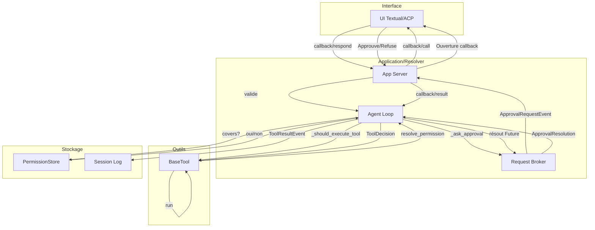
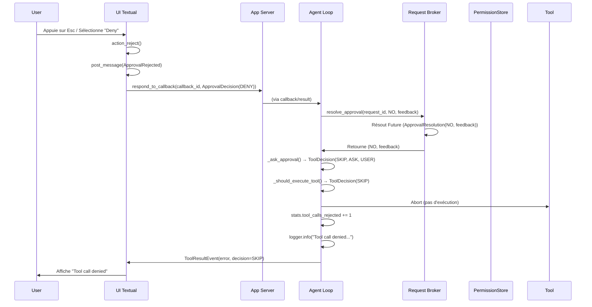

# Déroulement et scénarios

---

## Diagramme principal du flux de permission



**Interface** : Affiche les callbacks de permission et transmet les réponses. Ne décide pas.
**Application/Resolver** : App Server est l'autorité centrale. Agent Loop vérifie et bloque si refusé.
**Outils** : Tous les outils implémentent `resolve_permission()`. L'exécution est validée avant toute action.
**Stockage** : PermissionStore stocke les règles de session. Session Log enregistre les tool calls.

---

## Scénarios de décision de permission

| Situation | Outil | Résultat | Code responsable | Source |
|-----------|-------|----------|------------------|--------|
| **Lecture dans le workspace** | `read_file` | `ALWAYS` (si dans workspace) ou `ASK` (si outside) | `resolve_file_tool_permission()` vérifie `is_path_within_workdir()` | `vibe/core/tools/utils.py:L183-249` |
| **Écriture dans le workspace** | `write_file` | `ALWAYS` (si dans workspace) ou `ASK` (si outside) | `resolve_file_tool_permission()` vérifie `is_path_within_workdir()` | `vibe/core/tools/utils.py:L183-249` |
| **Accès hors workspace** | `read_file`, `write_file`, `bash` | `ASK` avec `RequiredPermission(scope=OUTSIDE_DIRECTORY)` | Ajoute la permission requise | `vibe/core/tools/utils.py:L225-238` |
| **Fichier sensible (.env)** | `read_file`, `bash` | `ASK` avec `RequiredPermission(scope=FILE_PATTERN)` | Détecte les motifs sensibles | `vibe/core/tools/utils.py:L210-218` |
| **Commande bash allowlistée** | `bash` | `ALWAYS` (si dans allowlist et pas dans denylist) | `_is_unconditionally_allowed()` vérifie les listes | `vibe/core/tools/builtins/bash.py:L720-722` |
| **Commande bash denylistée** | `bash` | `ASK` avec permissions requises ou `NEVER` | Filtre par denylist | `vibe/core/tools/builtins/bash.py:L690-705` |
| **Commande avec sudo** | `bash` | `ASK` avec `RequiredPermission` pour la commande | `needs_exact_command_scope()` | `vibe/core/tools/builtins/bash.py:L730-739` |
| **Permission déjà accordée pour la session** | Tous | `ALWAYS` | `PermissionStore.covers()` retourne True | `vibe/core/agent_loop/_loop.py:L3053-3063` |
| **Permission permanente (ALWAYS)** | Tous | `ALWAYS` | Config de l'outil | `vibe/core/tools/manager.py:L750-775` |
| **Permission permanente (NEVER)** | Tous | `NEVER` | Config de l'outil | `vibe/core/tools/manager.py:L750-775` |
| **Outil fourni par un plugin** | Plugin tools | Même que les outils built-in | Intégration via ToolManager | `vibe/core/tools/manager.py:L200-250` |
| **Outil fourni par MCP** | MCP tools | Même que les outils built-in | `ToolManager.integrate_mcp()` | `vibe/core/tools/manager.py:L560-580` |
| **Outil fourni par un connector** | Connector tools | Même que les outils built-in | `ToolManager.integrate_connectors()` | `vibe/core/tools/manager.py:L582-600` |

---

## Que se passe-t-il quand une action est refusée ?

### Cas (a) : L'utilisateur répond "Deny" à une demande

**Flux complet :**

1. **UI** : L'utilisateur appuie sur `Esc` ou sélectionne "Deny" (option 4) → `approval_app.py:L253` (`action_reject()`) → sélectionne la dernière option
2. **UI** : `approval_app.py:L316` → `post_message(ApprovalRejected(tool_name, tool_args))`
3. **App** : `app.py:L2145` → `on_approval_app_approval_rejected()` → appelle `_respond_to_approval(ApprovalDecisionType.DENY)`
4. **App** : `app.py:L3123-3133` → `_respond_to_approval()` → `_respond_to_active_callback(ApprovalCallbackOutput(decision=DENY))`
5. **App** : `app.py:L3135-3148` → `_respond_to_active_callback()` → `app_server.respond_to_callback(callback.callback_id, output)`
6. **Server** : `session.py:L713-722` → `respond_to_callback()` → envoie `"callback/result"` avec `CallbackResult(callback_id, output)`
7. **Loop** : `_loop.py:L1147-1148` → `resolve_approval_request()` → `self._request_broker.resolve_approval(request_id, response=NO, feedback)`
8. **Broker** : `_request_broker.py:L89-92` → `resolve_approval()` → résout le Future avec `ApprovalResolution(response=NO, feedback)`
9. **Loop** : `_loop.py:L3068-3095` → `_ask_approval()` retourne `ToolDecision(verdict=SKIP, approval_type=ASK, approval_source=USER, feedback)`
10. **Loop** : `_loop.py:L3027-3070` → `_should_execute_tool()` retourne cette décision
11. **Loop** : `_loop.py:L2855-2871` → **L'outil n'est PAS exécuté** → génère `ToolResultEvent` avec `error` et `decision=SKIP`

**Ce que reçoit le modèle :**
```python
ToolResultEvent(
    tool_name="bash",
    error="<TOOL_ERROR_TAG>bash failed: Tool call denied</TOOL_ERROR_TAG>",
    decision="skip",
    approval_type="ask",
    approval_source="user",
    feedback="User denied permission"
)
```

**L'agent continue ou s'arrête :**
- **L'agent continue** : Seul l'outil est skipé, la boucle passe à l'étape suivante

**Journalisation :**
- ✅ `logger.info("Tool call denied tool=%s tool_call_id=%s outcome=denied", tool_name, tool_call_id)` (`_loop.py:L2863-2865`)
- ✅ `stats.tool_calls_rejected += 1` (`_loop.py:L2868`)
- ⚠️ **Session log** : Un `ToolResultEvent` est généré, probablement stocké dans le session log (non explicitement vérifié dans le code)

**Diagramme de séquence :**



---

### Cas (b) : La permission est NEVER

**Flux :**

1. **Loop** : `_loop.py:L3027-3051` → `_should_execute_tool()` détecte `ctx.permission == ToolPermission.NEVER` (ou `config_perm == NEVER` si `ctx is None`)
2. **Loop** : Retourne immédiatement `ToolDecision(verdict=SKIP, approval_type=NEVER, approval_source=NEVER, feedback=ctx.reason or f"Tool '{tool_name}' is permanently disabled")`
3. **Loop** : `_loop.py:L2855-2871` → **L'outil n'est PAS exécuté** → génère `ToolResultEvent` avec `error`

**Ce que reçoit le modèle :**
```python
ToolResultEvent(
    tool_name="bash",
    error="<TOOL_ERROR_TAG>bash failed: Tool 'bash' is permanently disabled</TOOL_ERROR_TAG>",
    decision="skip",
    approval_type="never",
    approval_source="never",
    feedback="Tool 'bash' is permanently disabled"
)
```

**L'agent continue ou s'arrête :**
- **L'agent continue** : Seul l'outil est skipé

**Journalisation :**
- ✅ Même que cas (a) : `logger.info("Tool call denied tool=%s tool_call_id=%s outcome=denied", ...)` (`_loop.py:L2863-2865`)
- ✅ `stats.tool_calls_rejected += 1` (`_loop.py:L2868`)

---

### Cas (c) : Un motif de denylist correspond

**Flux :**

1. **Outil** : Pour `bash`, `bash.py:L684-739` → `resolve_permission()` appelle `_build_required_permissions()`
2. **Outil** : Dans `_build_required_permissions()` (`bash.py:L636-667`), les commandes sont filtrées :
   - Si une commande est dans `denylist` → elle n'est **pas** ajoutée aux commandes autorisées automatiquement
   - Les chemins en dehors du workspace sont vérifiés contre `allowlist` et `denylist` (`bash.py:L690-705`)
3. **Résultat** : Si la commande correspond à un motif de denylist → `PermissionContext(permission=ToolPermission.ASK, required_permissions=[...])` ou `ToolPermission.NEVER` selon la configuration
4. **Loop** : Si `required_permissions` n'est pas vide et non couvert par `PermissionStore` → demande d'approbation à l'utilisateur
5. **Si l'utilisateur refuse** → Voir cas (a)

**Comportement spécial :**
- **Denylist > Allowlist** : Si un motif est dans les deux listes, la denylist **l'emporte** (filtré dans `_build_required_permissions()`)
- **Source** : `vibe/core/tools/builtins/bash.py:L636-667`, `L690-705`

---

### Cas (d) : L'utilisateur appuie sur Esc

**Même que cas (a)** : Dans `approval_app.py` :
- `L42` : `Binding("n", "reject", "No", show=False)`
- `L253` : `action_reject()` → `self._select_if_unguarded(len(self.options) - 1)` → sélectionne la dernière option ("Deny")
- `L316` : Poste `ApprovalRejected`

Donc **Esc → action_reject() → Deny → Voir cas (a)**

---

## Comportement spécial en cas de refus

| Aspect | Comportement | Source |
|--------|--------------|--------|
| **Message renvoyé au LLM** | Oui : `ToolResultEvent` avec `error`, `decision=SKIP`, `approval_type`, `approval_source` | `_loop.py:L2855-2890` |
| **Compteur** | Oui : `stats.tool_calls_rejected += 1` | `_loop.py:L2868` |
| **Arrêt de la boucle** | ❌ Non : La boucle continue, seul l'outil est skipé | `_loop.py:L3027-3070` |
| **Journalisation** | ✅ Oui : `logger.info("Tool call denied tool=%s tool_call_id=%s outcome=denied")` | `_loop.py:L2863-2865` |
| **Session log** | ⚠️ Probablement : `ToolResultEvent` est généré, mais stockage explicite dans le session log non vérifié | `_loop.py:L2873-2890` |
