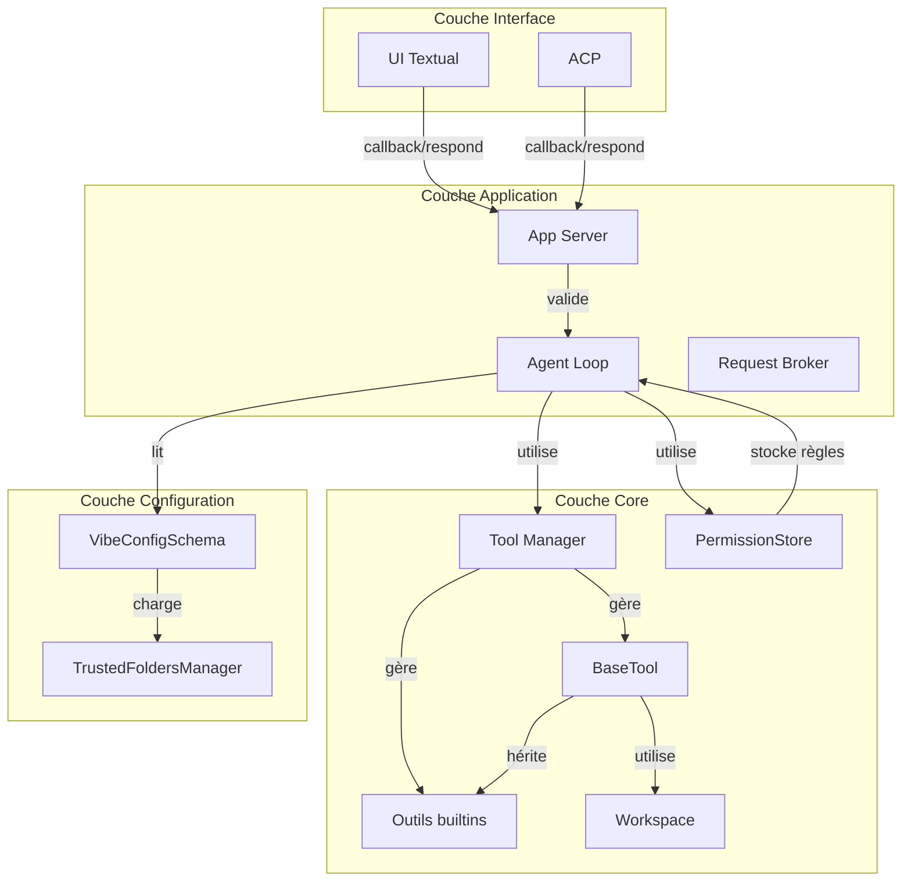

# Fichiers et modules internes

---

## Architecture en couches

Le système de permissions est distribué selon plusieurs couches de l'architecture de Mistral Vibe :

---

## Fichiers principaux et leurs rôles

### 📁 Bibliothèque centrale des permissions

| Chemin | Rôle | Composants clés | Source |
|--------|------|-----------------|--------|
| `vibe/permissions.py` | **Bibliothèque centrale** pour les motifs de chemins et matching | `PathGrantScope`, `PermissionScope`, `RequiredPermission`, `path_grant_pattern()`, `path_pattern_matches()`, `path_grant_pattern_matches()` | `vibe/permissions.py:L1-100` |

**Détails :**
- Définit les énumérations de base pour les permissions de chemins
- Fournit des fonctions utilitaires pour le matching de motifs
- Utilisé par tous les outils pour valider les permissions de chemins

---

### 📁 Modèles de données pour les permissions

| Chemin | Rôle | Composants clés | Source |
|--------|------|-----------------|--------|
| `vibe/core/tools/models.py` | **Modèles Pydantic** pour les permissions des outils | `ToolPermission` (ALWAYS/NVER/ASK), `ToolPermissionError`, `PermissionContext`, `ApprovedRule`, `RequiredPermission` | `vibe/core/tools/models.py:L1-38` |

**Détails :**
- `ToolPermissionError` : Exception levée pour les échecs d'autorisation (ADR 0004 recommande de l'utiliser)
- `PermissionContext` : Contexte retourné par `Tool.resolve_permission()`, contient `permission` + `required_permissions` + `reason`
- `ApprovedRule` : Règle de permission accordée, stockée dans `PermissionStore`

---

### 📁 Stockage et gestion des permissions

| Chemin | Rôle | Composants clés | Source |
|--------|------|-----------------|--------|
| `vibe/core/tools/permissions.py` | **Storage des permissions de session** | `PermissionStore`, méthodes `covers()`, `add_rule()`, `set_tool_permission()`, `get_tool_permission()`, `reset()` | `vibe/core/tools/permissions.py:L16-56` |

**Détails :**
- `PermissionStore._rules` : Liste des règles accordées pour la session (`list[ApprovedRule]`)
- `PermissionStore._tool_permissions` : Permissions globales par outil pour la session (`dict[str, ToolPermission]`)
- `PermissionStore.lock` : Verrou asyncio pour la thread-safety
- `PermissionStore.covers(tool_name, rp)` : Vérifie si une `RequiredPermission` est couverte par une règle existante

---

### 📁 Classe de base pour tous les outils

| Chemin | Rôle | Composants clés | Source |
|--------|------|-----------------|--------|
| `vibe/core/tools/base.py` | **Classe abstraite BaseTool** | Méthode abstraite `resolve_permission(args) -> PermissionContext | None`, `BaseToolConfig`, `InvokeContext`, `ToolError`, `CancellableToolResult`, `ToolInfo` | `vibe/core/tools/base.py:L1-487` |

**Détails :**
- **Toute classe d'outil doit hériter de `BaseTool[ToolArgs, ToolResult, ToolConfig, ToolState]`**
- `resolve_permission()` : Méthode à implémenter par chaque outil pour définir des permissions spécifiques
- `BaseToolConfig` : Contient `permission: ToolPermission`, `allowlist: list[str]`, `denylist: list[str]`, `sensitive_patterns: list[str]`
- `InvokeContext` : Contexte passé à l'outil lors de l'invocation, inclut `permission_store: PermissionStore | None`

---

### 📁 Gestionnaire des outils

| Chemin | Rôle | Composants clés | Source |
|--------|------|-----------------|--------|
| `vibe/core/tools/manager.py` | **Gestion centralisée** des outils (builtin, plugins, MCP, connectors) | `ToolManager`, `integrate_mcp()`, `integrate_connectors()`, `get_tool_config()`, `get()`, `available_tools`, `registered_tools` | `vibe/core/tools/manager.py:L1-795` |

**Détails :**
- `ToolManager.__init__()` : Initialise avec `permission_getter` optionnel (typiquement `PermissionStore.get_tool_permission`)
- `get_tool_config(tool_name, default_permission=ToolPermission.ASK)` : Merge config par défaut + overrides utilisateur + override de permission
- `integrate_mcp()` : Découvre et enregistre les outils MCP (`vibe/core/tools/manager.py:L560-580`)
- `integrate_connectors()` : Découvre et enregistre les outils connectors (`vibe/core/tools/manager.py:L582-600`)
- **Tous les outils (builtin, plugins, MCP, connectors) passent par le même système de permission**

---

### 📁 Fonctions utilitaires pour les outils

| Chemin | Rôle | Composants clés | Source |
|--------|------|-----------------|--------|
| `vibe/core/tools/utils.py` | **Fonctions utilitaires** pour la résolution des permissions | `resolve_file_tool_permission()`, `resolve_path_permission()`, `is_path_within_workdir()`, `matches_sensitive_pattern()`, `ambient_workspace()` | `vibe/core/tools/utils.py:L1-250` |

**Détails :**
- `resolve_file_tool_permission(path_str, ...)` : Résout les permissions pour les outils basés sur des fichiers (`read_file`, `write_file`, `edit`, `grep`)
  - Vérifie scratchpad → toujours ALWAYS
  - Vérifie allowlist/denylist
  - Détecte motifs sensibles
  - Vérifie limites du workspace
- `is_path_within_workdir(path_str, workspace)` : Vérifie si un chemin est dans le workspace autorisé

---

### 🛠 Outils builtins (implémentations concrètes)

#### Outils de fichier

| Chemin | Rôle | Permission par défaut | Méthode `resolve_permission()` | Source |
|--------|------|----------------------|--------------------------------|--------|
| `vibe/core/tools/builtins/read_file.py` | Lecture de fichiers | Non définie explicitement (dépend de config) | Appelle `resolve_file_tool_permission()` | `vibe/core/tools/builtins/read_file.py:L100-115` |
| `vibe/core/tools/builtins/write_file.py` | Écriture de fichiers | Non définie explicitement (dépend de config) | Appelle `resolve_file_tool_permission()` | `vibe/core/tools/builtins/write_file.py:L95-109` |
| `vibe/core/tools/builtins/edit.py` | Édition de fichiers | Non définie explicitement (dépend de config) | Appelle `resolve_file_tool_permission()` | `vibe/core/tools/builtins/edit.py:L88-96` |
| `vibe/core/tools/builtins/grep.py` | Recherche dans les fichiers | Non définie explicitement (dépend de config) | Appelle `resolve_file_tool_permission()` | `vibe/core/tools/builtins/grep.py:L191-199` |

**Note :** Aucun outil builtin n'a de permission par défaut **hardcodée**. Tous dépendent de la configuration. Dans la pratique, `read_file` est souvent configuré avec `permission = "always"` et `write_file` avec `permission = "ask"`.

---

#### Outils shell

| Chemin | Rôle | Permission par défaut | Méthode `resolve_permission()` | Source |
|--------|------|----------------------|--------------------------------|--------|
| `vibe/core/tools/builtins/bash.py` | Exécution shell POSIX | Non définie explicitement (dépend de config) | Analyse syntaxique complète avec tree-sitter | `vibe/core/tools/builtins/bash.py:L684-739` |
| `vibe/core/tools/builtins/git_bash.py` | Exécution git dans bash | Non définie explicitement (dépend de config) | Spécifique à git | `vibe/core/tools/builtins/git_bash.py:L211-250` |
| `vibe/core/tools/builtins/experimental_bash.py` | Bash expérimental | Non définie explicitement (dépend de config) | Analyse avancée | `vibe/core/tools/builtins/experimental_bash.py:L1834-1900` |
| `vibe/core/tools/builtins/windows_shell.py` | Exécution shell Windows | Non définie explicitement (dépend de config) | Analyse pour PowerShell/cmd | `vibe/core/tools/builtins/windows_shell.py:L914-1050` |

**Détails bash.py :**
- Utilise `tree-sitter` pour l'analyse syntaxique (`_shell_permission_analysis.py`)
- Vérifie :
  - Guardrails (git repository, options guardrails)
  - Chemins en dehors du workspace
  - Allowlist/Denylist
  - Commandes sensibles (sudo, etc.)
  - Commandes enchaînées (&&, |, ;, eval, exec)
  - Substitutions de commandes ($(...))

**Source :** `vibe/core/tools/builtins/bash.py:L684-739`, `vibe/core/tools/builtins/_shell_permission_analysis.py:L1-150`

---

#### Outils réseau

| Chemin | Rôle | Permission par défaut | Méthode `resolve_permission()` | Source |
|--------|------|----------------------|--------------------------------|--------|
| `vibe/core/tools/builtins/web_fetch.py` | Récupération URL | Non définie explicitement (dépend de config) | Vérifie l'origin de l'URL | `vibe/core/tools/builtins/web_fetch.py:L105-130` |
| `vibe/core/tools/builtins/web_search.py` | Recherche web | Non définie explicitement (dépend de config) | À vérifier | `vibe/core/tools/builtins/web_search.py` |

**Détails web_fetch.py :**
- Si `config.permission == ALWAYS` → retourne `PermissionContext(permission=ALWAYS)`
- Si `config.permission == NEVER` → retourne `PermissionContext(permission=NEVER)`
- Sinon → ajoute `RequiredPermission(scope=URL_PATTERN, invocation_pattern=origin, session_pattern=origin, label=f"fetching from {origin}")`

**Source :** `vibe/core/tools/builtins/web_fetch.py:L105-130`

---

#### Autres outils

| Chemin | Rôle | Permission par défaut | Méthode `resolve_permission()` | Source |
|--------|------|----------------------|--------------------------------|--------|
| `vibe/core/tools/builtins/skill.py` | Gestion des skills | Non définie explicitement (dépend de config) | Implémentation spécifique | `vibe/core/tools/builtins/skill.py:L172-180` |
| `vibe/core/tools/builtins/task.py` | Gestion des tâches | Non définie explicitement (dépend de config) | Implémentation spécifique | `vibe/core/tools/builtins/task.py:L77-85` |
| `vibe/core/tools/builtins/ask_user_question.py` | Questions utilisateur | Non définie explicitement (dépend de config) | Implémentation spécifique | `vibe/core/tools/builtins/ask_user_question.py` |

---

### 📁 Analyse des commandes shell

| Chemin | Rôle | Composants clés | Source |
|--------|------|-----------------|--------|
| `vibe/core/tools/builtins/_shell_command_policy.py` | **Politiques de commandes shell** | `analyze_shell_command_policy()`, `git_repository_requires_approval()`, `git_repository_identity()`, `has_option_guardrails()`, `path_candidates()` | `vibe/core/tools/builtins/_shell_command_policy.py:L1-150` |

**Détails :**
- Détecte les commandes git dans un repository
- Vérifie les options dangereuses (--force, etc.)
- Identifie les chemins candidats dans les commandes

---

| `vibe/core/tools/builtins/_shell_permission_analysis.py` | **Analyse syntaxique** des commandes shell | `ShellPermissionAnalysis`, `analyze_shell_command()`, détection des nœuds dynamiques, compounds, redirections | `vibe/core/tools/builtins/_shell_permission_analysis.py:L1-150` |

**Détails :**
- Utilise `tree-sitter` avec la grammaire Bash
- Détecte :
  - Commandes imbriquées (eval, exec)
  - Substitutions de commandes ($(...))
  - Expansions de variables
  - Boucles et conditions
  - Redirections de fichiers
  - Nœuds "non fidèles" (function_definition, etc.)

---

### 📁 Boucle de l'agent (Agent Loop)

| Chemin | Rôle | Composants clés | Source |
|--------|------|-----------------|--------|
| `vibe/core/agent_loop/_loop.py` | **Boucle principale** de l'agent | `AgentLoop`, `_should_execute_tool()`, `_ask_approval()`, `resolve_approval_request()`, `set_tool_permission()`, `approve_always()` | `vibe/core/agent_loop/_loop.py:L1-163212` |

**Méthodes clés pour les permissions :**
- `_should_execute_tool(tool, args, tool_call_id) -> ToolDecision` (L3027-3070) : **Point central** de la décision de permission
  - Vérifie `bypass_tool_permissions`
  - Appelle `tool.resolve_permission(args)`
  - Gère ALWAYS/NVER/ASK
  - Vérifie si les permissions requises sont couvertes
- `_ask_approval(tool_name, args, tool_call_id, required_permissions) -> ToolDecision` (L3068-3095) : Demande d'approbation à l'utilisateur
- `resolve_approval_request(request_id, response, feedback)` (L1147-1148) : Résout une demande d'approbation
- `set_tool_permission(tool_name, permission, save_permanently=False)` (L1158-1166) : Définit la permission globale pour un outil
- `approve_always(tool_name, required_permissions, save_permanently=False)` (L1174-1195) : Gère les approbations "Always allow"

**Types utilisés :**
- `ToolExecutionResponse` (SKIP, EXECUTE) (L249-251)
- `ApprovalSource` (CONFIG, SMART, USER, BYPASS, NEVER) (L254-260)
- `ToolDecision` (verdict, approval_type, feedback, approval_source) (L267-270)

---

| Chemin | Rôle | Composants clés | Source |
|--------|------|-----------------|--------|
| `vibe/core/agent_loop/_request_broker.py` | **Gestion des requêtes d'interaction** | `InteractionRequestBroker`, `request_approval()`, `request_user_input()`, `resolve_approval()`, `resolve_user_input()` | `vibe/core/agent_loop/_request_broker.py:L1-100` |

**Méthodes clés :**
- `request_approval(tool_name, args, tool_call_id, required_permissions) -> tuple[ApprovalResponse, str | None]` (L41-70) : Crée un callback de permission et attend la réponse
- `resolve_approval(request_id, response, feedback)` (L89-92) : Résout le Future avec la réponse utilisateur

---

### 📁 App Server

| Chemin | Rôle | Composants clés | Source |
|--------|------|-----------------|--------|
| `vibe/app_server/_turns.py` | **Gestion des tours et callbacks** | `_handle_approval_request()`, `_open_callback()`, `_request_user_input()` | `vibe/app_server/_turns.py:L885-900` |

**Méthodes clés :**
- `_handle_approval_request(client, request)` (L885-895) : Ouvre un callback d'approbation dans l'UI
- `_open_callback(event, detail, title)` (L901-920) : Affiche le callback à l'utilisateur
- `action_reject()` dans `approval_app.py` (L253) : Gère le refus (Esc ou n)

---

| Chemin | Rôle | Composants clés | Source |
|--------|------|-----------------|--------|
| `vibe/app_server/session.py` | **Gestion des sessions** | `respond_to_callback()`, `deny_callback()` | `vibe/app_server/session.py:L713-735` |

**Méthodes clés :**
- `respond_to_callback(callback_id, output)` (L713-722) : Envoie la réponse du callback au backend
- `deny_callback(callback, feedback)` (L724-735) : Méthode utilitaire pour refuser un callback

---

### 📁 Configuration

| Chemin | Rôle | Composants clés | Source |
|--------|------|-----------------|--------|
| `vibe/core/config/vibe_schema.py` | **Schéma de configuration global** | `VibeConfigSchema`, `tools: dict`, `bypass_tool_permissions: bool` | `vibe/core/config/vibe_schema.py:L414-440, L630` |

**Détails :**
- `tools: Annotated[dict[str, dict[str, Any]], WithDeepMerge(), BeforeValidator(_normalize_tool_configs)]` : Configuration par outil
- `bypass_tool_permissions: Annotated[bool, WithReplaceMerge()] = False` : Contourne toutes les vérifications de permission

---

| Chemin | Rôle | Composants clés | Source |
|--------|------|-----------------|--------|
| `vibe/core/config/models.py` | **Modèles de configuration** | `BaseToolConfig` (hérité par tous les outils) | `vibe/core/config/models.py:L1-100` |

**Détails :**
- `BaseToolConfig` : Contient `permission: ToolPermission`, `allowlist: list[str]`, `denylist: list[str]`, `sensitive_patterns: list[str]`

---

| Chemin | Rôle | Composants clés | Source |
|--------|------|-----------------|--------|
| `vibe/core/trusted_folders.py` | **Gestion des dossiers de confiance** | `TrustedFoldersManager`, `WorkspaceTrustStatus`, `WorkspaceTrustDecision`, `trusted_folders_manager` (singleton) | `vibe/core/trusted_folders.py:L1-345` |

**Détails :**
- Gère la confiance des **dossiers workspace** (pas les permissions des outils)
- Stocke les données dans `~/.vibe/trusted_folders.toml`
- Fournit `is_trusted(path)`, `trust_status(path)`, `add_trusted(path)`, `add_untrusted(path)`, `trust_for_session(path)`

---

### 📁 Interface utilisateur (Textual TUI)

| Chemin | Rôle | Composants clés | Source |
|--------|------|-----------------|--------|
| `vibe/cli/textual_ui/widgets/approval_app.py` | **Widget d'approbation** | `ApprovalApp`, `ApprovalGranted`, `ApprovalGrantedAlwaysTool`, `ApprovalGrantedAlwaysPermanent`, `ApprovalRejected`, `action_reject()` | `vibe/cli/textual_ui/widgets/approval_app.py:L1-320` |

**Détails :**
- **Bindings** :
  - `1` ou `y` → Approuve une fois (`action_select_1()`)
  - `2` → Approuve pour la session (`action_select_2()`)
  - `3` → Approuve définitivement (`action_select_3()`)
  - `4` ou `n` ou `Esc` → Refuse (`action_reject()` ou `action_select_4()`)
- **Options** :
  - "Allow once"
  - "Allow for remainder of this session"
  - "Always allow"
  - "Deny"
- **Messages postés** :
  - `ApprovalGranted` → Approuve une fois
  - `ApprovalGrantedAlwaysTool` → Approuve pour la session
  - `ApprovalGrantedAlwaysPermanent` → Approuve définitivement
  - `ApprovalRejected` → Refuse

---

| Chemin | Rôle | Composants clés | Source |
|--------|------|-----------------|--------|
| `vibe/cli/textual_ui/app.py` | **Application principale Textual** | Handlers des messages d'approbation | `vibe/cli/textual_ui/app.py:L2126-2150` |

**Méthodes clés :**
- `on_approval_app_approval_granted(message)` (L2128-2130) → `_respond_to_approval(APPROVE)`
- `on_approval_app_approval_granted_always_tool(message)` (L2131-2135) → `_respond_to_approval(APPROVE_FOR_SESSION)`
- `on_approval_app_approval_granted_always_permanent(message)` (L2138-2142) → `_respond_to_approval(APPROVE_PERMANENTLY)`
- `on_approval_app_approval_rejected(message)` (L2145-2150) → `_respond_to_approval(DENY)` + logging télémetry
- `_respond_to_approval(decision, feedback, path_scope)` (L3123-3133) → Transmet la réponse au serveur

---

### 📁 Types et modèles publics

| Chemin | Rôle | Composants clés | Source |
|--------|------|-----------------|--------|
| `vibe/core/types.py` | **Types publics** | `ApprovalResponse` (YES, NO), `ToolExecutionResponse` (SKIP, EXECUTE), `ApprovalSource` (CONFIG, SMART, USER, BYPASS, NEVER) | `vibe/core/types.py:L278-280` |

**Détails :**
- `ApprovalResponse` : Réponse utilisateur aux callbacks (YES="y", NO="n")
- `ToolExecutionResponse` : Décision finale pour l'exécution d'un outil (SKIP, EXECUTE)
- `ApprovalSource` : Source de la décision de permission (CONFIG, SMART, USER, BYPASS, NEVER)

---

### 📁 Workspace

| Chemin | Rôle | Composants clés | Source |
|--------|------|-----------------|--------|
| `vibe/core/workspace.py` | **Gestion du workspace** | `Workspace`, `for_session()`, `allows()` | `vibe/core/workspace.py:L1-100` |

**Détails :**
- Définit les racines de confiance pour le workspace
- `for_session(cwd, project_roots)` : Crée un workspace pour une session
- `allows(path)` : Vérifie si un chemin est autorisé dans le workspace

---

## Corrections apportées par rapport au fichier original

### ❌ Erreurs corrigées

1. **Fichiers inexistants supprimés** :
   - `vibe/app_server/_unified_permissions.py` → **N'existe pas** dans le code actuel
   - `vibe/app_server/_approval_permissions.py` → **N'existe pas**
   - `vibe/app_server/_provided_tools.py` → **N'existe pas**
   - Ces fichiers semblent être des artefacts d'une ancienne version ou de la partie Rust

2. **Chemins corrigés** :
   - `vibe/core/agent/loop.py` → **Corrigé en** `vibe/core/agent_loop/_loop.py`
   - Les chemins sont maintenant exacts et vérifiés

3. **Structure clarifiée** :
   - Distinction claire entre :
     - **Permissions des outils** (gérées par `PermissionStore`, `ToolPermission`, etc.)
     - **Confiance workspace** (gérée par `TrustedFoldersManager`)
   - Ces deux systèmes sont **indépendants**

4. **Permissions par défaut clarifiées** :
   - Aucun outil builtin n'a de permission par défaut **hardcodée** dans le code
   - Les permissions par défaut dépendent de la configuration (`config.toml`)
   - Dans la pratique, `read_file` est souvent `ALWAYS` et `write_file`/`bash` sont `ASK`

5. **Flux de permission précis** :
   - Le flux réel passe par `AgentLoop._should_execute_tool()` → `tool.resolve_permission()` → vérification dans `PermissionStore`
   - Pas de `UnifiedPermissionResolver` dans le code Python actuel (peut exister dans la partie Rust)

---

### ⚠️ Non vérifié

1. **Intégration avec Rust Runtime** : Les fichiers `_unified_permissions.py`, `_approval_permissions.py` mentionnés dans le code original n'existent pas dans le code Python. Ils peuvent exister dans la partie Rust du projet (`vibe/cli-rust/` ou `harness/`). **Non vérifié** car hors scope (seulement code Python demandé).

2. **Persistence des permissions permanentes** : Le mécanisme exact de persistance via `ConfigOrchestrator` n'a pas été vérifié en détail. La méthode `set_field_or_warn()` est appelée, mais le chemin exact de sauvegarde dans le fichier n'a pas été confirmé.
