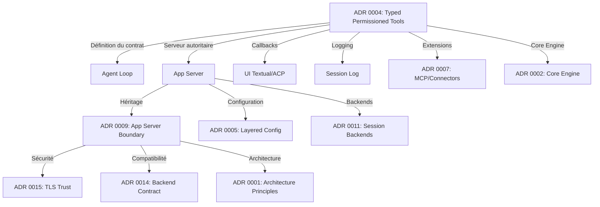

# ADR et contrat des outils

---

## Liste complète des ADR liés aux permissions, outils ou sécurité

| N° | Titre | Décision | Lien avec les permissions | Source |
|---|-------|----------|---------------------------|--------|
| **0001** | Architecture Principles | Architecture hexagonale : core ↔ edges, optimisation pour startup rapide et changements locaux | **Indirect** : Les permissions sont un *port* (frontière) entre le core et les effets de bord. La séparation permet d'isoler la logique de permission dans le core | `docs/adr/0001-architecture-principles.md` |
| **0002** | Core Engine And Delivery Surfaces | `vibe/core` = moteur (agent loop, **tools**, LLM, config, sessions), `vibe/app_server` = harness, delivery surfaces (CLI, ACP, programmatic) consomment le core | **Direct** : Les **tools** font partie du core. Les permissions sont gérées dans le même espace | `docs/adr/0002-core-engine-and-delivery-surfaces.md:L8-12` |
| **0003** | Event Driven Agent Loop | Boucle d'agent basée sur des **événements typés** (streaming async). Les événements incluent les approvals, tool calls, tool results | **Indirect** : Les *approvals* (demandes de permission) sont des événements typés dans le système | `docs/adr/0003-event-driven-agent-loop.md:L8-10` |
| **0004** | **Typed Permissioned Tools** | **Contrat des outils** : Les outils sont des ports typés vers les effets de bord. **La politique de permission fait partie intégrante du contrat de l'outil**. Analyse sémantique des commandes shell (récursive, normalisation des chemins). Un effet public unique représente le tool call complet | **Central et direct** : **Définition complète du tool contract** pour les permissions | `docs/adr/0004-typed-permissioned-tools.md` |
| **0005** | Layered Configuration | Configuration en couches (CLI > env > fichiers projet > defaults). Les paramètres de **permission** sont des *server-applied settings* | **Direct** : `tools: dict`, `bypass_tool_permissions` sont configurés via ce système | `docs/adr/0005-layered-configuration.md:L15-20` |
| **0007** | Extension Mechanisms | **Mécanismes d'extension** : skills, agents, subagents, hooks, **MCP servers**, **connectors**. Les extensions fournissent des outils qui doivent respecter le même contrat | **Direct** : Les outils **MCP** et **connectors** doivent respecter le même contrat de permission que les outils built-in | `docs/adr/0007-extension-mechanisms.md:L8-12` |
| **0008** | Feature Instrumentation | Téléométrie pour les *features* (funnels, adoption, status flows) | **Indirect** : Les événements de permission (ex: `approval_requested`, `approval_denied`) peuvent être instrumentés pour la télémétrie | `docs/adr/0008-feature-instrumentation.md` |
| **0009** | **App Server Boundary** | L'app-server est la **seule frontière** entre les delivery surfaces et le core. **Le serveur est autoritaire** pour : outils, permissions, effets, résultats visibles par le modèle. **Règles de sécurité** : le serveur applique la politique outils/FS/réseau/MCP/connector ; les projections publiques ne peuvent pas accorder de permission | **Direct et critique** : **Le serveur applique les permissions** (pas le client). Toute mutation passe par l'app-server | `docs/adr/0009-app-server-boundary.md:L25-30,L150-160` |
| **0010** | Textual Content Rendering | Rendu du contenu dans l'UI Textual (styles, markup) | **Indirect** : L'UI affiche les demandes de permission mais ne décide pas | `docs/adr/0010-textual-content-rendering.md` |
| **0011** | App Server Session Backends | Backends de session (Legacy vs Unified Harness). Les opérations sur les sessions passent par des *ports* typés | **Indirect** : Les backends de session **héritent** de la politique de permission du core via l'app-server | `docs/adr/0011-unified-harness-backend.md:L40-45` |
| **0014** | Backend Contract Compatibility | Compatibilité avec les backends Mistral (self-hosted). Changements de contrat wire doivent être *additifs et tolérants* | **Indirect (sécurité)** : La politique de permission doit rester compatible avec les versions antérieures | `docs/adr/0014-backend-contract-compatibility.md:L10-20` |
| **0015** | **Outbound TLS Trust Policy** | Politique de confiance TLS pour les connexions sortantes (`enable_system_trust_store`). Utilise Certifi ou system trust store | **Direct (sécurité)** : Sécurité des connexions réseau (impacte les outils comme `web_fetch`) | `docs/adr/0015-outbound-tls-trust-policy.md` |

---

## ADR 0004 : Typed Permissioned Tools (Détails)

### Décision complète

> **"Tools are typed, permissioned ports into side effects."**

Le document ADR 0004 (`docs/adr/0004-typed-permissioned-tools.md`) définit **le contrat que chaque outil doit respecter** :

1. **Typage fort** : Les outils doivent déclarer des types Pydantic pour :
   - `args` (arguments d'entrée)
   - `result` (résultat de sortie)
   - `config` (configuration)
   - `state` (état)
   - Tous via la classe `BaseTool[ToolArgs, ToolResult, ToolConfig, ToolState]`

2. **Contrat de permission** : **La politique de permission fait partie intégrante du contrat de l'outil**
   - Les outils touchant le FS, processus, réseau ou services externes **doivent déclarer et honorer les permissions de manière cohérente**
   - Surface-specific tool behavior should adapt the same core contract rather than fork the domain semantics

3. **Analyse sémantique des commandes shell** :
   - L'analyse des permissions pour shell doit couvrir **l'exécution sémantique** plutôt que seulement le texte de la commande de niveau supérieur
   - Analyse **récursive** des commandes imbriquées
   - Normalisation des chemins **avant** les vérifications des limites du workspace
   - Inclut les chemins MSYS sur Windows
   - Les lecteurs auto-allowlistés nécessitent toujours une approval lorsqu'ils accèdent à des répertoires en dehors

4. **Projection publique unifiée** :
   - Une seule entrée d'effet public représente : l'appel de l'outil, le streaming de sortie, le blocage pour approval, le résultat, la durée, et l'état terminal
   - Les kinds d'effets publics sont des catégories de présentation sémantique, pas un registre de noms d'outils
   - Les outils arbitraires (MCP, connector, custom) utilisent la projection générique

5. **Extensions** :
   - Les outils MCP/connector peuvent fournir des outils qui doivent **respecter le même contrat**
   - Un backend dont le protocole source porte intentionnellement des faits d'outils sans présentation Vibe peut traduire un ensemble fermé d'outils built-in vers ces catégories sémantiques existantes

### Ce que chaque outil doit respecter (Tool Contract)

| Composant | Obligation | Implémentation | Source |
|-----------|------------|----------------|--------|
| **Hériter de BaseTool** | ✅ Obligatoire | `class MonOutil(BaseTool[...]):` | `vibe/core/tools/base.py:L100-150` |
| **Déclarer les types** | ✅ Obligatoire | Typage Pydantic pour args, result, config, state | `vibe/core/tools/base.py:L100-150` |
| **Implémenter resolve_permission** | ✅ Obligatoire | `def resolve_permission(self, args) -> PermissionContext | None:` | `vibe/core/tools/base.py:L448-450` |
| **Respecter ToolPermission** | ✅ Obligatoire | Vérifier et honorer la permission de la config | `vibe/core/tools/base.py:L448-450` |
| **Lever ToolPermissionError** | ⚠️ Recommandé | `raise ToolPermissionError("raison")` pour les refus | ADR 0004:L40-41, `vibe/core/tools/models.py:L10` |
| **Ne pas exécuter si refusé** | ✅ Obligatoire | Bloquer l'exécution si permission refusée | `vibe/core/agent_loop/_loop.py:L3027-3070` |

### Quels composants doivent appliquer le contrat ?

| Composant | Rôle | Application du contrat | Source |
|-----------|------|-----------------------|--------|
| **Agent Loop** | Exécute les outils et gère la boucle LLM | **Applique les permissions** avant d'exécuter un outil via `_should_execute_tool()`. Bloque l'exécution si `ToolPermissionError` est levée ou si la décision est `SKIP` | `vibe/core/agent_loop/_loop.py:L3027-3070` |
| **UI (Textual/ACP)** | Affiche les demandes de permission (callbacks) | **Ne décide pas** : transmet les réponses utilisateur à l'app-server. N'applique aucune logique de permission | `vibe/cli/textual_ui/widgets/approval_app.py:L1-320` |
| **Session Log** | Journalise les appels d'outils | **Enregistre** les tool calls y compris les refus via `ToolResultEvent` | `vibe/core/agent_loop/_loop.py:L2855-2900` |
| **App Server** | **Serveur autoritaire** pour les permissions | **Applique et fait respecter** le contrat : valide les outils, résout les permissions, projette les effets publics, gère les callbacks. Centralise la logique pour tous les clients | `docs/adr/0009-app-server-boundary.md:L150-160` |
| **ACP** | Protocole client | **Transmet** les callbacks de permission sans contournement. Ne modifie pas la logique de permission | `vibe/app_server/session.py:L829-930` |

---

## Relations entre les ADR

---

## Synthèse des liens entre ADR et permissions

| ADR | Lien avec les permissions | Niveau |
|-----|---------------------------|--------|
| 0001 | Architecture permet d'isoler les permissions comme un port | Indirect |
| 0002 | Les outils font partie du core qui gère les permissions | Direct |
| 0003 | Les approvals sont des événements typés dans la boucle | Indirect |
| **0004** | **Définition complète du tool contract et des permissions** | **Central** |
| **0005** | **Configuration des permissions via le système de layers** | **Direct** |
| 0007 | Les outils extensions doivent respecter le même contrat | Direct |
| 0008 | Instrumentation des événements de permission | Indirect |
| **0009** | **L'app-server est l'autorité centrale pour les permissions** | **Direct** |
| 0010 | UI affiche mais ne décide pas des permissions | Indirect |
| 0011 | Backends héritent de la politique de permission | Indirect |
| 0014 | Compatibilité des permissions entre versions | Indirect |
| **0015** | **Sécurité TLS pour les outils réseau** | **Direct** |

---

## Conclusion

- **ADR 0004** est le **document central** pour comprendre le système de permissions
- **ADR 0009** précise que **l'app-server est le seul à appliquer les permissions**
- **ADR 0005** explique **comment configurer** les permissions
- **ADR 0007** étend les permissions aux **outils pluggables** (MCP, connectors)
- **ADR 0015** ajoute une couche de **sécurité réseau** (TLS)

Le **contrat de l'outil** défini dans ADR 0004 est **respecté par tous les composants** :
1. Les outils **déclarent** leurs besoins en permissions
2. L'agent loop **vérifie** les permissions avant exécution
3. L'app-server **centralise** la logique de permission
4. L'UI **affiche** les demandes sans décider
5. Le session log **enregistre** les décisions
