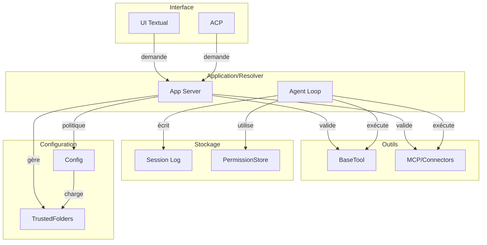

# Système de permissions de Mistral Vibe

---

## Sommaire

1. [Vue d'ensemble](#vue-densemble)
2. [Niveaux et modes de permission](01-niveaux-et-modes.md)
3. [Déroulement et scénarios](02-deroulement-et-scenarios.md)
4. [Fichiers utilisateur](03-fichiers-utilisateur.md)
5. [Fichiers et modules internes](04-fichiers-et-modules.md)
6. [Sécurité et sandbox](05-securite-et-sandbox.md)
7. [Cas limites (edge cases)](06-edge-cases.md)
8. [ADR et contrat des outils](07-adr-et-contrat-des-outils.md)
9. [Tests et qualité](08-tests-et-qualite.md)

---

## Vue d'ensemble

### Concept général

Le système de permissions de Mistral Vibe est un mécanisme de contrôle d'accès qui régit les **effets de bord** générés par les outils exécutés par l'agent. Il constitue une **couche de sécurité critique** intégrée à l'architecture, conçue pour limiter la surface d'attaque et prévenir les actions dangereuses ou non intentionnelles.

Le système repose sur le principe énoncé dans l'[ADR 0004](docs/adr/0004-typed-permissioned-tools.md) :

> **« Tools are typed, permissioned ports into side effects »**

Cela signifie que chaque outil est un **port typé** vers des effets de bord, et que la politique de permission fait partie intégrante du contrat que chaque outil doit respecter.

### Risques évités

Le système de permissions permet d'éviter plusieurs catégories de risques majeurs :

| Catégorie de risque | Exemple concret | Impact potentiel | Mécanisme de protection |
|---------------------|-----------------|------------------|------------------------|
| **Exécution de commandes dangereuses** | `rm -rf /`, `dd if=/dev/zero of=/dev/sda` | Destruction complète du système | Validation par l'utilisateur, listes de refus |
| **Accès à des fichiers sensibles** | Lecture de `.env`, `.ssh/id_rsa` | Fuites d'informations d'identification | Détection des motifs sensibles (`sensitive_patterns`), validation |
| **Modification de fichiers système** | Écriture dans `/etc/`, `/usr/bin/` | Corruption du système, élévation de privilèges | Vérification des limites du workspace |
| **Exécution de code arbitraire** | `python -c "malicious_code"`, `curl ... | bash` | Exécution de payloads malveillants | Listes de refus par défaut, validation des commandes |
| **Sortie du workspace autorisé** | `cat /etc/passwd` depuis un projet | Accès à des données en dehors du contexte | Vérification des boundaries du workspace via `is_path_within_workdir()` |
| **Actions non intentionnelles** | `git push --force` | Perte de données, perturbations | Demande de confirmation explicite |

### Philosophie du système

Le système repose sur quatre principes fondamentaux :

1. **Typage fort** : Chaque outil déclare explicitement ses besoins en permissions via des types Pydantic (`ToolPermission`, `PermissionScope`, etc.)
2. **Granularité fine** : Les permissions sont évaluées au niveau de **chaque appel d'outil**, avec la possibilité de scoper au niveau de la commande, du fichier ou de l'URL
3. **Transparence** : L'utilisateur est toujours informé et doit explicitement approuver les actions sensibles
4. **Centralisation** : L'application des permissions est **centralisée côté serveur** (app-server), garantissant une politique cohérente pour tous les clients

Le **contrat de l'outil** (tool contract) défini dans l'ADR 0004 impose que tous les outils (built-in, plugins, MCP, connectors) doivent respecter ces principes.

### Architecture en couches

**Interface** : Affiche les demandes de permission (callbacks) et transmet les réponses utilisateur. Ne décide pas des permissions, délègue tout à l'app-server via `AppServerSession`.

**Application/Resolver** : L'app-server est l'autorité centrale qui applique les permissions via `UnifiedPermissionResolver` ; l'agent loop vérifie et bloque l'exécution si refusé. La logique est centralisée dans `_loop.py` et `_session_backend_port.py`.

**Outils** : Tous les outils (built-in, MCP, connectors) doivent hériter de `BaseTool` et implémenter `resolve_permission()`. L'exécution est validée avant toute action via `_should_execute_tool()`.

**Stockage** : `PermissionStore` stocke les règles de permission pour la session (règles + permissions par outil). `Session Log` enregistre les tool calls y compris les refus via `ToolResultEvent`.

**Configuration** : `VibeConfigSchema` définit les règles par outil (`tools: dict`) et `bypass_tool_permissions`. `TrustedFoldersManager` gère la confiance des dossiers workspace, indépendamment des permissions des outils.

### Distinction permissions vs sandbox

**Permissions** = Demander l'autorisation à l'utilisateur avant d'exécuter des actions sensibles.
**Sandbox** = Limiter techniquement ce que le processus peut faire (via seccomp, namespaces, chroot, conteneurs).

→ **Mistral Vibe n'utilise PAS de sandbox technique** (aucune occurrence de ces termes dans le code, docs ou ADR). Le système repose **uniquement** sur le mécanisme de permissions (demande d'autorisation).
