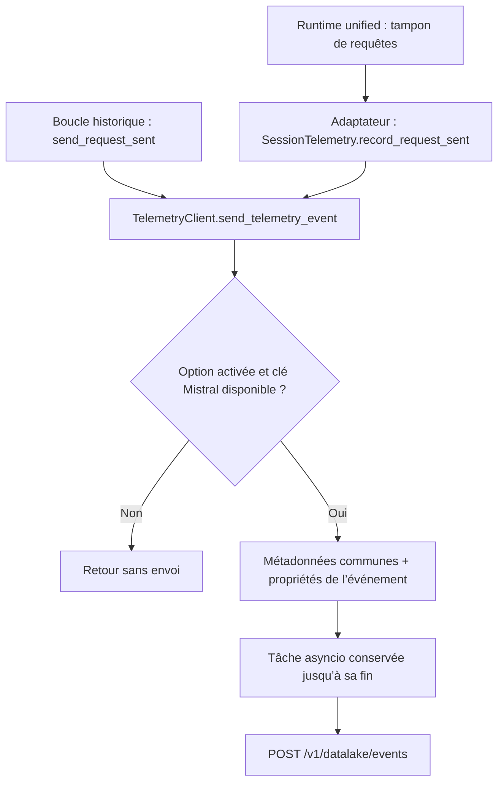

# La télémétrie dans Mistral Vibe

Version étudiée : Vibe 2.26.1, commit `5e931ff3`. Vérifications réalisées le 1er novembre 2026.

La télémétrie sert à décrire l’utilisation de Vibe sous forme d’événements : ouverture d’une session, appel au modèle, résultat d’un outil, compaction du contexte ou action dans l’interface. Elle permet de compter ces opérations et de les relier à une session, un client et, parfois, une expérience. Le module `vibe/core/telemetry/` construit les données communes et les transmet au service de télémétrie associé au fournisseur Mistral configuré. Il s’agit d’événements applicatifs, avec un nom comme `vibe.request_sent` et un dictionnaire de propriétés.

## Les pièces du module

Le point d’entrée pratique est [`send.py`](../../../../vibe/core/telemetry/send.py). `TelemetryClient` y regroupe les méthodes qui fabriquent les propriétés propres à chaque événement (`send_request_sent`, `send_tool_call_finished`, `send_new_session`, etc.) et la méthode commune `send_telemetry_event`, chargée de l’envoi. Le même fichier résout le fournisseur Mistral et sa clé API. Même si le modèle actif utilise un autre fournisseur, la clé envoyée au service de télémétrie provient d’un fournisseur configuré avec le backend Mistral.

[`types.py`](../../../../vibe/core/telemetry/types.py) définit le contexte de lancement, les modèles de métadonnées Pydantic et les types de champs employés par plusieurs événements. Par exemple, `TelemetryCallType` distingue un appel principal d’un appel secondaire ou utilitaire. [`build_metadata.py`](../../../../vibe/core/telemetry/build_metadata.py) assemble les métadonnées communes : système, architecture, version de Vibe, identifiants de session, client et point d’entrée. Il construit aussi les métadonnées destinées aux requêtes du modèle et compte les images jointes lorsque le modèle les accepte. `__init__.py` est vide.

Enfin, [`session.py`](../../../../vibe/core/telemetry/session.py) contient `SessionTelemetry`, utilisé par le backend « unified ». Cette couche garde le nom du modèle actif et un ensemble d’identifiants d’effets déjà traités. `claim(effect_id)` ne réussit qu’une fois ; `mark_recorded` permet de marquer les effets retrouvés lors de la reprise d’une session. Ses méthodes `record_*` délèguent ensuite à `TelemetryClient`.

Cette répartition sépare les modèles de données, la construction du contexte et le suivi d’une session. `send.py` reste cependant le fichier central : il contient à la fois le transport HTTP et les méthodes propres aux différentes fonctionnalités. Ajouter un événement implique donc souvent de modifier ce fichier, même si le mécanisme d’envoi reste identique.

## Du code métier à l’envoi

Dans la boucle d’agent historique, [`_loop.py`](../../../../vibe/core/agent_loop/_loop.py) appelle `send_request_sent` dans `_complete` et `_chat_streaming`, avant d’appeler le backend du modèle. Il calcule le nombre de messages et de caractères du contexte préparé pour le modèle, la longueur du dernier message utilisateur non injecté, le type d’appel et le nombre d’images de ce message. L’événement `vibe.request_sent` contient ces mesures, le modèle et, si disponible, l’identifiant du message. Le texte du prompt n’est pas placé dans ce payload. L’événement signale le lancement d’un appel, pas sa réussite : une erreur du modèle peut survenir ensuite.

`send_telemetry_event` vérifie d’abord `enable_telemetry`, puis cherche une clé API Mistral. Si l’option est désactivée ou si aucun couple fournisseur/clé n’est trouvé, il retourne sans programmer d’envoi. Sinon, il reconstruit les métadonnées au moment de l’événement grâce aux fonctions *getter* reçues par le client : un changement de session ou de configuration peut donc être pris en compte sans recréer celui-ci. Le contexte de lancement et `harness_backend`, eux, sont fixés à la construction du client.

Le dictionnaire de l’événement est fusionné avec ces métadonnées par `self.build_client_event_metadata() | properties` : en cas de même clé, la propriété spécifique à l’événement l’emporte. Cela permet notamment à un événement de compaction de préciser la session concernée. Les métadonnées communes dont la valeur est `None` sont omises, mais ce filtrage ne s’applique pas automatiquement aux propriétés de l’événement. Le corps HTTP a la forme `{"event": "vibe.request_sent", "properties": {...}}`, avec éventuellement un `correlation_id` au niveau supérieur.



Les deux backends convergent donc vers le même envoi. La flèche vers le `POST` représente une tentative, sans garantie de réception.

L’appelant n’attend pas ce `POST` : `asyncio.create_task` programme l’envoi sur la boucle asyncio en cours, et un ensemble conserve les tâches encore actives. Un callback retire chaque tâche terminée ; `aclose()` attend les tâches restantes avant de fermer le client HTTP. Le client est créé à la demande avec `httpx.Timeout(5.0)` et dix connexions au maximum. Ces cinq secondes sont des délais HTTPX par opération, pas une limite globale de durée pour vider tous les événements. Le nombre de tâches en attente n’est pas explicitement borné.

Les exceptions dérivées d’`Exception` dans la coroutine d’envoi sont ignorées. Il n’y a ni file persistante ni nouvelle tentative dans ce module, et le code n’appelle pas `raise_for_status()` : une réponse HTTP 4xx ou 5xx n’entraîne donc pas de traitement particulier ici. Cette tolérance aux erreurs ne couvre pas toute la méthode : la construction des métadonnées et la création de tâche sont en dehors du `try`. Une boucle asyncio active est nécessaire pour programmer l’envoi.

Le backend « unified » suit un autre chemin pour produire les mêmes familles d’événements. Dans [`_unified_harness_backend_adapter.py`](../../../../vibe/app_server/_unified_harness_backend_adapter.py), les requêtes du runtime sont récupérées depuis un tampon, puis passées à `SessionTelemetry.record_request_sent` sur la boucle de l’application. Les résultats terminaux d’outils sont reconstruits depuis les états de session ; l’adaptateur appelle `claim` avant `record_tool_call_finished` pour éviter de compter deux fois un effet aperçu dans plusieurs instantanés. Pour un outil `write_file` réussi, l’événement peut contenir `nb_files_created: 1` et une extension comme `.py`, sans envoyer le chemin du fichier. La voie historique calcule ces champs à partir du résultat et des arguments de l’outil dans `send.py`.

Plus précisément, `_forward_request_sent` vide `RequestSentQueue` et conserve le modèle indiqué par chaque requête, qui peut différer du modèle actif de la session. [`request_call_type`](../../../../vibe/app_server/_completion_attribution.py) traduit la raison de l’appel et son numéro d’itération : le premier appel de l’agent devient `main_call`, les suivants et la compaction deviennent `secondary_call`. La classification d’approbation et la génération de titre ont leurs propres catégories. Pour les événements d’outils, `SessionTelemetry` utilise au contraire le modèle suivi par `set_model`.

## Un exemple avec `vibe.request_sent`

Le test `test_send_request_sent_payload` dans [`test_telemetry_send.py`](../../../../tests/core/telemetry/test_telemetry_send.py) fournit un exemple simple, avec des valeurs choisies pour le test :

```python
client.send_request_sent(
    model="codestral",
    nb_context_chars=1234,
    nb_context_messages=5,
    nb_prompt_chars=42,
    call_type="main_call",
)
```

Ici, `TelemetryClient` ne mesure rien lui-même : il reçoit les compteurs. Dans la boucle historique, `nb_context_chars` vient de la somme des longueurs des champs `content`, en remplaçant un contenu absent par une chaîne vide. `nb_prompt_chars` compte les caractères du dernier message utilisateur non injecté, ou vaut zéro s’il n’y en a pas. Ce sont des caractères, pas des tokens ; le compteur ne représente pas la taille complète de la requête HTTP ni celle des images ou des définitions d’outils.

La méthode construit `vibe.request_sent`, ajoute `call_source="vibe_code"`, conserve `message_id=None` et produit `attachment_counts={}` dans cet exemple. Avec deux images acceptées par le modèle, le compteur serait `{"image": 2}` ; les comptes nuls sont écartés. `send_telemetry_event` ajoute ensuite les métadonnées disponibles, par exemple la version et la session. Le test vérifie ces propriétés en mémoire, sans envoyer de requête réelle.

Il faut distinguer cet événement des métadonnées transmises avec l’appel au modèle. `_build_backend_metadata` utilise `build_request_metadata`, puis la boucle passe ce résultat au backend. Le chemin unified fait de même via `build_completion_attribution`. Ces constructions ne sont pas conditionnées par `enable_telemetry` : désactiver l’envoi des événements ne supprime donc pas à lui seul les métadonnées jointes aux appels du modèle.

## Activation, clés et déduplication

Dans [`VibeConfigSchema`](../../../../vibe/core/config/vibe_schema.py), `enable_telemetry` vaut `True` par défaut. Cela ne suffit pas pour envoyer : `get_mistral_provider_and_api_key` doit aussi trouver un fournisseur et sa clé. `get_mistral_provider` privilégie le fournisseur actif si son backend est `Backend.MISTRAL`, sinon le premier fournisseur configuré avec ce backend. Le choix se fait avant la recherche de clé : si ce fournisseur n’a pas de clé, la fonction ne poursuit pas la recherche parmi les autres fournisseurs Mistral.

[`resolve_api_key`](../../../../vibe/utils/api_keys.py) lit d’abord la variable d’environnement nommée par `api_key_env_var`, puis le trousseau système. La clé est envoyée dans l’en-tête `Authorization: Bearer …`, pas dans les propriétés de l’événement. Cette sélection évite de reprendre automatiquement la clé d’un fournisseur tiers actif. Elle repose toutefois sur la configuration du backend, pas sur une vérification du propriétaire du domaine.

L’URL d’envoi est dérivée de `provider.api_base` avec les fonctions de [`vibe/utils/http.py`](../../../../vibe/utils/http.py). Par exemple, `https://api.custom.host/v2` donne `https://api.custom.host/v1/datalake/events`. Si la base ne peut pas être extraite, le code utilise `https://api.mistral.ai`. Le destinataire n’est donc pas nécessairement le domaine public de Mistral. `_is_enabled` retourne `False` si la lecture de configuration lève une exception ; la recherche du fournisseur traite aussi ses erreurs en retournant `None`. Cela ne signifie pas que toutes les erreurs de préparation sont interceptées.

La déduplication concerne surtout les effets terminés d’outils, de sous-agents et de compaction dans le backend unified. Les méthodes `record_*` ne font pas elles-mêmes de `claim` : c’est l’adaptateur qui doit le faire. Lors d’une reprise, `_seed_tool_telemetry` marque les effets déjà terminés pour éviter leur réémission. L’ensemble reste en mémoire, et un identifiant est enregistré avant la tentative d’envoi : si celle-ci échoue, un nouvel instantané ne provoque pas de nouvelle tentative pour cet effet. Un seul effet de compaction peut aussi produire deux événements différents.

Les événements `request_sent` suivent une autre logique : le tampon est vidé à chaque lecture, sans passer par cet ensemble d’identifiants. Relire un tampon vide ne produit rien, mais cela ne constitue pas une déduplication générale de deux requêtes identiques. Aucune de ces dispositions ne garantit une livraison exactement une fois au serveur.

## Interactions et limites visibles

Le module reçoit du contexte depuis la configuration, les sessions, les expériences et les différents points d’entrée (CLI, ACP et serveur d’application). Les interfaces clientes peuvent aussi passer par `TelemetryResource` dans [`_service_resources.py`](../../../../vibe/app_server/_service_resources.py), qui transmet un appel `telemetry/record` au serveur plutôt que de posséder le client HTTP. Des fonctionnalités comme la compaction, le téléport et les commandes d’interface utilisent ensuite les méthodes spécialisées de `TelemetryClient`.

Les champs envoyés privilégient souvent des comptes, statuts et catégories plutôt que le contenu : longueur d’un texte copié, nombre de fichiers modifiés, extension ou résultat d’un sous-agent. Ce choix n’est toutefois pas une anonymisation générale : les identifiants de session et les attributs d’expérience restent dans les métadonnées. Ces derniers peuvent notamment contenir `userId`. `send_telemetry_event` accepte un dictionnaire libre, sans validation globale du schéma de chaque événement. Les modèles Pydantic structurent les métadonnées communes, mais ne filtrent pas toutes les propriétés ajoutées par les appelants.

L’[ADR 0008](../../../adr/0008-feature-instrumentation.md) demande d’instrumenter les fonctionnalités, de réutiliser les événements existants et d’ajouter des métadonnées standardisées. Les fonctions d’outils unified réutilisent bien `vibe.tool_call_finished`. En revanche, l’ADR parle d’un bloc `properties.metadata`, tandis que le code fusionne les métadonnées directement dans `properties`. Le test du `POST` attend lui aussi cette forme plate. C’est une divergence concrète entre le document et l’implémentation ; les sources locales ne permettent pas de décider si l’ADR doit être corrigé ou si le format doit évoluer. L’ADR précise également que le registre des événements est alimenté automatiquement depuis la production : il n’est pas un schéma à modifier manuellement. Ce registre externe n’a pas été vérifié ici.

## Ce que vérifient les tests

Les trois fichiers de [`tests/core/telemetry/`](../../../../tests/core/telemetry/) répartissent les vérifications ainsi :

| Fichier | Comportements vérifiés |
|---|---|
| `test_telemetry_send.py` | Propriétés des événements, métadonnées, URL, activation, clé absente, métriques de fichiers et appel HTTP simulé |
| `test_session_telemetry.py` | `claim`, pré-marquage, changement du modèle des événements d’outils, décisions d’approbation et compaction |
| `test_build_attachment_counts.py` | Message absent, images absentes, comptage et capacité du modèle à recevoir des images |

La fixture automatique `telemetry_events` de [`tests/conftest.py`](../../../../tests/conftest.py) remplace `send_telemetry_event` par une fonction qui fusionne les métadonnées et stocke les événements en mémoire. C’est utile pour tester les propriétés sans réseau, mais cela contourne les contrôles d’activation et le transport réel. `test_send_telemetry_event_posts_when_enabled` rétablit la méthode d’origine, remplace le client HTTP par un mock, puis attend `aclose()` avant de vérifier le corps et les en-têtes du `POST`. Le test de désactivation rétablit également la méthode réelle.

Cette distinction révèle une faiblesse : `test_send_telemetry_event_swallows_config_getter_value_error` ne rétablit pas la méthode d’origine, donc il n’exerce pas réellement le contrôle qu’annonce son nom. Le test d’absence de clé vérifie directement la résolution de clé, mais son appel d’envoi reste remplacé par la fixture. Un test passant n’est donc pas, à lui seul, la preuve que tout le chemin annoncé a été exécuté.

D’autres tests complètent cette couverture. [`test_telemetry_integration.py`](../../../../tests/core/experiments/test_telemetry_integration.py) vérifie les métadonnées d’expériences, notamment la présence et l’absence des attributs. Dans [`test_unified_harness_backend_adapter.py`](../../../../tests/app_server/test_unified_harness_backend_adapter.py), `test_request_sent_forwarding_maps_call_type_and_drains` vérifie les catégories d’appel et l’absence de nouveaux événements au second vidage du tampon ; `test_ordinary_tool_call_finished_emits_once_with_file_metrics` vérifie l’émission unique des effets d’outils. [`test_telemetry_resource.py`](../../../../tests/app_server/test_telemetry_resource.py) vérifie l’adaptation de `log` vers `record`, avec un mock, pas la livraison complète par RPC.

Ces tests vérifient les données et certains enchaînements locaux. Ils ne démontrent ni la réception des événements par le service distant ni leur conservation après un arrêt brutal. Les comportements décrits ci-dessus ont été vérifiés par lecture du code et des assertions ; les résultats d’exécution sont précisés ci-dessous.

Après installation des dépendances avec `uv sync --frozen`, la sélection suivante a donné **92 tests réussis en 2,95 secondes**, sans échec ni test ignoré :

```bash
uv run --no-sync pytest -n 0 \
  tests/core/telemetry \
  tests/core/experiments/test_telemetry_integration.py \
  tests/app_server/test_telemetry_resource.py \
  tests/app_server/test_unified_harness_backend_adapter.py::test_request_sent_forwarding_maps_call_type_and_drains \
  tests/app_server/test_unified_harness_backend_adapter.py::test_ordinary_tool_call_finished_emits_once_with_file_metrics
```

La suite complète et le service distant n’ont pas été testés. Aucun code de production ni test n’a été modifié.
