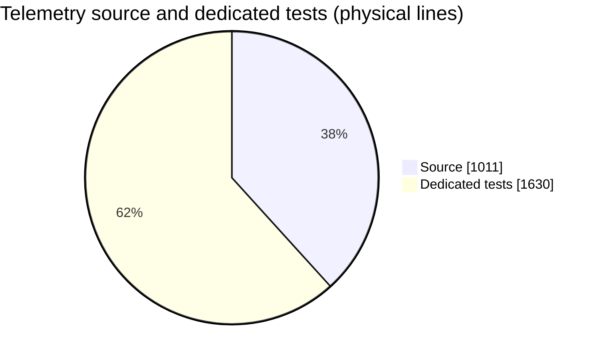
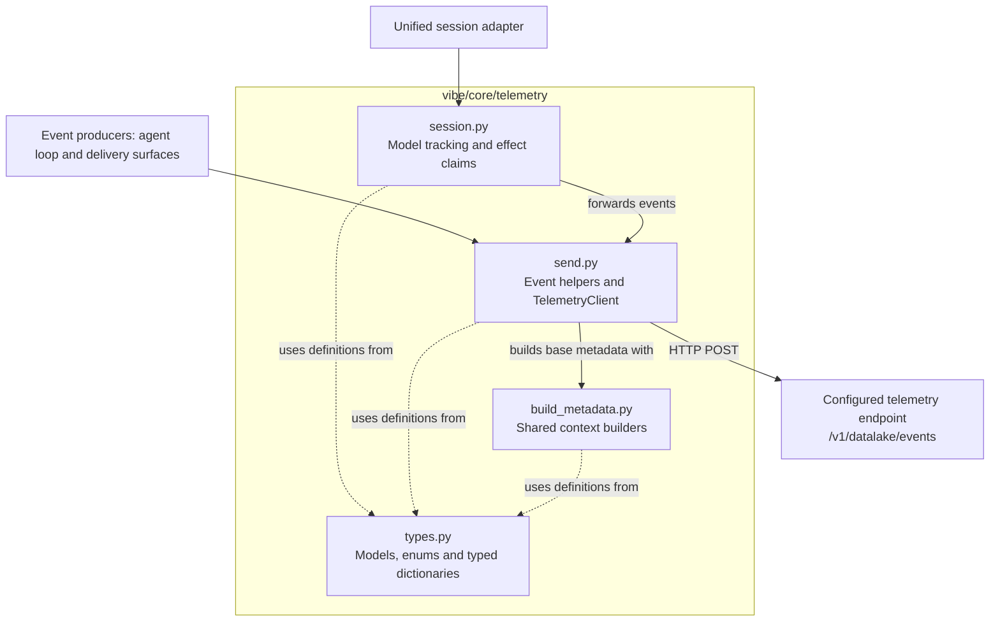
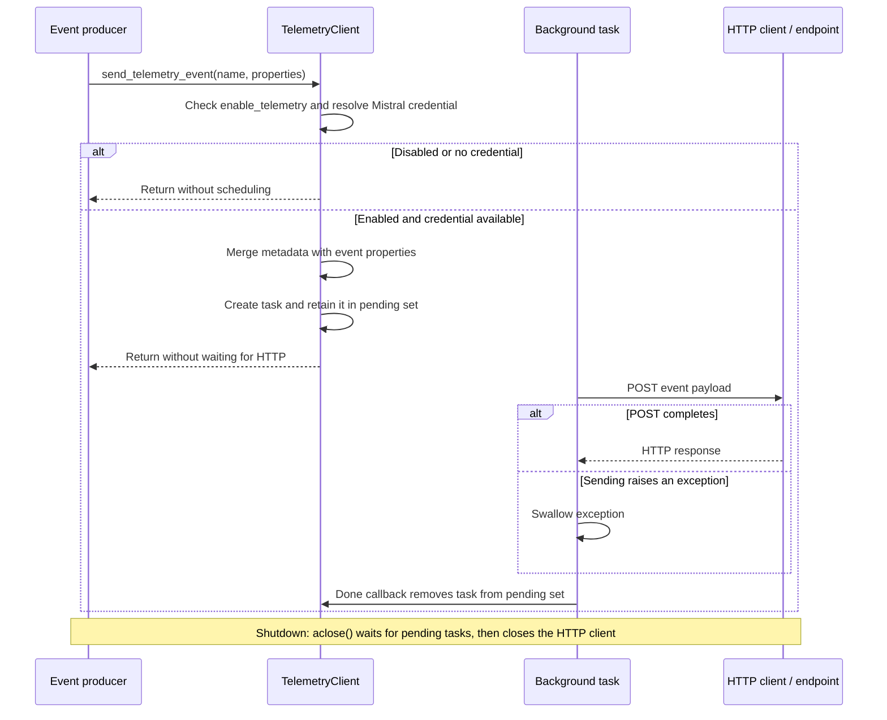
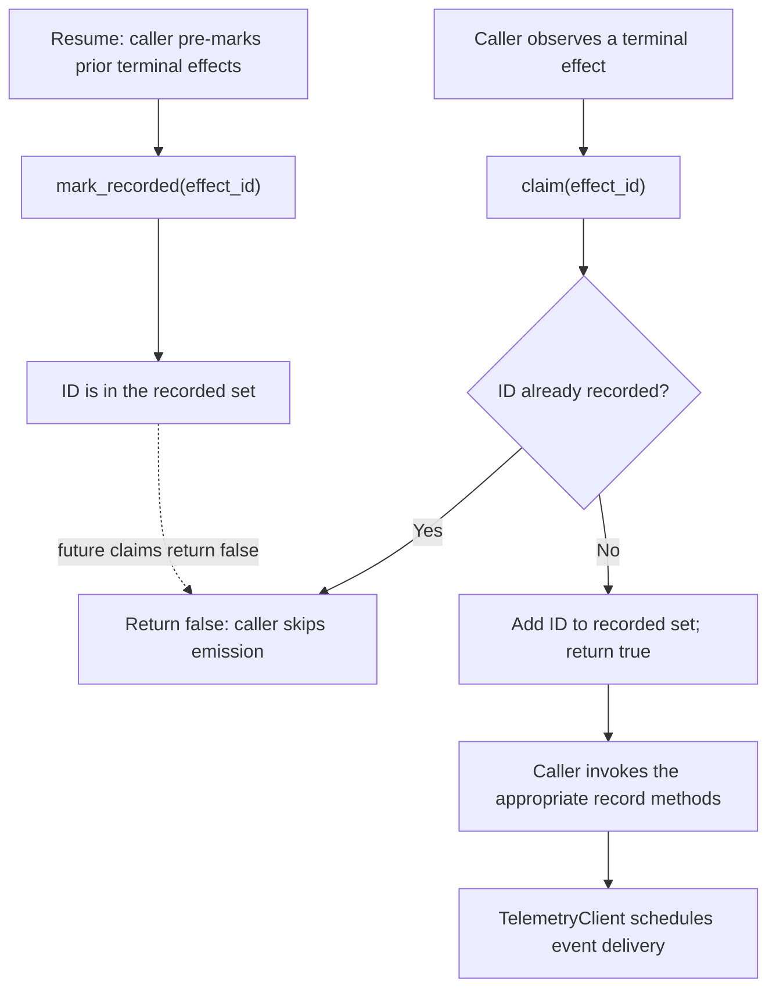

# Mistral Vibe — Telemetry Module Analysis

Last updated: 2026-10-19 (v2.26.1, commit `5e931ff3`)

Deep-dive into `vibe/core/telemetry/`, following the structure of [Python Statistics](../../python_statistics.md). See [Statistics](../../statistics.md) for the cross-language overview.

## Overview

Telemetry records structured usage events: session lifecycle, model requests, tool outcomes, compaction, and user interactions. This package builds metadata and event payloads, sends events asynchronously, and provides a session-level interface for the unified harness.

| Metric | Value |
|---|---|
| Total Python files (source + dedicated tests) | **8** |
| Total Python LOC | **2,641** |
| Source files (`vibe/core/telemetry/`) | 5 |
| Source LOC | **1,011** |
| Test files (`tests/core/telemetry/`) | 3 |
| Test LOC | **1,630** |
| Avg lines/file (all) | 330.1 |
| Avg lines/source file | 202.2 |
| Test-to-source ratio (lines) | **1.61:1** |

The source total matches the telemetry entry in the professor's Python analysis. The empty `__init__.py` counts as a source file. Tests elsewhere in the repository are excluded from these totals.

*Figure 1 — Dedicated tests account for 61.7% of the combined line count. This measures code volume, not test coverage.*

## Code Density (source only, 1,011 lines)

| Category | Lines | % |
|---|---|---|
| Blank lines | 120 | 11.9% |
| Comment lines (`#`) | 26 | 2.6% |
| Docstring marker lines (starting with `"""`) | 14 | 1.4% |
| Remaining lines | 851 | 84.2% |

This uses the same style of line-based breakdown as the professor's report. The remainder includes docstring body text, so it is an approximation of code density, not an exact executable-code count. Percentages may not sum to 100% because of rounding.

## Language Constructs (source only)

| Construct | Count |
|---|---|
| `class` definitions | 13 |
| `def` / `async def` functions, including methods and nested functions | 54 |
| `async def` functions | 2 (3.7% of all functions) |
| Decorators | 5 |
| Import statements (`import` / `from`) | 39 |

Eleven of the thirteen classes live in `types.py`: six Pydantic models, four typed dictionaries, and one enum. The other two are `TelemetryClient` and `SessionTelemetry`. Only sending and cleanup are async; most functions construct payloads or forward events synchronously.

## File Size Distribution

### Source files (5 files)

| Bucket | Count | % |
|---|---|---|
| < 20 lines | 1 | 20% |
| 20–49 lines | 0 | 0% |
| 50–99 lines | 0 | 0% |
| 100–199 lines | 3 | 60% |
| 200–499 lines | 0 | 0% |
| ≥ 500 lines | 1 | 20% |

### Test files (3 files)

| Bucket | Count | % |
|---|---|---|
| < 20 lines | 0 | 0% |
| 20–49 lines | 1 | 33.3% |
| 50–99 lines | 1 | 33.3% |
| 100–199 lines | 0 | 0% |
| 200–499 lines | 0 | 0% |
| ≥ 500 lines | 1 | 33.3% |

Both source and tests have one dominant file, rather than an even distribution of responsibilities by size.

## Source Modules

Paths below are relative to [`vibe/core/telemetry/`](../../../../vibe/core/telemetry/).

| File | Lines | % of source | Responsibility |
|---|---|---|---|
| `send.py` | 603 | 59.6% | Credentials, HTTP client lifecycle, event payloads, and sending |
| `types.py` | 153 | 15.1% | Launch context, metadata models, event field types |
| `session.py` | 148 | 14.6% | Active model and effect deduplication for unified sessions |
| `build_metadata.py` | 107 | 10.6% | Shared metadata, launch context, and image attachment counts |
| `__init__.py` | 0 | 0% | Empty package marker |

*Figure 2 — Main responsibilities and relationships. Solid arrows show calls or event flow; dashed arrows show use of shared types. This is a focused view, not a complete import graph.*

### `send.py` — event construction and transport

`TelemetryClient` receives getter functions for current configuration, session identifiers, and optional experiment/account information. This lets events reflect current state without rebuilding the client.

`send_telemetry_event()` checks whether telemetry is enabled and whether a Mistral provider credential is available. It merges base metadata with event properties, then schedules an HTTP POST to `/v1/datalake/events`. The server base is derived from the selected Mistral provider's API base, with `https://api.mistral.ai` as the fallback. Event properties override identically named base metadata fields.

The HTTP client is created lazily with a five-second HTTPX timeout and a ten-connection limit. Pending tasks are retained in a set and removed when done. `aclose()` waits for pending tasks and closes the client. Exceptions inside the sending coroutine are swallowed; this is best-effort delivery, without an explicit retry or persistent event queue in this module.

Event helpers include `send_request_sent()`, `send_tool_call_finished()`, `send_new_session()`, and `send_user_copied_text()`. Unified tool and subagent helpers reuse the existing `vibe.tool_call_finished` event.

*Figure 3 — Best-effort event delivery. The background work is scheduled on the event loop. The sender does not explicitly check the HTTP response status; completion here does not establish server acceptance. The exception handler surrounds the background send, not all synchronous metadata construction.*

### `types.py` and `build_metadata.py` — common event context

Metadata includes OS, architecture, Vibe version, client and entrypoint information, session identifiers, and optional experiment assignments. `TelemetryRequestMetadata` adds request-specific fields such as call type and message ID. Builders omit absent optional metadata when dumping the base model.

`build_attachment_counts()` currently counts images only, and only when the target model supports them. The launch context also provides a small set of Sentry tags, connecting shared context with error reporting.

### `session.py` — unified-session bookkeeping

`SessionTelemetry` wraps the client and tracks the active model. `claim(effect_id)` returns true only the first time an effect is seen; `mark_recorded()` can pre-register effects restored from a resumed session. The `record_*` methods forward events but do not claim effect IDs themselves: callers must use the deduplication interface appropriately.

*Figure 4 — Intended caller-managed deduplication flow. Claiming happens before delivery, so it prevents repeated processing but cannot ensure delivery. A single claimed compaction effect may produce more than one event.*

## Tests (`tests/core/telemetry/`, 3 files, 1,630 lines)

### By area

| File | Lines | Test functions | Main checks |
|---|---|---|---|
| `test_telemetry_send.py` | 1,496 | 64 | Payloads, metadata, opt-out, credentials, URLs, file metrics, and mocked HTTP sending |
| `test_session_telemetry.py` | 98 | 4 | Deduplication, active model changes, approval fields, and compaction events |
| `test_build_attachment_counts.py` | 36 | 4 | Missing messages/images, image counts, and model capability filtering |

### Test framework usage

| Metric | Count |
|---|---|
| Synchronous `test_*` functions | 66 |
| Async `test_*` functions | 6 (8.3% of tests) |
| Total test functions | **72** |
| `@pytest.mark` usages | 9 |
| `@pytest.mark.parametrize` usages (included above) | 3 |
| Locally defined `@pytest.fixture` functions | 0 |

Shared fixtures come from [`tests/conftest.py`](../../../../tests/conftest.py). Its `telemetry_events` fixture captures events by replacing the sending method. Transport tests restore the original method and use mocks, including `AsyncMock`, to inspect HTTP calls. Parametrization means the number of executed test cases can exceed the number of test functions.

Related integration tests also exist outside this scope, for example [`test_telemetry_integration.py`](../../../../tests/core/experiments/test_telemetry_integration.py) and [`test_telemetry_resource.py`](../../../../tests/app_server/test_telemetry_resource.py).

## Largest Source Files

| Lines | Functions (including methods) | File |
|---|---|---|
| 603 | 37 | `send.py` |
| 153 | 2 | `types.py` |
| 148 | 11 | `session.py` |
| 107 | 4 | `build_metadata.py` |

## Observations

1. **Sending dominates the module**: `send.py` contains 59.6% of source lines and 37 of 54 functions. It combines reusable transport machinery with feature-specific event helpers, making it the main maintenance point when events change.
2. **Tests are concentrated in the same area**: `test_telemetry_send.py` accounts for 91.8% of dedicated test lines. The overall 1.61:1 test-to-source ratio indicates substantial test-code volume, but does not establish execution or branch coverage.
3. **Async work is isolated**: only two source functions are async. Public event helpers schedule work without awaiting the network; shutdown explicitly waits for pending work. The connection limit bounds connections, but the pending-task set has no explicit size bound.
4. **Payload helpers reduce content collection**: copied text is represented by its length, requests by character/message counts, and file operations by counts/extensions. Unified subagent events intentionally exclude prompts and paths. This is not a guarantee of anonymity: session IDs and experiment attributes can still identify or correlate activity, and the generic sender accepts arbitrary properties.
5. **Deduplication is local bookkeeping**: `SessionTelemetry` prevents repeated effect claims within its lifetime, with support for pre-marking resumed effects. It does not guarantee exactly-once delivery to the server; an event can be lost after its effect has been claimed.
6. **The documented metadata shape deserves clarification**: [ADR 0008](../../../adr/0008-feature-instrumentation.md) specifies `properties.metadata`, whereas `send_telemetry_event()` merges base metadata directly into `properties`; the mocked HTTP test expects this flat shape. This is a documentation/implementation discrepancy to clarify before proposing a wire-format change.

## Measurement Method and Limits

Measurements cover all `*.py` files under `vibe/core/telemetry/` and `tests/core/telemetry/` at the commit above. Physical lines are counted with `str.splitlines()`, including blanks and comments. Blank lines have no non-whitespace characters; comment and docstring-marker lines are detected after removing leading whitespace. Size buckets are non-overlapping.

Classes, functions, async functions, decorators, and imports were counted by walking Python's abstract syntax tree with `ast.parse()` and `ast.walk()`, using `uv run --no-sync python`. Test functions are function definitions whose names begin with `test_`; pytest decorator usages are counted from their source lines. Imports under `TYPE_CHECKING` and nested functions are included.

This report was prepared with a coding agent using local source inspection and calculated statistics, then checked against the professor's report structure. No runtime behavior or configuration was changed. The test suite was inspected but not executed; no test-pass or measured coverage claim is made. A focused validation command for future work is `uv run pytest tests/core/telemetry/`.

Figures are embedded as editable Mermaid definitions so they can render directly in GitHub's Markdown view. Their values and flows come from the same source snapshot as the tables; they do not depend on external image hosting.
