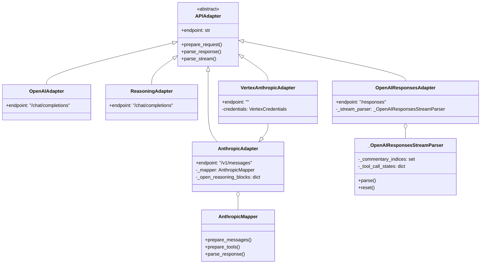
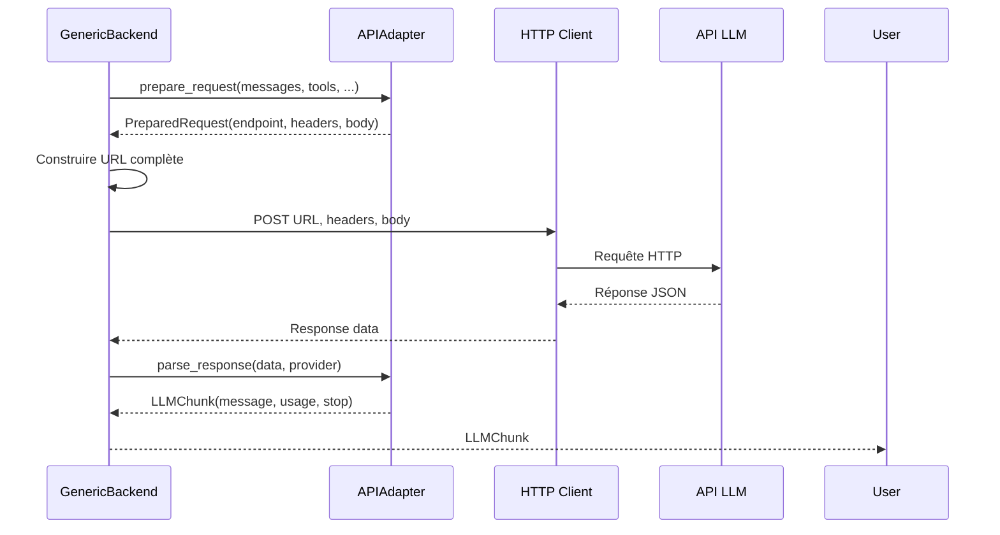

# Adapters : Traducteurs entre Vibe et les APIs LLM

> **Module** : `vibe/core/llm/backend/` 
> **Fork** : `rrobbes/mistral-vibe` 
> **Partie** : 7/13 - Pattern Adapter pour la Compatibilité Multi-Provider

---

## Introduction

Les **adapters** implémentent le **Adapter Pattern** pour traduire entre les types internes de Vibe et les formats spécifiques de chaque fournisseur LLM. Ils sont **le composant central de la compatibilité multi-provider**.

### Le Problème

Chaque fournisseur LLM a son propre format d'API :
- OpenAI : `{role, content, tool_calls}`
- Anthropic : `{role, content: [blocks], tool_use}`
- Mistral SDK : Types Python typés
- OpenAI Responses : `input: [items], output: [items]`

### La Solution

Une **interface unifiée** (`APIAdapter`) avec des implémentations spécialisées pour chaque fournisseur.

---

## Architecture des Adapters

### La Classe de Base : APIAdapter

Définie dans `base.py` :

```python
from abc import ABC, abstractmethod
from collections.abc import AsyncGenerator, Sequence
from typing import ClassVar

class APIAdapter(ABC):
 endpoint: str # Endpoint API par défaut
 
 @abstractmethod
 def prepare_request(self, *, model_name: str, messages: Sequence[LLMMessage], 
 temperature: float, tools: list[AvailableTool] | None,
 max_tokens: int | None, tool_choice: StrToolChoice | AvailableTool | None,
 enable_streaming: bool, provider: ProviderConfig,
 api_key: str | None = None, thinking: str = "off") -> PreparedRequest:
 """Préparer une requête HTTP."""
 
 @abstractmethod
 def parse_response(self, data: dict[str, Any], provider: ProviderConfig) -> LLMChunk:
 """Parser une réponse HTTP."""
 
 async def parse_stream(self, responses: AsyncGenerator[dict[str, Any]], 
 provider: ProviderConfig) -> AsyncGenerator[ParsedStreamChunk]:
 """Parser un stream (implémentation par défaut)."""
```

### Registre des Adapters

Dans `generic.py` :

```python
_ADAPTERS: dict[str, Callable[[], APIAdapter]] = {
 "openai": OpenAIAdapter,
 "reasoning": ReasoningAdapter,
 "anthropic": AnthropicAdapter,
 "openai-responses": OpenAIResponsesAdapter,
 "vertex-anthropic": _vertex_anthropic_adapter,
}

def _get_adapter(api_style: str) -> APIAdapter:
 return _ADAPTERS[api_style]()
```

---

## Tableau Comparatif

| Adapter | Fournisseurs | Endpoint | Format Message | Reasoning | Tool Calls | Streaming |
|---------|--------------|----------|----------------|-----------|------------|-----------|
| OpenAIAdapter | OpenAI, Azure, Mistral (API compat) | `/chat/completions` | `{role, content}` | champ personnalisable | OpenAI format | SSE |
| AnthropicAdapter | Anthropic Claude | `/v1/messages` | `{role, content: [blocks]}` | `thinking` blocks | `tool_use` | Custom |
| ReasoningAdapter | Modèles avec reasoning avancé | `/chat/completions` | `{role, content: [blocks]}` | `thinking` blocks | OpenAI format | SSE |
| OpenAIResponsesAdapter | OpenAI Responses API | `/responses` | `input: [items]` | `reasoning` encrypté | `function_call` | Custom |
| VertexAnthropicAdapter | Vertex AI (Anthropic) | Dynamique | Anthropic format | `thinking` blocks | `tool_use` | Custom |

---

## 1️⃣ OpenAIAdapter

**Fichier** : Defini dans `generic.py`

### Rôle
Adapter **polyvalent** pour tous les fournisseurs compatibles OpenAI.

### Endpoint
```python
endpoint: str = "/chat/completions"
```

### Fonctionnalités
- Gestion des images (conversion en data URI)
- Reasoning via champ personnalisable
- Tool calls OpenAI
- Streaming SSE standard

### Exemple
```python
from vibe.core.llm.backend.generic import OpenAIAdapter

adapter = OpenAIAdapter()
req = adapter.prepare_request(
 model_name="gpt-3.5-turbo",
 messages=messages,
 temperature=0.2,
 provider=provider,
)
```

---

## 2️⃣ AnthropicAdapter

**Fichier** : `anthropic.py` (526 lignes)

### Rôle
Adapter pour **Anthropic Claude** avec toutes ses spécificités.

### Endpoint
```python
endpoint: str = "/v1/messages"
API_VERSION = "2023-06-01"
BETA_FEATURES = "interleaved-thinking-2025-05-14,..."
```

### Composants

#### AnthropicMapper
Gère la conversion des messages :

```python
class AnthropicMapper:
 def prepare_messages(self, messages: Sequence[LLMMessage]) -> tuple[str | None, list[dict]]:
 # Sépare system_prompt et messages utilisateur/assistant
 # Convertit les images en base64
 # Gère les tool_calls et tool_results
 ...
```

#### Gestion du Streaming
Anthropic utilise des **événements typés** :

```python
STREAMING_EVENT_TYPES = {
 "message_start", "message_delta", "message_stop",
 "content_block_start", "content_block_delta", "content_block_stop",
 "ping", "error",
}
```

Le parser maintient un état (`_open_reasoning_blocks`) pour réassembler les blocks de reasoning.

### Particularités
- **Images** : Encodées en base64 (pas en data URI)
- **Reasoning** : Utilise `ThinkChunk` avec type `thinking` ou `redacted_thinking`
- **Tool calls** : Format `tool_use` avec `name` et `input` (JSON)
- **Headers** : `x-api-key` au lieu de `Authorization`
- **Cached tokens** : Gestion spécifique avec `cache_creation_input_tokens` et `cache_read_input_tokens`

---

## 3️⃣ ReasoningAdapter

**Fichier** : `reasoning_adapter.py` (207 lignes)

### Rôle
Adapter spécialisé pour les modèles supportant le **reasoning avancé**.

### Endpoint
```python
endpoint: str = "/chat/completions"
```

### Fonctionnalités
- Format de message avec **content blocks** :
 ```json
 {
 "role": "assistant",
 "content": [
 {"type": "thinking", "thinking": [{"type": "text", "text": "..."}]},
 {"type": "text", "text": "..."}
 ]
 }
 ```
- Parsing des blocks de reasoning et de texte
- Support des tool calls OpenAI

---

## 4️⃣ OpenAIResponsesAdapter

**Fichier** : `openai_responses.py` (~800 lignes)

### Rôle
Adapter pour le **nouveau format OpenAI Responses API**.

### Endpoint
```python
endpoint: str = "/responses"
```

### Architecture

Utilise `_OpenAIResponsesStreamParser` pour gérer :
- **Événements de stream** : `response.created`, `response.output_text.delta`, etc.
- **State management** : Suivi des tool calls en cours
- **Commentary messages** : Identification des messages de reasoning

### Particularités
- **Format `input`** : Liste d'items au lieu de `messages`
 ```json
 {
 "model": "gpt-4",
 "input": [
 {"role": "system", "content": "..."},
 {"role": "user", "content": "..."},
 {"type": "function_call", "name": "...", "arguments": "..."}
 ],
 "reasoning": {"effort": "high"}
 }
 ```
- **Reasoning encrypté** : Support via `include: ["reasoning.encrypted_content"]`
- **Max output tokens** : Utilise `max_output_tokens` au lieu de `max_tokens`

---

## 5️⃣ VertexAnthropicAdapter

**Fichier** : `vertex.py` (135 lignes)

### Rôle
Spécialisation de `AnthropicAdapter` pour **Vertex AI**.

### Endpoint
```python
endpoint: str = "" # Construit dynamiquement
```

### Fonctionnalités
- **Authentication** : Google ADC (Application Default Credentials)
- **URL construction** : Format Vertex AI :
 ```
 /v1/projects/{project_id}/locations/{region}/publishers/anthropic/models/{model}:rawPredict
 ```
- **Credentials caching** : Token partagé entre toutes les requêtes

### Exemple de Configuration
```python
provider_config = ProviderConfig(
 name="vertex",
 api_base="https://us-central1-aiplatform.googleapis.com",
 api_style="vertex-anthropic",
 project_id="my-gcp-project",
 region="us-central1",
)
```

---

## Comment les Adapters sont Utilisés

### Dans GenericBackend

```python
# Dans complete() et complete_streaming()
api_style = getattr(self._provider, "api_style", "openai")
api_key, api_key_origin = self._resolve_credential(api_style)
adapter = _get_adapter(api_style)

# Préparation de la requête
req = adapter.prepare_request(
 model_name=model.name,
 messages=messages,
 temperature=temperature,
 tools=tools,
 max_tokens=max_tokens,
 tool_choice=tool_choice,
 enable_streaming=enable_streaming,
 provider=self._provider,
 api_key=api_key,
 thinking=model.thinking,
)

# Exécution de la requête HTTP
# ...

# Parsing de la réponse
chunk = adapter.parse_response(response.data, self._provider)
```

### Dans MistralBackend

Le `MistralBackend` n'utilise **pas** d'adapters. Il utilise directement le SDK Mistral avec son propre `MistralMapper` pour la conversion des types.

---

## Diagrammes

### Diagramme de Classes



### Diagramme de Séquence : Requête avec Adapter



---

## Configuration des Adapters

### Comment choisir l'adapter ?

L'adapter est sélectionné via `provider.api_style` :

```python
from vibe.core.config import ProviderConfig

# OpenAI
provider = ProviderConfig(
 name="openai",
 api_base="https://api.openai.com/v1",
 api_style="openai", # Utilise OpenAIAdapter
)

# Anthropic
provider = ProviderConfig(
 name="anthropic",
 api_base="https://api.anthropic.com/v1",
 api_style="anthropic", # Utilise AnthropicAdapter
)

# OpenAI Responses
provider = ProviderConfig(
 name="openai",
 api_base="https://api.openai.com/v1",
 api_style="openai-responses", # Utilise OpenAIResponsesAdapter
)

# Vertex AI
provider = ProviderConfig(
 name="vertex",
 api_base="https://us-central1-aiplatform.googleapis.com",
 api_style="vertex-anthropic", # Utilise VertexAnthropicAdapter
 project_id="my-project",
 region="us-central1",
)

# Par défaut : "openai"
provider = ProviderConfig(
 name="mistral",
 api_base="https://api.mistral.ai/v1",
 # api_style non spécifié → utilise "openai" par défaut
)
```

---

## Bonnes Pratiques

### 1. Toujours utiliser le registre

```python
# BON
from vibe.core.llm.backend.generic import _get_adapter
adapter = _get_adapter("openai")

# MAUVAIS
from vibe.core.llm.backend.generic import OpenAIAdapter
adapter = OpenAIAdapter() # Contourne le registre
```

### 2. Un adapter par requête

```python
# BON - Chaque requête a son adapter
async def process_request(provider: ProviderConfig):
 adapter = _get_adapter(provider.api_style)
 req = adapter.prepare_request(...)
 # ...

# MAUVAIS - Partage d'adapter entre requêtes
adapter = _get_adapter("anthropic")
for _ in range(10):
 # Problème : état partagé entre requêtes !
 req = adapter.prepare_request(...)
```

### 3. Gérer les erreurs de parsing

```python
try:
 chunk = adapter.parse_response(data, provider)
except (ValueError, KeyError, json.JSONDecodeError) as e:
 logger.error(f"Failed to parse response: {e}")
 # Gérer l'erreur
```

### 4. Tester les adapters

```python
# Test unitaire d'un adapter
def test_anthropic_adapter():
 adapter = AnthropicAdapter()
 
 # Tester prepare_request
 messages = [LLMMessage(role=Role.user, content="Hello")]
 provider = ProviderConfig(name="anthropic", api_base="https://api.anthropic.com")
 
 req = adapter.prepare_request(
 model_name="claude-3-sonnet",
 messages=messages,
 temperature=0.2,
 tools=None,
 max_tokens=None,
 tool_choice=None,
 enable_streaming=False,
 provider=provider,
 api_key="test_key",
 )
 
 assert req.endpoint == "/v1/messages"
 assert "anthropic-version" in req.headers
 assert "x-api-key" in req.headers
```

---

## Limitations

### 1. État dans les Adapters

Certains adapters maintiennent un **état interne** :
- `AnthropicAdapter` : `_open_reasoning_blocks` pour le streaming
- `OpenAIResponsesAdapter` : `_stream_parser._tool_call_states`

**Conséquence** : Un adapter ne doit **jamais** être partagé entre plusieurs requêtes.

### 2. Complexité des Adapters

Les adapters deviennent **de plus en plus complexes** :
- OpenAIAdapter : ~150 lignes
- AnthropicAdapter : ~500 lignes
- OpenAIResponsesAdapter : ~800 lignes

**Solution** : Décomposer en classes plus petites (Mapper, Parser, etc.)

### 3. Maintenance

Chaque nouvelle version d'API peut nécessiter une **mise à jour des adapters** :
- Nouveau format de message
- Nouveau type d'événement de streaming
- Changement dans le format des tool calls

**Solution** : Tests automatisés + CI/CD

---

## Performances

| Adapter | Temps de création | Mémoire | Complexité |
|---------|-------------------|---------|------------|
| OpenAIAdapter | ~0.001ms | ~10Ko | Faible |
| ReasoningAdapter | ~0.001ms | ~10Ko | Faible |
| AnthropicAdapter | ~0.002ms | ~50Ko | Moyenne |
| OpenAIResponsesAdapter | ~0.005ms | ~100Ko | Élevée |
| VertexAnthropicAdapter | ~0.002ms | ~50Ko | Moyenne |

**Note** : Les temps sont négligeables par rapport au temps de requête LLM.

---

## Résumé

| Aspect | Description |
|--------|-------------|
| **Rôle** | Traduction entre types Vibe et APIs LLM |
| **Pattern** | Adapter Pattern |
| **Interface** | `APIAdapter` (classe abstraite) |
| **Adapters disponibles** | 5 (OpenAI, Anthropic, Reasoning, OpenAI Responses, Vertex Anthropic) |
| **Utilisation** | Via `generic.py`:`_get_adapter()` |
| **Étendable** | Oui - ajouter une entrée dans `_ADAPTERS` |

---

## Références

- [Adapter Pattern - Design Patterns (GoF)](https://en.wikipedia.org/wiki/Adapter_pattern)
- [OpenAI API Reference](https://platform.openai.com/docs/api-reference)
- [Anthropic API Documentation](https://docs.anthropic.com/en/api)
- [Mistral API Documentation](https://docs.mistral.ai/api/)
- [OpenAI Responses API](https://platform.openai.com/docs/guides/responses)
- [Vertex AI Documentation](https://cloud.google.com/vertex-ai)

---

## Voir Aussi

- **[04-FACTORY.md](/docs/factory)** - Création des backends
- **[05-GENERIC_BACKEND.md](/docs/generic-backend)** - Backend qui utilise les adapters
- **[06-MISTRAL_BACKEND.md](/docs/mistral-backend)** - Backend qui n'utilise PAS d'adapters
- **[08-IMAGES.md](/docs/images)** - Gestion des images (utilisée par les adapters)

---

*Documentation spécifique au fork éducatif `rrobbes/mistral-vibe` - Dernière mise à jour: 30 octobre 2026*
