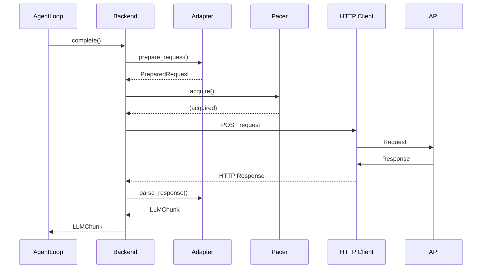

# Pour Aller Plus Loin : Étendre et Contribuer

> **Module** : `vibe/core/llm/backend/` 
> **Fork** : `rrobbes/mistral-vibe` 
> **Partie** : 13/13 - Guide Avancé pour Développeurs

---

## Introduction

Ce document s'adresse aux **développeurs avancés** qui souhaitent :
- **Comprendre** les mécanismes internes du module backend
- **Étendre** le module avec de nouveaux providers
- **Contribuer** au projet Mistral Vibe
- **Optimiser** les performances
- **Debugger** des problèmes complexes

> ** Niveau requis** : Ce document suppose que vous avez déjà lu et compris les documents précédents.

---

## ️ Table des Matières

1. [Comprendre l'Architecture Interne](#1-comprendre-larchitecture-interne)
2. [Ajouter un Nouveau Provider](#2-ajouter-un-nouveau-provider)
3. [Créer un Nouveau Backend](#3-créer-un-nouveau-backend)
4. [Personnalisation Avancée](#4-personnalisation-avancée)
5. [Tests et Validation](#5-tests-et-validation)
6. [Debugging Avancé](#6-debugging-avancé)
7. [Contribuer au Projet](#7-contribuer-au-projet)
8. [Ressources Additionnelles](#8-ressources-additionnelles)

---

## 1. Comprendre l'Architecture Interne

### Flux de Données Complet

### Diagramme de Séquence Simplifié



---

## 2. Ajouter un Nouveau Provider

### Étapes à Suivre

1. **Créer un adapter** (héritant de `APIAdapter`)
2. **Implémenter** `prepare_request()` et `parse_response()`
3. **Enregistrer** l'adapter dans `_ADAPTERS` (generic.py)
4. **Configurer** le provider avec `api_style` pointant vers votre adapter

### Exemple : Ajout de Cohere

#### 1. Créer l'adapter

```python
# vibe/core/llm/backend/cohere.py
from vibe.core.llm.backend.base import APIAdapter, PreparedRequest, ParsedStreamChunk
from vibe.core.types import LLMChunk, LLMMessage, Role, LLMUsage, StopInfo
from typing import TYPE_CHECKING, Any, ClassVar
from collections.abc import AsyncGenerator, Sequence

if TYPE_CHECKING:
 from vibe.core.config import ProviderConfig

class CohereAdapter(APIAdapter):
 endpoint: ClassVar[str] = "/v1/chat"
 
 def prepare_request(self, **kwargs) -> PreparedRequest:
 # Convertir les messages au format Cohere
 converted_messages = [
 {
 "role": self._map_role(msg.role),
 "message": msg.content or "",
 }
 for msg in kwargs["messages"]
 ]
 
 payload = {
 "model": kwargs["model_name"],
 "chat_history": converted_messages,
 "max_tokens": kwargs["max_tokens"],
 }
 
 return finalize_chat_request(
 payload=payload,
 enable_streaming=kwargs["enable_streaming"],
 stream_options={},
 api_key=kwargs["api_key"],
 endpoint=self.endpoint,
 )
 
 def _map_role(self, role: Role) -> str:
 return {
 Role.system: "SYSTEM",
 Role.user: "USER",
 Role.assistant: "CHATBOT",
 Role.tool: "CHATBOT",
 }.get(role, "USER")
 
 def parse_response(self, data: dict[str, Any], provider) -> LLMChunk:
 response = data.get("response", {})
 message = LLMMessage(
 role=Role.assistant,
 content=response.get("text", ""),
 )
 usage = LLMUsage(
 prompt_tokens=data.get("meta", {}).get("input_tokens", 0),
 completion_tokens=data.get("meta", {}).get("output_tokens", 0),
 )
 stop = StopInfo(reason=str(response.get("finish_reason"))) if response.get("finish_reason") else None
 
 return LLMChunk(message=message, usage=usage, stop=stop)
 
 async def parse_stream(self, responses, provider) -> AsyncGenerator[ParsedStreamChunk]:
 async for data in responses:
 yield ParsedStreamChunk(data, self.parse_response(data, provider))
```

#### 2. Enregistrer dans GenericBackend

```python
# vibe/core/llm/backend/generic.py
from vibe.core.llm.backend.cohere import CohereAdapter

_ADAPTERS = {
 "openai": OpenAIAdapter,
 "anthropic": AnthropicAdapter,
 "cohere": CohereAdapter, # Ajout de Cohere
 # ... autres adapters
}
```

#### 3. Configurer le Provider

```python
from vibe.core.config import ProviderConfig
from vibe.core.types import Backend

cohere_provider = ProviderConfig(
 name="cohere",
 backend=Backend.GENERIC,
 api_base="https://api.cohere.ai",
 api_key_env_var="COHERE_API_KEY",
 api_style="cohere", # Doit correspondre à la clé dans _ADAPTERS
 reasoning_field_name="reasoning_content",
)
```

---

## 3. Créer un Nouveau Backend

### Quand Créer un Nouveau Backend ?

| Scénario | Utiliser GenericBackend ? | Créer un Nouveau Backend ? |
|----------|--------------------------|---------------------------|
| Adapter simple pour API REST | Oui | Non |
| SDK officiel disponible (Mistral, Google) | Non | Oui |
| Besoin de WebSockets | Non | Oui |
| Gestion très spécifique | Non | Oui |

### Structure de Base

```python
# vibe/core/llm/backend/my_backend.py
from vibe.core.types import BackendLike, LLMChunk, ModelConfig
from vibe.core.llm.exceptions import BackendErrorBuilder
from vibe.utils.api_keys import resolve_api_key_with_origin

class MyCustomBackend:
 def __init__(self, *, provider, timeout=720.0, **kwargs):
 self._provider = provider
 self._timeout = timeout
 resolved = resolve_api_key_with_origin(provider.api_key_env_var)
 self._api_key = resolved[0] if resolved else None
 self._client = None
 
 async def __aenter__(self):
 # Initialiser le client
 return self
 
 async def __aexit__(self, *args):
 # Fermer le client
 pass
 
 async def complete(self, *, model, messages, temperature, **kwargs) -> LLMChunk:
 # Implémenter la requête non-streaming
 raise NotImplementedError
 
 def complete_streaming(self, *, model, messages, temperature, **kwargs):
 # Implémenter la requête streaming
 raise NotImplementedError
 yield
```

### Enregistrer dans la Factory

```python
# vibe/core/llm/backend/factory.py
from vibe.core.llm.backend.my_backend import MyCustomBackend

def _create_my_backend(**kwargs):
 return MyCustomBackend(**kwargs)

BACKEND_FACTORY = {
 Backend.MISTRAL: _create_mistral_backend,
 Backend.GENERIC: _create_generic_backend,
 Backend.MY_BACKEND: _create_my_backend, # Ajout
}
```

---

## 4. Personnalisation Avancée

### Personnaliser le Pacing

```python
from vibe.core.utils import AdaptivePacer

class CustomPacer(AdaptivePacer):
 def __init__(self, max_interval=10.0):
 super().__init__()
 self._max_interval = max_interval
 self._interval = 0.0
 
 def on_rate_limited(self):
 self._interval = min(self._interval + 1.5, self._max_interval)
 
 def on_success(self):
 self._interval = max(0, self._interval - 0.5)

# Utilisation
backend = GenericBackend(provider=provider, pacer=CustomPacer())
```

### Personnaliser le Tracing

```python
from vibe.core.tracing import model_call_span
from opentelemetry import trace

async def custom_span(**kwargs):
 tracer = trace.get_tracer(__name__)
 span = tracer.start_span("model.call", attributes={**kwargs, "custom": "value"})
 try:
 yield span
 finally:
 span.end()
```

---

## 5. Tests et Validation

### Structure d'un Test pour un Adapter

```python
# tests/core/llm/backend/test_adapters/test_cohere.py
import pytest
from vibe.core.llm.backend.cohere import CohereAdapter
from vibe.core.config import ProviderConfig
from vibe.core.types import LLMMessage, Role

@pytest.fixture
def adapter():
 return CohereAdapter()

@pytest.fixture
def provider():
 return ProviderConfig(
 name="cohere",
 api_style="cohere",
 reasoning_field_name="reasoning_content",
 )

def test_prepare_request(adapter, provider):
 request = adapter.prepare_request(
 model_name="command-r-plus",
 messages=[LLMMessage(role=Role.user, content="Hello")],
 temperature=0.7,
 enable_streaming=False,
 provider=provider,
 api_key="test_key",
 )
 assert request.endpoint == "/v1/chat"
 assert b"command-r-plus" in request.body

def test_parse_response(adapter, provider):
 data = {
 "response": {"text": "Hi!", "finish_reason": "COMPLETE"},
 "meta": {"input_tokens": 10, "output_tokens": 5},
 }
 chunk = adapter.parse_response(data, provider)
 assert chunk.message.content == "Hi!"
 assert chunk.usage.prompt_tokens == 10
```

---

## 6. Debugging Avancé

### Outils de Debugging

1. **Logging** :
 ```python
 import logging
 logging.basicConfig(level=logging.DEBUG)
 ```

2. **Retry Observer** :
 ```python
 class DebugObserver:
 async def __call__(self, reason):
 print(f"Retry: {reason.category.name} - {reason.detail}")
 
 backend = create_backend(provider=provider, on_retry=DebugObserver())
 ```

3. **Tracing** :
 ```python
 backend = create_backend(provider=provider, enable_otel=True)
 ```

### Debugging des Problèmes de Streaming

```python
async for chunk in backend.complete_streaming(...):
 print(f"Chunk: {chunk}") # Debug chaque chunk
 if chunk.message.content:
 print(f"Content: {chunk.message.content}")
```

---

## 7. Contribuer au Projet

### Bonnes Pratiques

1. **Suivez les conventions** du projet
2. **Documentez** votre code
3. **Ajoutez des tests** pour les nouvelles fonctionnalités
4. **Mettez à jour** la documentation
5. **Testez** avec différents providers
6. **Validez** les performances

### Soumettre une Pull Request

1. Fork le dépôt `rrobbes/mistral-vibe`
2. Créez une branche pour votre feature
3. Commitez vos changements
4. Poussez vers votre fork
5. Ouvrez une PR vers `rrobbes/mistral-vibe:main`

---

## 8. Ressources Additionnelles

- [Documentation Mistral SDK](https://github.com/mistralai/mistral-src)
- [Documentation httpx](https://www.python-httpx.org/)
- [OpenAI API Reference](https://platform.openai.com/docs/api-reference)
- [Anthropic API Documentation](https://docs.anthropic.com/en/api)
- [OpenTelemetry Python](https://opentelemetry-python.readthedocs.io/)

---

## Conclusion

Vous avez maintenant toutes les **clés en main** pour :
- Comprendre l'architecture interne du module backend
- Ajouter de nouveaux providers
- Créer des backends personnalisés
- Personnaliser le comportement existant
- Tester et valider vos modifications
- Contribuer au projet

N'hésitez pas à **explorer le code source**, **poser des questions** et **contribuer** !

---

## Navigation

| Précédent | Retour au README |
|-----------|-------------------|
| [12. Configuration et Utilisation](/docs/usage) | [↩ Retour au README](/docs/intro) |
