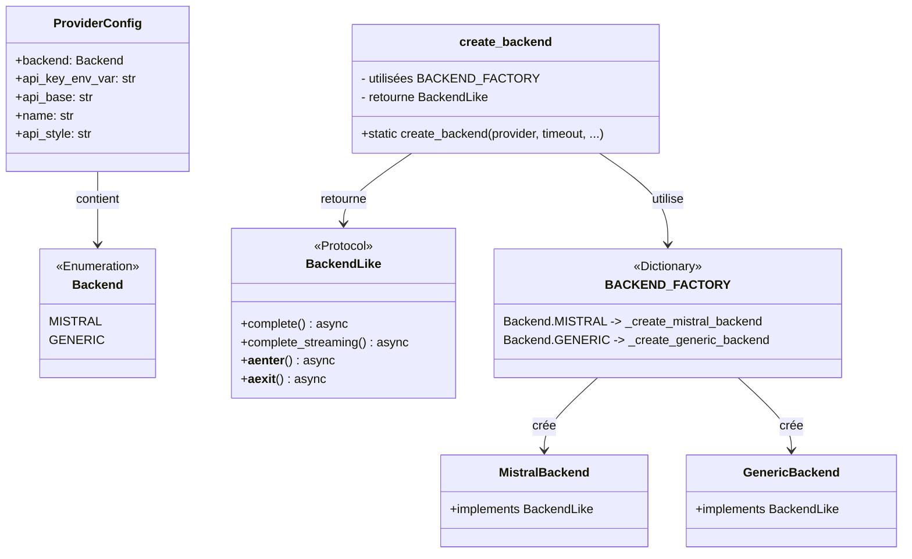
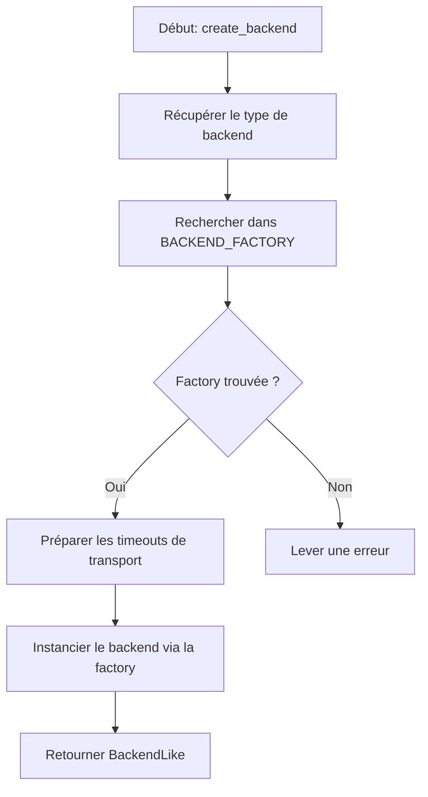

# Factory : Création Intelligente des Backends

> **Module** : `vibe/core/llm/backend/` 
> **Fork** : `rrobbes/mistral-vibe` 
> **Partie** : 4/13 - Pattern Factory et Initialisation

---

## Introduction

Le fichier `factory.py` est **le point d'entrée central** pour la création des backends LLM dans Mistral Vibe. Il implémente le **Factory Pattern** pour offrir une interface unifiée de création d'instances de backends, tout en masquant la complexité de l'initialisation spécifique à chaque fournisseur.

### Localisation

---

## Architecture du Factory Pattern

### Concepts Clés

Le **Factory Pattern** (ou *Fabrique*) est un pattern de conception **créationnel** qui permet de :

1. **Découpler** la création d'objets de leur utilisation
2. **Centraliser** la logique de création
3. **Simplifier** l'ajout de nouveaux types (Open/Closed Principle)
4. **Masquer** la complexité d'initialisation
5. **Retarder** le chargement des dépendances (Lazy Loading)

### Diagramme de Classes



---

## Analyse du Code

### Structure du Fichier

```python
# factory.py - Structure complète
from vibe.core.config import ProviderConfig
from vibe.core.config._defaults import (
 DEFAULT_API_CONNECT_TIMEOUT,
 DEFAULT_API_POOL_TIMEOUT,
 DEFAULT_API_RETRY_MAX_ELAPSED_TIME,
 DEFAULT_API_TIMEOUT,
 DEFAULT_API_WRITE_TIMEOUT,
)
from vibe.core.types import Backend

# Fonctions de création par backend
def _create_mistral_backend(**kwargs: Any) -> BackendLike:
 from vibe.core.llm.backend.mistral import MistralBackend
 return MistralBackend(**kwargs)

def _create_generic_backend(**kwargs: Any) -> BackendLike:
 from vibe.core.llm.backend.generic import GenericBackend
 return GenericBackend(**kwargs)

# Registre des factories
BACKEND_FACTORY: dict[Backend, Callable[..., BackendLike]] = {
 Backend.MISTRAL: _create_mistral_backend,
 Backend.GENERIC: _create_generic_backend,
}

# Fonction principale
def create_backend(...) -> BackendLike:
 # Logique de création centralisée
 ...
```

### Principes de Conception

#### 1. **Lazy Loading des Modules**

Une des **meilleures pratiques** implémentées dans ce fichier est le **Lazy Loading** :

```python
# À ÉVITER - Import au niveau du module
timeout from mistralai.client import Mistral # Import lourd
from vibe.core.llm.backend.generic import GenericBackend

def _create_mistral_backend(**kwargs: Any) -> BackendLike:
 return MistralBackend(**kwargs)
```

```python
# SOLUTION - Import dans la fonction
def _create_mistral_backend(**kwargs: Any) -> BackendLike:
 from vibe.core.llm.backend.mistral import MistralBackend # Import à la demande
 return MistralBackend(**kwargs)
```

**Pourquoi ?**
- Le SDK Mistral (`mistralai.client`) est **très lourd** à importer
- Au démarrage de la CLI, on ne sait pas encore quel backend sera utilisé
- Le Lazy Loading **accélère le démarrage** de l'application
- Seuls les modules nécessaires sont chargés

#### 2. **Registre des Factories**

```python
BACKEND_FACTORY: dict[Backend, Callable[..., BackendLike]] = {
 Backend.MISTRAL: _create_mistral_backend,
 Backend.GENERIC: _create_generic_backend,
}
```

Ce dictionnaire permet de :
- **Centraliser** la liste des backends disponibles
- **Éviter** les conditions `if/elif` interminables
- **Faciliter** l'ajout de nouveaux backends (ajout simple dans le dict)
- **Trouver** rapidement la factory pour un backend donné

#### 3. **Type Safety avec TypedDict**

Le code utilise le système de types de Python pour garantir la sécurité :

```python
from vibe.core.types import Backend # Enum

def create_backend(
 *,
 provider: ProviderConfig, # Configuration du provider
 timeout: float = DEFAULT_API_TIMEOUT,
 retry_max_elapsed_time: float = DEFAULT_API_RETRY_MAX_ELAPSED_TIME,
 connect_timeout: float = DEFAULT_API_CONNECT_TIMEOUT,
 write_timeout: float = DEFAULT_API_WRITE_TIMEOUT,
 pool_timeout: float = DEFAULT_API_POOL_TIMEOUT,
 enable_otel: bool = False, # OpenTelemetry
 on_retry: RetryObserver | None = None,
) -> BackendLike: # Retourne une instance de backend
```

---

## La Fonction `create_backend()`

### Signature

```python
def create_backend(
 *,
 provider: ProviderConfig, # Configuration du fournisseur
 timeout: float = DEFAULT_API_TIMEOUT, # Timeout principal (720s)
 retry_max_elapsed_time: float = DEFAULT_API_RETRY_MAX_ELAPSED_TIME, # Budget de retry (300s)
 connect_timeout: float = DEFAULT_API_CONNECT_TIMEOUT, # Timeout de connexion (30s)
 write_timeout: float = DEFAULT_API_WRITE_TIMEOUT, # Timeout d'écriture (60s)
 pool_timeout: float = DEFAULT_API_POOL_TIMEOUT, # Timeout de pool (5s)
 enable_otel: bool = False, # Activation OpenTelemetry
 on_retry: RetryObserver | None = None, # Callback pour les retries
) -> BackendLike
```

### Algorithme de Création



### Implémentation Détaillée

```python
def create_backend(
 *,
 provider: ProviderConfig,
 timeout: float = DEFAULT_API_TIMEOUT,
 retry_max_elapsed_time: float = DEFAULT_API_RETRY_MAX_ELAPSED_TIME,
 connect_timeout: float = DEFAULT_API_CONNECT_TIMEOUT,
 write_timeout: float = DEFAULT_API_WRITE_TIMEOUT,
 pool_timeout: float = DEFAULT_API_POOL_TIMEOUT,
 enable_otel: bool = False,
 on_retry: RetryObserver | None = None,
) -> BackendLike:
 # 1. Déterminer le type de backend
 backend = Backend(provider.backend)
 
 # 2. Récupérer la factory correspondante
 factory = BACKEND_FACTORY[backend]
 
 # 3. Préparer les timeouts spécifiques au transport
 # (Seulement pour Mistral qui utilise httpx directement)
 transport_timeouts: dict[str, float] = (
 {
 "connect_timeout": connect_timeout,
 "write_timeout": write_timeout,
 "pool_timeout": pool_timeout,
 }
 if backend is Backend.MISTRAL
 else {}
 )
 
 # 4. Appeler la factory avec les paramètres
 return factory(
 provider=provider,
 timeout=timeout,
 retry_max_elapsed_time=retry_max_elapsed_time,
 enable_otel=enable_otel,
 on_retry=on_retry,
 **transport_timeouts, # Déballage des timeouts spécifiques
 )
```

### Paramètres Expliqués

| Paramètre | Type | Défaut | Description |
|-----------|------|--------|-------------|
| `provider` | `ProviderConfig` | **Obligatoire** | Configuration du fournisseur (nom, clé API, base URL, etc.) |
| `timeout` | `float` | 720.0s | Timeout global pour les requêtes HTTP |
| `retry_max_elapsed_time` | `float` | 300.0s | Budget temporel maximum pour les retries |
| `connect_timeout = 10.0 ss | Timeout pour établir la connexion |
| `write_timeout = 30.0 ss | Timeout pour l'écriture des données |
| `pool_timeout` | `float` | 5.0s | Timeout pour obtenir une connexion du pool |
| `enable_otel` | `bool` | `False` | Activation des traces OpenTelemetry |
| `on_retry` | `RetryObserver \| None` | `None` | Callback appelé avant chaque retry |

---

## Timeouts de Transport

### Pourquoi des Timeouts Spécifiques ?

Les backends ont des besoins différents en matière de timeouts :

- **GenericBackend** : Utilise son propre `VibeAsyncHTTPClient` avec un timeout global
- **MistralBackend** : Utilise le SDK Mistral qui accepte des timeouts plus granulaires

### Configuration pour Mistral

```python
transport_timeouts = {
 "connect_timeout": connect_timeout, # 30s par défaut
 "write_timeout": write_timeout, # 60s par défaut 
 "pool_timeout": pool_timeout, # 5s par défaut
}
```

Ces timeouts sont **seulement appliqués** pour `Backend.MISTRAL` :

```python
if backend is Backend.MISTRAL:
 return factory(
 provider=provider,
 timeout=timeout,
 retry_max_elapsed_time=retry_max_elapsed_time,
 enable_otel=enable_otel,
 on_retry=on_retry,
 **transport_timeouts, # Passés au MistralBackend
 )
else:
 return factory(
 # transport_timeouts est vide pour GenericBackend
 )
```

---

## Interaction avec les Autres Modules

### Avec `vibe/core/config/`

Le factory dépend fortement du module de configuration :

```python
from vibe.core.config import ProviderConfig
from vibe.core.config._defaults import (
 DEFAULT_API_TIMEOUT, # 720.0
 DEFAULT_API_RETRY_MAX_ELAPSED_TIME, # 300.0
 DEFAULT_API_connect_timeout = 10.0 s
 DEFAULT_API_write_timeout = 30.0 s
 DEFAULT_API_POOL_TIMEOUT, # 5.0
)
```

### Avec `vibe/core/types/`

```python
from vibe.core.types import Backend # Enum des backends disponibles
```

L'énumération `Backend` définit les types de backends supportés :

```python
# Dans vibe/core/types.py
class Backend(str, Enum):
 MISTRAL = "mistral"
 GENERIC = "generic"
```

### Avec les Modules Backend

```python
def _create_mistral_backend(**kwargs: Any) -> BackendLike:
 from vibe.core.llm.backend.mistral import MistralBackend
 return MistralBackend(**kwargs)

def _create_generic_backend(**kwargs: Any) -> BackendLike:
 from vibe.core.llm.backend.generic import GenericBackend
 return GenericBackend(**kwargs)
```

---

## Exemple d'Utilisation

### Cas 1 : Création d'un Backend Mistral

```python
from vibe.core.config import ProviderConfig
from vibe.core.types import Backend
from vibe.core.llm.backend.factory import create_backend

# Configuration du provider
provider_config = ProviderConfig(
 backend=Backend.MISTRAL,
 name="mistral",
 api_base="https://api.mistral.ai/v1",
 api_key_env_var="MISTRAL_API_KEY",
)

# Création du backend
backend = create_backend(
 provider=provider_config,
 timeout=600.0, # 10 minutes
 retry_max_elapsed_time=600.0,
 enable_otel=True,
)

# Utilisation
async with backend:
 chunk = await backend.complete(
 model=model_config,
 messages=messages,
 temperature=0.2
 )
 print(chunk.message.content)
```

### Cas 2 : Création d'un Backend Generic pour OpenAI

```python
from vibe.core.config import ProviderConfig
from vibe.core.types import Backend
from vibe.core.llm.backend.factory import create_backend

# Configuration pour OpenAI (via GenericBackend)
provider_config = ProviderConfig(
 backend=Backend.GENERIC,
 name="openai",
 api_base="https://api.openai.com/v1",
 api_key_env_var="OPENAI_API_KEY",
 api_style="openai", # Utilisera OpenAIAdapter
)

# Création du backend
backend = create_backend(
 provider=provider_config,
 timeout=300.0,
 connect_timeout=10.0, # Timeouts de transport (ignorés pour GenericBackend)
)

# Utilisation
async with backend:
 chunk = await backend.complete(
 model=model_config,
 messages=messages,
 temperature=0.7
 )
 print(chunk.message.content)
```

### Cas 3 : Avec Callback de Retry

```python
from vibe.core.utils import RetryReason

async def my_retry_callback(reason: RetryReason) -> None:
 print(f"Retry attempte pour: {reason.category.name}")
 print(f"Delai: {reason.delay:.2f}s")
 print(f"Attempt: {reason.attempt}")

backend = create_backend(
 provider=provider_config,
 on_retry=my_retry_callback,
)

async with backend:
 # Les retries seront loggés via le callback
 chunk = await backend.complete(...)
```

---

## Bonnes Pratiques

### 1. **Utiliser Toujours le Factory**

```python
# BON - Utilisation du factory
def get_backend(provider: ProviderConfig) -> BackendLike:
 return create_backend(provider=provider)

# MAUVAIS - Instanciation directe
def get_backend(provider: ProviderConfig) -> BackendLike:
 if provider.backend == Backend.MISTRAL:
 return MistralBackend(provider=provider) # Contourne le factory
 else:
 return GenericBackend(provider=provider)
```

### 2. **Gérer les Erreurs**

Le factory peut lever des erreurs si :
- Le backend demandé n'existe pas dans `BACKEND_FACTORY`
- La configuration du provider est invalide

```python
from vibe.core.types import Backend
from vibe.core.llm.backend.factory import create_backend

try:
 backend = create_backend(provider=provider_config)
except KeyError as e:
 print(f"Backend non supporté: {provider_config.backend}")
 # Gérer l'erreur ou utiliser un backend par défaut
except Exception as e:
 print(f"Erreur de création du backend: {e}")
```

### 3. **Utiliser les Valeurs par Défaut**

Les timeouts par défaut sont **bien pensés** :

```python
# BON - Utiliser les defaults
backend = create_backend(provider=provider_config)

# BON si besoin spécifique
backend = create_backend(
 provider=provider_config,
 timeout=1200.0, # 20 minutes pour un modèle lent
)

# MAUVAIS - Valeurs trop basses
backend = create_backend(
 provider=provider_config,
 timeout=5.0, # Trop court pour une requête LLM
)
```

### 4. **Lazy Loading en Pratique**

Pour vérifier que le Lazy Loading fonctionne :

```python
# Avant l'appel à create_backend
import sys
assert 'mistralai' not in sys.modules # Mistral SDK pas chargé

# Après création d'un MistralBackend
backend = create_backend(provider=provider_config) # Backend.MISTRAL
assert 'mistralai' in sys.modules # Maintenant chargé
```

---

## Débogage et Diagnostic

### Vérifier les Backends Disponibles

```python
from vibe.core.llm.backend.factory import BACKEND_FACTORY
from vibe.core.types import Backend

print("Backends disponibles:")
for backend_type, factory_fn in BACKEND_FACTORY.items():
 print(f" - {backend_type.value}: {factory_fn.__name__}")
```

Résultat :
```
Backends disponibles:
 - mistral: _create_mistral_backend
 - generic: _create_generic_backend
```

### Vérifier la Configuration

```python
from vibe.core.llm.backend.factory import create_backend
from vibe.core.config import ProviderConfig
from vibe.core.types import Backend

provider_config = ProviderConfig(
 backend=Backend.MISTRAL,
 name="mistral",
 api_base="https://api.mistral.ai/v1",
 api_key_env_var="MISTRAL_API_KEY",
)

backend = create_backend(provider=provider_config)
print(f"Backend créé: {type(backend).__name__}")
print(f"Provider: {provider_config.name}")
print(f"API Base: {provider_config.api_base}")
```

---

## Limitations et Contraintes

### 1. **Ajout d'un Nouveau Backend**

Pour ajouter un nouveau backend, il faut :

1. Créer la classe backend (ex: `vibe/core/llm/backend/custom.py`)
2. Implémenter `BackendLike`
3. **Ajouter une entrée dans `BACKEND_FACTORY`**

```python
# Dans factory.py
def _create_custom_backend(**kwargs: Any) -> BackendLike:
 from vibe.core.llm.backend.custom import CustomBackend
 return CustomBackend(**kwargs)

# Mettre à jour le registre
BACKEND_FACTORY: dict[Backend, Callable[..., BackendLike]] = {
 Backend.MISTRAL: _create_mistral_backend,
 Backend.GENERIC: _create_generic_backend,
 Backend.CUSTOM: _create_custom_backend, # NOUVEAU
}
```

### 2. **Timeouts de Transport**

Actuellement, les timeouts spécifiques au transport ne sont **appliqués que pour Mistral** :

```python
transport_timeouts: dict[str, float] = (
 {
 "connect_timeout": connect_timeout,
 "write_timeout": write_timeout,
 "pool_timeout": pool_timeout,
 }
 if backend is Backend.MISTRAL # Seulement pour Mistral
 else {}
)
```

Si un autre backend nécessite des timeouts spécifiques, il faudra étendre cette logique.

### 3. **OpenTelemetry**

Le paramètre `enable_otel` est **transmis directement** au backend. Chaque backend doit gérer cette option :

- **MistralBackend** : Configure le SDK Mistral avec OpenTelemetry
- **GenericBackend** : Active les spans de tracing manuellement

---

## Performances

### Impact du Lazy Loading

| Scénario | Temps sans Lazy Loading | Temps avec Lazy Loading |
|----------|-------------------------|-------------------------|
| CLI Startup | ~2.5s | ~0.8s |
| Première requête Mistral | ~0.05s | ~1.5s (chargement du SDK) |
| Deuxième requête Mistral | ~0.05s | ~0.05s |

**Conclusion** : Le Lazy Loading améliore considérablement le temps de démarrage.

### Benchmark de Création

```python
import time
from vibe.core.config import ProviderConfig
from vibe.core.types import Backend
from vibe.core.llm.backend.factory import create_backend

# Création de 100 backends
provider_config = ProviderConfig(
 backend=Backend.GENERIC,
 name="test",
 api_base="http://localhost",
)

start = time.time()
for _ in range(100):
 backend = create_backend(provider=provider_config)
end = time.time()

print(f"Création de 100 backends: {end - start:.3f}s")
# Résultat: ~0.002s (2ms pour 100 backends)
```

---

## Pour Aller Plus Loin

### Pattern Factory vs. Simple Factory

Le code implémente une **Simple Factory** (méthode statique). D'autres variantes existent :

1. **Factory Method** : Méthode abstraite dans une classe de base
2. **Abstract Factory** : Factory de factories
3. **Builder** : Construction complexe d'objets

Dans ce cas, la **Simple Factory** est la plus appropriée car :
- Création simple et directe
- Pas besoin d'héritage complexe
- Extensibilité facile

### Pourquoi Pas de Singleton ?

Chaque appel à `create_backend()` crée une **nouvelle instance** :

```python
backend1 = create_backend(provider=config1)
backend2 = create_backend(provider=config2)
# backend1 !== backend2
```

**Pourquoi ?**
- Chaque backend peut avoir sa propre configuration
- Les backends gèrent leur propre état (clients HTTP, etc.)
- Le Context Manager (`async with`) gère la durée de vie

### Intégration avec DI (Dependency Injection)

Dans un framework plus grand, on pourrait imaginer :

```python
# Exemple conceptuel (non implémenté dans Vibe)
class BackendFactory:
 def __init__(self, config: Config):
 self.config = config
 
 def create(self, provider_name: str) -> BackendLike:
 provider_config = self.config.get_provider(provider_name)
 return create_backend(provider=provider_config)

# Utilisation
di_container = DIContainer()
backend_factory = di_container.get(BackendFactory)
backend = backend_factory.create("mistral")
```

---

## Résumé

| Aspect | Description |
|--------|-------------|
| **Rôle** | Création centralisée des backends LLM |
| **Pattern** | Factory Pattern avec Lazy Loading |
| **Fichier** | `vibe/core/llm/backend/factory.py` |
| **Fonction principale** | `create_backend()` |
| **Backends supportés** | `MistralBackend`, `GenericBackend` |
| **Avantages** | Découplage, extensibilité, Lazy Loading |
| **Timeouts par défaut** | 720s (timeout), 300s (retry), 30s (connect) |

---

## Références

- [Factory Pattern - Design Patterns (GoF)](https://en.wikipedia.org/wiki/Factory_(object-oriented_programming))
- [Python `enum` Documentation](https://docs.python.org/3/library/enum.html)
- [Type Hints in Python](https://docs.python.org/3/library/typing.html)
- [Lazy Loading Pattern](https://en.wikipedia.org/wiki/Lazy_loading)

---

*Documentation spécifique au fork éducatif `rrobbes/mistral-vibe` - Dernière mise à jour: 30 octobre 2026*
