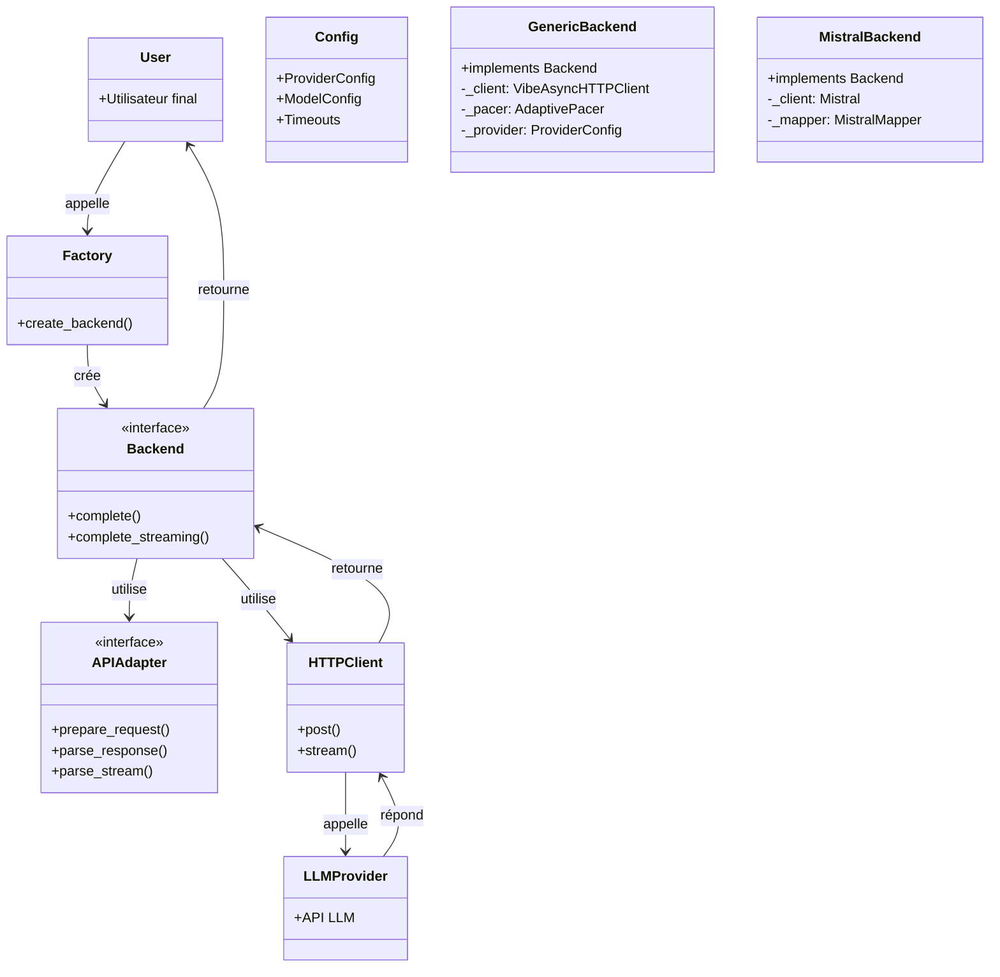
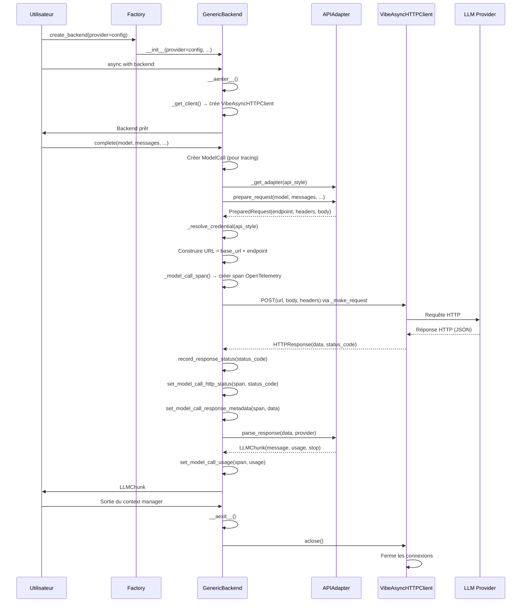
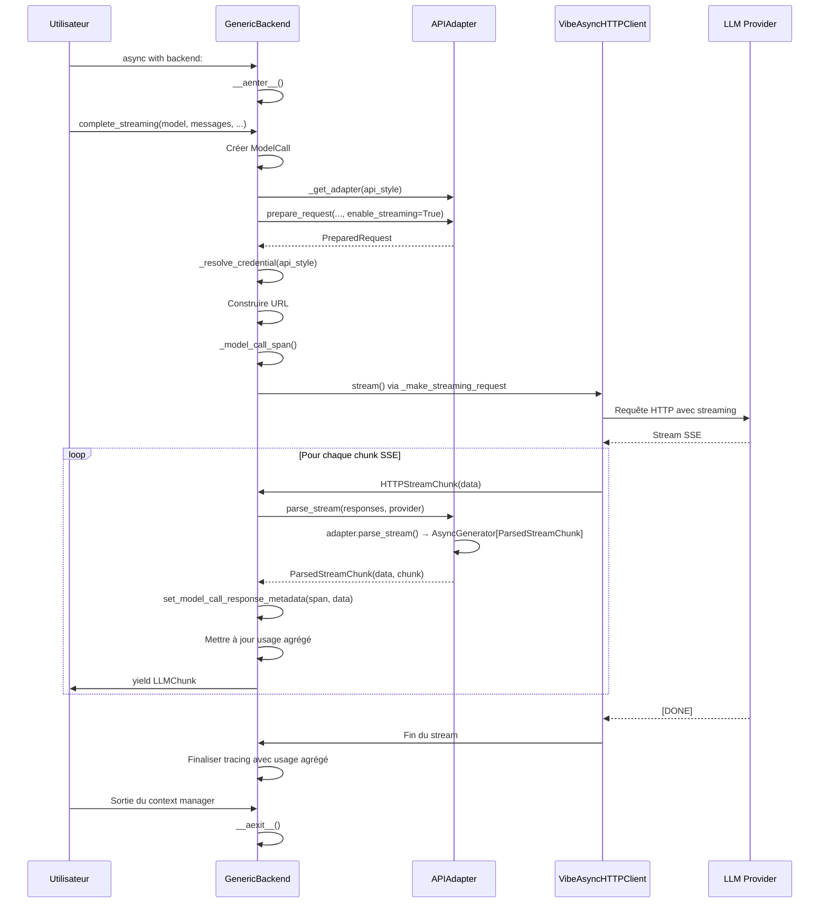
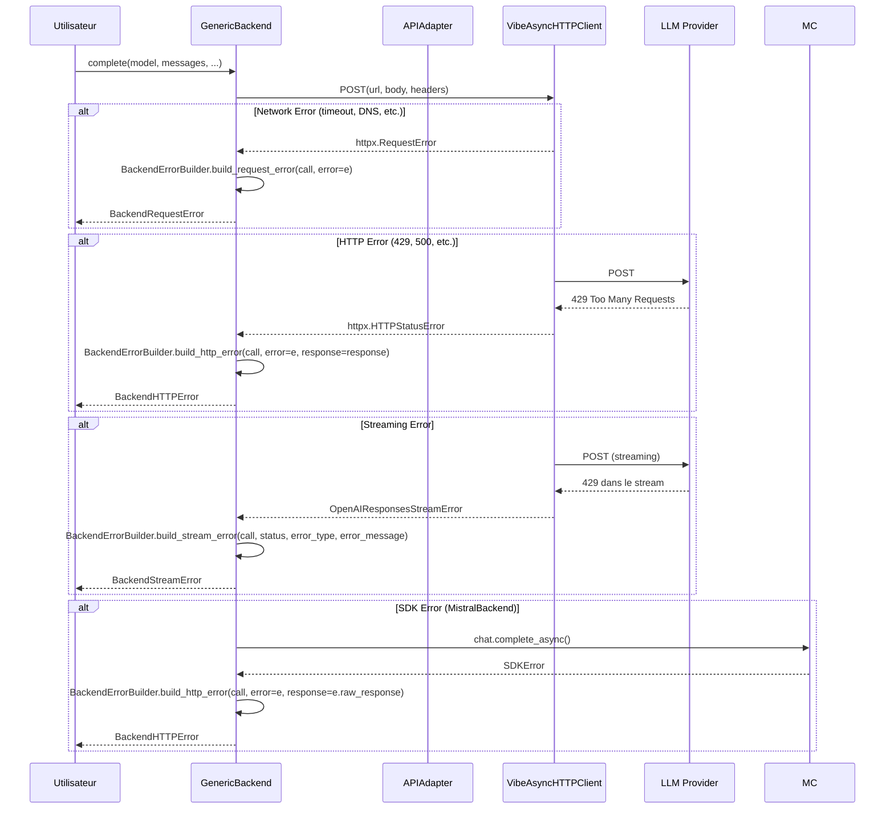
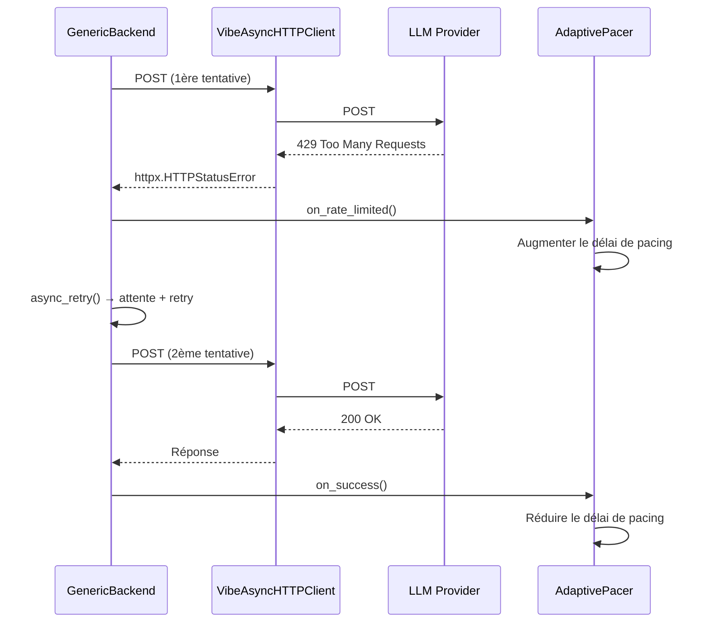
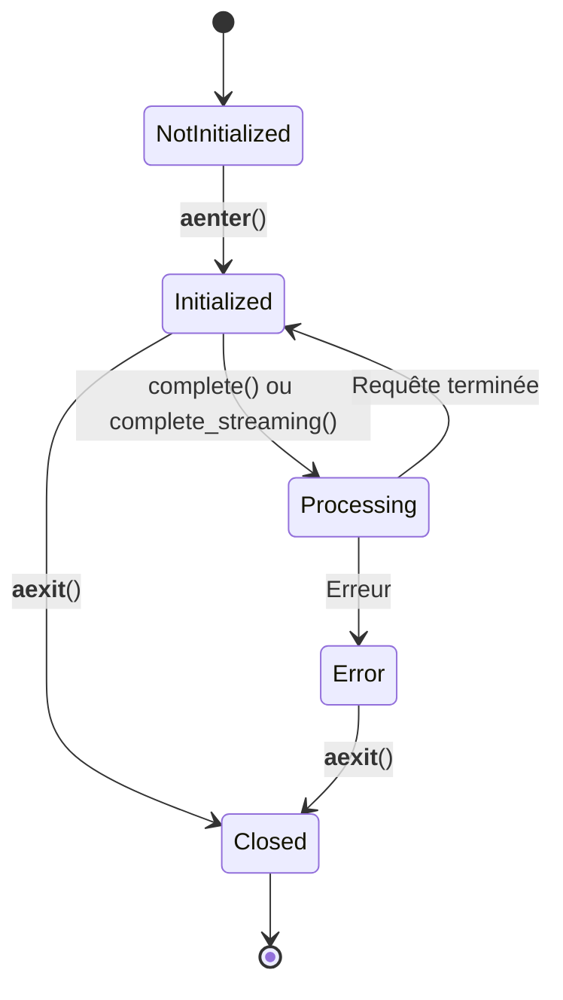
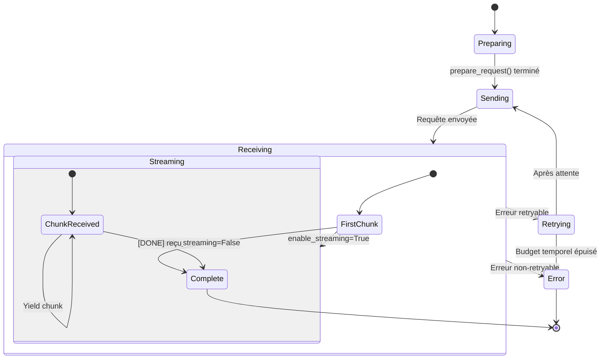

# Flux et Interactions : Voyages d'une Requête LLM

> **Module** : `vibe/core/llm/backend/` 
> **Fork** : `rrobbes/mistral-vibe` 
> **Partie** : 9/13 - Suivi Complet des Requêtes

---

## Introduction

Ce document décrit **les flux complets** des requêtes dans le module backend, depuis la création d'un backend jusqu'à la réception de la réponse. Nous allons explorer :

1. **Le voyage d'une requête simple** (non-streaming)
2. **Le voyage d'une requête streaming**
3. **La gestion des erreurs**
4. **Les interactions entre les composants**
5. **Les points d'extension**

### Pourquoi ce Document ?

Comprendre les flux permet de :
- **Déboguer** plus efficacement
- **Optimiser** les performances
- **Étendre** les fonctionnalités
- **Comprendre** l'architecture globale
- **Documenter** les intégrations

---

## Les Acteurs du Flux

### Personnages Principaux



---

## Flux 1 : Requête Simple (Non-Streaming)

### Vue d'Ensemble

```
Utilisateur
 ↓ (create_backend)
Factory (factory.py)
 ↓ (détermine le type)
Backend (GenericBackend ou MistralBackend)
 ↓ (context manager: __aenter__)
Initialisation du Client HTTP
 ↓ (complete)
Préparation de la Requête (via Adapter)
 ↓ (requête HTTP)
LLM Provider
 ↓ (réponse HTTP)
Parsing de la Réponse (via Adapter)
 ↓ (context manager: __aexit__)
Fermeture du Client HTTP
 ↓
LLMChunk (résultat)
```

### Diagramme de Séquence Détaillé



### Étapes Détaillées

#### 1. Création du Backend

```python
# Dans le code utilisateur
from vibe.core.llm.backend.factory import create_backend
from vibe.core.config import ProviderConfig

provider_config = ProviderConfig(
 backend=Backend.GENERIC,
 name="openai",
 api_base="https://api.openai.com/v1",
)

backend = create_backend(provider=provider_config)
```

**Dans factory.py** :
```python
def create_backend(provider: ProviderConfig, ...) -> BackendLike:
 backend = Backend(provider.backend) # Backend.GENERIC
 factory = BACKEND_FACTORY[backend] # _create_generic_backend
 return factory(provider=provider, ...)
```

**Résultat** : Une instance de `GenericBackend` est créée.

#### 2. Entrée dans le Context Manager

```python
async with backend:
 # Utilisation du backend
```

**Dans GenericBackend.__aenter__()** :
```python
async def __aenter__(self) -> GenericBackend:
 if self._client is None:
 self._client = VibeAsyncHTTPClient(
 timeout=httpx.Timeout(self._timeout),
 limits=httpx.Limits(...),
 verify=build_ssl_context(),
 )
 return self
```

**Résultat** : Le client HTTP est initialisé.

#### 3. Préparation de la Requête

```python
chunk = await backend.complete(
 model=model_config,
 messages=messages,
 temperature=0.2,
)
```

**Dans GenericBackend.complete()** :
```python
# 1. Déterminer l'adapter
api_style = getattr(self._provider, "api_style", "openai")
api_key, api_key_origin = self._resolve_credential(api_style)
adapter = _get_adapter(api_style) # OpenAIAdapter

# 2. Préparer la requête via l'adapter
req = adapter.prepare_request(
 model_name=model.name,
 messages=messages,
 temperature=temperature,
 tools=tools,
 max_tokens=max_tokens,
 tool_choice=tool_choice,
 enable_streaming=False,
 provider=self._provider,
 api_key=api_key,
 thinking=model.thinking,
)
```

**Dans OpenAIAdapter.prepare_request()** :
```python
def prepare_request(self, ..., enable_streaming: bool, ...) -> PreparedRequest:
 converted_messages = self._convert_messages(messages, provider)
 payload = build_chat_payload(
 model_name=model_name,
 messages=converted_messages,
 temperature=temperature,
 tools=tools,
 max_tokens=max_tokens,
 tool_choice=tool_choice,
 thinking=thinking,
 )
 stream_options = {"include_usage": True}
 if provider.name == "mistral":
 stream_options["stream_tool_calls"] = True
 
 return finalize_chat_request(
 payload=payload,
 enable_streaming=False,
 stream_options=stream_options,
 api_key=api_key,
 endpoint=self.endpoint, # "/chat/completions"
 )
```

**Résultat** : `PreparedRequest(endpoint="/chat/completions", headers={...}, body=b'{"model":...}')`

#### 4. Construction de l'URL et Résolution des Crédentials

```python
# Construire l'URL
base = req.base_url or self._provider.api_base # "https://api.openai.com/v1"
url = f"{base}{req.endpoint}" # "https://api.openai.com/v1/chat/completions"

# Créer ModelCall pour le tracing
call = ModelCall(
 provider=self._provider.name, # "openai"
 endpoint=url,
 model=model.name,
 messages=messages,
 temperature=temperature,
 has_tools=bool(tools),
 tool_choice=tool_choice,
 api_key_origin=api_key_origin,
)
```

#### 5. Exécution de la Requête HTTP

```python
async with self._model_call_span(...) as span:
 def record_response_status(status_code: int) -> None:
 set_model_call_http_status(span, status_code)
 
 try:
 response = await self._make_request(
 url, req.body, headers, on_response_status=record_response_status
 )
 except httpx.HTTPStatusError as e:
 set_model_call_http_status(span, e.response.status_code)
 raise BackendErrorBuilder.build_http_error(call, error=e, response=e.response)
 except httpx.RequestError as e:
 raise BackendErrorBuilder.build_request_error(call, error=e)
```

**Dans _make_request** (avec retry et pacing) :
```python
# _make_request est une composition de :
# 1. _pace() - Adaptive pacing
# 2. async_retry() - Retry avec budget temporel
# 3. _send_request() - Requête HTTP simple

async def _send_request(self, url: str, data: bytes, headers: dict[str, str], ...):
 client = self._get_client()
 response = await client.post(url, content=data, headers=headers)
 response.raise_for_status()
 if on_response_status is not None:
 on_response_status(response.status_code)
 response_body = response.json()
 return self.HTTPResponse(response_body, response.status_code)
```

#### 6. Parsing de la Réponse

```python
# Mettre à jour le tracing
set_model_call_http_status(span, response.status_code)
set_model_call_response_metadata(span, response.data)

# Parser la réponse
chunk = adapter.parse_response(response.data, self._provider)

# Mettre à jour les métriques de tracing
if chunk.usage is not None and _reports_usage(response.data):
 set_model_call_usage(
 span,
 prompt_tokens=chunk.usage.prompt_tokens,
 completion_tokens=chunk.usage.completion_tokens,
 )

return chunk
```

**Dans OpenAIAdapter.parse_response()** :
```python
def parse_response(self, data: dict[str, Any], provider: ProviderConfig) -> LLMChunk:
 message = self._parse_message(data, provider.reasoning_field_name)
 if message is None:
 message = LLMMessage(role=Role.assistant, content="")

 usage_data = data.get("usage") or {}
 prompt_details = usage_data.get("prompt_tokens_details") or {}
 usage = LLMUsage(
 prompt_tokens=usage_data.get("prompt_tokens", 0),
 completion_tokens=usage_data.get("completion_tokens", 0),
 cached_tokens=prompt_details.get("cached_tokens", 0),
 )
 choices = data.get("choices") or []
 finish_reason = choices[0].get("finish_reason") if choices else None
 stop = StopInfo(reason=str(finish_reason)) if finish_reason is not None else None

 return LLMChunk(message=message, usage=usage, stop=stop)
```

#### 7. Sortie du Context Manager

```python
# Fin du bloc async with
async def __aexit__(self, exc_type, exc_val, exc_tb) -> None:
 if self._owns_client and self._client:
 await self._client.aclose()
 self._client = None
```

---

## Flux 2 : Requête Streaming

### Vue d'Ensemble

```
Utilisateur
 ↓ (create_backend)
Factory
 ↓
Backend
 ↓ (context manager: __aenter__)
Initialisation
 ↓ (complete_streaming)
Préparation de la Requête
 ↓ (requête HTTP streaming)
LLM Provider
 ↓ (stream de chunks SSE)
Parsing du Stream
 ↓ (yield de chaque LLMChunk)
 ↓ (agrégation des usages)
 ↓ (context manager: __aexit__)
Fermeture
 ↓
AsyncGenerator[LLMChunk]
```

### Diagramme de Séquence Détaillé



### Étapes Détaillées

#### 1. Préparation de la Requête Streaming

```python
# Dans GenericBackend.complete_streaming()
api_style = getattr(self._provider, "api_style", "openai")
api_key, api_key_origin = self._resolve_credential(api_style)
adapter = _get_adapter(api_style)

req = adapter.prepare_request(
 model_name=model.name,
 messages=messages,
 temperature=temperature,
 tools=tools,
 max_tokens=max_tokens,
 tool_choice=tool_choice,
 enable_streaming=True, # Streaming activé
 provider=self._provider,
 api_key=api_key,
 thinking=model.thinking,
)
```

**Différence avec non-streaming** : `enable_streaming=True` → l'adapter ajoute `"stream": true` au payload.

#### 2. Exécution de la Requête Streaming

```python
async with self._model_call_span(...) as span:
 usage = LLMUsage()
 has_usage = False
 
 def record_response_status(status_code: int) -> None:
 set_model_call_http_status(span, status_code)
 
 try:
 async with aclosing(
 self._make_streaming_request(
 url,
 req.body,
 headers,
 adapter,
 on_response_status=record_response_status,
 )
 ) as stream:
 async for stream_chunk in stream:
 set_model_call_response_metadata(span, stream_chunk.data)
 chunk = stream_chunk.chunk
 if chunk.usage is not None and _reports_usage(stream_chunk.data):
 has_usage = True
 usage += chunk.usage
 yield chunk
 except ...:
 # Gestion des erreurs
 ...
 
 if has_usage:
 set_model_call_usage(span, prompt_tokens=usage.prompt_tokens, ...)
```

#### 3. Parsing du Stream

**Dans GenericBackend._send_parsed_streaming_request()** :
```python
async def _send_parsed_streaming_request(
 self,
 url: str,
 data: bytes,
 headers: dict[str, str],
 adapter: APIAdapter,
 on_response_status: Callable[[int], None] | None = None,
) -> AsyncGenerator[ParsedStreamChunk]:
 async with aclosing(
 self._send_streaming_request(url, data, headers, on_response_status)
 ) as response_stream:
 responses = (stream_chunk.data async for stream_chunk in response_stream)
 async with aclosing(
 adapter.parse_stream(responses, self._provider)
 ) as parsed_stream:
 async for parsed in parsed_stream:
 yield parsed
```

**Dans APIAdapter.parse_stream()** (implémentation par défaut) :
```python
async def parse_stream(
 self, responses: AsyncGenerator[dict[str, Any]], provider: ProviderConfig
) -> AsyncGenerator[ParsedStreamChunk]:
 async with aclosing(responses):
 async for data in responses:
 yield ParsedStreamChunk(data, self.parse_response(data, provider))
```

**Pour Anthropic** : L'adapter a sa propre implémentation qui gère les événements de streaming.

#### 4. Parsing des Chunks SSE

**Dans GenericBackend._send_streaming_request()** :
```python
async def _send_streaming_request(
 self,
 url: str,
 data: bytes,
 headers: dict[str, str],
 on_response_status: Callable[[int], None] | None = None,
) -> AsyncGenerator[HTTPStreamChunk]:
 client = self._get_client()
 async with client.stream(
 method="POST", url=url, content=data, headers=headers
 ) as response:
 if not response.is_success:
 await response.aread()
 response.raise_for_status()
 if on_response_status is not None:
 on_response_status(response.status_code)
 
 # Parsing des Server-Sent Events
 async for line in iter_sse_lines(response):
 if line.strip() == "":
 continue
 if line.startswith(":"):
 continue
 
 DELIM_CHAR = ":"
 if f"{DELIM_CHAR} " not in line:
 raise ValueError(f"Stream chunk improperly formatted.")
 delim_index = line.find(DELIM_CHAR)
 key = line[0:delim_index]
 value = line[delim_index + 2 :]
 
 if key != "data":
 continue
 if value.strip() == "[DONE]":
 return
 
 try:
 chunk_data = json.loads(value.strip())
 except json.JSONDecodeError:
 raise ValueError("Stream chunk contains malformed JSON.") from None
 
 yield self.HTTPStreamChunk(data=chunk_data)
```

**Format SSE** :
```
data: {"choices": [{"delta": {"content": "Hello"}}]}

data: {"choices": [{"delta": {"content": " world"}}]}

data: [DONE]
```

---

## Flux 3 : Gestion des Erreurs

### Vue d'Ensemble

### Diagramme de Séquence : Gestion des Erreurs



### Types d'Erreurs

#### 1. BackendRequestError

**Cause** : Erreur réseau (timeout, DNS, connexion refusée, etc.)

**Exemple** :
```python
try:
 async with backend:
 chunk = await backend.complete(...)
except BackendRequestError as e:
 print(f"Erreur réseau: {e}")
 # Gérer : retry, changer de réseau, etc.
```

#### 2. BackendHTTPError

**Cause** : Erreur HTTP (4xx, 5xx)

**Exemple** :
```python
try:
 async with backend:
 chunk = await backend.complete(...)
except BackendHTTPError as e:
 if e.status_code == 429:
 print("Rate limit - attendez et réessayez")
 elif e.status_code == 401:
 print("Clé API invalide")
 elif e.status_code == 404:
 print("Modèle non trouvé")
```

#### 3. BackendStreamError

**Cause** : Erreur pendant le streaming

**Exemple** :
```python
try:
 async with backend:
 stream = backend.complete_streaming(...)
 async for chunk in stream:
 print(chunk.message.content)
except BackendStreamError as e:
 print(f"Erreur de streaming: {e.error_type} - {e.message}")
```

### BackendErrorBuilder

**Localisation** : `vibe/core/llm/exceptions.py`

```python
class BackendErrorBuilder:
 @staticmethod
 def build_http_error(
 call: ModelCall,
 error: Exception,
 response: httpx.Response | None = None,
 ) -> BackendHTTPError:
 """Construire une erreur HTTP enrichie."""
 ...

 @staticmethod
 def build_request_error(
 call: ModelCall,
 error: Exception,
 ) -> BackendRequestError:
 """Construire une erreur de requête."""
 ...

 @staticmethod
 def build_stream_error(
 call: ModelCall,
 status: int | None,
 error_type: str,
 error_message: str,
 ) -> BackendStreamError:
 """Construire une erreur de streaming."""
 ...
```

**Pourquoi un Builder ?**
- **Centralisation** : Toutes les erreurs passent par le même point
- **Enrichissement** : Ajout de métadonnées (call, provider, model, etc.)
- **Typage** : Retourne le bon type d'erreur
- **Consistance** : Formatage uniforme des messages d'erreur

---

## Flux 4 : Retry et Résilience

### Vue d'Ensemble

```
Requête LLM
 ↓
Erreur retryable (429, 500-504, timeout, network)
 ↓
Backend.check_retryable()
 ↓
Oui → Attendre (backoff) + Retry
 ↓
Non → Lever l'erreur
 ↓
Budget temporel épuisé ?
 ↓
Oui → Lever l'erreur
 ↓
Non → Continuer
```

### Diagramme de Séquence : Retry



### Implémentation du Retry

**Dans GenericBackend.__init__()** :
```python
# Configuration du retry avec budget temporel
retried = async_retry(
 tries=None, # Pas de limite de tentatives
 max_elapsed_time=retry_max_elapsed_time, # Budget temporel (300s par défaut)
 on_retry=paced_on_retry,
)(self._send_request)
self._make_request = self._pace(retried)
```

**Fonction paced_on_retry** :
```python
async def paced_on_retry(reason: RetryReason) -> None:
 if reason.category is RetryCategory.RATE_LIMITED:
 self._pacer.on_rate_limited()
 if self._user_on_retry is not None:
 await self._user_on_retry(reason)
```

**Catégories de Retry** :
- **RATE_LIMITED** : Erreur 429 (Too Many Requests)
- **SERVER_ERROR** : Erreurs 5xx (500, 502, 503, 504)
- **NETWORK_ERROR** : Erreurs réseau (timeout, DNS, etc.)
- **OTHER** : Autres erreurs retryables

---

## Diagrammes Résumés

### Diagramme d'États : Backend



### Diagramme d'États : Requête



---

## Points d'Extension

### 1. Ajouter un Nouveau Backend

Pour ajouter un nouveau backend (ex: `CustomBackend`) :

1. **Créer la classe backend** :
 ```python
 class CustomBackend:
 async def complete(self, ...) -> LLMChunk:
 ...
 async def complete_streaming(self, ...) -> AsyncGenerator[LLMChunk, None]:
 ...
 async def __aenter__(self):
 ...
 async def __aexit__(self, ...):
 ...
 ```

2. **Ajouter au registre** :
 ```python
 # Dans factory.py
 def _create_custom_backend(**kwargs: Any) -> BackendLike:
 from vibe.core.llm.backend.custom import CustomBackend
 return CustomBackend(**kwargs)
 
 BACKEND_FACTORY[Backend.CUSTOM] = _create_custom_backend
 ```

3. **Ajouter à l'énumération** :
 ```python
 # Dans vibe/core/types.py
 class Backend(str, Enum):
 MISTRAL = "mistral"
 GENERIC = "generic"
 CUSTOM = "custom" # NOUVEAU
 ```

### 2. Ajouter un Nouveau Adapter

Pour ajouter un nouveau adapter (ex: `CustomAdapter`) :

1. **Créer la classe adapter** :
 ```python
 class CustomAdapter(APIAdapter):
 endpoint: ClassVar[str] = "/custom/endpoint"
 
 def prepare_request(self, ...) -> PreparedRequest:
 ...
 
 def parse_response(self, data: dict[str, Any], provider: ProviderConfig) -> LLMChunk:
 ...
 ```

2. **Ajouter au registre** :
 ```python
 # Dans generic.py
 _ADAPTERS["custom"] = CustomAdapter
 ```

3. **Configurer le provider** :
 ```python
 provider_config = ProviderConfig(
 api_style="custom",
 ...
 )
 ```

### 3. Personnaliser le Client HTTP

```python
from vibe.utils.http import VibeAsyncHTTPClient
import httpx

# Créer un client personnalisé
custom_client = VibeAsyncHTTPClient(
 timeout=httpx.Timeout(600.0),
 limits=httpx.Limits(max_connections=50),
)

# Passer au backend
backend = GenericBackend(
 provider=provider_config,
 client=custom_client,
)
```

### 4. Ajouter un Callback de Tracing

```python
from vibe.core.utils import RetryReason

async def my_retry_callback(reason: RetryReason) -> None:
 print(f"Retry: {reason.category.name}, attempt: {reason.attempt}, delay: {reason.delay}s")

backend = create_backend(
 provider=provider_config,
 on_retry=my_retry_callback,
)
```

---

## Résumé

| Flux | Description | Complexité | Points Clés |
|------|-------------|------------|-------------|
| **Requête Simple** | `complete()` | Moyenne | Adapter, HTTP, Parsing, Tracing |
| **Requête Streaming** | `complete_streaming()` | Élevée | SSE, Parsing incrémental, Agrégation |
| **Gestion des Erreurs** | BackendError | Moyenne | Typage, Enrichissement, Centralisation |
| **Retry** | Résilience | Élevée | Budget temporel, Pacing, Backoff |

---

## Références

- [Server-Sent Events - MDN](https://developer.mozilla.org/en-US/docs/Web/API/Server-sent_events)
- [HTTP Status Codes - MDN](https://developer.mozilla.org/en-US/docs/Web/HTTP/Status)
- [Exponential Backoff - Wikipedia](https://en.wikipedia.org/wiki/Exponential_backoff)
- [OpenTelemetry Tracing](https://opentelemetry.io/docs/specs/otel/trace/)

---

## Voir Aussi

- **[04-FACTORY.md](/docs/factory)** - Création des backends
- **[05-GENERIC_BACKEND.md](/docs/generic-backend)** - Implémentation du GenericBackend
- **[06-MISTRAL_BACKEND.md](/docs/mistral-backend)** - Implémentation du MistralBackend
- **[07-ADAPTERS.md](/docs/adapters)** - Délices des adapters
- **[10-RESILIENCE.md](/docs/resilience)** - Stratégies de résilience (détails)
- **[11-DIAGRAMS.md](/docs/diagrams)** - Diagrammes techniques complets

---

*Documentation spécifique au fork éducatif `rrobbes/mistral-vibe` - Dernière mise à jour: 30 octobre 2026*
