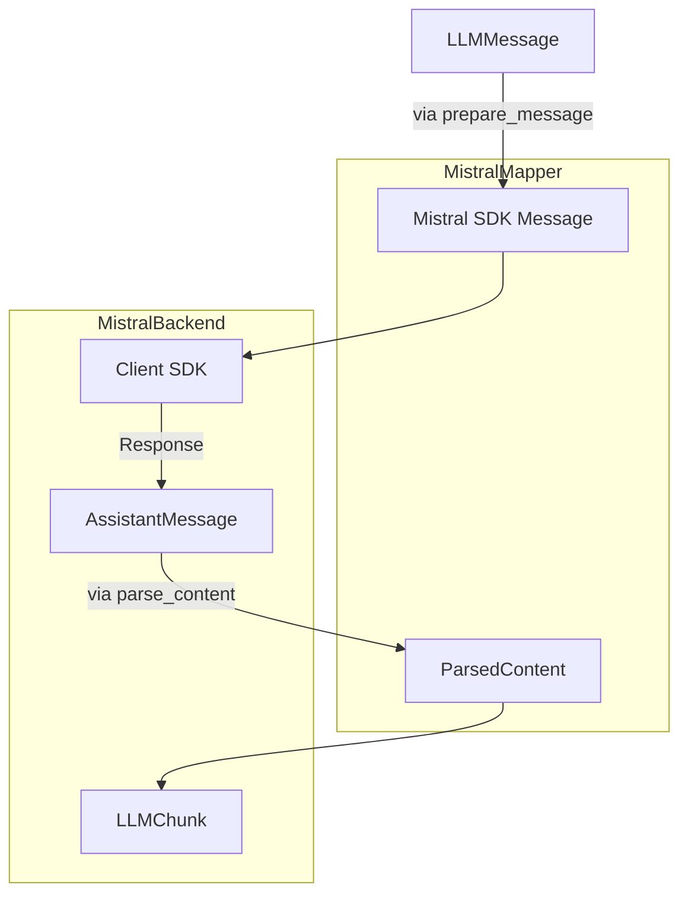
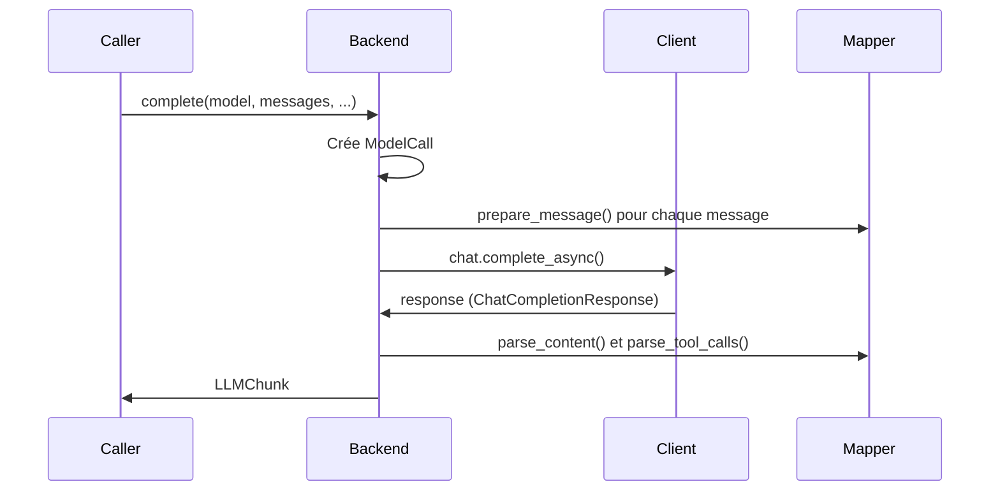
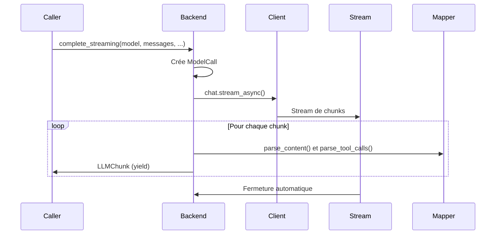

# MistralBackend : Intégration SDK Native

> **Module** : `vibe/core/llm/backend/` 
> **Fichier** : `mistral.py` 
> **Fork** : `rrobbes/mistral-vibe` 
> **Partie** : 6/13 - Backend Spécialisé Mistral

---

## Introduction

Le **`MistralBackend`** représente l'une des deux implémentations concrètes de backend dans Vibe, spécialement conçue pour interagir avec les modèles Mistral via leur **SDK officiel Python** (`mistralai` package). Contrairement au `GenericBackend` qui utilise des requêtes HTTP brutes, `MistralBackend` offre une intégration native avec le SDK Mistral, ce qui permet :

- Une **abstraction** des concepts spécifiques Mistral (thinking, tool calls, etc.)
- Une **gestion** des retries et des erreurs via le SDK
- Un **support natif** des fonctionnalités avancées comme le streaming
- Une **intégration transparente** avec les services Mistral (y compris Vertex AI)

---

## Architecture Générale

### Structure du Fichier `mistral.py`

### Flux de Données dans MistralBackend



---

## Composants Internes

### 1. MistralMapper : Le Traducteur

Le `MistralMapper` est une **classe de transformation** qui assure la conversion bidirectionnelle entre les types Vibe et les types du SDK Mistral.

#### `prepare_message()` - De Vibe vers Mistral

Convertit un `LLMMessage` Vibe en un `ChatCompletionRequestMessage` du SDK Mistral.

**Signature** :
```python
def prepare_message(
 self, msg: LLMMessage, *, include_reasoning_content: bool = True
) -> ChatCompletionRequestMessage
```

**Cas d'utilisation par rôle** :

```python
# System Message
SystemMessage(role="system", content=msg.content or "")

# User Message (avec images)
UserMessage(
 role="user",
 content=[
 TextChunk(type="text", text=msg.content),
 ImageURLChunk(type="image_url", image_url=ImageURL(url=_to_data_uri(att)))
 for att in msg.images
 ]
)

# Assistant Message (avec reasoning)
AssistantMessage(
 role="assistant",
 content=[
 ThinkChunk(type="thinking", thinking=[TextChunk(type="text", text=msg.reasoning_content)]),
 TextChunk(type="text", text=msg.content)
 ],
 tool_calls=[...] # Conversion des tool calls
)

# Tool Message
ToolMessage(
 role="tool",
 content=msg.content,
 tool_call_id=msg.tool_call_id,
 name=msg.name,
)
```

**Points clés** :
- Gestion des **images** via `_to_data_uri()` (conversion en data URI)
- Support du **reasoning content** via `ThinkChunk`
- Conversion des **tool calls** vers le format Mistral
- Preservation des métadonnées (index, id, etc.)

#### `parse_content()` - De Mistral vers Vibe

Extraire le contenu textuel et le reasoning depuis les réponses du SDK.

**Signature** :
```python
def parse_content(self, content: AssistantMessageContent) -> ParsedContent
```

**Types gérés** :
- `str` → Contenu simple
- `list[ContentChunk]` → Contenu riche avec raisonnement
 - `TextChunk` → Contenu textuel
 - `ThinkChunk` → Contenu de reasoning
 - `FileChunk` → Ignoré (non supporté)

**Exemple** :
```python
# Réponse avec thinking
content = [
 ThinkChunk(type="thinking", thinking=[TextChunk(type="text", text="Je réfléchis...")]),
 TextChunk(type="text", text="Voici ma réponse")
]

# Résultat
ParsedContent(
 content="Voici ma réponse",
 reasoning_content="Je réfléchis..."
)
```

#### `prepare_tool()` et `prepare_tool_choice()`

**`prepare_tool()`** : Convertit un `AvailableTool` Vibe en `Tool` du SDK Mistral.

```python
def prepare_tool(self, tool: AvailableTool) -> Tool:
 return Tool(
 type="function",
 function=Function(
 name=tool.function.name,
 description=tool.function.description,
 parameters=tool.function.parameters,
 ),
 )
```

**`prepare_tool_choice()`** : Convertit les choix d'outils.

```python
def prepare_tool_choice(
 self, tool_choice: StrToolChoice | AvailableTool
) -> ChatCompletionStreamRequestToolChoice:
 if isinstance(tool_choice, str):
 return cast(ToolChoiceEnum, tool_choice) # "auto", "none", "any"
 
 return ToolChoice(
 type="function",
 function=FunctionName(name=tool_choice.function.name)
 )
```

#### `parse_tool_calls()`

Convertit les `MistralToolCall` du SDK en `ToolCall` Vibe.

```python
def parse_tool_calls(self, tool_calls: list[MistralToolCall]) -> list[ToolCall]:
 return [
 ToolCall(
 id=tool_call.id,
 function=FunctionCall(
 name=tool_call.function.name,
 arguments=tool_call.function.arguments
 if isinstance(tool_call.function.arguments, str)
 else json.dumps(tool_call.function.arguments, ensure_ascii=False),
 ),
 index=tool_call.index,
 )
 for tool_call in tool_calls
 ]
```

**Points clés** :
- Gestion des arguments sous forme de `str` ou `dict`
- Sérialisation JSON avec `ensure_ascii=False` pour Unicode
- Préservation de l'index et de l'id

### 2. Fonctions Utilitaires

#### `_reasoning_effort()` - Mapping du Niveau de Réflexion

Convertit le paramètre `thinking` de la configuration Vibe en valeur acceptable par le SDK Mistral.

```python
ReasoningEffortValue = Literal["none", "high"]

_THINKING_TO_REASONING_EFFORT: dict[str, ReasoningEffortValue] = {
 "low": "none",
 "medium": "high",
 "high": "high",
 "max": "high",
}

def _reasoning_effort(model: ModelConfig) -> ReasoningEffortValue | None:
 if (
 model.thinking == "off"
 and "off" in model.thinking_levels
 and model.thinking_levels_curated
 ):
 return "none"
 return _THINKING_TO_REASONING_EFFORT.get(model.thinking)
```

**Logique** :
- `thinking="off"` → `None` (sauf si explicitement supporté)
- `thinking="low"` → `"none"`
- `thinking="medium"` ou `"high"` ou `"max"` → `"high"`

**Note importante** : Certains modèles (comme la famille zai-glm) rejettent la valeur explicite `"none"`, donc le mapping est conditionnel.

#### `_cached_tokens()` - Extraction des Tokens Cache

Le SDK Mistral rapporte les hits de cache dans `usage.prompt_tokens_details.cached_tokens`. Cette fonction extrait cette valeur de manière sécurisée.

```python
def _cached_tokens(usage: object | None) -> int:
 if usage is None:
 return 0
 details = getattr(usage, "prompt_tokens_details", None)
 value = (
 details.get("cached_tokens")
 if isinstance(details, dict)
 else getattr(details, "cached_tokens", None)
 )
 try:
 return int(value or 0)
 except (TypeError, ValueError):
 return 0
```

**Points clés** :
- Gestion des types variables (dict vs object)
- Conversion sécurisée en int
- Valeur par défaut 0 en cas d'erreur

---

## MistralBackend : Classe Principale

### Constructeur `__init__()`

Initialise le backend avec la configuration nécessaire.

**Signature** :
```python
def __init__(
 self,
 provider: ProviderConfig,
 timeout: float = DEFAULT_API_TIMEOUT,
 retry_max_elapsed_time: float = DEFAULT_API_RETRY_MAX_ELAPSED_TIME,
 connect_timeout: float = DEFAULT_API_CONNECT_TIMEOUT,
 write_timeout: float = DEFAULT_API_WRITE_TIMEOUT,
 pool_timeout: float = DEFAULT_API_POOL_TIMEOUT,
 enable_otel: bool = False,
 on_retry: RetryObserver | None = None,
) -> None
```

**Paramètres** :
| Paramètre | Description | Défaut |
|-----------|-------------|--------|
| `provider` | Configuration du fournisseur (clé API, URL, etc.) | Obligatoire |
| `timeout` | Timeout global pour les requêtes | `DEFAULT_API_TIMEOUT` (120s) |
| `retry_max_elapsed_time` | Temps max pour les retries | `DEFAULT_API_RETRY_MAX_ELAPSED_TIME` |
| `connect_timeout` | Timeout de connexion | `DEFAULT_API_CONNECT_TIMEOUT` (10s) |
| `write_timeout` | Timeout d'écriture | `DEFAULT_API_WRITE_TIMEOUT` (10s) |
| `pool_timeout` | Timeout de pool de connexions | `DEFAULT_API_POOL_TIMEOUT` (10s) |
| `enable_otel` | Activation de la télémétrie OpenTelemetry | `False` |
| `on_retry` | Callback pour les retries | `None` |

**Initialisation interne** :

```python
# Client SDK (lazy initialization)
self._client: Mistral | None = None
self._http_client: VibeAsyncHTTPClient | None = None

# Configuration
self._provider = provider
self._transport_timeouts = {
 "connect": connect_timeout,
 "write": write_timeout,
 "pool": pool_timeout,
}
self._enable_otel = enable_otel
self._on_retry = on_retry

# Résolution de la clé API
resolved = resolve_api_key_with_origin(self._provider.api_key_env_var)
self._api_key = resolved[0] if resolved else None
self._api_key_origin = resolved[1] if resolved else None

# Validation du reasoning_field_name
if reasoning_field != "reasoning_content":
 raise ValueError("Mistral backend does not support custom reasoning_field_name")

# Extraction de l'URL du serveur
server_url = get_server_url_from_api_base(self._provider.api_base)
self._server_url = server_url
self._timeout = timeout
self._retry_max_elapsed_time = retry_max_elapsed_time
self._retry_config = self._build_retry_config()
self._mapper = MistralMapper()
```

**Validation importante** :
- **Ne supporte pas** les `reasoning_field_name` personnalisés
- **Exige** un format d'URL valide avec version API

### Gestion de la Configuration Retry

#### `_build_retry_config()`

Construis la configuration de retry pour le SDK Mistral.

```python
def _build_retry_config(self) -> RetryConfig:
 max_elapsed_time_ms = int(self._retry_max_elapsed_time * 1000)
 return RetryConfig(
 strategy="backoff",
 backoff=BackoffStrategy(
 initial_interval=500, # 500ms
 max_interval=30000, # 30s
 exponent=1.5, # Facteur exponentiel
 max_elapsed_time=max_elapsed_time_ms,
 ),
 retry_connection_errors=True,
 )
```

**Stratégie** :
- Backoff exponentiel avec facteur 1.5
- Intervalle initial : 500ms
- Intervalle max : 30s
- Temps max total : configurable

### Création du Client SDK

#### `_create_mistral_client()`

Crée et configure le client SDK Mistral avec :

```python
def _create_mistral_client(self) -> Mistral:
 self._loop = asyncio.get_running_loop()
 
 # Configuration du client HTTP
 self._http_client = VibeAsyncHTTPClient(
 verify=build_ssl_context(),
 follow_redirects=True,
 event_hooks={
 "request": [self._bound_transport_timeouts],
 "response": [self._on_response],
 },
 limits=httpx.Limits(
 max_connections=_MAX_CONNECTIONS, # 20
 keepalive_expiry=MODEL_HTTP_KEEPALIVE_EXPIRY_SECONDS, # 60s
 ),
 )
 
 # Création du client SDK
 client = Mistral(
 api_key=self._api_key,
 server_url=self._server_url,
 timeout_ms=int(self._timeout * 1000),
 retry_config=self._retry_config,
 async_client=self._http_client,
 )
 
 # Enregistrement du hook de retry
 _register_retry_hook(client, _RetryNoticeHook(self._report_error))
 
 # Activation OpenTelemetry
 if self._enable_otel:
 configure_telemetry(client, provider="global")
 
 return client
```

**Points clés** :
- Client HTTP personnalisé avec `VibeAsyncHTTPClient`
- Configuration SSL via `build_ssl_context()`
- Suivi des redirections activé
- Hooks pour gestion des timeouts et retries
- Limite de connexions : 20
- Keepalive : 60 secondes
- Intégration OpenTelemetry optionnelle

### Gestion des Timeouts de Transport

#### `_bound_transport_timeouts()`

Applique des limites aux timeouts de transport (connect, write, pool) **sans réduire le budget de lecture**.

```python
async def _bound_transport_timeouts(self, request: httpx.Request) -> None:
 timeout = dict(request.extensions.get("timeout", {}))
 for axis, limit in self._transport_timeouts.items():
 current = timeout.get(axis)
 timeout[axis] = limit if current is None else min(current, limit)
 request.extensions = {**request.extensions, "timeout": timeout}
```

**Problème résolu** :
Le SDK envoie un timeout scalaire unique par requête, que httpx étend à toutes les dimensions. Sans ce cap, un timeout long pour une génération de modèle bloquerait aussi l'ouverture de socket et l'acquisition de connexion du pool, rendant un hôte inaccessible indétectable pendant tout le timeout.

**Solution** :
- Chaque cap est un **plafond** (ceiling) et non une valeur
- Un appel avec timeout plus court gagne sur tous les axes
- Seuls connect, write et pool sont limités
- Le timeout de lecture (read) reste intact

### Gestion des Retries et Erreurs

#### `_on_response()` - Traitement des Réponses Retryable

Libère la connexion derrière une réponse retryable et rapporte l'erreur.

```python
async def _on_response(self, response: httpx.Response) -> None:
 if response.status_code not in _RETRYABLE_STATUS_CODES:
 return
 try:
 await response.aread() # Lit le body
 except Exception:
 logger.debug("Could not read the body of a %s response", response.status_code)
 await response.aclose() # Ferme la réponse
 await self._notice_retry(RetryReason.from_http_status(response.status_code))
```

**Pourquoi ?** :
- Les requêtes de streaming sont émises avec le body non lu
- Le SDK maintient une réponse en échec vivante pendant le backoff de retry
- Sans lecture du body, la connexion reste checkée out du pool
- Lecture du body → retourne la connexion au pool

**Codes retryable** : `{429, 500, 502, 503, 504}`

#### `_report_error()` - Rapport d'Erreurs depuis les Workers

Rapports les erreurs depuis les threads workers du SDK.

```python
def _report_error(self, error: Exception) -> None:
 if self._loop is None or not isinstance(error, _RETRYABLE_ERRORS):
 return
 try:
 future = asyncio.run_coroutine_threadsafe(
 self._notice_retry(RetryReason.from_error(error)), self._loop
 )
 except RuntimeError: # loop already closed
 return
 future.add_done_callback(_log_delivery_failure)
```

**Erreurs retryable** : `(httpx.NetworkError, httpx.TimeoutException)`

#### `_notice_retry()` - Notification de Retry

Émet une notification de retry et appelle le callback si configuré.

```python
async def _notice_retry(self, reason: RetryReason) -> None:
 logger.warning(
 "Retrying request category=%s detail=%s", reason.category, reason.detail
 )
 if self._on_retry is not None:
 await self._on_retry(reason)
```

### Context Manager Async

Gère le cycle de vie du client SDK.

#### `__aenter__()`

```python
async def __aenter__(self) -> MistralBackend:
 self._client = self._create_mistral_client()
 await self._client.__aenter__()
 return self
```

#### `__aexit__()`

```python
async def __aexit__(
 self,
 exc_type: type[BaseException] | None,
 exc_val: BaseException | None,
 exc_tb: types.TracebackType | None,
) -> None:
 client = self._client
 http_client = self._http_client
 self._client = None
 self._http_client = None
 try:
 if client is not None:
 await client.__aexit__(exc_type, exc_val, exc_tb)
 finally:
 if http_client is not None:
 await http_client.aclose()
```

#### `aclose()`

Fermeture explicite du backend.

```python
async def aclose(self) -> None:
 await self.__aexit__(None, None, None)
```

### Méthodes Principales

#### `complete()` - Complétion Synchrone

Exécute une requête de complétion et retourne un seul `LLMChunk`.

**Signature** :
```python
async def complete(
 self,
 *,
 model: ModelConfig,
 messages: Sequence[LLMMessage],
 temperature: float,
 tools: list[AvailableTool] | None,
 max_tokens: int | None,
 tool_choice: StrToolChoice | AvailableTool | None,
 extra_headers: dict[str, str] | None,
 metadata: dict[str, str] | None = None,
) -> LLMChunk
```

**Flux d'exécution** :



**Code** :

```python
call = ModelCall(
 provider=self._provider.name,
 endpoint=self._server_url,
 model=model.name,
 messages=messages,
 temperature=temperature,
 has_tools=bool(tools),
 tool_choice=tool_choice,
 api_key_origin=self._api_key_origin,
)

try:
 reasoning_effort = _reasoning_effort(model)
 response = await self._get_client().chat.complete_async(
 model=model.name,
 messages=[
 self._mapper.prepare_message(
 msg, include_reasoning_content=model.thinking != "off"
 )
 for msg in messages
 ],
 temperature=temperature,
 tools=[self._mapper.prepare_tool(tool) for tool in tools] if tools else None,
 max_tokens=max_tokens,
 tool_choice=self._mapper.prepare_tool_choice(tool_choice) if tool_choice else None,
 http_headers=extra_headers,
 metadata=metadata,
 stream=False,
 reasoning_effort=reasoning_effort,
 )

 choice = response.choices[0]
 message = choice.message
 parsed = self._mapper.parse_content(message.content) if message and message.content else ParsedContent(content="", reasoning_content=None)
 
 return LLMChunk(
 message=LLMMessage(
 role=Role.assistant,
 content=parsed.content,
 reasoning_content=parsed.reasoning_content,
 tool_calls=self._mapper.parse_tool_calls(message.tool_calls) if message and message.tool_calls else None,
 ),
 usage=LLMUsage(
 prompt_tokens=response.usage.prompt_tokens or 0,
 completion_tokens=response.usage.completion_tokens or 0,
 cached_tokens=_cached_tokens(response.usage),
 ),
 stop=StopInfo(reason=str(choice.finish_reason)) if choice.finish_reason is not None else None,
 )

except SDKError as e:
 raise BackendErrorBuilder.build_http_error(call, error=e, response=e.raw_response) from e
except (httpx.RequestError, httpx.StreamError) as e:
 raise BackendErrorBuilder.build_request_error(call, error=e) from e
```

**Gestion des erreurs** :
- `SDKError` → `BackendErrorBuilder.build_http_error()`
- `httpx.RequestError`, `httpx.StreamError` → `BackendErrorBuilder.build_request_error()`

#### `complete_streaming()` - Complétion en Streaming

Exécute une requête de complétion en streaming et retourne un générateur asynchrone de `LLMChunk`.

**Signature** :
```python
async def complete_streaming(
 self,
 *,
 model: ModelConfig,
 messages: Sequence[LLMMessage],
 temperature: float,
 tools: list[AvailableTool] | None,
 max_tokens: int | None,
 tool_choice: StrToolChoice | AvailableTool | None,
 extra_headers: dict[str, str] | None,
 metadata: dict[str, str] | None = None,
) -> AsyncGenerator[LLMChunk, None]
```

**Flux d'exécution** :



**Code** :

```python
call = ModelCall(...) # Similaire à complete()

try:
 reasoning_effort = _reasoning_effort(model)
 
 stream = await self._get_client().chat.stream_async(
 model=model.name,
 messages=[
 self._mapper.prepare_message(
 msg, include_reasoning_content=model.thinking != "off"
 )
 for msg in messages
 ],
 temperature=temperature,
 tools=[self._mapper.prepare_tool(tool) for tool in tools] if tools else None,
 max_tokens=max_tokens,
 tool_choice=self._mapper.prepare_tool_choice(tool_choice) if tool_choice else None,
 http_headers=extra_headers,
 metadata=metadata,
 reasoning_effort=reasoning_effort,
 )
 
 correlation_id = stream.response.headers.get("mistral-correlation-id")
 
 # Fermeture automatique de la réponse sous-jacente
 async with stream:
 async for chunk in stream:
 choice = chunk.data.choices[0] if chunk.data.choices else None
 delta = choice.delta if choice else None
 parsed = self._mapper.parse_content(delta.content) if delta and delta.content else ParsedContent(content="", reasoning_content=None)
 
 yield LLMChunk(
 message=LLMMessage(
 role=Role.assistant,
 content=parsed.content,
 reasoning_content=parsed.reasoning_content,
 tool_calls=self._mapper.parse_tool_calls(delta.tool_calls) if delta and delta.tool_calls else None,
 ),
 usage=LLMUsage(
 prompt_tokens=chunk.data.usage.prompt_tokens or 0 if chunk.data.usage else 0,
 completion_tokens=chunk.data.usage.completion_tokens or 0 if chunk.data.usage else 0,
 cached_tokens=_cached_tokens(chunk.data.usage),
 ),
 correlation_id=correlation_id,
 stop=StopInfo(reason=str(choice.finish_reason)) if choice and choice.finish_reason is not None else None,
 )

except SDKError as e:
 raise BackendErrorBuilder.build_http_error(call, error=e, response=e.raw_response) from e
except (httpx.RequestError, httpx.StreamError) as e:
 raise BackendErrorBuilder.build_request_error(call, error=e) from e
```

**Points clés** :
- **Gestion du correlation_id** depuis les headers de réponse
- **Fermeture automatique** de la réponse httpx via `async with stream`
- **Génération progressive** des chunks
- **Consolidation de l'usage** à chaque chunk

---

## Spécificités de MistralBackend

### 1. Intégration avec le SDK Mistral

**Avantages** :
- **Abstraction native** des concepts Mistral
- **gestion** des retries via le SDK
- **Support complet** des fonctionnalités avancées
- **Maintenance simplifiée** (le SDK gère les changements d'API)

**Inconvénients** :
- **Dépendance supplémentaire** (`mistralai` package)
- **Moins flexible** pour des modifications spécifiques
- **Compatibilité** à maintenir avec les versions du SDK

### 2. Support du Reasoning (Thinking)

MistralBackend supporte le **reasoning** via le mécanisme `ThinkChunk` du SDK :

- **Activation** : Via le paramètre `reasoning_effort` du SDK
- **Mapping** : `model.thinking` → `reasoning_effort`
- **Extraction** : Via `_extract_thinking_text()` dans le mapper

**Niveaux supportés** :
| Vibe `thinking` | SDK `reasoning_effort` |
|-----------------|------------------------|
| `"off"` | `None` (ou `"none"` si supporté) |
| `"low"` | `"none"` |
| `"medium"` | `"high"` |
| `"high"` | `"high"` |
| `"max"` | `"high"` |

### 3. Support de Vertex AI

MistralBackend peut aussi être utilisé avec **Vertex AI** via :

- Configuration de `provider.api_base` avec l'URL Vertex AI
- Résolution de la clé API via `resolve_api_key_with_origin()`
- Extraction du server URL via `get_server_url_from_api_base()`

**Exemple** :
```python
provider = ProviderConfig(
 name="vertex",
 backend=Backend.MISTRAL,
 api_base="https://us-central1-aiplatform.googleapis.com/v1/projects/.../locations/us-central1/publishers/mistral/models/...",
 api_key_env_var="GOOGLE_APPLICATION_CREDENTIALS",
)
```

### 4. Support des Images

Via le mapper, les images sont converties en **data URI** :

```python
# Dans prepare_message()
if msg.images:
 user_parts: list[ContentChunk] = []
 if msg.content:
 user_parts.append(TextChunk(type="text", text=msg.content))
 user_parts.extend(
 ImageURLChunk(
 type="image_url",
 image_url=ImageURL(url=_to_data_uri(att))
 )
 for att in msg.images
 )
 return UserMessage(role="user", content=user_parts)
```

**Format** : `data:image/<type>;base64,<encoded_data>`

### 5. Gestion des Erreurs

MistralBackend utilise `BackendErrorBuilder` pour construire des erreurs structurées :

- **`build_http_error()`** : Pour les erreurs HTTP (SDKError)
- **`build_request_error()`** : Pour les erreurs de requête (RequestError, StreamError)

**Informations incluses** :
- Provider name
- Endpoint URL
- Model name
- Messages
- Temperature
- Tool information
- API key origin

---

## Comparaison avec GenericBackend

| Caractéristique | MistralBackend | GenericBackend |
|----------------|----------------|----------------|
| **Approche** | SDK Natif | HTTP Brut |
| **Dépendance** | `mistralai` SDK | `httpx` seulement |
| **Flexibilité** | Moins flexible | Très flexible |
| **Maintenance** | Facile (SDK gère l'API) | Plus complexe |
| **Fonctionnalités** | Support complet Mistral | Adaptable à tous |
| **Performance** | Optimisé par SDK | Contrôle fin |
| **Vertex AI** | Support natif | Nécessite configuration |
| **Reasoning** | Via ThinkChunk | Via champs personnalisés |
| **Images** | Via data URI | Via data URI |
| **Streaming** | Support natif | Support natif |

---

## Bonnes Pratiques

### 1. Utilisation Recommandée

```python
from vibe.core.llm.backend.factory import create_backend

# Création via factory
backend = create_backend(
 provider=provider_config,
 timeout=60.0,
 retry_max_elapsed_time=30.0,
)

# Utilisation dans un contexte async
async with backend:
 # Complétion simple
 chunk = await backend.complete(
 model=model,
 messages=messages,
 temperature=0.2
 )
 
 # Complétion en streaming
 async for chunk in backend.complete_streaming(
 model=model,
 messages=messages,
 temperature=0.2
 ):
 print(chunk.message.content)
```

### 2. Limitations et Contraintes

- ** Ne pas** utiliser `reasoning_field_name` personnalisé
- ** Vérifier** que `api_base` a un format valide avec version API
- ** Certains modèles** peuvent rejeter `reasoning_effort=