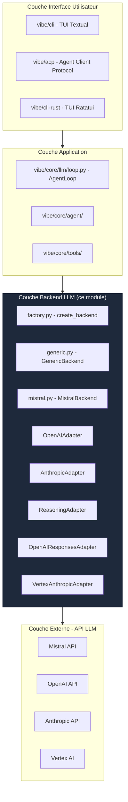

# Vue d'Ensemble du Module Backend LLM

> **Module** : `vibe/core/llm/backend/` 
> **Fork** : `rrobbes/mistral-vibe` 
> **Partie** : 1/13 - Introduction et Concepts de Base

---

## Introduction

Le module `vibe/core/llm/backend/` est **le composant central** qui permet à Mistral Vibe de communiquer avec les différents fournisseurs de modèles de langage (LLM). Sans ce module, Vibe devrait gérer manuellement chaque API LLM, ce qui créerait une complexité insupportable.

### Le Problème Résolu

Imaginez un monde sans ce module :

```python
# Sans backend module - Code dupliqué et complexe
if provider == "mistral":
 # Appel API Mistral
 response = requests.post(
 "https://api.mistral.ai/v1/chat/completions",
 headers={"Authorization": f"Bearer {MISTRAL_API_KEY}"},
 json={"model": model, "messages": messages, ...}
 )
 result = parse_mistral_response(response)
elif provider == "openai":
 # Appel API OpenAI
 response = requests.post(
 "https://api.openai.com/v1/chat/completions",
 headers={"Authorization": f"Bearer {OPENAI_API_KEY}"},
 json={"model": model, "messages": messages, ...}
 )
 result = parse_openai_response(response)
elif provider == "anthropic":
 # Appel API Anthropic - Format différent !
 response = requests.post(
 "https://api.anthropic.com/v1/messages",
 headers={"x-api-key": ANTHROPIC_API_KEY},
 json={"model": model, "messages": formatted_messages, ...}
 )
 result = parse_anthropic_response(response)
# Et ainsi de suite pour chaque provider...
```

**Problèmes majeurs** :
- **Duplication massive** de code
- **Difficile à maintenir** (changement d'API = modifier partout)
- **Peu extensible** (ajouter un provider = modifier tout le code)
- **Peu testable** (difficile de mock)
- **Peu résilient** (chaque provider gère les erreurs différemment)

### La Solution

Le module `backend/` offre une abstraction unifiée :

```python
# Avec backend module - Simple
from vibe.core.llm.backend.factory import create_backend

backend = create_backend(provider=provider_config)

async with backend:
 # Une seule interface pour tous les providers !
 chunk = await backend.complete(
 model=model,
 messages=messages,
 temperature=0.2
 )
 print(chunk.message.content)
```

---

## Positionnement dans l'Architecture

### Où se situe ce module ?



### Rôle Principal

Ce module **isole la complexité** des API LLM et offre une **interface simple et unifiée** pour :

1. **Envoyer des requêtes** aux modèles LLM
2. **Recevoir et parser les réponses** dans un format standard
3. **Gérer le streaming** en temps réel
4. **Normaliser les erreurs** de tous les providers
5. **Optimiser les performances** (caching, retry, pacing)

### Composants Clés

---

## Rôle et Responsabilités

### Ce que ce module FAIT

 **Abstraction des API LLM** : Une interface unique pour tous les providers 
 **Gestion du transport** : Requêtes HTTP, SDK, streaming 
 **Conversion des formats** : Messages, outils, images entre Vibe et les API 
 **Gestion des erreurs** : Normalisation et retrys 
 **Optimisation** : Pacing, caching, timeouts configurables 
 **Tracing** : Intégration OpenTelemetry pour le monitoring 

### Ce que ce module NE FAIT PAS

 **Ne gère pas la logique métier** : C'est le rôle de `llm/loop.py` 
 **Ne gère pas les outils** : C'est le rôle de `core/tools/` 
 **Ne gère pas les agents** : C'est le rôle de `core/agent/` 
 **Ne gère pas la configuration globale** : C'est le rôle de `core/config/` 
 **Ne gère pas le stockage des sessions** : C'est le rôle de `core/sessions/` 

---

## Concepts Clés

### 1. BackendLike : L'Interface Universelle

`BackendLike` est un **Protocol** (interface Python) qui définit **le contrat que tout backend doit respecter**. C'est le point d'entrée principal pour utiliser ce module.

**Méthodes requises** :
- `__aenter__()` et `__aexit__()` : Pour le pattern context manager async
- `complete()` : Requête synchrone, retourne un `LLMChunk` complet
- `complete_streaming()` : Requête asynchrone, yield des `LLMChunk` au fur et à mesure

### 2. APIAdapter : Les Traducteurs

`APIAdapter` est une **classe abstraite** qui définit comment **traduire** entre le monde de Vibe et les API externes.

Chaque adapter implémente :
- `prepare_request()` : Vibe → Requête API
- `parse_response()` : Réponse API → `LLMChunk`
- `parse_stream()` : Stream API → Stream de `LLMChunk`

### 3. LLMChunk : L'Unité de Réponse

`LLMChunk` est **l'unité fondamentale** des réponses LLM dans Vibe. Il contient :

- `message` : `LLMMessage` - Le message retourné par le modèle
- `usage` : `LLMUsage` - Les tokens utilisés (prompt, completion, cached)
- `stop` : `StopInfo` - Pourquoi la génération s'est arrêtée
- `correlation_id` : str - Identifiant de corrélation (optionnel)

### 4. ProviderConfig : Configuration des Providers

`ProviderConfig` contient toutes les informations nécessaires pour se connecter à un provider LLM :

- `name` : Nom du provider (ex: "mistral", "openai")
- `backend` : Type de backend (`Backend.GENERIC` ou `Backend.MISTRAL`)
- `api_base` : URL de base de l'API (ex: "https://api.mistral.ai/v1")
- `api_key_env_var` : Variable d'environnement contenant l'API key
- `api_style` : Style de l'API (ex: "openai", "anthropic")
- Autres : `project_id`, `region` (pour Vertex AI), etc.

### 5. ModelConfig : Configuration des Modèles

`ModelConfig` définit les paramètres du modèle à utiliser :

- `name` : Nom du modèle (ex: "mistral-large-latest")
- `provider` : Provider à utiliser
- `temperature` : Niveau de créativité (0.0 à 1.0)
- `max_tokens` : Nombre maximum de tokens à générer
- `thinking` : Niveau de reasoning ("off", "low", "medium", "high", "max")
- `tool_choice` : Comment choisir les outils ("auto", "none", ou un outil spécifique)

---

## Fonctionnalités Principales

### Abstraction Unifiée

Une seule interface pour tous les providers :

```python
# Fonctionne avec Mistral, OpenAI, Anthropic, Vertex AI, etc.
async with backend:
 chunk = await backend.complete(model=model, messages=messages)
```

### Support du Streaming

Réception progressive des réponses :

```python
async with backend:
 async for chunk in backend.complete_streaming(model=model, messages=messages):
 print(chunk.message.content, end="", flush=True)
```

### Gestion des Outils

Support des Function Calls :

```python
async with backend:
 chunk = await backend.complete(
 model=model,
 messages=messages,
 tools=[weather_tool, calculator_tool],
 tool_choice="auto"
 )
 # chunk.message.tool_calls contient les appels d'outils
```

### Gestion des Images

Support des images dans les messages :

```python
message = LLMMessage(
 role=Role.user,
 content="Qu'y a-t-il sur cette image ?",
 images=[image_attachment]
)
```

### Résilience

- **Retry automatique** avec backoff exponentiel
- **Pacing adaptatif** pour éviter les rate limits
- **Gestion des erreurs** normalisée
- **Timeouts configurables**

### Tracing et Monitoring

Intégration OpenTelemetry pour :
- Suivre les performances
- Monitorer l'utilisation des tokens
- Debugger les problèmes

---

## Comparaison avec d'Autres Approches

| Approche | Avantages | Inconvénients | Complexité |
|----------|-----------|---------------|------------|
| **Sans Abstraction** | Simple pour 1 provider | Code dupliqué, difficile à maintenir | Élevée |
| **Abstraction Basique** | Moins de duplication | Peu flexible, difficile à étendre | Moyenne |
| **Ce Module** | Flexible, Extensible, Robuste | Légère complexité initiale | Moyenne |
| **SDKs Spécifiques** | Optimisé pour chaque provider | Impossible de standardiser, lourd | Élevée |

**Notre approche** : **Choix de conception** entre flexibilité, maintenabilité et performance.

---

## À Retenir

1. **Ce module est le pont** entre Vibe et les API LLM
2. **Il offre une abstraction unifiée** via `BackendLike`
3. **Il gère la complexité** des différents formats d'API
4. **Il est résilient** avec retry, pacing et gestion des erreurs
5. **Il est extensible** - facile d'ajouter un nouveau provider

### Prochaine Étape

Pour comprendre **comment** ce module est conçu, lisez :
→ **[Architecture et Design](/docs/architecture)**
