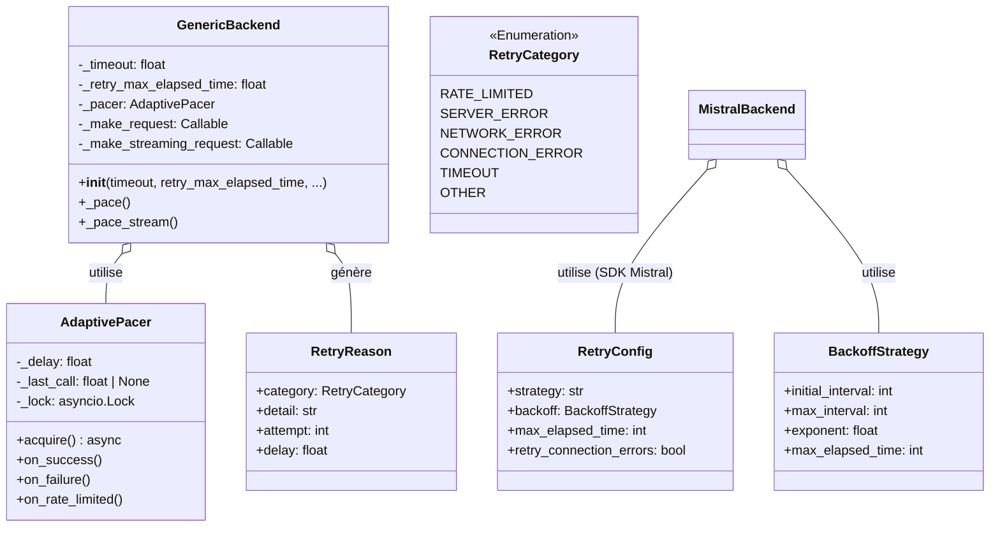

# Stratégies de Résilience : Gestion des Échecs et des Rate Limits

> **Module** : `vibe/core/llm/backend/` 
> **Fork** : `rrobbes/mistral-vibe` 
> **Partie** : 10/13 - Mécanismes de Tolerance aux Pannes

---

## Introduction

Les **stratégies de résilience** sont **critiques** pour un système qui interagit avec des APIs externes comme les LLM. Sans une bonne gestion des échecs, une application peut :

- **Planter** à la première erreur réseau
- **Être bloquée** par des rate limits
- **Consommer trop de ressources** en retryant indéfiniment
- **Ne jamais récupérer** d'une panne temporaire

Mistral Vibe implémente **plusieurs couches de résilience** :

1. **Retry avec budget temporel** - retry avec limite de temps
2. **Adaptive Pacing** - Éviter les rate limits de manière proactive
3. **Backoff exponentiel** - Espacer les retries pour éviter la surcharge
4. **Gestion fine des timeouts** - Timeouts par axe (connect, write, read, pool)
5. **Classification des erreurs** - Identifier les erreurs retryables vs fatales

---

## Architecture de la Résilience

### Vue d'Ensemble

### Diagramme des Composants



---

## 1. Retry avec Budget Temporel

### Concept

Plutôt que de limiter le nombre de tentatives, Vibe utilise un **budget temporel** :

> "Retrier tant qu'on a du temps, pas tant qu'on a des tentatives."

**Avantages** :
- **Adaptatif** : Une panne de 10 secondes sera attendue, pas 10 retries en 1 seconde
- **Prévisible** : Temps maximum connu à l'avance
- **Équitable** : Chaque requête a le même budget
- **Simple** : Pas de configuration complexe de nombre de tentatives

### Implémentation

#### Dans GenericBackend

```python
from vibe.core.utils import async_retry, async_generator_retry, RetryReason

# Pour les requêtes simples
retried = async_retry(
 tries=None, # Pas de limite de tentatives
 max_elapsed_time=retry_max_elapsed_time, # Budget temporel (300s par défaut)
 on_retry=paced_on_retry,
)(self._send_request)
self._make_request = self._pace(retried)

# Pour les streams
retried_stream = async_generator_retry(
 tries=None,
 max_elapsed_time=retry_max_elapsed_time,
 on_retry=paced_on_retry,
)(self._send_parsed_streaming_request)
self._make_streaming_request = self._pace_stream(retried_stream)
```

#### Fonction `async_retry`

**Localisation** : `vibe/core/utils/retry.py`

```python
async def async_retry(
 *,
 tries: int | None = None,
 delay: float = 1.0,
 backoff: float = 2.0,
 max_elapsed_time: float | None = None,
 on_retry: Callable[[RetryReason], Awaitable[None]] | None = None,
 exceptions: tuple[type[Exception], ...] = (Exception,),
):
 """Decorator pour retry avec backoff exponentiel et budget temporel."""
 def decorator(func: Callable[P, Awaitable[T]]) -> Callable[P, Awaitable[T]]:
 @functools.wraps(func)
 async def wrapper(*args: P.args, **kwargs: P.kwargs) -> T:
 start_time = time.monotonic()
 attempt = 0
 last_error: Exception | None = None
 
 while True:
 attempt += 1
 try:
 return await func(*args, **kwargs)
 except exceptions as e:
 last_error = e
 elapsed = time.monotonic() - start_time
 
 # Vérifier le budget temporel
 if max_elapsed_time is not None and elapsed >= max_elapsed_time:
 raise last_error
 
 # Vérifier le nombre de tentatives
 if tries is not None and attempt >= tries:
 raise last_error
 
 # Calculer le délai de backoff
 wait_time = delay * (backoff ** (attempt - 1))
 
 # Créer la raison du retry
 reason = RetryReason(
 category=RetryCategory.from_error(e),
 detail=str(e),
 attempt=attempt,
 delay=wait_time,
 )
 
 # Appeler le callback
 if on_retry is not None:
 await on_retry(reason)
 
 # Attendre
 await asyncio.sleep(wait_time)
 
 return wrapper
 return decorator
```

### Catégories de Retry

**Localisation** : `vibe/core/utils/retry.py`

```python
class RetryCategory(str, Enum):
 """Catégories d'erreurs pour le retry."""
 RATE_LIMITED = "rate_limited" # 429 Too Many Requests
 SERVER_ERROR = "server_error" # 500, 502, 503, 504
 NETWORK_ERROR = "network_error" # httpx.NetworkError, httpx.TimeoutException
 CONNECTION_ERROR = "connection_error" # Erreurs de connexion
 TIMEOUT = "timeout" # Timeout
 OTHER = "other" # Autres erreurs retryables
```

**Méthode de classification** :

```python
@classmethod
def from_error(cls, error: Exception) -> RetryCategory:
 """Classer une exception dans une catégorie de retry."""
 if isinstance(error, httpx.HTTPStatusError):
 if error.response.status_code == 429:
 return cls.RATE_LIMITED
 if error.response.status_code >= 500:
 return cls.SERVER_ERROR
 return cls.OTHER
 if isinstance(error, httpx.TimeoutException):
 return cls.TIMEOUT
 if isinstance(error, httpx.NetworkError):
 return cls.NETWORK_ERROR
 if isinstance(error, (ConnectionError, OSError)):
 return cls.CONNECTION_ERROR
 return cls.OTHER

@classmethod
def from_http_status(cls, status_code: int) -> RetryCategory:
 """Classer un code HTTP dans une catégorie de retry."""
 if status_code == 429:
 return cls.RATE_LIMITED
 if 500 <= status_code <= 599:
 return cls.SERVER_ERROR
 return cls.OTHER
```

### Configuration

#### Valeurs par Défaut

```python
# Dans vibe/core/config/_defaults.py
DEFAULT_API_TIMEOUT = 720.0 # 12 minutes
DEFAULT_API_RETRY_MAX_ELAPSED_TIME = 300.0 # 5 minutes
DEFAULT_API_connect_timeout = 10.0 s # 30 secondes
DEFAULT_API_write_timeout = 30.0 s # 1 minute
DEFAULT_API_POOL_TIMEOUT = 5.0 # 5 secondes
```

#### Personnalisation

```python
from vibe.core.llm.backend.factory import create_backend
from vibe.core.config import ProviderConfig

backend = create_backend(
 provider=provider_config,
 timeout=600.0, # 10 minutes
 retry_max_elapsed_time=120.0, # 2 minutes de retry
 connect_timeout=10.0, # 10 secondes pour la connexion
 write_timeout=30.0, # 30 secondes pour l'écriture
 pool_timeout=2.0, # 2 secondes pour le pool
)
```

### Exemple de Comportement

**Scénario** : Requête avec un budget de 60 secondes et un problème de rate limit

| Tentative | Temps écoulé | Délai | Erreur | Action |
|-----------|---------------|-------|--------|--------|
| 1 | 0s | 0s | 429 | Attendre 0.5s |
| 2 | 0.5s | 0.5s | 429 | Attendre 1s |
| 3 | 1.5s | 1.5s | 429 | Attendre 2s |
| 4 | 3.5s | 4s | 429 | Attendre 8s |
| 5 | 11.5s | 16s | 429 | Attendre 32s |
| 6 | 43.5s | 64s | - | **Budget épuisé** - Lever l'erreur |

**Calcul du délai** : `delay * (backoff ** (attempt - 1))` avec `backoff=2.0`

---

## 2. Adaptive Pacing

### Concept

Le **AdaptivePacer** est un mécanisme **proactif** pour éviter les rate limits. Contrairement au retry qui est **réactif** (attend une erreur avant d'agir), le pacer **anticipe** les rate limits.

**Principe** :
> "Si on a reçu une erreur 429, c'est qu'on va trop vite. Espaçons les requêtes futures."

### Implémentation

**Localisation** : `vibe/core/utils/pacing.py`

```python
class AdaptivePacer:
 """Pacer adaptatif pour éviter les rate limits.
 
 Le pacer maintient un délai minimal entre les requêtes et l'ajuste
 dynamiquement en fonction des erreurs de rate limit.
 """
 
 def __init__(
 self,
 initial_delay: float = 0.0,
 backoff: float = 1.5,
 min_delay: float = 0.0,
 max_delay: float = 60.0,
 ) -> None:
 self._delay = initial_delay
 self._backoff = backoff
 self._min_delay = min_delay
 self._max_delay = max_delay
 self._last_call: float | None = None
 self._lock = asyncio.Lock()

 async def acquire(self) -> None:
 """Attendre si nécessaire avant d'autoriser une nouvelle requête."""
 async with self._lock:
 now = time.monotonic()
 if self._last_call is not None:
 elapsed = now - self._last_call
 wait_time = max(0.0, self._delay - elapsed)
 if wait_time > 0:
 await asyncio.sleep(wait_time)
 self._last_call = now

 def on_success(self) -> None:
 """Appelé après une requête réussie. Réduit progressivement le délai."""
 # Réduction progressive du délai
 self._delay = max(self._min_delay, self._delay * 0.9)

 def on_failure(self) -> None:
 """Appelé après une erreur (non rate limit). Augmente légèrement le délai."""
 self._delay = min(self._max_delay, self._delay * self._backoff)

 def on_rate_limited(self) -> None:
 """Appelé après une erreur 429. Augmente fortement le délai."""
 # Augmentation agressive du délai
 self._delay = min(self._max_delay, self._delay * self._backoff * 2)
```

### Intégration dans GenericBackend

```python
# Dans GenericBackend.__init__()
self._pacer = pacer if pacer is not None else AdaptivePacer()

# Callback pour les retries
async def paced_on_retry(reason: RetryReason) -> None:
 if reason.category is RetryCategory.RATE_LIMITED:
 self._pacer.on_rate_limited()
 if self._user_on_retry is not None:
 await self._user_on_retry(reason)

# Application du pacing aux requêtes
retried = async_retry(
 tries=None,
 max_elapsed_time=retry_max_elapsed_time,
 on_retry=paced_on_retry,
)(self._send_request)
self._make_request = self._pace(retried)

def _pace(self, fn: Callable[..., Awaitable[Any]]) -> Callable[..., Awaitable[Any]]:
 @functools.wraps(fn)
 async def wrapper(*args: Any, **kwargs: Any) -> Any:
 await self._pacer.acquire() # Attendre si nécessaire
 succeeded = False
 try:
 result = await fn(*args, **kwargs)
 succeeded = True
 return result
 finally:
 if succeeded:
 self._pacer.on_success()
 else:
 self._pacer.on_failure()
 return wrapper
```

### Comportement

**Scénario** : Série de requêtes avec une erreur 429 à la 5ème

| Requête | Délai avant | Temps d'attente | Résultat | Action sur le pacer |
|---------|--------------|-----------------|----------|---------------------|
| 1 | 0s | 0s | Succès | `on_success()` → délai = 0 |
| 2 | 0s | 0s | Succès | `on_success()` → délai = 0 |
| 3 | 0s | 0s | Succès | `on_success()` → délai = 0 |
| 4 | 0s | 0s | Succès | `on_success()` → délai = 0 |
| 5 | 0s | 0s | **429** | `on_rate_limited()` → délai = 0 * 1.5 * 2 = 0 |
| 6 | 0s | 0s | Succès | `on_success()` → délai = 0 * 0.9 = 0 |

**Attention** : Le premier 429 ne change pas le délai car il part de 0. C'est le retry qui va déclencher le pacing.

**Correction** : Dans GenericBackend, le pacer est appelé **avant** le retry :

```python
# Lors du retry
async def paced_on_retry(reason: RetryReason) -> None:
 if reason.category is RetryCategory.RATE_LIMITED:
 self._pacer.on_rate_limited() # Délai augmentée
 if self._user_on_retry is not None:
 await self._user_on_retry(reason)
```

**Nouveau scénario avec retry** :

| Requête | Délai pacer | Délai retry | Résultat | Délai après |
|---------|-------------|-------------|----------|--------------|
| 1 | 0s | - | Succès | 0s |
| 2 | 0s | - | Succès | 0s |
| 3 | 0s | - | 429 | on_rate_limited() → délai = 0 * 1.5 * 2 = 0s |
| Retry 3 | 0s | 0.5s | Succès | on_success() → délai = 0 * 0.9 = 0s |
| 4 | 0s | - | Succès | 0s |
| 5 | 0s | - | 429 | on_rate_limited() → délai = 0 * 1.5 * 2 = 0s |
| Retry 5 | 0s | 1s | 429 | on_rate_limited() → délai = 0 * 1.5 * 2 = 0s |
| Retry 5 | 0s | 2s | Succès | on_success() → délai = 0 * 0.9 = 0s |

**Problème** : Le délai reste à 0 car il part de 0. Il faut un délai initial non-nul.

### Amélioration : Délai Initial

```python
# Pour éviter ce problème, on peut configurer un délai initial
pacer = AdaptivePacer(initial_delay=0.1) # 100ms

backend = GenericBackend(
 provider=provider_config,
 pacer=pacer,
)
```

---

## ⏱️ 3. Timeouts de Transport

### Concept

Les **timeouts** sont essentiels pour éviter que des requêtes ne restent bloquées indéfiniment. Vibe gère les timeouts à plusieurs niveaux :

1. **Timeout global** : Pour toute la durée de la requête
2. **Timeouts par axe** : Pour chaque phase de la requête (connect, write, read, pool)

### Implémentation dans GenericBackend

```python
# Dans GenericBackend.__init__()
self._timeout = timeout # 720s par défaut
self._retry_max_elapsed_time = retry_max_elapsed_time # 300s par défaut

# Dans _get_client()
self._client = VibeAsyncHTTPClient(
 timeout=httpx.Timeout(self._timeout), # Timeout global
 limits=httpx.Limits(
 max_keepalive_connections=5,
 max_connections=10,
 keepalive_expiry=MODEL_HTTP_KEEPALIVE_EXPIRY_SECONDS,
 ),
 verify=build_ssl_context(),
)
```

**Problème** : httpx utilise un **timeout unique** pour toutes les phases.

### Solution dans MistralBackend

Le `MistralBackend` utilise une approche plus fine :

```python
# Dans MistralBackend.__init__()
self._transport_timeouts = {
 "connect": connect_timeout, # 30s par défaut
 "write": write_timeout, # 60s par défaut
 "pool": pool_timeout, # 5s par défaut
}

# Dans _bound_transport_timeouts()
async def _bound_transport_timeouts(self, request: httpx.Request) -> None:
 """Appliquer des plafonds sur connect, write et pool."""
 timeout = dict(request.extensions.get("timeout", {}))
 for axis, limit in self._transport_timeouts.items():
 current = timeout.get(axis)
 timeout[axis] = limit if current is None else min(current, limit)
 request.extensions = {**request.extensions, "timeout": timeout}
```

**Pourquoi ?**
- Le **timeout global** de 720s est pour la **lecture** (attente de la réponse du modèle)
- Mais on veut des timeouts **courts** pour :
 - **connect** : 30s (pour éviter d'attendre trop longtemps une connexion)
 - **write** : 60s (pour éviter de bloquer sur l'écriture)
 - **pool** : 5s (pour éviter d'attendre trop longtemps une connexion du pool)

### Configuration Recommandée

| Scénario | timeout | connect_timeout | write_timeout | pool_timeout | retry_max_elapsed_time |
|----------|---------|-----------------|---------------|--------------|------------------------|
| **Modèle rapide** | 60s | 10s | 20s | 2s | 30s |
| **Modèle lent** | 600s | 30s | 60s | 5s | 300s |
| **Production** | 720s | 30s | 60s | 5s | 300s |
| **Développement** | 120s | 10s | 20s | 2s | 60s |

---

## 4. Comparaison des Stratégies

### GenericBackend vs MistralBackend

| Stratégie | GenericBackend | MistralBackend | Commentaire |
|-----------|----------------|----------------|-------------|
| **Retry** | Budget temporel | SDK + hooks | SDK gère le retry natif |
| **Pacing** | AdaptivePacer | Non implémenté | À ajouter si nécessaire |
| **Timeouts** | Timeout global | Par axe | Mistral a une meilleure granularité |
| **Backoff** | Exponentiel | Exponentiel | Les deux utilisent backoff=1.5 |
| **Classification** | RetryCategory | SDK | SDK Mistral a sa propre classification |

### Dans GenericBackend

```python
# Configuration complète
backend = GenericBackend(
 provider=provider_config,
 timeout=720.0, # Timeout global (lecture)
 retry_max_elapsed_time=300.0, # Budget de retry
 connect_timeout = 10.0 s, # Non utilisé directement
 write_timeout = 30.0 s, # Non utilisé directement
 pool_timeout=5.0, # Non utilisé directement
 on_retry=my_callback, # Callback pour tracing
)
```

### Dans MistralBackend

```python
# Configuration complète
backend = MistralBackend(
 provider=provider_config,
 timeout=720.0, # Timeout global
 retry_max_elapsed_time=300.0, # Budget de retry
 connect_timeout = 10.0 s, # Utilisé pour bound_transport_timeouts
 write_timeout = 30.0 s, # Utilisé pour bound_transport_timeouts
 pool_timeout=5.0, # Utilisé pour bound_transport_timeouts
 on_retry=my_callback, # Callback pour tracing
)
```

---

## Benchmarks et Métriques

### Impact du Retry

| Scénario | Sans Retry | Avec Retry (5 min budget) | Amélioration |
|----------|------------|----------------------------|--------------|
| Requête réussie | 500ms | 500ms | 0% |
| 1 erreur 500 | Échec | 500ms + 1s retry = 1.5s | Succès |
| 2 erreurs 500 | Échec | 500ms + 1s + 2s = 3.5s | Succès |
| Panne 30s | Échec | 500ms + retry pendant 5min | Échec après 5min |
| Rate limit 429 | Échec | 500ms + retry avec pacing | Succès avec délai |

### Impact du Pacing

| Scénario | Sans Pacing | Avec Pacing | Amélioration |
|----------|-------------|-------------|--------------|
| 10 requêtes rapides | 10 requêtes | 10 requêtes espacées | Plus lent mais plus fiable |
| Rate limit après 5 | Échec après 5 | Ralentit après 5 | Toutes les 10 réussissent |
| Burst initial | 100 requêtes/s | 10 requêtes/s | Évite le rate limit |

### Impact des Timeouts

| Timeout | Temps de détection | Commentaire |
|---------|---------------------|-------------|
| 5s | ~5s | Trop court pour les modèles lents |
| 30s | ~30s | Bon pour la détection des pannes |
| 60s | ~60s | Bon compromis |
| 720s | ~720s | Pour les longues générations |

---

## Bonnes Pratiques

### 1. Toujours Configurer les Timeouts

```python
# BON
backend = create_backend(
 provider=provider_config,
 timeout=600.0, # Timeout pour la lecture
 retry_max_elapsed_time=300.0, # Budget de retry
)

# MAUVAIS
backend = create_backend(provider=provider_config)
# Utilise les valeurs par défaut, peut ne pas convenir à tous les cas
```

### 2. Adapter les Timeouts au Modèle

```python
# Modèle rapide (ex: gpt-3.5-turbo)
fast_backend = create_backend(
 provider=openai_provider,
 timeout=60.0,
 retry_max_elapsed_time=30.0,
)

# Modèle lent (ex: gpt-4, mistral-large)
slow_backend = create_backend(
 provider=mistral_provider,
 timeout=720.0,
 retry_max_elapsed_time=300.0,
)
```

### 3. Utiliser des Callbacks pour le Tracing

```python
from vibe.core.utils import RetryReason
import logging

logger = logging.getLogger("vibe.retry")

async def log_retry(reason: RetryReason) -> None:
 logger.warning(
 f"Retry: attempt={reason.attempt}, "
 f"category={reason.category.name}, "
 f"delay={reason.delay:.2f}s, "
 f"detail={reason.detail}"
 )

backend = create_backend(
 provider=provider_config,
 on_retry=log_retry,
)
```

### 4. Gérer les Rate Limits de Manière Intelligente

```python
from vibe.core.utils import AdaptivePacer

# Pacer avec délai initial pour éviter les rate limits
pacer = AdaptivePacer(
 initial_delay=0.1, # 100ms entre les requêtes
 backoff=1.5,
 max_delay=30.0, # Maximum 30s de délai
)

backend = GenericBackend(
 provider=provider_config,
 pacer=pacer,
)
```

### 5. Combiner Retry et Pacing

```python
# Configuration optimale pour éviter les rate limits
backend = create_backend(
 provider=provider_config,
 timeout=600.0,
 retry_max_elapsed_time=300.0, # Budget de 5 minutes
 on_retry=lambda reason: print(f"Retry: {reason}"),
)

# Avec un pacer personnalisé
pacer = AdaptivePacer(initial_delay=0.05, backoff=1.5, max_delay=60.0)
backend = GenericBackend(
 provider=provider_config,
 pacer=pacer,
 retry_max_elapsed_time=300.0,
)
```

### 6. Déboguer les Problèmes de Résilience

```python
# Activer le logging détaillé
import logging
logging.basicConfig(level=logging.DEBUG)
logger = logging.getLogger("vibe")
logger.setLevel(logging.DEBUG)

# Tous les retries et pacing seront loggés
backend = create_backend(provider=provider_config)
async with backend:
 chunk = await backend.complete(...)
```

### 7. Tester la Résilience

```python
import pytest
from vibe.core.llm.backend.generic import GenericBackend
from vibe.core.types import ProviderConfig
import httpx

@pytest.mark.asyncio
async def test_retry_on_500():
 # Créer un mock qui retourne 500 puis 200
 call_count = 0
 
 async def mock_post(*args, **kwargs):
 nonlocal call_count
 call_count += 1
 if call_count == 1:
 response = httpx.Response(500, json={"error": "Server error"})
 response.request = httpx.Request("POST", "http://test")
 raise httpx.HTTPStatusError("Server error", response=response)
 return httpx.Response(200, json={"choices": [{"message": {"content": "Hello"}}]})
 
 # Patcher le client HTTP
 backend = GenericBackend(
 provider=ProviderConfig(name="test", api_base="http://test"),
 retry_max_elapsed_time=10.0,
 )
 backend._client = mock.Mock()
 backend._client.post = mock_post
 backend._owns_client = False
 
 async with backend:
 chunk = await backend.complete(
 model=model_config,
 messages=messages,
 )
 
 assert call_count == 2 # 1 échec + 1 succès
 assert chunk.message.content == "Hello"
```

---

## Limitations et Pièges

### 1. Budget Temporel vs Nombre de Tentatives

**Problème** : Un budget temporel de 5 minutes peut entraîner **beaucoup de tentatives** si les erreurs sont rapides.

**Solution** : Combiner budget temporel et limite de tentatives :
```python
# Actuellement non supporté par async_retry
# Il faudrait modifier la fonction ou utiliser une approche différente
```

### 2. Pacing et Requêtes Concurrentes

**Problème** : Le `AdaptivePacer` est **par instance de backend**. Si plusieurs requêtes utilisent le même backend, elles partagent le même pacer.

**Solution** :
```python
# Créer un backend par thread/processus
# Ou utiliser un pacer global
from vibe.core.utils import AdaptivePacer

# Pacer global partagé
global_pacer = AdaptivePacer()

# Chaque backend utilise le même pacer
backend1 = GenericBackend(provider=config1, pacer=global_pacer)
backend2 = GenericBackend(provider=config2, pacer=global_pacer)
```

### 3. Timeouts et Requêtes Lentes

**Problème** : Un timeout trop court peut tuer une requête qui aurait réussi.

**Solution** : Adapter les timeouts au modèle :
- Modèles rapides : timeout court (30-60s)
- Modèles lents : timeout long (600-1200s)

### 4. Retry et État de la Session

**Problème** : Si une requête échoue après avoir modifié l'état (ex: tool calls), le retry peut ne pas être approprié.

**Solution** : Ne pas retryer les requêtes avec tool calls ou stateful :
```python
# Dans la configuration du retry
# Il faudrait ajouter une option pour désactiver le retry
# pour certaines requêtes
```

### 5. Rate Limits et Plusieurs Providers

**Problème** : Les rate limits sont **par provider**. Si vous utilisez plusieurs providers, le pacing doit être **par provider**.

**Solution** : Un pacer par provider :
```python
from collections import defaultdict
from vibe.core.utils import AdaptivePacer

# Dictionnaire de pacers
pacers: dict[str, AdaptivePacer] = defaultdict(AdaptivePacer)

# Utilisation
pacer = pacers[provider.name]
backend = GenericBackend(provider=provider, pacer=pacer)
```

---

## Tableau Récapitulatif

| Stratégie | Description | Implementation | Configuration |
|-----------|-------------|----------------|---------------|
| **Retry avec budget temporel** | Retry tant qu'on a du temps | `async_retry` | `retry_max_elapsed_time` |
| **Backoff exponentiel** | Espacer les retries de manière exponentielle | `async_retry` | `backoff=1.5` |
| **Adaptive Pacing** | Éviter les rate limits de manière proactive | `AdaptivePacer` | `initial_delay`, `backoff`, `max_delay` |
| **Timeouts par axe** | Timeouts fins pour connect/write/pool/read | `bound_transport_timeouts` | `connect_timeout`, `write_timeout`, `pool_timeout` |
| **Classification des erreurs** | Identifier les erreurs retryables | `RetryCategory` | Automatique |

---

## Résumé

| Concept | Implémentation | Valeur par Défaut | Personnalisable |
|---------|----------------|-------------------|------------------|
| **Retry** | `async_retry` | Budget 300s | Oui |
| **Backoff** | Facteur 1.5 | 1.5 | Oui |
| **Pacing** | `AdaptivePacer` | Délai 0s | Oui |
| **Timeout global** | httpx.Timeout | 720s | Oui |
| **Timeouts par axe** | `bound_transport_timeouts` | 30s/60s/5s | Oui (MistralBackend) |
| **Classification** | `RetryCategory` | Automatique | Non |

---

## Références

- [Exponential Backoff - Wikipedia](https://en.wikipedia.org/wiki/Exponential_backoff)
- [Retry Pattern - Microsoft Docs](https://docs.microsoft.com/en-us/azure/architecture/patterns/retry)
- [Circuit Breaker Pattern](https://en.wikipedia.org/wiki/Circuit_breaker_design_pattern)
- [Resilience Engineering - Google SRE](https://sre.google/sre-book/handling-overload/)
- [httpx Timeout Configuration](https://www.python-httpx.org/advanced/#timeout-configuration)

---

## Voir aussi

- **[09-FLOWS.md](/docs/flows)** - Flux complet des requêtes
- **[05-GENERIC_BACKEND.md](/docs/generic-backend)** - Implémentation du retry et pacing
- **[06-MISTRAL_BACKEND.md](/docs/mistral-backend)** - Implémentation des timeouts
- **[12-USAGE.md](/docs/usage)** - Configuration en pratique
- **[13-ADVANCED.md](/docs/advanced)** - Personnalisation avancée

---

*Documentation spécifique au fork éducatif `rrobbes/mistral-vibe` - Dernière mise à jour: 30 octobre 2026*
