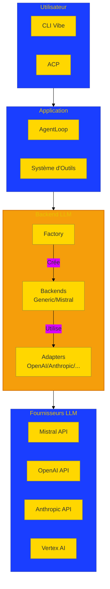
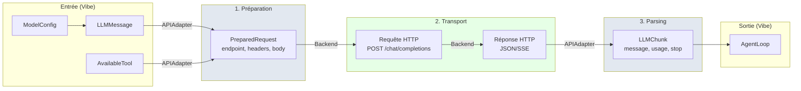
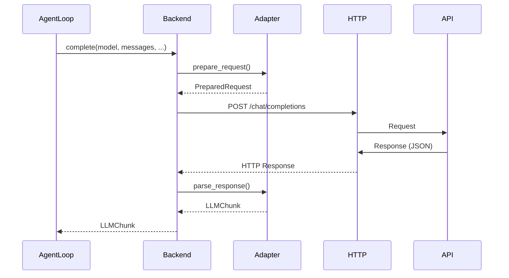
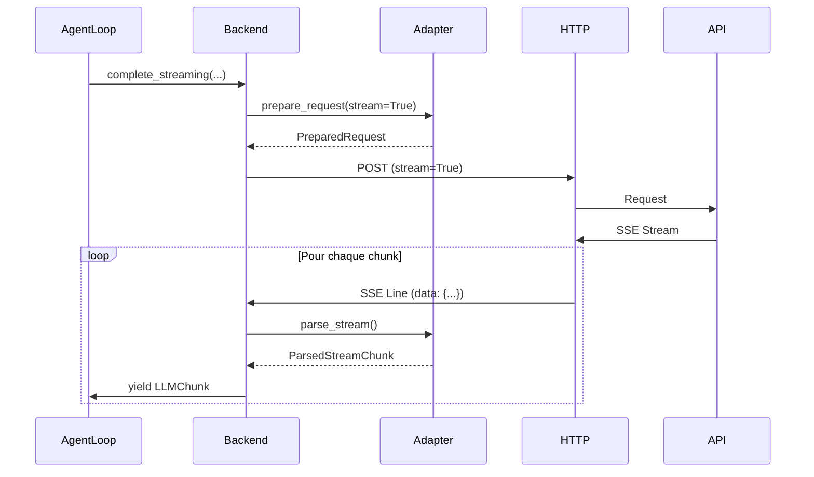

# **Synthèse du Module Backend LLM - Mistral Vibe**

> **Module** : `vibe/core/llm/backend/` 
> **Fork** : `rrobbes/mistral-vibe` 
> **Type** : Documentation Synthétique

---

## **En Bref**

Le module **`vibe/core/llm/backend/`** est le module responsable de la communication entre Mistral Vibe et les fournisseurs de modèles de langage (Mistral, OpenAI, Anthropic, Vertex AI, etc.). Il offre une abstraction unifiée qui masque la complexité des différentes API et permet à Vibe d'interagir avec n'importe quel provider LLM de manière transparente.

** En une phrase** : *Une seule interface pour tous les modèles LLM.*

---

## **Architecture en 1 Image**



---

## **Les 4 Composants Clés**

### 1️⃣ **BackendLike** (Protocol)
**Rôle** : Interface universelle que tous les backends doivent implémenter 
**Fichier** : `vibe/core/llm/types.py` 

**Méthodes obligatoires** :
```python
async def __aenter__(self) -> BackendLike # Context manager
async def __aexit__(self, ...) -> None # Nettoyage
async def complete(self, *, model, messages, ...) -> LLMChunk # Requête synchrone
complete_streaming(self, ...) -> AsyncGenerator[LLMChunk] # Requête streaming
```

**Pourquoi ?** : Permet à l'AgentLoop d'utiliser n'importe quel backend **sans connaître son implémentation**. 

---

### 2️⃣ **APIAdapter** (Classe Abstraite)
**Rôle** : Traducteur entre les formats Vibe et les API externes 
**Fichier** : `vibe/core/llm/backend/base.py` 

**Méthodes à implémenter** :
```python
def prepare_request(self, *, model_name, messages, ...) -> PreparedRequest # Vibe → API
def parse_response(self, data, provider) -> LLMChunk # API → Vibe
async def parse_stream(self, responses, provider) -> AsyncGenerator[ParsedStreamChunk]
```

**Adapters existants** : OpenAIAdapter, AnthropicAdapter, ReasoningAdapter, OpenAIResponsesAdapter, VertexAnthropicAdapter

**Exemple** : L'AnthropicAdapter convertit les `LLMMessage` de Vibe vers le format `messages` d'Anthropic, et vice-versa.

---

### 3️⃣ **Backends** (Implémentations Concrètes)

| Backend | Type | SDK/Technologie | Cas d'Usage |
|---------|------|----------------|-------------|
| **GenericBackend** | HTTP | httpx | Providers sans SDK (OpenAI, Anthropic via adapters) |
| **MistralBackend** | SDK | mistralai | Modèles Mistral (meilleures performances) |

**Généralités** :
- Gèrent le **transport HTTP** (ou SDK)
- Implémentent la **logique de retry**
- Gèrent le **pacing adaptatif** (éviter les rate limits)
- Supportent le **streaming** (SSE)
- Intègrent le **tracing** (OpenTelemetry)

---

### 4️⃣ **Factory** (Création)
**Rôle** : Créer le bon backend selon le provider 
**Fichier** : `vibe/core/llm/backend/factory.py` 

**Fonction principale** :
```python
def create_backend(
 *,
 provider: ProviderConfig,
 timeout: float = 720.0,
 retry_max_elapsed_time: float = 300.0,
 connect_timeout = 10.0 s,
 write_timeout = 30.0 s,
 pool_timeout = 10.0 s,
 enable_otel: bool = False,
 on_retry: RetryObserver | None = None,
) -> BackendLike
```

**Fonctionnalités** :
- **Lazy loading** : Les modules lourds (comme mistralai) ne sont chargés qu'à la première utilisation
- **Sélection automatique** : Choisit GenericBackend ou MistralBackend selon le provider
- **Configuration unifiée** : Tous les timeouts et options en un seul endroit

---

## **Flux de Données**



---

## **Configuration**

### ProviderConfig (Définition d'un Provider)

```python
from vibe.core.config import ProviderConfig
from vibe.core.types import Backend

provider = ProviderConfig(
 name="mistral", # Nom unique du provider
 backend=Backend.MISTRAL, # Type de backend : MISTRAL ou GENERIC
 api_base="https://api.mistral.ai/v1", # URL de base de l'API
 api_key_env_var="MISTRAL_API_KEY", # Variable d'env pour la clé API
 api_style="mistral", # Style d'API pour l'adapter
 reasoning_field_name="reasoning_content", # Champ pour le reasoning
)
```

**Providers supportés** :
- Mistral (backend: MISTRAL, api_style: mistral)
- OpenAI (backend: GENERIC, api_style: openai)
- Anthropic (backend: GENERIC, api_style: anthropic)
- Vertex AI (backend: GENERIC, api_style: vertex-anthropic)
- OpenRouter (backend: GENERIC, api_style: openai)

---

### Création d'un Backend

```python
from vibe.core.llm.backend.factory import create_backend

# Création via la Factory (méthode recommandée)
backend = create_backend(
 provider=provider,
 timeout=300.0, # Timeout global (secondes)
 retry_max_elapsed_time=180.0, # Budget pour les retries (secondes)
 enable_otel=False, # Désactiver OpenTelemetry
)

# Utilisation avec context manager
async with backend:
 chunk = await backend.complete(
 model=model,
 messages=messages,
 temperature=0.2,
 )
 print(chunk.message.content)
```

---

## **Utilisation de Base**

### 1. Requête Synchrone (Non-Streaming)

```python
import asyncio
from vibe.core.config import ProviderConfig, ModelConfig
from vibe.core.types import LLMMessage, Role
from vibe.core.llm.backend.factory import create_backend

async def simple_query():
 provider = ProviderConfig(
 name="mistral",
 backend=Backend.MISTRAL,
 api_base="https://api.mistral.ai/v1",
 api_key_env_var="MISTRAL_API_KEY",
 )
 
 model = ModelConfig(name="mistral-large-latest", thinking="off")
 messages = [
 LLMMessage(role=Role.user, content="Quelle est la capitale de la France ?"),
 ]
 
 backend = create_backend(provider=provider)
 
 async with backend:
 chunk = await backend.complete(
 model=model,
 messages=messages,
 temperature=0.2,
 )
 
 print(f"Réponse: {chunk.message.content}")
 print(f"Usage: {chunk.usage.prompt_tokens} prompt tokens, {chunk.usage.completion_tokens} completion tokens")

asyncio.run(simple_query())
```

### 2. Requête Streaming

```python
async def streaming_query():
 # ... configuration identique ...
 
 async with backend:
 async for chunk in backend.complete_streaming(
 model=model,
 messages=messages,
 temperature=0.7,
 ):
 if chunk.message.content:
 print(chunk.message.content, end="", flush=True)

asyncio.run(streaming_query())
```

---

## **Fonctionnalités Avancées**

### Gestion des Messages

**Types de messages supportés** :
- `system` : Instructions du système
- `user` : Questions de l'utilisateur
- `assistant` : Réponses de l'assistant
- `tool` : Résultats d'outils

**Exemple avec images** :
```python
from vibe.core.types import ImageAttachment, ImageType

image = ImageAttachment(
 type=ImageType.PATH,
 path="/path/to/image.jpg",
)

message = LLMMessage(
 role=Role.user,
 content="Décris cette image",
 images=[image], # Images converties automatiquement en Data URI
)
```

### Gestion des Outils (Tool Calls)

```python
from vibe.core.types import AvailableTool, FunctionDefinition

tools = [
 AvailableTool(
 function=FunctionDefinition(
 name="get_weather",
 description="Récupère la météo pour une ville",
 parameters={
 "type": "object",
 "properties": {
 "city": {"type": "string", "description": "Nom de la ville"}
 },
 "required": ["city"],
 },
 ),
 ),
]

chunk = await backend.complete(
 model=model,
 messages=messages,
 tools=tools,
 tool_choice="auto", # auto, none, ou nom d'un outil
)

# Si l'assistant appelle un outil
if chunk.message.tool_calls:
 for tool_call in chunk.message.tool_calls:
 print(f"Appel de {tool_call.function.name} avec {tool_call.function.arguments}")
```

---

## **Résilience et Optimisation**

### Stratégie de Retry

- **Erreurs récupérables** : 429 (Rate Limit), 500/502/503/504, NetworkErrors, Timeout
- **Backoff exponentiel** : `initial_interval=500ms`, `max_interval=30s`, `exponent=1.5`
- **Budget temporel** : Arrête après `retry_max_elapsed_time` secondes
- **Adaptive Pacing** : Ajuste automatiquement le rythme après un rate limit

**Exemple de configuration** :
```python
backend = create_backend(
 provider=provider,
 retry_max_elapsed_time=300.0, # 5 minutes de budget pour les retries
)
```

### Observabilité

```python
from vibe.core.utils import RetryObserver, RetryReason

class MyObserver:
 async def __call__(self, reason: RetryReason):
 print(f"Retry: {reason.category.name} - {reason.detail}")

backend = create_backend(
 provider=provider,
 on_retry=MyObserver(),
 enable_otel=True, # Active OpenTelemetry
)
```

---

## **Diagrammes des Flux Principaux**

### 1. Flux d'une Requête Non-Streaming



### 2. Flux d'une Requête Streaming



### 3. Architecture en Couches

---

## **Points Clés à Retenir**

### **Pourquoi ce module est-il important ?**

| Problème (Sans Backend) | Solution (Avec Backend) |
|--------------------------|-------------------------|
| Code dupliqué pour chaque provider | Une seule interface unifiée |
| Difficile à maintenir | Maintenance centralisée |
| Peu extensible | Ajout facile de nouveaux providers |
| Peu testable | Composants isolés et testables |
| Gestion des erreurs incohérente | gestion des erreurs standardisée |

### **Les 5 Atouts du Module**

1. ** Abstraction** : Masque la complexité des API externes
2. ** Performance** : Lazy loading, pooling, pacing adaptatif
3. ** Résilience** : retry, backoff exponentiel
4. ** Extensibilité** : Ajout facile de nouveaux providers
5. ** Observabilité** : Tracing, logging, métriques

### **Chiffres Clés**

- **2 Backends** : Generic (HTTP), Mistral (SDK)
- **5 Adapters** : OpenAI, Anthropic, OpenAIResponses, Reasoning, Vertex
- **3203 lignes** de code Python
- **~11 000 lignes** de documentation
- **10+ diagrammes** pour visualiser les concepts

---

## **Exemple Complet : Chatbot Simple**

```python
import asyncio
from vibe.core.llm.backend.factory import create_backend
from vibe.core.config import ProviderConfig, ModelConfig
from vibe.core.types import Backend, LLMMessage, Role

class SimpleChatbot:
 def __init__(self, provider_config: ProviderConfig, model_name: str):
 self.provider = provider_config
 self.model = ModelConfig(name=model_name, thinking="off")
 self.conversation = []
 
 async def __aenter__(self):
 self.backend = create_backend(provider=self.provider)
 await self.backend.__aenter__()
 # Message système initial
 self.conversation.append(
 LLMMessage(role=Role.system, content="Tu es un assistant utile.")
 )
 return self
 
 async def __aexit__(self, *args):
 await self.backend.__aexit__(*args)
 
 async def ask(self, question: str) -> str:
 self.conversation.append(LLMMessage(role=Role.user, content=question))
 
 async with self.backend:
 chunk = await self.backend.complete(
 model=self.model,
 messages=self.conversation,
 temperature=0.7,
 )
 
 self.conversation.append(chunk.message)
 return chunk.message.content

async def main():
 provider = ProviderConfig(
 name="mistral",
 backend=Backend.MISTRAL,
 api_base="https://api.mistral.ai/v1",
 api_key_env_var="MISTRAL_API_KEY",
 )
 
 chatbot = SimpleChatbot(provider, "mistral-large-latest")
 
 async with chatbot:
 response = await chatbot.ask("Bonjour !")
 print(f"Assistant: {response}")
 
 response = await chatbot.ask("Quelle est la capitale de la France ?")
 print(f"Assistant: {response}")

if __name__ == "__main__":
 asyncio.run(main())
```

---

## **Pour Aller Plus Loin**

### Documentation Complète
- **[01-OVERVIEW.md](/docs/overview)** - Vue d'ensemble détaillée
- **[02-ARCHITECTURE.md](/docs/architecture)** - Principes de conception
- **[03-FOUNDATIONS.md](/docs/foundations)** - BackendLike et APIAdapter
- **[11-DIAGRAMS.md](/docs/diagrams)** - Tous les diagrammes
- **[12-USAGE.md](/docs/usage)** - Guide pratique complet
- **[13-ADVANCED.md](/docs/advanced)** - Extensions et contributions

### Ressources Externes
- [Repository GitHub (rrobbes/mistral-vibe)](https://github.com/rrobbes/mistral-vibe)
- [Documentation Mistral SDK](https://github.com/mistralai/mistral-src)
- [OpenAI API Reference](https://platform.openai.com/docs/api-reference)
- [Anthropic API Documentation](https://docs.anthropic.com/en/api)

---

## **Résumé en 3 Points**

1. **Le module backend est une couche d'abstraction** qui permet à Vibe de communiquer avec n'importe quel provider LLM via une interface unique.

2. **Il repose sur 4 composants** : BackendLike (interface), APIAdapter (traducteur), Backends (implémentations), Factory (création).

3. **Il offre** : unification des API, résilience, performance, extensibilité et observabilité.

---

*Cette synthèse couvre l'essentiel du module `vibe/core/llm/backend/`. Pour plus de détails, consultez les fichiers de documentation complets dans le dossier `docs/`.*
