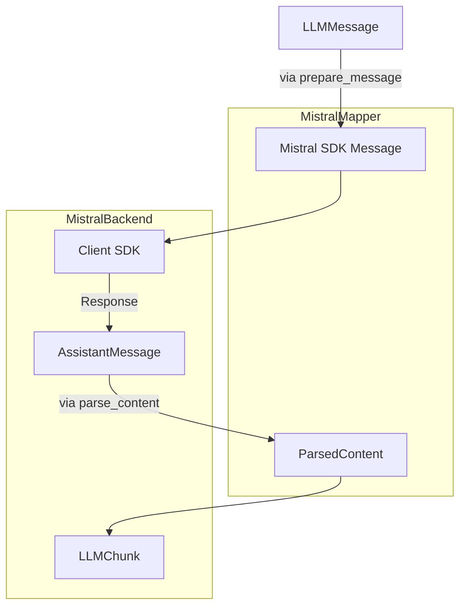

# MistralBackend : Intégration SDK Native

> **Module** : `vibe/core/llm/backend/` 
> **Fichier** : `mistral.py` 
> **Fork** : `rrobbes/mistral-vibe` 
> **Partie** : 6/13 - Backend Spécialisé Mistral

---

## Introduction

Le **`MistralBackend`** représente l'une des deux implémentations concrètes de backend dans Vibe, spécialement conçue pour interagir avec les modèles Mistral via leur **SDK officiel Python** (`mistralai` package). Contrairement au `GenericBackend` qui utilise des requêtes HTTP brutes, `MistralBackend` offre une intégration native avec le SDK Mistral, ce qui permet :

- Une **abstraction** des concepts spécifiques Mistral (thinking, tool calls, etc.)
- Une **gestion** des retries et des erreurs via le SDK
- Un **support natif** des fonctionnalités avancées comme le streaming
- Une **intégration transparente** avec les services Mistral (y compris Vertex AI)

---

## ️ Architecture Générale

### Structure du Fichier `mistral.py`

### Flux de Données dans MistralBackend



---

## Composants Internes

### 1. MistralMapper : Le Traducteur

Le `MistralMapper` est une **classe de transformation** qui assure la conversion bidirectionnelle entre les types Vibe et les types du SDK Mistral.

#### `prepare_message()` - De Vibe vers Mistral

Convertit un `LLMMessage` Vibe en un `ChatCompletionRequestMessage` du SDK Mistral.

**Signature** :
```python
def prepare_message(
 self, msg: LLMMessage, *, include_reasoning_content: bool = True
) -> ChatCompletionRequestMessage
```

**Cas d'utilisation par rôle** :

```python
# System Message
SystemMessage(role="system", content=msg.content or "")

# User Message (avec images)
UserMessage(
 role="user",
 content=[
 TextChunk(type="text", text=msg.content),
 ImageURLChunk(type="image_url", image_url=ImageURL(url=_to_data_uri(att)))
 for att in msg.images
 ]
)

# Assistant Message (avec reasoning)
AssistantMessage(
 role="assistant",
 content=[
 ThinkChunk(type="thinking", thinking=[TextChunk(type="text", text=msg.reasoning_content)]),
 TextChunk(type="text", text=msg.content)
 ],
 tool_calls=[...] # Conversion des tool calls
)

# Tool Message
ToolMessage(
 role="tool",
 content=msg.content,
 tool_call_id=msg.tool_call_id,
 name=msg.name,
)
```

**Points clés** :
- Gestion des **images** via `_to_data_uri()` (conversion en data URI)
- Support du **reasoning content** via `ThinkChunk`
- Conversion des **tool calls** vers le format Mistral
- Preservation des métadonnées (index, id, etc.)

#### `parse_content()` - De Mistral vers Vibe

Extraire le contenu textuel et le reasoning depuis les réponses du SDK.

**Signature** :
```python
def parse_content(self, content: AssistantMessageContent) -> ParsedContent
```

**Types gérés** :
- `str` → Contenu simple
- `list[ContentChunk]` → Contenu riche avec raisonnement
 - `TextChunk` → Contenu textuel
 - `ThinkChunk` → Contenu de reasoning
 - `FileChunk` → Ignoré (non supporté)

**Exemple** :
```python
# Réponse avec thinking
content = [
 ThinkChunk(type="thinking", thinking=[TextChunk(type="text", text="Je réfléchis...")]),
 TextChunk(type="text", text="Voici ma réponse")
]

# Résultat
ParsedContent(
 content="Voici ma réponse",
 reasoning_content="Je réfléchis..."
)
```

#### `prepare_tool()` et `prepare_tool_choice()`

**`prepare_tool()`** : Convertit un `AvailableTool` Vibe en `Tool` du SDK Mistral.

```python
def prepare_tool(self, tool: AvailableTool) -> Tool:
 return Tool(
 type="function",
 function=Function(
 name=tool.function.name,
 description=tool.function.description,
 parameters=tool.function.parameters,
 ),
 )
```

**`prepare_tool_choice()`** : Convertit les choix d'outils.

```python
def prepare_tool_choice(
 self, tool_choice: StrToolChoice | AvailableTool
) -> ChatCompletionStreamRequestToolChoice:
 if isinstance(tool_choice, str):
 return cast(ToolChoiceEnum, tool_choice) # "auto", "none", "any"
 
 return ToolChoice(
 type="function",
 function=FunctionName(name=tool_choice.function.name)
 )
```

#### `parse_tool_calls()`

Convertit les `MistralToolCall` du SDK en `ToolCall` Vibe.

```python
def parse_tool_calls(self, tool_calls: list[MistralToolCall]) -> list[ToolCall]:
 return [
 ToolCall(
 id=tool_call.id,
 function=FunctionCall(
 name=tool_call.function.name,
 arguments=tool_call.function.arguments
 if isinstance(tool_call.function.arguments, str)
 else json.dumps(tool_call.function.arguments, ensure_ascii=False),
 ),
 index=tool_call.index,
 )
 for tool_call in tool_calls
 ]
```

**Points clés** :
- Gestion des arguments sous forme de `str` ou `dict`
- Sérialisation JSON avec `ensure_ascii=False` pour Unicode
- Préservation de l'index et de l'id

### 2. ️ Fonctions Utilitaires

#### `_reasoning_effort()` - Mapping du Niveau de Réflexion

Convertit le paramètre `thinking` de la configuration Vibe en valeur acceptable par le SDK Mistral.

```python
ReasoningEffortValue = Literal["none", "high"]

_THINKING_TO_REASONING_EFFORT: dict[str, ReasoningEffortValue] = {
 "low": "none",
 "medium": "high",
 "high": "high",
 "max": "high",
}

def _reasoning_effort(model: ModelConfig) -> ReasoningEffortValue | None:
 if (
 model.thinking == "off"
 and "off" in model.thinking_levels
 and model.thinking_levels_curated
 ):
 return "none"
 return _THINKING_TO_REASONING_EFFORT.get(model.thinking)
```

**Logique** :
- `thinking="off"` → `None` (sauf si explicitement supporté)
- `thinking="low"` → `"none"`
- `thinking="medium"` ou `"high"` ou `"max"` → `"high"`

**Note importante** : Certains modèles (comme la famille zai-glm) rejettent la valeur explicite `"none"`, donc le mapping est conditionnel.

#### `_cached_tokens()` - Extraction des Tokens Cache

Le SDK Mistral rapporte les hits de cache dans `usage.prompt_tokens_details.cached_tokens`. Cette fonction extrait cette valeur de manière sécurisée.

```python
def _cached_tokens(usage: object | None) -> int:
 if usage is None:
 return 0
 details = getattr(usage, "prompt_tokens_details", None)
 value = (
 details.get("cached_tokens")
 if isinstance(details, dict)
 else getattr(details, "cached_tokens", None)
 )
 try:
 return int(value or 0)
 except (TypeError, ValueError):
 return 0
```

**Points clés** :
- Gestion des types variables (dict vs object)
- Conversion sécurisée en int
- Valeur par défaut 0 en cas d'erreur

---

## MistralBackend : Classe Principale

### Constructeur `__init__()`

Initialise le backend avec la configuration nécessaire.

**Signature** :
```python
def __init__(
 self,
 provider: ProviderConfig,
 timeout: float = DEFAULT_API_TIMEOUT,
 retry_max_elapsed_time: float = DEFAULT_API_RETRY_MAX_ELAPSED_TIME,
 connect_timeout = 10.0 s,
)

# Utilisation dans un contexte async
async with backend:
 # Complétion simple
 chunk = await backend.complete(
 model=model,
 messages=messages,
 temperature=0.2
 )
 
 # Complétion en streaming
 async for chunk in backend.complete_streaming(
 model=model,
 messages=messages,
 temperature=0.2
 ):
 print(chunk.message.content)
```

### 2. ️ Limitations et Contraintes

- ** Ne pas** utiliser `reasoning_field_name` personnalisé
- ** Vérifier** que `api_base` a un format valide avec version API
- **️ Certains modèles** peuvent rejeter `reasoning_effort=