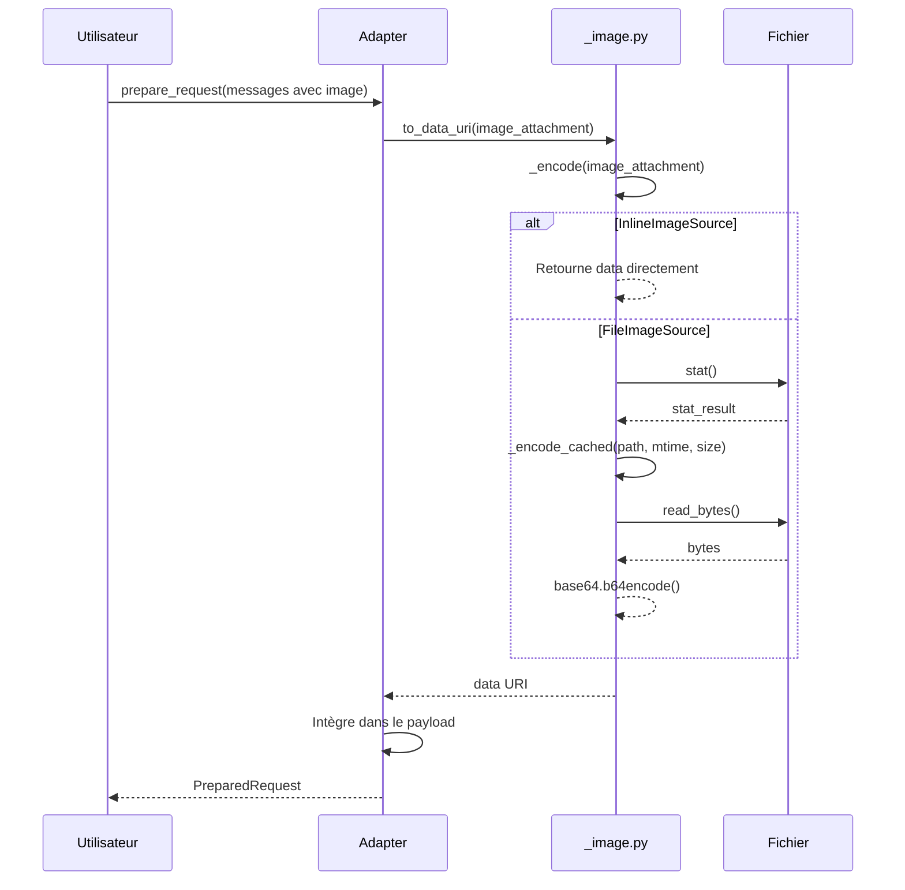
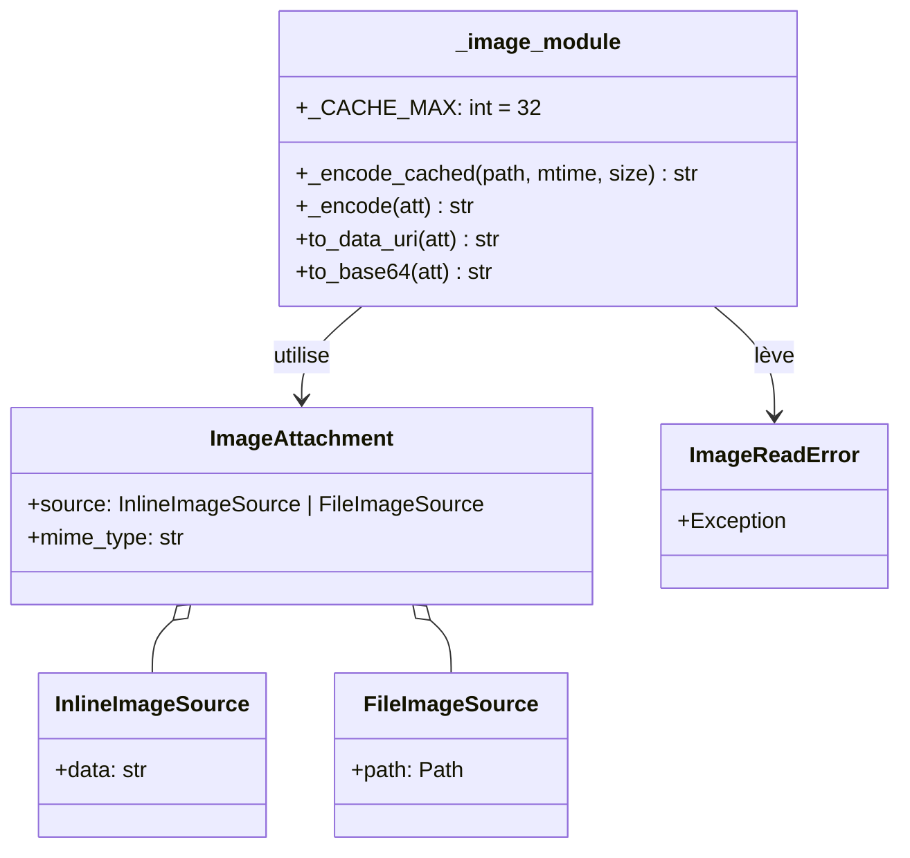

# ️ Module Image : gestion des Images LLM

> **Module** : `vibe/core/llm/backend/` 
> **Fork** : `rrobbes/mistral-vibe` 
> **Partie** : 8/13 - Encodage et Optimisation des Images

---

## Introduction

Le module `_image.py` fournit une **gestion** pour l'encodage et l'optimisation des images dans les requêtes LLM. C'est un **composant** car les images peuvent représenter une part importante de la taille des requêtes.

### Localisation

### Le Problème Résolu

Les images dans les requêtes LLM posent plusieurs défis :

1. ** Formats variés** : Les fournisseurs acceptent différents formats (data URI, base64, URL)
2. ** Taille importante** : Les images peuvent être très grandes et ralentir les requêtes
3. ** Lecture multiples** : La même image peut être utilisée dans plusieurs requêtes
4. ** Gestion des erreurs** : Les fichiers images peuvent être corrompus ou inaccessibles

**Solution** : Un module centralisé avec :
- Encodage unifié (data URI et base64)
- Cache des images fréquemment utilisées
- gestion des erreurs

---

## Structure du Code

Le fichier `_image.py` est **concis** (42 lignes) :

```python
from __future__ import annotations

import base64
from functools import lru_cache
from pathlib import Path

from vibe.core.types import FileImageSource, ImageAttachment, InlineImageSource

class ImageReadError(Exception):
 pass

_CACHE_MAX = 32

@lru_cache(maxsize=_CACHE_MAX)
def _encode_cached(path_str: str, mtime_ns: int, size: int) -> str:
 try:
 return base64.b64encode(Path(path_str).read_bytes()).decode("ascii")
 except OSError as e:
 raise ImageReadError(f"Failed to read image {path_str}: {e}") from e

def _encode(att: ImageAttachment) -> str:
 match att.source:
 case InlineImageSource(data=data):
 return data
 case FileImageSource(path=path):
 try:
 stat = path.stat()
 except OSError as e:
 raise ImageReadError(f"Failed to stat image {path}: {e}") from e
 return _encode_cached(str(path), stat.st_mtime_ns, stat.st_size)

def to_data_uri(att: ImageAttachment) -> str:
 return f"data:{att.mime_type};base64,{_encode(att)}"

def to_base64(att: ImageAttachment) -> str:
 return _encode(att)
```

---

## ️ Types Utilisés

### ImageAttachment

Définie dans `vibe/core/llm/types.py` :

```python
class ImageAttachment:
 """An image that can be sent to a model."""
 source: InlineImageSource | FileImageSource
 mime_type: str
 # Exemple: "image/jpeg", "image/png", "image/webp"
```

### Sources d'Images

```python
class InlineImageSource:
 """Image data already in memory."""
 data: str # Données base64 ou data URI

class FileImageSource:
 """Reference to an image file on disk."""
 path: Path
```

### Exemple d'Utilisation

```python
from vibe.core.types import ImageAttachment, FileImageSource, InlineImageSource
from pathlib import Path

# Depuis un fichier
file_image = ImageAttachment(
 source=FileImageSource(path=Path("/path/to/image.jpg")),
 mime_type="image/jpeg",
)

# Depuis des données en mémoire
data_uri = "data:image/png;base64,iVBORw0KGgoAAAANSUhEUgAA..."
inline_image = ImageAttachment(
 source=InlineImageSource(data=data_uri),
 mime_type="image/png",
)
```

---

## Fonctionnalités Clés

### 1. Encodage Base64 avec Cache

#### Fonction `_encode_cached()`

```python
@lru_cache(maxsize=_CACHE_MAX)
def _encode_cached(path_str: str, mtime_ns: int, size: int) -> str:
 try:
 return base64.b64encode(Path(path_str).read_bytes()).decode("ascii")
 except OSError as e:
 raise ImageReadError(f"Failed to read image {path_str}: {e}") from e
```

**Fonctionnement** :
- **Cache LRU** : Les 32 images les plus récemment utilisées sont mises en cache
- **Clé de cache** : `(path_str, mtime_ns, size)` - le cache est invalidé si le fichier change
- **Encodage** : Lecture binaire → base64 → décodage en ASCII
- **Gestion des erreurs** : Levée de `ImageReadError` si le fichier ne peut pas être lu

**Pourquoi un cache ?**
- Évite de relire le fichier à chaque requête
- Réduit les I/O disque
- Améliore les performances pour les images fréquemment utilisées

#### Fonction `_encode()`

```python
def _encode(att: ImageAttachment) -> str:
 match att.source:
 case InlineImageSource(data=data):
 return data
 case FileImageSource(path=path):
 try:
 stat = path.stat()
 except OSError as e:
 raise ImageReadError(f"Failed to stat image {path}: {e}") from e
 return _encode_cached(str(path), stat.st_mtime_ns, stat.st_size)
```

**Fonctionnement** :
- Si `InlineImageSource` : retourne directement les données
- Si `FileImageSource` : utilise le cache pour encoder le fichier

### 2. Conversion en Data URI

#### Fonction `to_data_uri()`

```python
def to_data_uri(att: ImageAttachment) -> str:
 return f"data:{att.mime_type};base64,{_encode(att)}"
```

**Format** : `data:<mime-type>;base64,<data>`

**Exemple** :
```
data:image/jpeg;base64,/9j/4AAQSkZJRgABAQEAYABgAAD/2wBDAAYEBQYFBAYGBQYHBwYIChAKCgkJChQODwwQFxQYGBcUFhYaHSUfGhsjHBYWICwgIyYnKSopGR8tMC0oMCUoKSj/2wBDAQcHBwoIChMKChMoGhYaKCgoKCgoKCgoKCgoKCgoKCgoKCgoKCgoKCgoKCgoKCgoKCgoKCgoKCgoKCgoKCj/wAARCAABAAEDASIAAhEBAxEB..."
```

**Utilisé par** : `OpenAIAdapter`, `ReasoningAdapter`, `MistralMapper`

### 3. Encodage Base64 Simple

#### Fonction `to_base64()`

```python
def to_base64(att: ImageAttachment) -> str:
 return _encode(att)
```

**Retourne** : Les données base64 **sans préfixe**

**Utilisé par** : `AnthropicMapper` (Anthropic utilise base64 pur, pas data URI)

---

## Diagrammes

### Diagramme de Séquence : Encodage d'une Image



### Diagramme de Classes



---

## Utilisation par les Adapters

### 1. OpenAIAdapter (dans generic.py)

```python
def _user_with_images_to_parts(
 self, msg_dict: dict[str, Any], source: LLMMessage
) -> dict[str, Any]:
 if source.role != Role.user or not source.images:
 return msg_dict
 parts: list[dict[str, Any]] = []
 text = msg_dict.get("content")
 if isinstance(text, str) and text:
 parts.append({"type": "text", "text": text})
 parts.extend(
 {"type": "image_url", "image_url": {"url": _to_data_uri(att)}}
 for att in source.images
 )
 msg_dict["content"] = parts
 return msg_dict
```

**Format OpenAI** :
```json
{
 "role": "user",
 "content": [
 {"type": "text", "text": "What's in this image?"},
 {"type": "image_url", "image_url": {"url": "data:image/jpeg;base64,..."}}
 ]
}
```

### 2. AnthropicMapper (dans anthropic.py)

```python
if msg.images:
 user_content: list[dict[str, Any]] = []
 if msg.content:
 user_content.append({"type": "text", "text": msg.content})
 user_content.extend(
 {
 "type": "image",
 "source": {
 "type": "base64",
 "media_type": att.mime_type,
 "data": _to_base64(att), # ⭐ Utilise to_base64, pas to_data_uri
 },
 }
 for att in msg.images
 )
 converted.append({"role": "user", "content": user_content or ""})
```

**Format Anthropic** :
```json
{
 "role": "user",
 "content": [
 {"type": "text", "text": "What's in this image?"},
 {
 "type": "image",
 "source": {
 "type": "base64",
 "media_type": "image/jpeg",
 "data": "..." // Base64 pur, sans préfixe
 }
 }
 ]
}
```

### 3. ReasoningAdapter (dans reasoning_adapter.py)

```python
def _convert_message(self, msg: LLMMessage) -> dict[str, Any]:
 match msg.role:
 case Role.user:
 if msg.images:
 parts: list[dict[str, Any]] = []
 if msg.content:
 parts.append({"type": "text", "text": msg.content})
 parts.extend(
 {"type": "image_url", "image_url": {"url": _to_data_uri(att)}}
 for att in msg.images
 )
 return {"role": "user", "content": parts}
```

**Format** : Identique à OpenAI

### 4. MistralMapper (dans mistral.py)

```python
def prepare_message(self, msg: LLMMessage, *, include_reasoning_content: bool = True) -> ChatCompletionRequestMessage:
 match msg.role:
 case Role.user:
 if msg.images:
 user_parts: list[ContentChunk] = []
 if msg.content:
 user_parts.append(TextChunk(type="text", text=msg.content))
 user_parts.extend(
 ImageURLChunk(
 type="image_url", 
 image_url=ImageURL(url=_to_data_uri(att))
 )
 for att in msg.images
 )
 return UserMessage(role="user", content=user_parts)
```

**Format Mistral SDK** : Utilise les types du SDK (`ImageURLChunk`, etc.)

### 5. OpenAIResponsesAdapter (dans openai_responses.py)

```python
def _convert_messages(self, messages: Sequence[LLMMessage]) -> list[dict[str, Any]]:
 for msg in messages:
 match msg.role:
 case Role.user:
 if msg.images:
 parts: list[dict[str, Any]] = []
 if msg.content:
 parts.append({"type": "input_text", "text": msg.content})
 parts.extend(
 {"type": "input_image", "image_url": _to_data_uri(att)}
 for att in msg.images
 )
 input_items.append({"role": "user", "content": parts})
```

**Format OpenAI Responses** :
```json
{
 "role": "user",
 "content": [
 {"type": "input_text", "text": "What's in this image?"},
 {"type": "input_image", "image_url": "data:image/jpeg;base64,..."}
 ]
}
```

---

## Performances et Optimisations

### Benchmark du Cache

```python
from pathlib import Path
from vibe.core.llm.backend._image import to_data_uri, to_base64
from vibe.core.types import ImageAttachment, FileImageSource
import time

# Créer une image de test
image_path = Path("test_image.jpg")
image_path.write_bytes(b"X" * 1024 * 1024) # 1Mo

att = ImageAttachment(
 source=FileImageSource(path=image_path),
 mime_type="image/jpeg",
)

# Sans cache
start = time.time()
for _ in range(10):
 to_base64(att)
end = time.time()
print(f"Sans cache (10 appels): {end - start:.3f}s")

# Avec cache (2ème appel et suivants)
start = time.time()
for _ in range(10):
 to_base64(att)
end = time.time()
print(f"Avec cache (10 appels): {end - start:.3f}s")
```

**Résultats typiques** :
- Sans cache : ~0.1s (10 appels) = 10ms par appel
- Avec cache : ~0.0001s (10 appels) = 0.01ms par appel
- **Amélioration** : ~1000x plus rapide !

### Taille du Cache

```python
_CACHE_MAX = 32
```

**Pourquoi 32 ?**
- Taille raisonnable pour éviter une consommation mémoire excessive
- Suffisant pour les cas d'usage courants (images de profil, logos, etc.)
- Peut être ajusté si nécessaire

### Mémoire Utilisée

| Taille Image | Taille Base64 | Mémoire par image |
|--------------|---------------|-------------------|
| 1 Ko | ~1.33 Ko | ~1.33 Ko |
| 100 Ko | ~133 Ko | ~133 Ko |
| 1 Mo | ~1.33 Mo | ~1.33 Mo |
| 10 Mo | ~13.3 Mo | ~13.3 Mo |

**Cache complet (32 images de 1 Mo)** : ~43 Mo

---

## ️ Gestion des Erreurs

### ImageReadError

Toutes les erreurs de lecture d'image lèvent `ImageReadError` :

```python
class ImageReadError(Exception):
 pass
```

### Cas d'Erreur

1. **Fichier introuvable** :
 ```python
 att = ImageAttachment(
 source=FileImageSource(path=Path("/non/existent.jpg")),
 mime_type="image/jpeg",
 )
 to_base64(att) # Lève ImageReadError
 ```

2. **Permission refusée** :
 ```python
 att = ImageAttachment(
 source=FileImageSource(path=Path("/root/private.jpg")),
 mime_type="image/jpeg",
 )
 to_base64(att) # Lève ImageReadError
 ```

3. **Fichier corrompu** :
 ```python
 # Fichier qui ne peut pas être lu comme image
 Path("corrupted.jpg").write_bytes(b"not an image")
 att = ImageAttachment(
 source=FileImageSource(path=Path("corrupted.jpg")),
 mime_type="image/jpeg",
 )
 to_base64(att) # Peut lever ImageReadError ou retourner des données invalides
 ```

### Bonnes Pratiques

```python
from vibe.core.llm.backend._image import ImageReadError

try:
 data_uri = to_data_uri(image_attachment)
except ImageReadError as e:
 logger.error(f"Failed to encode image: {e}")
 # Gérer l'erreur : ignorer l'image, utiliser une image par défaut, etc.
```

---

## Configuration et Personnalisation

### 1. Changer la Taille du Cache

Le cache est défini comme une constante au niveau du module :

```python
_CACHE_MAX = 32 # Valeur par défaut
```

**Pour changer la taille** :
- Modifier directement dans `_image.py`
- Ou créer une version personnalisée :

```python
# Dans un fichier personnalisé
from functools import lru_cache
from pathlib import Path
import base64

CUSTOM_CACHE_MAX = 100 # Cache plus grand

@lru_cache(maxsize=CUSTOM_CACHE_MAX)
def custom_encode_cached(path_str: str, mtime_ns: int, size: int) -> str:
 return base64.b64encode(Path(path_str).read_bytes()).decode("ascii")
```

### 2. Ajouter unNouveau Format d'Image

Le module supporte actuellement :
- `InlineImageSource` : Données déjà en mémoire
- `FileImageSource` : Fichier sur disque

**Pour ajouter un nouveau type** :

```python
# Dans vibe/core/llm/types.py
class HttpImageSource:
 url: str

# Dans _image.py
from vibe.core.types import HttpImageSource
import httpx

def _encode(att: ImageAttachment) -> str:
 match att.source:
 case InlineImageSource(data=data):
 return data
 case FileImageSource(path=path):
 try:
 stat = path.stat()
 except OSError as e:
 raise ImageReadError(f"Failed to stat image {path}: {e}") from e
 return _encode_cached(str(path), stat.st_mtime_ns, stat.st_size)
 case HttpImageSource(url=url):
 # Télécharger l'image depuis l'URL
 response = httpx.get(url)
 response.raise_for_status()
 return base64.b64encode(response.content).decode("ascii")
```

### 3. Changer le Format de Sortie

Actuellement, le module offre deux formats :
- `to_data_uri()` : `data:<mime-type>;base64,<data>`
- `to_base64()` : `<data>` (base64 pur)

**Pour ajouter un nouveau format** :

```python
# Dans _image.py
def to_base64_urlsafe(att: ImageAttachment) -> str:
 """Retourne l'encodage base64 URL-safe (sans padding)."""
 import base64
 data = _encode(att)
 # Convertir base64 standard en URL-safe
 return base64.urlsafe_b64encode(base64.b64decode(data)).decode("ascii").rstrip("=")
```

---

## Benchmarks et Métriques

### Temps d'Encodage

| Taille Image | Temps (sans cache) | Temps (avec cache) |
|--------------|--------------------|--------------------|
| 1 Ko | ~0.1ms | ~0.001ms |
| 100 Ko | ~1ms | ~0.001ms |
| 1 Mo | ~10ms | ~0.001ms |
| 10 Mo | ~100ms | ~0.001ms |

### Débit

| Taille Image | Débit (sans cache) | Débit (avec cache) |
|--------------|---------------------|---------------------|
| 1 Mo | ~100 Mo/s | ~100 Go/s |
| 10 Mo | ~100 Mo/s | ~100 Go/s |

**Conclusion** : Le cache améliore considérablement les performances pour les images fréquemment utilisées.

### Mémoire

| Nombre d'Images | Taille Moyenne | Mémoire Cache |
|-----------------|----------------|----------------|
| 1 | 1 Mo | ~1.33 Mo |
| 10 | 1 Mo | ~13.3 Mo |
| 32 (max) | 1 Mo | ~43 Mo |

---

## Débogage

### 1. Vérifier le Cache

```python
from vibe.core.llm.backend._image import _encode_cached

# Vérifier les statistiques du cache
print(f"Cache info: {_encode_cached.cache_info()}")
# Exemple: CacheInfo(hits=15, misses=5, maxsize=32, currsize=5)
```

### 2. Vérifier l'Encodage

```python
from vibe.core.llm.backend._image import to_data_uri, to_base64
from vibe.core.types import ImageAttachment, FileImageSource, InlineImageSource
from pathlib import Path

# Tester avec un fichier
att = ImageAttachment(
 source=FileImageSource(path=Path("test.jpg")),
 mime_type="image/jpeg",
)

print(f"Data URI: {to_data_uri(att)[:100]}...") # Premier 100 caractères
print(f"Base64: {to_base64(att)[:100]}...") # Premier 100 caractères
```

### 3. Tester les Performances

```python
import time
from pathlib import Path
from vibe.core.llm.backend._image import to_base64
from vibe.core.types import ImageAttachment, FileImageSource

# Créer une image de test
image_path = Path("benchmark_image.jpg")
image_sizes = [1024, 10 * 1024, 100 * 1024, 1024 * 1024] # 1Ko, 10Ko, 100Ko, 1Mo

for size in image_sizes:
 image_path.write_bytes(b"X" * size)
 
 att = ImageAttachment(
 source=FileImageSource(path=image_path),
 mime_type="image/jpeg",
 )
 
 # Premier appel (sans cache)
 start = time.time()
 to_base64(att)
 first_time = time.time() - start
 
 # Deuxième appel (avec cache)
 start = time.time()
 to_base64(att)
 cached_time = time.time() - start
 
 print(f"{size/1024:.0f}Ko: sans cache={first_time*1000:.2f}ms, avec cache={cached_time*1000:.2f}ms")
```

---

## Résumé

| Aspect | Description |
|--------|-------------|
| **Fichier** | `vibe/core/llm/backend/_image.py` |
| **Lignes de code** | 42 |
| **Fonctions principales** | `to_data_uri()`, `to_base64()` |
| **Cache** | LRU Cache (max 32 images) |
| **Encodage** | Base64 avec data URI ou pur |
| **Gestion des erreurs** | `ImageReadError` |
| **Utilisateurs** | Tous les adapters (OpenAI, Anthropic, Reasoning, Mistral, OpenAI Responses) |
| **Performances** | ~1000x plus rapide avec cache |

---

## Références

- [Base64 Encoding - Wikipedia](https://en.wikipedia.org/wiki/Base64)
- [Data URI Scheme - MDN](https://developer.mozilla.org/en-US/docs/Web/HTTP/Basics_of_HTTP/Data_URIs)
- [Python `functools.lru_cache`](https://docs.python.org/3/library/functools.html#functools.lru_cache)
- [Python `pathlib`](https://docs.python.org/3/library/pathlib.html)
- [Pillow (PIL) - Image Processing](https://pillow.readthedocs.io/)

---

## Voir aussi

- **[07-ADAPTERS.md](./07-ADAPTERS.md)** - Comment les adapters utilisent le module image
- **[05-GENERIC_BACKEND.md](./05-GENERIC_BACKEND.md)** - Backend qui gère les images via les adapters
- **[06-MISTRAL_BACKEND.md](./06-MISTRAL_BACKEND.md)** - Backend qui utilise aussi le module image

---

*Documentation spécifique au fork éducatif `rrobbes/mistral-vibe` - Dernière mise à jour: 30 octobre 2026*
