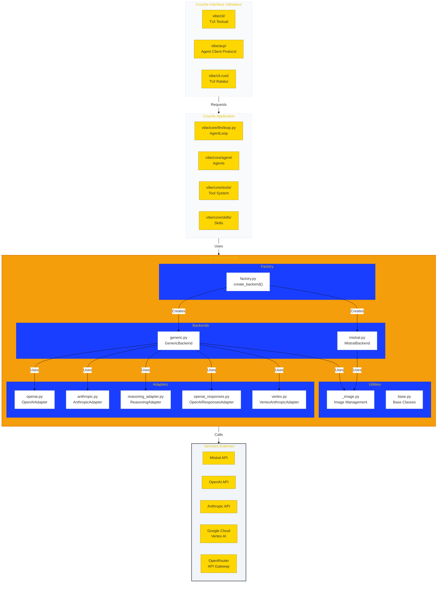
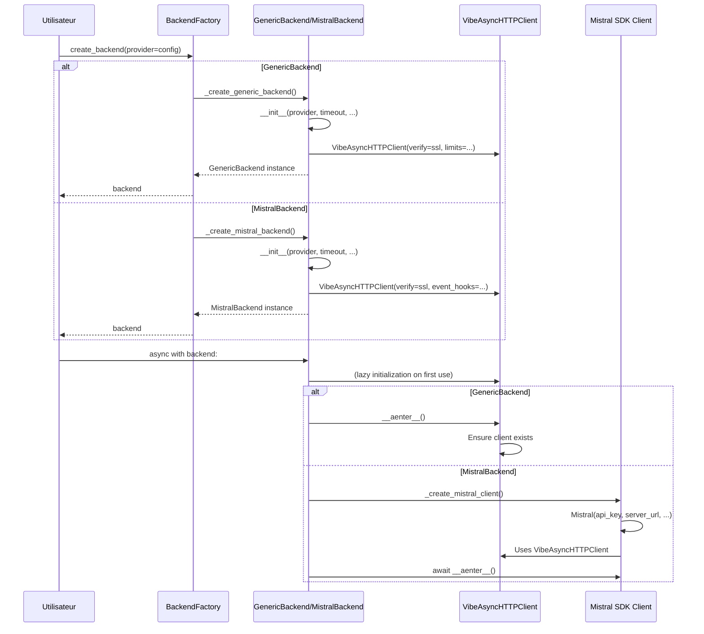
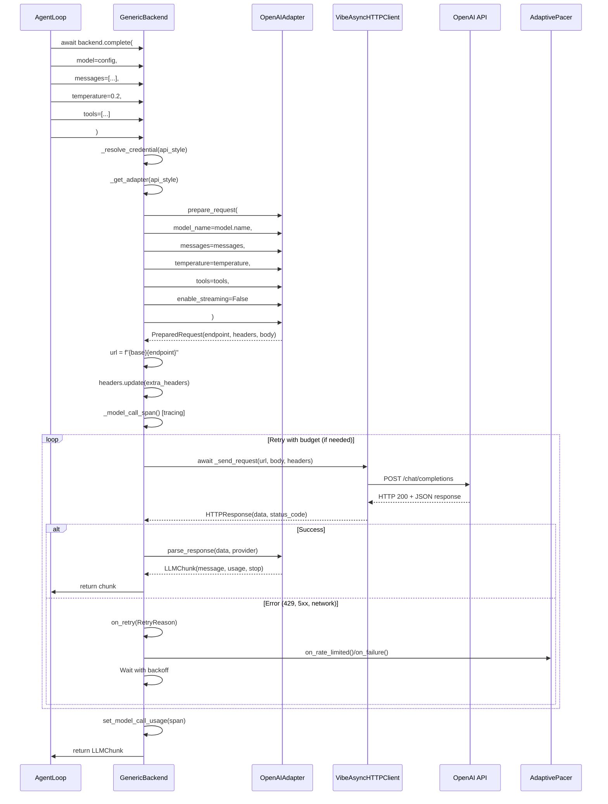
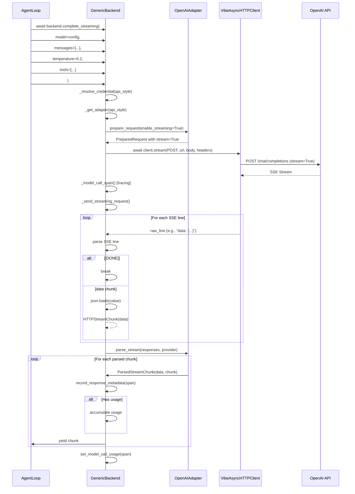
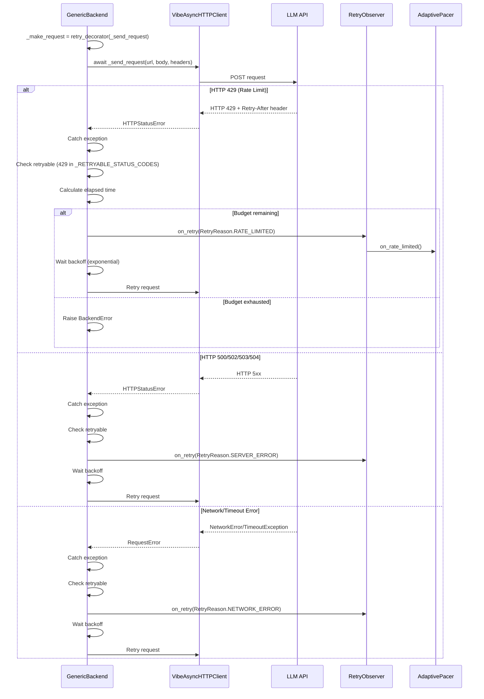
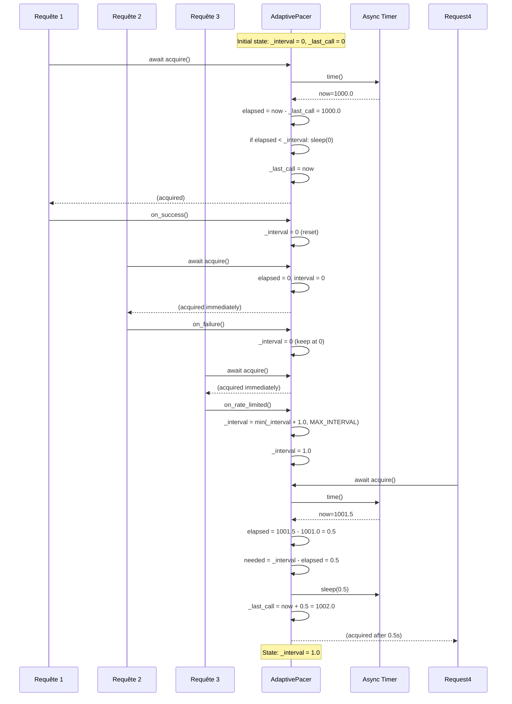
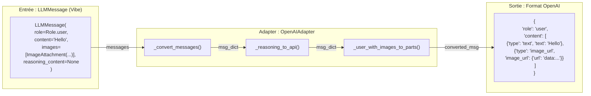
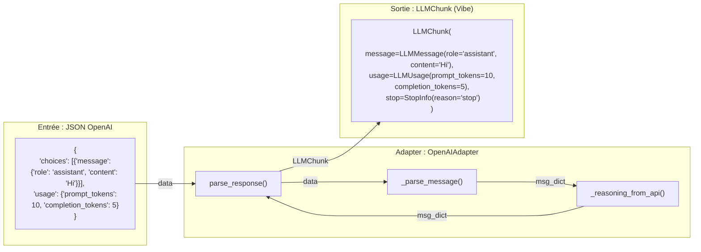
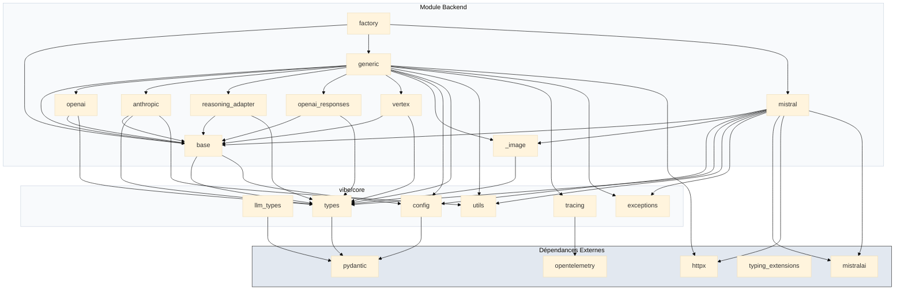

# ️ Diagrammes du Module Backend LLM

> **Module** : `vibe/core/llm/backend/` 
> **Fork** : `rrobbes/mistral-vibe` 
> **Partie** : 11/13 - Visualisation de l'Architecture et des Flux

---

## Introduction

Ce document contient **tous les diagrammes** qui illustrent l'architecture, les flux de données et les interactions au sein du module `backend/`. Ces visualisations complètent les explications textuelles des autres documents et permettent de **comprendre rapidement** comment les différents composants interagissent.

> ** Conseil** : Utilisez ces diagrammes comme **référence visuelle** lors de la lecture des autres documents. Ils vous aideront à visualiser les concepts abstraits.

---

## ️ Table des Matières

1. [Diagramme de Classes Global](#1-diagramme-de-classes-global)
2. [Diagramme d'Architecture en Couches](#2-diagramme-darchitecture-en-couches)
3. [Diagrammes de Séquence](#3-diagrammes-de-séquence)
 - [3.1. Initialisation d'un Backend](#31-initialisation-dun-backend)
 - [3.2. Exécution d'une Requête Non-Streaming](#32-exécution-dune-requête-non-streaming)
 - [3.3. Exécution d'une Requête Streaming](#33-exécution-dune-requête-streaming)
 - [3.4. Gestion des Erreurs et Retry](#34-gestion-des-erreurs-et-retry)
 - [3.5. Adaptive Pacing](#35-adaptive-pacing)
4. [Diagrammes de Flux de Données](#4-diagrammes-de-flux-de-données)
 - [4.1. Transformation des Messages](#41-transformation-des-messages)
 - [4.2. Parsing des Réponses](#42-parsing-des-réponses)
5. [Diagramme des States](#5-diagramme-des-states)
6. [Diagramme de Déploiement](#6-diagramme-de-déploiement)
7. [Diagramme des Dépendances](#7-diagramme-des-dépendances)
8. [Légende et Conventions](#8-légende-et-conventions)

---

## 1. Diagramme de Classes Global

Ce diagramme montre **toutes les classes principales** du module `backend/` et leurs relations.

```mermaid
classDiagram
 %% ========== ABSTRACTIONS ==========
 class BackendLike {
 <<Protocol>>
 +__aenter__() BackendLike
 +__aexit__()
 +complete() LLMChunk
 +complete_streaming() AsyncGenerator
 }

 class APIAdapter {
 <<Abstract>>
 +endpoint: str
 +prepare_request() PreparedRequest
 +parse_response() LLMChunk
 +parse_stream() ParsedStreamChunk
 }

 %% ========== CONCRETE BACKENDS ==========
 class GenericBackend {
 -_client: VibeAsyncHTTPClient
 -_provider: ProviderConfig
 -_pacer: AdaptivePacer
 +__aenter__()
 +__aexit__()
 +complete()
 +complete_streaming()
 -_send_request()
 -_send_streaming_request()
 -_make_request()
 -_make_streaming_request()
 }

 class MistralBackend {
 -_client: Mistral
 -_http_client: VibeAsyncHTTPClient
 -_mapper: MistralMapper
 +__aenter__()
 +__aexit__()
 +complete()
 +complete_streaming()
 -_create_mistral_client()
 }

 %% ========== ADAPTERS ==========
 class OpenAIAdapter {
 +endpoint: chat_completions
 +prepare_request()
 +parse_response()
 -_convert_messages()
 -_reasoning_to_api()
 -_reasoning_from_api()
 }

 class AnthropicAdapter {
 +endpoint: v1_messages
 +prepare_request()
 +parse_response()
 -_prepare_tool_calls()
 }

 class ReasoningAdapter {
 +endpoint: api_chat
 +prepare_request()
 +parse_response()
 }

 class OpenAIResponsesAdapter {
 +endpoint: responses
 +prepare_request()
 +parse_response()
 }

 class VertexAnthropicAdapter {
 +endpoint: vertex_endpoint
 +prepare_request()
 +parse_response()
 }

 %% ========== UTILITY CLASSES ==========
 class MistralMapper {
 +prepare_message() ChatCompletionRequestMessage
 +prepare_tool() Tool
 +prepare_tool_choice() ChatCompletionStreamRequestToolChoice
 +parse_content() ParsedContent
 +parse_tool_calls() list
 }

 class AdaptivePacer {
 -_interval: float
 -_last_call: float
 +acquire()
 +on_success()
 +on_failure()
 +on_rate_limited()
 }

 class BackendErrorBuilder {
 +build_http_error()
 +build_request_error()
 +build_stream_error()
 }

 %% ========== FACTORY ==========
 class BackendFactory {
 +BACKEND_FACTORY: dict
 +create_backend() BackendLike
 }

 %% ========== DATA STRUCTURES ==========
 class PreparedRequest {
 <<NamedTuple>>
 +endpoint: str
 +headers: dict
 +body: bytes
 +base_url: str
 }

 class ParsedStreamChunk {
 <<NamedTuple>>
 +data: dict
 +chunk: LLMChunk
 }

 class LLMChunk {
 <<Pydantic>>
 +message: LLMMessage
 +usage: LLMUsage
 +stop: StopInfo
 +correlation_id: str
 }

 class LLMMessage {
 <<Pydantic>>
 +role: Role
 +content: Content
 +reasoning_content: Content
 +tool_calls: list
 +images: list
 }

 %% ========== RELATIONS ==========
 BackendLike <|.. GenericBackend : Implements
 BackendLike <|.. MistralBackend : Implements
 
 APIAdapter <|.. OpenAIAdapter : Extends
 APIAdapter <|.. AnthropicAdapter : Extends
 APIAdapter <|.. ReasoningAdapter : Extends
 APIAdapter <|.. OpenAIResponsesAdapter : Extends
 APIAdapter <|.. VertexAnthropicAdapter : Extends
 
 GenericBackend --> APIAdapter : Uses
 GenericBackend --> AdaptivePacer : Contains
 GenericBackend --> VibeAsyncHTTPClient : Contains
 
 MistralBackend --> Mistral : Uses
 MistralBackend --> VibeAsyncHTTPClient : Contains
 MistralBackend --> MistralMapper : Contains
 
 MistralMapper --> LLMMessage : Transforms
 MistralMapper --> LLMChunk : Produces
 
 BackendFactory --> GenericBackend : Creates
 BackendFactory --> MistralBackend : Creates
 
 BackendErrorBuilder --> BackendError : Produces

 %% ========== STYLES ==========
 classDef Protocol fill:#1e293b,stroke:#0f172a,stroke-width:2px,color:#fff
 classDef Abstract fill:#334155,stroke:#1e293b,stroke-width:2px,color:#e2e8f0
 classDef Backend fill:#f59e0b,stroke:#d97706,stroke-width:2px,color:#1e293b
 classDef Adapter fill:#fbbf24,stroke:#f59e0b,stroke-width:2px,color:#1e293b
 classDef Utility fill:#64748b,stroke:#475569,stroke-width:2px,color:#fff
 classDef Data fill:#e2e8f0,stroke:#cbd5e1,stroke-width:1px,color:#1e293b

 class BackendLike Protocol
 class APIAdapter Abstract
 class GenericBackend Backend
 class MistralBackend Backend
 class OpenAIAdapter Adapter
 class AnthropicAdapter Adapter
 class ReasoningAdapter Adapter
 class OpenAIResponsesAdapter Adapter
 class VertexAnthropicAdapter Adapter
 class MistralMapper Utility
 class AdaptivePacer Utility
 class BackendErrorBuilder Utility
 class BackendFactory Utility
 class PreparedRequest Data
 class ParsedStreamChunk Data
 class LLMChunk Data
 class LLMMessage Data
```



---

## 2. Diagramme d'Architecture en Couches

Ce diagramme montre **l'organisation en couches** du module et son positionnement dans l'architecture globale de Vibe.



### Explications du Diagramme

| Couche | Rôle | Composants |
|--------|------|------------|
| **Interface Utilisateur** | Interaction avec l'utilisateur final | TUI Python, TUI Rust, ACP |
| **Application** | Logique métier de l'agent | AgentLoop, Agents, Tools, Skills |
| **Backend LLM ** | Communication avec les API LLM | Factory, Backends, Adapters, Utilities |
| **Services Externes** | Fournisseurs de modèles | Mistral, OpenAI, Anthropic, Google Cloud, OpenRouter |

---

## 3. Diagrammes de Séquence

Les diagrammes de séquence montrent **l'ordre des interactions** entre les objets au fil du temps.

---

### 3.1. Initialisation d'un Backend



**Explications** :
- La création du backend est **lazy** : le client HTTP n'est pas créé immédiatement
- La Factory utilise un **pattern de création différée** (lazy loading)
- Le `async with` déclenche l'initialisation réelle
- MistralBackend utilise le **SDK officiel MistralAI** alors que GenericBackend utilise un client HTTP direct

---

### 3.2. Exécution d'une Requête Non-Streaming



**Points Clés** :
1. **Séparation des responsabilités** : Backend gère le transport, Adapter gère la transformation
2. **Retry avec budget temporel** : Pas de nombre fixe de tentatives, mais un budget de temps
3. **Adaptive Pacing** : Ajuste automatiquement le rythme des appels après un rate limit
4. **Tracing** : Intégration avec OpenTelemetry pour l'observabilité

---

### 3.3. Exécution d'une Requête Streaming



**Points Clés** :
1. **Server-Sent Events (SSE)** : Le streaming utilise le protocole SSE
2. **Parsing incrémental** : Chaque chunk est parsé au fur et à mesure
3. **Accumulation de l'usage** : Les tokens sont comptés sur tout le stream
4. **Générateur async** : Permet de recevoir les réponses en temps réel

---

### 3.4. Gestion des Erreurs et Retry



**Stratégie de Retry** :
- **429 (Rate Limit)** : Attend avec backoff exponentiel, notifie le Pacer
- **5xx (Server Errors)** : Attend avec backoff exponentiel
- **Network Errors** : Attend avec backoff exponentiel
- **Budget temporel** : Arrête après `retry_max_elapsed_time` secondes
- **Backoff exponentiel** : `initial_interval=500ms`, `max_interval=30s`, `exponent=1.5`

---

### 3.5. Adaptive Pacing



**Algorithme de Pacing** :
1. **`acquire()`** : Attend si le temps écoulé depuis la dernière requête est inférieur à l'intervalle courant
2. **`on_success()`** : Réinitialise l'intervalle à 0 (récompense)
3. **`on_failure()`** : Garde l'intervalle courant (pas de pénalité)
4. **`on_rate_limited()`** : Incrémente l'intervalle de 1 seconde (max 10s)
5. **Récupération** : Après une période calme, l'intervalle se réinitialise progressivement

---

## 4. Diagrammes de Flux de Données

Ces diagrammes montrent **comment les données sont transformées** à travers le système.

---

### 4.1. Transformation des Messages



**Processus** :
1. Conversion du `LLMMessage` en `dict` via `.model_dump()`
2. Exclusion des champs spécifiques à Vibe (`message_id`, `reasoning_message_id`, etc.)
3. Gestion du champ `reasoning_content` vers le nom de champ de l'API (ex: `thinking` pour Reasoning)
4. Transformation des images en format `image_url` avec encodage data URI
5. Construction du message final dans le format attendu par l'API

---

### 4.2. Parsing des Réponses



**Processus** :
1. Extraction du message depuis `choices[0].message` ou `choices[0].delta`
2. Transformation des champs de reasoning de l'API vers `reasoning_content` de Vibe
3. Construction de l'objet `LLMMessage`
4. Extraction de l'usage des tokens
5. Création du `LLMChunk` final

---

## 5. Diagramme des States

Ce diagramme montre **les états possibles d'un backend** et les transitions entre eux.

```mermaid
stateDiagram-v2
 [*] --> NotInitialized: Création via Factory

 state NotInitialized {
 [*] --> Ready
 note right of NotInitialized
 Client HTTP non créé
 Ressources non allouées
 end note
 }

 state Ready {
 NotInitialized --> Ready: __aenter__() ou première utilisation
 
 state Active {
 Ready --> Active: Appel à complete() ou complete_streaming()
 
 state Processing {
 Active --> Processing: Début de la requête
 Processing --> Processing: Reception de chunks (streaming)
 Processing --> Ready: Fin de la requête
 }
 
 state ErrorHandling {
 Processing --> ErrorHandling: Erreur réseau/HTTP
 ErrorHandling --> Processing: Retry réussi
 ErrorHandling --> Error: Retry épuisé ou erreur fatale
 }
 }
 
 state Error {
 ErrorHandling --> Error
 Processing --> Error: Erreur fatale
 note left of Error
 Erreurs non récupérables :
 - Erreurs d'authentification
 - Modèle inexistant
 - Configuration invalide
 end note
 }
 }

 state Closed {
 Ready --> Closed: __aexit__() ou close()
 Active --> Closed: __aexit__() ou close()
 Error --> Closed: __aexit__() ou close()
 
 note right of Closed
 Client HTTP fermé
 Ressources libérées
 Impossibilité de réutiliser
 end note
 }

 Closed --> [*]
```

**Explications** :
- **NotInitialized** : État initial après création par la Factory
- **Ready** : Backend prêt à recevoir des requêtes
- **Active** : Backend en cours de traitement d'une requête
- **Processing** : Requête en cours d'exécution
- **ErrorHandling** : Gestion des erreurs récupérables avec retry
- **Error** : État terminal après une erreur fatale
- **Closed** : Backend fermé, ressources libérées

---

## 6. Diagramme de Déploiement

Ce diagramme montre **comment le module est déployé** dans un environnement de production.

```mermaid
%%{init: {'theme': 'base', 'themeVariables': { 'primaryColor': '#ffd700'}}}%%
deploymentDiagram
 node "Utilisateur" as User {
 component [CLI Vibe] as CLI
 }

 node "Machine Locale" as Local {
 component [Process Vibe] as VibeProcess
 component [Backend Module] as BackendModule
 
 VibeProcess --> BackendModule : Utilise
 }

 node "Cloud" as Cloud {
 component [Mistral API] as MistralAPI
 component [OpenAI API] as OpenAIAPI
 component [Anthropic API] as AnthropicAPI
 component [OpenRouter] as OpenRouter
 component [Vertex AI] as VertexAI
 }

 User -->|Lance| Local
 BackendModule -->|HTTP/HTTPS| Cloud
 
 %% Style
 style CLI fill:#f1f5f9
 style VibeProcess fill:#e2e8f0
 style BackendModule fill:#ffd700
 style Cloud fill:#f8fafc
```

**Flux de Déploiement** :
1. L'utilisateur lance la CLI Vibe sur sa machine locale
2. La CLI Vibe charge le module Backend
3. Le module Backend établit des connexions HTTP vers les API des fournisseurs
4. Les requêtes sont envoyées via HTTPS
5. Les réponses sont reçues et transformées pour la CLI

---

## 7. Diagramme des Dépendances

Ce diagramme montre **les dépendances internes et externes** du module.



**Dépendances Clés** :
- **httpx** : Client HTTP async utilisé par GenericBackend
- **mistralai** : SDK officiel Mistral utilisé par MistralBackend
- **pydantic** : Validation des modèles de données
- **opentelemetry** : Instrumentation et tracing (optionnel)

---

## 8. Légende et Conventions

### Types de Diagrammes Utilisés

| Type | Description | Utilisation dans ce document |
|------|-------------|-----------------------------|
| **Diagramme de Classes** | Montre les classes, leurs attributs, méthodes et relations | Structure des classes, héritage |
| **Diagramme de Flux** | Montre le flux de données à travers le système | Flux de requêtes, transformation des données |
| **Diagramme de Séquence** | Montre les interactions entre objets dans le temps | Initialisation, exécution des requêtes |
| **Diagramme d'État** | Montre les états d'un objet et les transitions | Cycle de vie des backends |
| **Diagramme de Déploiement** | Montre comment les composants sont déployés | Architecture physique |
| **Diagramme de Dépendances** | Montre les relations de dépendance entre modules | Gestion des dépendances |

### Conventions de Couleurs

| Couleur | Signification |
|---------|---------------|
| **Jaune (#ffd700)** | Module Backend LLM (ce module) |
| **Bleu clair (#e6f3ff)** | Classes abstraites, Protocols, Interfaces |
| **Vert clair (#e6ffe6)** | Classes concrètes (Backends) |
| **Rose clair (#ffe6e6)** | Adapters |
| **Jaune clair (#ffffe6)** | Classes utilitaires |
| **Gris (#f0f0f0)** | Structures de données |
| **Vert (#f0fff0)** | Services externes, Cloud |
| **Bleu (#f0f8ff)** | Couche Interface Utilisateur |
| **Bleu foncé (#e6f3ff)** | Couche Application |

### Symboles et Notations

| Symbole | Signification |
|---------|---------------|
| **`-->`** | Appel de méthode, flux de données |
| **`-->>`** | Retour de valeur |
| **`:`** | Commentaire, explication |
| **`[*]`** | État initial ou final dans les diagrammes d'état |
| **`++`** | Méthode/attribut public |
| **`-`** | Méthode/attribut privé |
| **`+`** | Méthode/attribut protégé |
| **`<<Protocol>>`** | Stéréotype Protocol (interface) |
| **`<<Abstract>>`** | Classe abstraite |
| **`<<NamedTuple>>`** | NamedTuple Python |
| **`<<Pydantic>>`** | Modèle Pydantic |

---

## Conclusion

Ces diagrammes fournissent une **visualisation complète** de l'architecture et des flux du module `backend/`. Ils sont conçus pour :

- **Faciliter la compréhension** des concepts complexes
- **Aider à la navigation** dans le code source
- **Servir de référence** lors de l'ajout de nouvelles fonctionnalités
- **Documenter les décisions d'architecture** de manière visuelle

> ** Conseil** : Imprimez ou gardez ces diagrammes ouverts lorsque vous travaillez sur le module. Ils vous aideront à garder une vue d'ensemble et à comprendre comment votre code s'intègre dans l'architecture globale.

---

## Navigation

| Précédent | Suivant |
|-----------|---------|
| [10. Stratégies de Résilience](./10-RESILIENCE.md) | [12. Configuration et Utilisation](./12-USAGE.md) |

[↩ Retour au README](../README.md)
