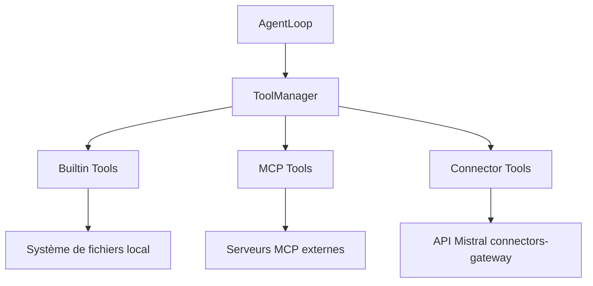

# Connectors : sous-système d'outils distants de Mistral Vibe

Les Connectors permettent à Vibe d'exposer des outils hébergés par l'API Mistral (`/v1/connectors-gateway/`) comme des outils natifs. Techniquement, ce sont des outils MCP spécialisés : ils héritent de `MCPTool` et réutilisent `call_tool_http`.

> **Convention** : les références de code pointent vers des fichiers et des fonctions, pas vers des numéros de ligne (qui vieillissent vite). Les points marqués **[non vérifié]** n'ont pas été confirmés par lecture directe du code ou des tests.

## Sommaire

1. [Positionnement (résumé)](#1-positionnement-résumé)
2. [Architecture](#2-architecture)
3. [Fonctionnement](#3-fonctionnement)
4. [Cache en détail](#4-cache-en-détail)
5. [Authentification et sécurité](#5-authentification-et-sécurité)
6. [Gestion des erreurs](#6-gestion-des-erreurs)
7. [Tests en détail](#7-tests-en-détail)
8. [Avantages](#8-avantages)
9. [Limites et risques](#9-limites-et-risques)
10. [Recommandations](#10-recommandations)
11. [Références](#11-références)

---

## 1. Positionnement (résumé)

Vibe regroupe trois familles d'outils. Toutes implémentent `BaseTool`, sont orchestrées par `ToolManager` et sont utilisées de la même façon par `AgentLoop` (`ToolManager.get()` puis `invoke()`).

|                       | Builtins                               | MCP                                                | Connectors                              |
| --------------------- | -------------------------------------- | -------------------------------------------------- | --------------------------------------- |
| **Origine**           | Code Python local (`vibe/core/tools/`) | Serveurs MCP externes (HTTP ou STDIO)              | API Mistral (`/v1/connectors-gateway/`) |
| **Découverte**        | Statique (import Python)               | Dynamique (`list_tools_http` / `list_tools_stdio`) | Dynamique (`/v1/connectors/bootstrap`)  |
| **Exécution**         | Locale                                 | Distante, configurable par serveur                 | Distante, URL et auth fixes             |
| **Cache**             | Aucun                                  | Descripteurs, 24 h (configurable)                  | Bootstrap, 10 min + mémoire             |
| **Authentification**  | Aucune                                 | Configurable (headers, OAuth)                      | Bearer `MISTRAL_API_KEY`                |
| **Dépendance réseau** | Non                                    | Selon le serveur                                   | Oui, obligatoire                        |
| **Classe de base**    | `BaseTool`                             | `MCPTool`                                          | `ConnectorProxyTool(MCPTool)`           |
| **Extensibilité**     | Modifier le code de Vibe               | Ajouter un serveur MCP                             | Dépend de l'API Mistral                 |



---

## 2. Architecture

### Hiérarchie de classes

```
BaseTool                      (vibe/core/tools/base.py)
  └── MCPTool                 (vibe/core/tools/remote.py)
        └── ConnectorProxyTool    (vibe/core/tools/connectors/connector_registry.py)
```

`MCPTool` définit :

- `_server_name`, `_remote_name` : nom du serveur et nom de l'outil côté distant
- `_is_connector` (`False` par défaut) et la méthode de classe `is_connector()`

`ConnectorProxyTool` surcharge `_is_connector = True` et porte les métadonnées du connector : `_connector_id`, `_connector_name`, `_api_key`, `_base_url`. Une classe proxy est générée dynamiquement pour chaque outil découvert.

### Composants

| Composant            | Rôle                                                         | Fichier                            |
| -------------------- | ------------------------------------------------------------ | ---------------------------------- |
| `ConnectorRegistry`  | Découverte, cache et OAuth des connectors                    | `connectors/connector_registry.py` |
| `ConnectorProxyTool` | Proxy généré pour chaque outil                               | idem                               |
| `ToolManager`        | Enregistrement, filtrage et instanciation de tous les outils | `tools/manager.py`                 |

### Points communs avec MCP

- Même classe de base (`MCPTool`) et même type de résultat (`MCPToolResult`).
- Même fonction d'exécution : `call_tool_http` délègue à l'implémentation MCP (`vibe/core/tools/mcp/tools.py`). Les corrections faites côté MCP profitent donc aux Connectors.
- Même mécanisme de filtrage par source côté `ToolManager`.

### Différences avec MCP

| Aspect           | MCP                                | Connectors                                                   |
| ---------------- | ---------------------------------- | ------------------------------------------------------------ |
| URL d'exécution  | Configurable par serveur           | Fixe : `{base_url}/v1/connectors-gateway/{connector_id}/mcp` |
| Authentification | Configurable (`_headers`, `_auth`) | Bearer `MISTRAL_API_KEY`                                     |
| Découverte       | Endpoint MCP du serveur            | `GET /v1/connectors/bootstrap`                               |
| Cache            | 24 h                               | 10 min (fichier) + mémoire                                   |
| OAuth            | Par serveur                        | `get_auth_url()` via le SDK Mistral                          |

---

## 3. Fonctionnement

### Découverte

```
ConnectorRegistry.get_tools_async()
  ├─ cache mémoire rempli et pas de force_refresh ? → retour immédiat
  └─ sinon → _discover_all()
       ├─ prend _discover_lock (évite les découvertes concurrentes)
       ├─ re-vérifie le cache mémoire sous le verrou
       ├─ lit le cache fichier (sauf force_refresh)
       ├─ si pas de cache valide → _fetch_bootstrap() + écriture du cache fichier
       ├─ déduplique les noms de connectors
       └─ crée une classe ConnectorProxyTool par outil

ToolManager.integrate_connectors_async()
  └─ enregistre les outils dans l'ensemble des outils connus
```

Règles de traitement :

- **Déduplication** : en cas de collision de noms, le suivant devient `wiki_2`, `wiki_3`, etc. (un simple warning dans les logs).
- **Filtrage par configuration** : un connector peut être désactivé via `config.connectors[].disabled`. Ses outils restent enregistrés mais ne sont plus disponibles.
- **Connectors non prêts** : ceux avec `status.is_ready = false` sont exclus.

### Exécution d'un outil

```
ToolManager.get("connector_web_search")
  └─ tool.invoke(query="...")          # validation des arguments (Pydantic)
       └─ run(args, ctx)
            └─ call_tool_http(
                 url     = {base_url}/v1/connectors-gateway/{connector_id}/mcp,
                 tool    = _remote_name,        # nom distant, ex. "search"
                 payload = args sans les None,
                 headers = {"Authorization": "Bearer {api_key}"},
               )
```

Le nom local (`connector_web_search`) diffère du nom distant (`_remote_name`) envoyé au serveur. En cas d'exception, `run()` journalise un warning et produit un message d'erreur adapté (voir section 6).

---

## 4. Cache en détail

### 4.1 Deux niveaux complémentaires

| Niveau      | TTL                                               | Emplacement                                 | Contenu                     | Persistance             |
| ----------- | ------------------------------------------------- | ------------------------------------------- | --------------------------- | ----------------------- |
| **Fichier** | 10 min (`_BOOTSTRAP_CACHE_TTL_SECONDS = 10 * 60`) | `$VIBE_HOME/connector_bootstrap_cache.json` | Payload de bootstrap réduit | Survit aux redémarrages |
| **Mémoire** | Durée de vie du `ConnectorRegistry`               | `ConnectorRegistry._cache`                  | Classes proxy générées      | Perdu au redémarrage    |

### 4.2 Clé de cache

Chaque entrée du fichier est indexée par un hash SHA-256 qui combine : l'URL de base, la clé d'API, le flag `supports_mcp=true` et la liste des connectors builtins (`_bootstrap_cache_key`). Conséquences :

- deux configurations différentes (autre URL, autre clé, autres builtins) ne partagent jamais d'entrée ;
- changer de clé d'API invalide de fait le cache précédent.

### 4.3 Quand le cache est consulté

À chaque appel de `get_tools_async()` :

1. **Cache mémoire** : si `_cache` est rempli et que `force_refresh` est faux, retour immédiat, sans I/O.
2. **Cache fichier** : sinon, `_discover_all()` lit le fichier. L'entrée est valide si elle est un dictionnaire avec un `stored_at_timestamp` entier, un `payload` dictionnaire contenant une liste `connectors`, et si elle a moins de 10 minutes (`_is_fresh_bootstrap_cache_entry`).
3. **API** : si aucune des deux couches ne répond, appel à `/v1/connectors/bootstrap`, puis écriture du cache fichier.

### 4.4 Quand un appel API est déclenché

| Situation                    | Détail                                                       |
| ---------------------------- | ------------------------------------------------------------ |
| Premier appel                | Aucun cache                                                  |
| TTL dépassé                  | Entrée de plus de 10 minutes                                 |
| `force_refresh=True`         | Rafraîchissement demandé explicitement                       |
| Fichier illisible            | `OSError` ou JSON invalide                                   |
| Entrée invalide              | Champs manquants ou mal typés                                |
| Bootstrap précédent en échec | `_cache` est resté à `None`, ce qui autorise un nouvel essai |

### 4.5 Contenu du cache fichier

Seules les données nécessaires à la reconstruction des outils sont écrites (`_bootstrap_cache_payload`) :

| Niveau    | Conservé                                                                            | Exclu                                                                       |
| --------- | ----------------------------------------------------------------------------------- | --------------------------------------------------------------------------- |
| Connector | `id`, `name`, `protocol`, `status.is_ready`, `auth_action.type`, `bootstrap_errors` | `display_name`, description du connector, URLs complètes d'authentification |
| Outil     | `name`, `description`, `inputSchema`                                                | tout autre champ                                                            |
| Global    |                                                                                     | valeurs `None` (supprimées récursivement par `_strip_none`), clé d'API      |

`bootstrap_errors` est conservé car il est affiché à l'utilisateur.

### 4.6 Écriture atomique

L'écriture se fait dans un fichier temporaire (`.<nom>.<pid>.tmp`) puis `os.replace()` le substitue au fichier final. Effets :

- un lecteur ne voit jamais un fichier à moitié écrit ;
- en cas d'erreur (`OSError`, `TypeError`), le fichier temporaire est supprimé et seul un log de niveau debug est émis : un échec d'écriture du cache ne casse pas la découverte.

Limite : le PID dans le nom évite les collisions de fichiers temporaires entre processus, mais deux processus peuvent encore s'écraser mutuellement leurs entrées (dernier écrivain gagnant). **[non vérifié]** que la lecture-fusion-écriture soit protégée contre cela.

### 4.7 Fréquence de réutilisation

| Scénario                                                     | Niveau utilisé | Effet                        |
| ------------------------------------------------------------ | -------------- | ---------------------------- |
| Appels successifs dans une session                           | Mémoire        | Aucun I/O, aucun réseau      |
| Nouvelle session avec cache fichier valide (moins de 10 min) | Fichier        | Pas d'appel API au démarrage |
| Cache fichier expiré ou absent                               | Aucun          | 1 appel API                  |

Pour une session de N minutes, le nombre maximal d'appels API est de l'ordre de ⌈N/10⌉ **si** le registry est reconstruit ou rafraîchi à chaque expiration. **[non vérifié]** : une fois `_cache` rempli en mémoire, `get_tools_async()` ne rappelle pas l'API tant qu'un `force_refresh` (par exemple `/reload`) n'a pas lieu. Le TTL de 10 minutes joue donc surtout entre sessions et au rechargement, ce qui relativise l'argument de la « charge toutes les 10 minutes ».

### 4.8 Résilience : ce que le cache permet et ne permet pas

- **Permet** : démarrer sans appel réseau pendant 10 minutes après un bootstrap réussi, et éviter la charge répétée sur l'API.
- **Ne permet pas** : survivre à une panne prolongée. Passé le TTL, une panne de l'API donne un dictionnaire d'outils vide, car le cache fichier expiré n'est pas utilisé comme secours (voir limite 9.1).

### 4.9 Le TTL de 10 minutes : un compromis

| Pour un TTL court                                                                 | Pour un TTL long                       |
| --------------------------------------------------------------------------------- | -------------------------------------- |
| Un connector fraîchement authentifié (OAuth) ou passé en `is_ready` apparaît vite | Moins d'appels au bootstrap            |
| Les nouveaux connectors sont pris en compte plus vite                             | Meilleure tolérance aux pannes courtes |
| Moins de risque d'afficher un statut périmé                                       | Alignement avec MCP (24 h)             |

La comparaison avec le TTL MCP de 24 h doit être nuancée : MCP met en cache des descripteurs de serveurs que l'utilisateur configure lui-même, alors que le bootstrap reflète un état côté serveur qui peut changer en cours de session. Allonger le TTL n'est donc pas gratuit.

---

## 5. Authentification et sécurité

| Opération            | Mécanisme                                                                          |
| -------------------- | ---------------------------------------------------------------------------------- |
| Exécution d'un outil | `Authorization: Bearer {MISTRAL_API_KEY}` (fixe)                                   |
| Bootstrap            | Bearer, même clé                                                                   |
| OAuth                | `get_auth_url()` via le SDK Mistral, qui renvoie l'URL à ouvrir dans le navigateur |

### Où se trouve la clé d'API

| Endroit            | Présente ? | Détail                                                                     |
| ------------------ | ---------- | -------------------------------------------------------------------------- |
| Fichier de cache   | Non        | Elle n'entre que dans le hash SHA-256 de la clé de cache                   |
| Payload de cache   | Non        | Aucun champ n'y fait référence (`_bootstrap_cache_payload`)                |
| Mémoire            | Oui        | Attribut de classe `_api_key` des proxies générés, et attribut du registry |
| Requêtes sortantes | Oui        | En-tête Bearer vers l'API Mistral                                          |

Un test explicite (`test_bootstrap_cache_does_not_store_raw_api_key`) écrit un cache avec la clé `secret-test-key` et vérifie qu'elle n'apparaît pas dans le fichier.

> Le hash de la clé de cache est un SHA-256 simple, sans sel. Il ne permet pas de retrouver la clé, mais deux fichiers de cache issus de la même configuration ont la même clé d'entrée. **[non vérifié]** : le fichier est-il créé avec des permissions restrictives ? À vérifier.

---

## 6. Gestion des erreurs

Les exceptions sont converties en messages précis, avec l'action suggérée.

| Cas                 | Message (résumé)                                           | Action suggérée                  |
| ------------------- | ---------------------------------------------------------- | -------------------------------- |
| HTTP 401 / 403      | Échec d'authentification (HTTP 401/403)                    | Vérifier `MISTRAL_API_KEY`       |
| HTTP 404            | Connector introuvable, supprimé ou inaccessible            | Vérifier son existence           |
| HTTP 5xx            | Requête en échec, problème serveur probablement temporaire | Réessayer avec `/reload`         |
| Autre HTTP          | Requête en échec (code HTTP)                               | Consulter le corps de la réponse |
| Timeout             | Délai dépassé, service lent ou injoignable                 | Vérifier la connexion            |
| Erreur de connexion | Impossible de joindre le proxy connectors                  | Vérifier le réseau               |

Particularités :

- le message inclut le nom et l'identifiant du connector ;
- le corps de la réponse serveur est ajouté, tronqué à 500 caractères ;
- les erreurs groupées (`ExceptionGroup`) sont gérées ;
- les détails techniques complets restent dans les logs (`exc_info`).

En cas d'échec du bootstrap, le message est mémorisé (`_bootstrap_error`) et exposé via `bootstrap_error()`.

---

## 7. Tests en détail

### 7.1 Vue d'ensemble

| Fichier                                       | Niveau      | Réseau réel                            | Composants exercés                                       |
| --------------------------------------------- | ----------- | -------------------------------------- | -------------------------------------------------------- |
| `tests/tools/test_connectors.py`              | Intégration | Non (`respx`, `FakeConnectorRegistry`) | `ConnectorRegistry`, `ConnectorProxyTool`, `ToolManager` |
| `tests/app_server/test_connector_catalog.py`  | Unitaire    | Non                                    | `compute_connector_counts`                               |
| `tests/cli/test_connector_auth_app.py`        | Intégration | Non (mock)                             | `get_auth_url()`                                         |
| `tests/acp/test_connectors.py`                | Contrat     | Non                                    | Interface ACP et Connectors                              |
| `tests/agent_loop/e2e/test_e2e_connectors.py` | E2E         | Selon l'environnement                  | `AgentLoop` → `ToolManager` → `ConnectorRegistry`        |

**[non vérifié]** : le contenu des quatre derniers fichiers n'a pas été relu. Leur description se déduit de leur nom et de leur emplacement, elle ne doit pas être traitée comme une évaluation de leur qualité.

### 7.2 Cœur de la suite : `tests/tools/test_connectors.py`

**Outils de test utilisés**

| Outil                                    | Usage                                                                 |
| ---------------------------------------- | --------------------------------------------------------------------- |
| `respx`                                  | Simule les réponses HTTP de `/v1/connectors/bootstrap`                |
| `FakeConnectorRegistry` (`tests/stubs/`) | Registry factice pour les tests d'intégration `ToolManager`           |
| `FakeMCPRegistry`                        | Registry MCP factice                                                  |
| `unittest.mock.patch`                    | Fige `time.time()` (expiration du cache) et remplace `call_tool_http` |
| `monkeypatch` + `tmp_path`               | Isole `VIBE_HOME` pour que le cache fichier soit propre à chaque test |

**Comportements couverts**

| Catégorie   | Ce qui est vérifié                                                                                         |
| ----------- | ---------------------------------------------------------------------------------------------------------- |
| Découverte  | Parsing du bootstrap, création des classes proxy, `connector_count`, `is_connected`                        |
| Cache       | Cache frais sans appel HTTP, expiration, `force_refresh`, corruption, persistance, absence de la clé d'API |
| Erreurs     | 401, 403, 404, 500, 502, timeout, erreur de connexion, `ExceptionGroup`, `bootstrap_error()`               |
| Exécution   | Appel de `ConnectorProxyTool.run()`, passage des arguments, gestion des exceptions                         |
| Intégration | Enregistrement dans `ToolManager`, filtrage par configuration                                              |
| Filtrage    | Connector désactivé, outil désactivé, connector non prêt                                                   |

**Exemples représentatifs**

```python
# Découverte
tools = await ConnectorRegistry(api_key="test-key").get_tools_async()
assert "connector_wiki_search" in tools
assert registry.connector_count == 1

# Cache frais : aucun appel HTTP (temps figé à 1_000 puis 1_100, TTL = 600 s)
assert "connector_wiki_cached" in tools
assert not route.called

# Sécurité
assert "secret-test-key" not in cache_text

# Intégration ToolManager
assert "connector_wiki_search" not in tm.available_tools   # filtré
assert "connector_wiki_search" in tm.registered_tools      # mais enregistré
```

**Types d'assertions**

| Type        | Exemple                                              | Objectif                    |
| ----------- | ---------------------------------------------------- | --------------------------- |
| Existence   | `"tool" in tools`                                    | Outil découvert ou filtré   |
| Égalité     | `connector_count == 1`                               | Comptages exacts            |
| Appels HTTP | `route.call_count`, `route.called`                   | Utilisation ou non du cache |
| Contenu     | `"authentication failed" in msg.lower()`             | Messages d'erreur           |
| État        | `is_connected(...)`, `bootstrap_error() is not None` | État interne du registry    |
| Type        | `issubclass(cls, MCPTool)`                           | Héritage                    |

### 7.3 Lacunes de couverture

| Lacune                                                        | Risque associé                                        |
| ------------------------------------------------------------- | ----------------------------------------------------- |
| Concurrence sur `_discover_lock`                              | Découvertes doubles ou état incohérent non détectés   |
| Cache partagé entre plusieurs `ConnectorRegistry` / processus | Écrasement mutuel des entrées                         |
| Écriture concurrente du fichier de cache                      | Dernier écrivain gagnant                              |
| Expiration exacte du TTL (bornes à la seconde)                | Erreur d'une seconde non détectée                     |
| Validation du schéma du bootstrap et payloads malformés       | Comportement imprévisible avec une réponse inattendue |
| Déduplication des noms (`_deduplicate_connectors`)            | Collisions complexes mal couvertes                    |
| Flux OAuth complet                                            | Seule la récupération de l'URL est testée             |
| Compatibilité entre versions de l'API                         | Régression silencieuse en cas d'évolution du contrat  |
| Performance et charge                                         | Aucun benchmark                                       |

### 7.4 Synthèse

**Bien couvert** : découverte, génération des proxies, cache (TTL, bypass, corruption, persistance), erreurs HTTP, exécution, intégration et filtrage `ToolManager`, absence de la clé d'API dans le cache.

**Partiellement couvert** : déduplication des noms, OAuth.

**Non couvert** : concurrence, validation de schéma, compatibilité de versions, performance.

---

## 8. Avantages

### 8.1 Architecture modulaire et extensible

L'héritage `BaseTool` → `MCPTool` → `ConnectorProxyTool` permet d'ajouter un nouveau type d'outil distant en trois étapes : une sous-classe de `MCPTool`, un registry de découverte dédié, une méthode `integrate_*_async()` dans `ToolManager`. Les Connectors illustrent ce modèle : base MCP réutilisée, métadonnées spécifiques ajoutées, `call_tool_http` déjà éprouvé.

### 8.2 Intégration transparente pour `AgentLoop`

```python
tool = tool_manager.get("bash")                  # Builtin
tool = tool_manager.get("mcp_my_server_tool")    # MCP
tool = tool_manager.get("connector_web_search")  # Connector

async for result in tool.invoke(query="test"):
    process(result)
```

La validation des arguments (`invoke()`) et l'instanciation paresseuse (`ToolManager.get()`) sont communes. `AgentLoop` n'a aucune logique spécifique aux Connectors.

### 8.3 Cache à deux niveaux

- Dans une session : le cache mémoire évite tout I/O.
- Entre sessions : le cache fichier évite l'appel API pendant 10 minutes.
- Écriture atomique et clés isolées par configuration.
- Un échec de lecture ou d'écriture du cache est non bloquant : on retombe sur l'API.

### 8.4 Messages d'erreur exploitables

Chaque classe d'erreur (401/403, 404, 5xx, timeout, connexion) donne un message qui nomme le connector, indique la cause probable et propose une action (`MISTRAL_API_KEY`, `/reload`, réseau). La couverture de test de ces messages est la plus complète de la suite.

### 8.5 Sécurité de la clé d'API

- Jamais écrite dans le cache fichier (hash uniquement), vérifié par un test dédié.
- Aucun champ superflu persisté (`display_name`, URLs, valeurs `None`).
- Écriture atomique du cache.

### 8.6 Réutilisation du code MCP

La délégation de `call_tool_http` évite de dupliquer le client HTTP/MCP. Les corrections et améliorations côté MCP se répercutent automatiquement.

### 8.7 Contrôle par configuration

Un connector ou un outil peut être désactivé finement (`disabled`, filtrage par source), et les outils filtrés restent enregistrés, ce qui permet de les réactiver sans redécouverte.

---

## 9. Limites et risques

### 9.1 Dépendance critique à l'API Mistral

- La découverte repose entièrement sur `/v1/connectors/bootstrap`.
- En cas d'échec, `_discover_all()` renvoie `{}`, marque `_cache` à `None` et enregistre `_bootstrap_error`.
- Passé le TTL, un cache fichier expiré n'est pas réutilisé comme repli : une panne de l'API fait disparaître tous les outils connectors.
- Contrairement à MCP stdio, il n'existe pas de chemin local de secours.

**Gravité : élevée.** Voir recommandation 2.

### 9.2 Observabilité absente

Le sous-système n'émet que des logs (warnings en cas d'échec). Aucune métrique sur :

- le nombre d'appels au bootstrap et à la gateway ;
- les latences et les taux d'erreur par code ;
- le ratio de succès du cache (hit/miss) ;
- le nombre de connectors et d'outils découverts.

Sans cela, impossible de savoir si le TTL est bien calibré ou de détecter une dégradation en production. **Gravité : moyenne à élevée.** Le registry MCP n'est pas mieux instrumenté, mais la dépendance à un service unique rend le manque plus coûteux ici.

### 9.3 TTL de 10 minutes : compromis à documenter, pas défaut avéré

- Plus court que MCP (24 h), pour de bonnes raisons possibles (voir 4.9).
- Impact réel sur la charge **non mesuré**. Une fois le cache mémoire rempli, le TTL n'est effectif qu'à la reconstruction du registry ou au rechargement (voir 4.7).
- Risque inverse si on l'allonge : retard de visibilité après une authentification.

**Gravité : faible à moyenne, à mesurer avant toute modification.**

### 9.4 Pas de détection des changements côté serveur

L'expiration se fait uniquement par TTL. Pas d'ETag, de `Last-Modified`, de webhook, ni de revalidation conditionnelle. Un connector ajouté, supprimé ou modifié n'est visible qu'après expiration du TTL ou `force_refresh` (`/reload`). `_fetch_bootstrap` ne lit pas les en-têtes de cache **[non vérifié sur l'API côté serveur : support éventuel d'ETag inconnu]**.

**Gravité : faible à moyenne.**

### 9.5 Pas de mode local ou de développement

`ConnectorRegistry.__init__` exige une clé d'API. Pour tester un connector il faut soit passer par l'API Mistral, soit tout mocker avec `respx` / `FakeConnectorRegistry`. Pas d'équivalent des serveurs MCP stdio locaux.

**Gravité : moyenne** pour l'expérience de développement.

### 9.6 Validation faible de la réponse de bootstrap

Le parsing s'appuie sur `.get()`, des valeurs par défaut et des tests `isinstance(..., dict)`. Pas de schéma formel, contrairement à `RemoteTool` côté MCP (modèle Pydantic).

Conséquences possibles :

- champs manquants ou mal typés ignorés sans erreur (par exemple un `tools` qui n'est pas une liste) ;
- connector créé mais sans outil exploitable, sans message explicite ;
- difficulté à diagnostiquer pourquoi un connector n'apparaît pas.

**Gravité : moyenne.**

### 9.7 Déduplication silencieuse des noms

Une collision (`wiki` / `wiki`) donne `wiki_2` avec un simple warning de log. Si l'ordre de retour de l'API change, le suffixe attribué à un connector peut changer, et une configuration utilisateur qui référence l'ancien alias pointera sur un autre outil. **Gravité : faible à moyenne.**

### 9.8 Clé d'API conservée en mémoire dans les classes générées

Pas un défaut de persistance, mais à connaître : `_api_key` est un attribut de classe des proxies. Elle est exposée à tout code qui introspecte ces classes dans le processus. **Gravité : faible**, à garder en tête pour les logs, les dumps de debug et la sérialisation.

### 9.9 Tableau récapitulatif

| #   | Limite                                                     | Gravité          |
| --- | ---------------------------------------------------------- | ---------------- |
| 9.1 | Dépendance critique à l'API, pas de repli sur cache expiré | Élevée           |
| 9.2 | Pas d'observabilité                                        | Moyenne à élevée |
| 9.3 | TTL court (impact non mesuré)                              | Faible à moyenne |
| 9.4 | Pas de revalidation conditionnelle                         | Faible à moyenne |
| 9.5 | Pas de mode local                                          | Moyenne          |
| 9.6 | Pas de validation de schéma                                | Moyenne          |
| 9.7 | Déduplication silencieuse                                  | Faible à moyenne |
| 9.8 | Clé d'API en mémoire dans les classes proxy                | Faible           |

---

## 10. Recommandations

### Priorité haute

1. **Métriques de base** : appels bootstrap/gateway, latence, erreurs par code, hit/miss du cache.
2. **Repli sur cache expiré** : si le bootstrap échoue, réutiliser la dernière entrée connue (même expirée) et le signaler à l'utilisateur plutôt que renvoyer `{}`.

### Priorité moyenne

3. **Valider le bootstrap** avec des modèles Pydantic et journaliser clairement les connectors ou outils rejetés.
4. **Mesurer avant d'allonger le TTL**, puis envisager une revalidation conditionnelle (ETag) si l'API la supporte.
5. **Mode local ou de développement** pour tester un connector sans l'API Mistral.
6. **Alias déterministes** (par exemple suffixe dérivé de l'identifiant) et avertissement visible à l'utilisateur lors d'une collision.

### Priorité basse

7. **Tests de concurrence** (`asyncio.gather` sur `get_tools_async`) et de TTL exact.
8. **Tests de payloads malformés** et de compatibilité de version d'API.
9. **Documenter les prérequis** du test E2E.
10. **Vérifier les permissions** du fichier de cache.

---

## 11. Références

- `vibe/core/tools/connectors/connector_registry.py` (registry, proxy, cache, erreurs, OAuth)
- `vibe/core/tools/remote.py` (`MCPTool`, `MCPToolResult`, `RemoteTool`)
- `vibe/core/tools/mcp/tools.py` et `vibe/core/tools/mcp/registry.py` (`call_tool_http`, TTL MCP)
- `vibe/core/tools/manager.py` (`ToolManager`, `integrate_connectors_async`, filtrage)
- `vibe/core/tools/base.py` (`BaseTool`, `invoke()`)
- `tests/tools/test_connectors.py`, `tests/stubs/fake_connector_registry.py`
- `docs/adr/0004-typed-permissioned-tools.md`
