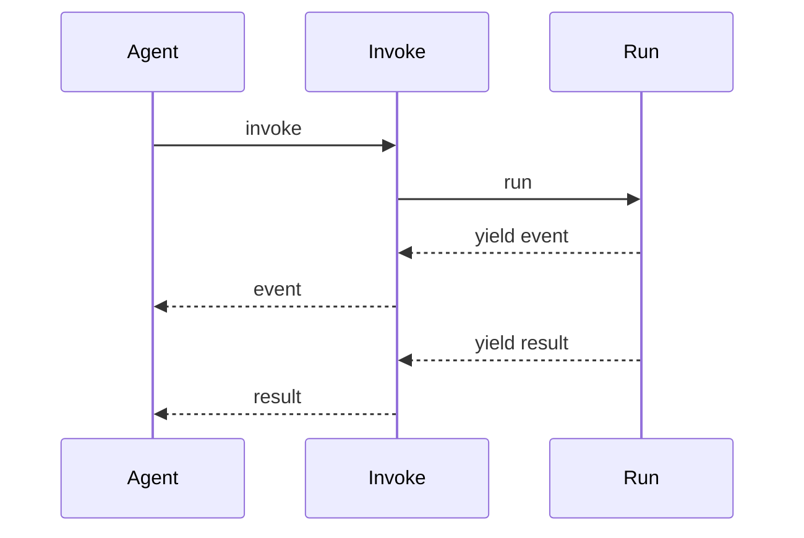
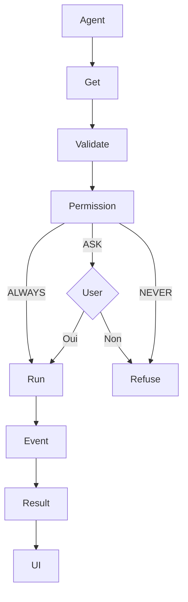
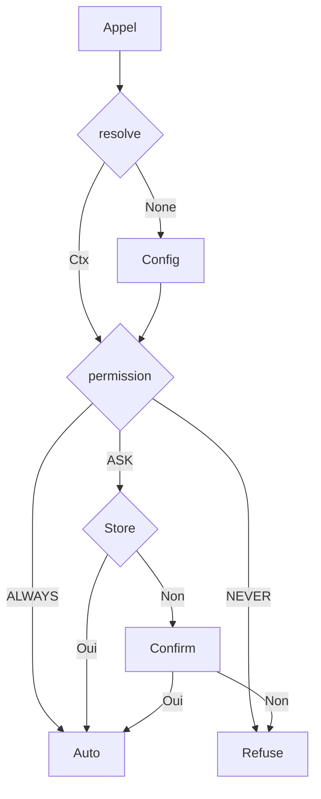
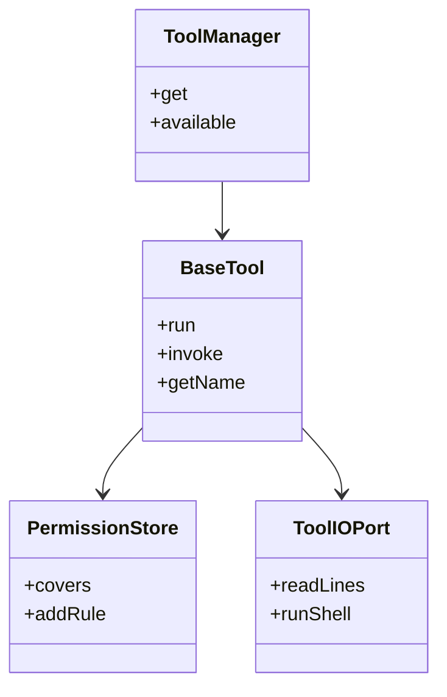

# Vue d'ensemble du système d'outils

> **Dossier source** : `vibe/core/tools/`  
> **Ce dossier doc** : `docs/understanding_vibe/tools/`  
> **Rôle** : Permet à l'agent d'exécuter des actions (fichiers, shell, services externes)  
> **Version** : 2.0 (révisée et vérifiée)  
> **Date** : 2026-11-02

---

## 📌 Résumé en une phrase

**Ce répertoire implémente le système qui transforme les instructions de l'IA en actions concrètes** : lecture/écriture de fichiers, exécution de commandes shell, appels à des APIs externes — le tout avec un contrôle d'accès granulaire.

---

## 🎯 Rôle principal

Sans ce système, Mistral Vibe serait un simple chat sans capacité d'action. Les outils sont le **pont entre le raisonnement de l'IA et l'environnement d'exécution**. Chaque outil est une classe Python typée qui sait valider ses entrées, demander les bonnes permissions, s'exécuter de façon asynchrone, et rapporter son résultat.

---

## 📁 Structure du répertoire (vérifiée)

```
vibe/core/tools/                          # 12 fichiers à la racine
├── base.py              # ⭐ BaseTool : classe abstraite mère de tous les outils
├── manager.py           # 🎯 ToolManager : découverte, registre, instanciation
├── models.py            # 🔐 ToolPermission (ALWAYS/NEVER/ASK), PermissionContext, ApprovedRule
├── permissions.py       # 🛡️ PermissionStore + wildcard_match : règles de session
├── io_port.py           # 🔌 ToolIOPort (Protocol) : read_lines, write_text, run_shell...
├── ui.py                # 🎨 ToolUIData, ToolCallDisplay, ToolResultDisplay : affichage TUI
├── utils.py             # 🛠️ resolve_tool_path, DEFAULT_SENSITIVE_PATTERNS, etc.
├── terminal_runtime.py  # ⏱️ TerminalRuntime : exécution de commandes terminal
├── arity.py             # 📐 build_session_pattern : arité des commandes pour les règles
├── remote.py            # 🌐 MCPTool : adaptateur pour outils MCP distants
├── mcp_sampling.py      # 🎲 MCPSamplingHandler : sampling côté serveur MCP
├── mcp_settings.py      # ⚙️ Config des serveurs MCP (depuis config)
│
├── builtins/            # 🛠️ 17 fichiers .py → 15 outils principaux + 4 sous-outils
│   ├── read_file.py, write_file.py, edit.py     # manipulation de fichiers
│   ├── bash.py, experimental_bash.py            # shell (2 variantes + 4 sous-outils)
│   ├── git_bash.py, windows_shell.py            # variantes spécialisées
│   ├── grep.py                                   # recherche dans les fichiers
│   ├── web_search.py, web_fetch.py              # web
│   ├── todo.py, task.py, skill.py               # gestion de tâches / skills
│   ├── ask_user_question.py, exit_plan_mode.py  # interaction utilisateur
│   ├── _shell_command_policy.py                 # politiques de sécurité shell (privé)
│   ├── _shell_permission_analysis.py            # analyse des commandes (privé)
│   ├── managed_shell/                            # backend shell managé (posix/windows)
│   └── prompts/                                  # 17 fichiers .md = description LLM de chaque outil
│
├── connectors/          # 🔗 3 fichiers : connector_registry.py, counts.py, __init__.py
│                        #    → outils fournis par des connecteurs externes (Google Drive, Notion...)
└── mcp/                 # 🌐 7 fichiers : registry, pool, tools, authorization, management,
                         #    descriptor_cache → outils fournis par des serveurs MCP
```

---

## 🏗️ Architecture détaillée

### 1. BaseTool — la classe mère (vérifié dans `base.py`)

Tout outil hérite de `BaseTool[ToolArgs, ToolResult, ToolConfig, ToolState]` — **4 paramètres génériques** :

| Générique | Rôle | Exemple (ReadFile) |
|-----------|------|-------------------|
| `ToolArgs` | Modèle Pydantic des arguments d'entrée (validés auto) | `ReadFileArgs(file_path, offset, limit)` |
| `ToolResult` | Modèle Pydantic du résultat (yieldé à la fin) | `ReadFileResult(content, num_lines, ...)` |
| `ToolConfig` | Config (permission, allowlist, denylist, extras) | `ReadFileConfig(permission=ALWAYS, max_read_bytes=50Ko)` |
| `ToolState` | État persistant entre appels (mutable) | `ReadFileState(injected_agents_md=set())` |

**Attributs de classe importants** (dans `base.py`) :
```python
selection_priority: ClassVar[int] = 0          # priorité si même nom (plus haut gagne)
allowlist_scopes: ClassVar[frozenset]         # scopes où lire l'allowlist
shell_rollout: ClassVar[str | None] = None     # gate feature-flag shell managé
```

**Méthodes clés** :
```python
async def run(self, args, ctx) -> AsyncGenerator[ToolStreamEvent | ToolResult, None]
    # méthode abstraite : logique de l'outil, yield des événements puis le résultat

async def invoke(self, ctx=None, **raw) -> AsyncGenerator[...]
    # point d'entrée : valide raw → ToolArgs (Pydantic), puis consomme run()

def resolve_permission(self, args) -> PermissionContext | None
    # surchargé par chaque outil : détermine ALWAYS/NEVER/ASK pour cet appel

def get_file_snapshot(self, args) -> FileSnapshot | None
    # appelé AVANT run() : capture l'état du fichier pour le rewind
```

**Comment le nom est dérivé** (`get_name()`) : `ReadFile` → `read_file` (conversion snake_case automatique).

### 2. ToolManager — le registre (vérifié dans `manager.py`)

```python
class ToolManager:
    def available_tools(self) -> dict[str, type[BaseTool]]   # {"read_file": ReadFile, ...}
    def get(self, tool_name: str) -> BaseTool                  # instance lazily créée et cachée
    def get_tool_config(self, tool_name) -> BaseToolConfig    # config effective
    def available_tool_specs(self) -> list[AvailableFunction] # specs JSON pour le LLM
```

**Flux interne** :
1. `_compute_search_paths()` → liste des dossiers à scanner
2. `_iter_tool_classes()` → charge chaque `.py`, extrait les classes `BaseTool`
3. `_select_available_variant()` → si plusieurs classes ont le même nom, `selection_priority` décide
4. `get(name)` → instancie via `from_config()` et met en cache dans `_instances`

### 3. PermissionStore — la sécurité (vérifié dans `permissions.py`)

3 niveaux (`models.py`) :
```python
class ToolPermission(StrEnum):
    ALWAYS = "always"   # exécution automatique
    NEVER  = "never"    # refus immédiat
    ASK    = "ask"      # demande confirmation à l'utilisateur
```

**Règles de session** (`ApprovedRule`) : quand l'utilisateur dit "toujours autoriser", une règle est stockée :
```python
class ApprovedRule(BaseModel):
    tool_name: str
    scope: PermissionScope          # PATH, COMMAND, GLOBAL, OUTSIDE_DIRECTORY
    session_pattern: str            # ex: "git status *" (wildcard)
```

`PermissionStore.covers(tool_name, required_permission)` vérifie si une règle couvre la permission demandée (avec `wildcard_match` : `"git status *"` matche `"git status"` et `"git status -s"`).

---

## ⚡ Le générateur asynchrone (streaming) — vérifié

Chaque `run()` retourne un `AsyncGenerator[ToolStreamEvent | ToolResult, None]`. C'est le mécanisme de **streaming** : l'outil peut émettre des événements de progression avant le résultat final.

### Les deux types de yield

| Type | Classe (dans `vibe/core/types.py`) | Quand ? |
|------|-------------------------------------|---------|
| `ToolStreamEvent` | `tool_name`, `message`, `tool_call_id` | Pendant l'exécution (progression) |
| `ToolResult` (ex: `ReadFileResult`) | spécifique à l'outil | Une seule fois, à la fin |

### Cycle de vie complet (vérifié)

```python
# base.py — invoke() consomme le générateur
async def invoke(self, ctx=None, **raw):
    args_model, _ = self._get_tool_args_results()
    args = args_model.model_validate(raw)        # validation Pydantic
    async for item in self.run(args, ctx):       # run() est le générateur
        yield item                                # re-yield vers l'appelant (agent loop)
```



### Exemple réel : ReadFile.run() (vérifié dans `read_file.py`)

```python
async def run(self, args, ctx):
    file_path = self._resolve_path(args.file_path)   # résout et valide le chemin
    lines, total, truncated = await self._read_file(args, file_path)
    # ...
    if ctx is not None:
        new_docs = self._find_undiscovered_agents_md(file_path)
        if new_docs:
            yield ToolStreamEvent(                    # 1er yield : progression
                tool_name=self.get_name(),
                tool_call_id=ctx.tool_call_id,
                message=f"Discovered {', '.join(parts)}",
            )
    yield ReadFileResult(                             # 2e yield : résultat final
        file_path=str(file_path),
        content=content,
        num_lines=len(lines),
        ...
    )
```

---

## 📝 Système de prompts (vérifié : 17 fichiers .md)

Chaque outil builtin a un fichier `.md` dans `builtins/prompts/` qui décrit son usage pour le LLM :

```
builtins/prompts/
├── read_file.md, write_file.md, edit.md
├── bash.md, experimental_bash.md, git_bash_fallback.md, managed_git_bash.md
├── managed_powershell.md, powershell_fallback.md
├── grep.md, web_search.md, web_fetch.md
├── todo.md, task.md, skill.md
├── ask_user_question.md, exit_plan_mode.md
└── __init__.py
```

**Chargement** (`base.py`, mis en cache avec `functools.cache`) :
```python
@classmethod
@functools.cache
def get_tool_prompt(cls) -> str | None:
    prompt_path = class_path.parent / "prompts" / f"{class_path.stem}.md"
    return read_safe(prompt_path).text
```

`get_full_description()` = prompt .md si existe, sinon `description` ClassVar. C'est cette description qui est envoyée au LLM dans la liste des outils disponibles.

---

## 📸 Checkpoints (snapshots) — vérifié

Avant qu'un outil modifie un fichier, `get_file_snapshot()` capture son contenu :

```python
# base.py
def get_file_snapshot(self, args) -> FileSnapshot | None:
    return None  # par défaut ; surchargé par Edit, WriteFile...

def get_file_snapshot_for_path(self, path: str) -> FileSnapshot:
    content = file_path.read_bytes()  # ou None si inexistant
    return FileSnapshot(path=str(file_path), state=FileState(content))
```

Cela permet le **rewind** (annulation) dans l'interface après une modification.

---

## 🗂️ InvokeContext — le contexte d'exécution (vérifié)

Passé à chaque `run()`, il contient tout ce dont un outil peut avoir besoin :

```python
@dataclass
class InvokeContext:
    tool_call_id: str                              # ID unique de l'appel
    session_id: str | None                         # ID de session
    session_dir: Path | None                       # dossier de la session
    scratchpad_dir: Path | None                    # dossier temporaire (scratchpad)
    permission_store: PermissionStore | None       # règles de permission de la session
    interaction_requests: InteractionRequestPort   # pour demander approval/input à l'utilisateur
    agent_manager, skill_manager, subagent_runner  # autres managers
    mcp_pool: MCPConnectionPool | None             # pool de connexions MCP
    tool_io: ToolIOPort | None                     # port I/O (read/write/shell)
    # ... + callbacks (switch_agent, clear_context, launch_context, etc.)
```

---

## 🎨 Affichage UI (ToolUIData) — vérifié dans `ui.py`

Chaque outil définit 3 méthodes d'affichage pour le TUI :

```python
class ToolUIData[TArgs, TResult](ABC):
    @classmethod
    def format_call_display(cls, args) -> ToolCallDisplay
        # ex: "Reading README.md (from line 1, limit 100)"

    @classmethod
    def get_result_display(cls, event: ToolResultEvent) -> ToolResultDisplay
        # ex: "Read 42 lines from README.md (truncated)"

    @classmethod
    def get_status_text(cls) -> str
        # ex: "Reading file" (affiché pendant l'exécution)
```

---

## 🔍 Découverte des outils — pas à pas (vérifié dans `manager.py`)

### Étape 1 — Calculer les chemins de recherche (`_compute_search_paths`)

```python
paths = [DEFAULT_TOOL_DIR.path]          # = VIBE_ROOT/core/tools/builtins (les builtins)
paths += config.tool_paths               # chemins custom depuis la config (vibe_schema.py)
paths += harness_files.project_tools_dirs  # .vibe/tools/ de chaque projet (trusted roots)
paths += harness_files.user_tools_dirs     # GLOBAL_TOOLS_DIR (~/.vibe/tools/ user)
```

### Étape 2 — Scanner chaque chemin (`_iter_tool_classes`)

Pour chaque dossier : `glob("*.py")`, ignore les fichiers commençant par `_` (privés), charge le module, extrait les classes qui héritent de `BaseTool[...]`.

### Étape 3 — Sélection par nom et priorité

Si deux classes ont le même nom (`get_name()`), celle avec le plus grand `selection_priority` gagne. Par défaut : `0`.

### Étape 4 — Registre final (`available_tools`)

```python
{"read_file": ReadFile, "bash": Bash, "edit": Edit, ...}  # 15 builtins + MCP + connecteurs + custom
```

Puis `get("read_file")` instancie lazily via `from_config()` et cache dans `_instances`.

---

## 📦 Composants principaux

| Fichier | Rôle | Lignes |
|---------|------|--------|
| `base.py` | `BaseTool`, `InvokeContext`, `ToolError`, snapshots | ~490 |
| `manager.py` | `ToolManager`, découverte, registre, config | ~800 |
| `permissions.py` | `PermissionStore`, `wildcard_match`, `ApprovedRule` | ~56 |
| `models.py` | `ToolPermission`, `PermissionContext` | ~38 |
| `io_port.py` | `ToolIOPort` (Protocol), `ShellCommandRequest/Result` | ~54 |
| `ui.py` | `ToolUIData`, `ToolCallDisplay`, `ToolResultDisplay` | ~200 |
| `utils.py` | `resolve_tool_path`, `DEFAULT_SENSITIVE_PATTERNS`, `display_file_path` | ~200 |
| `terminal_runtime.py` | `TerminalRuntime` | ~40 |
| `arity.py` | `build_session_pattern` | ~90 |
| `remote.py` | `MCPTool` | ~80 |
| `mcp_sampling.py` / `mcp_settings.py` | config MCP | ~130 |

---

## 🧩 Sous-répertoires (docs à venir dans ce dossier)

| Répertoire source | Fichier doc | Contenu | Statut |
|-------------------|-------------|---------|--------|
| `vibe/core/tools/builtins/` | [`builtins.md`](./builtins.md) | Les 15 outils principaux détaillés | ⏳ À faire |
| `vibe/core/tools/connectors/` | [`connectors.md`](./connectors.md) | `connector_registry.py` : outils externes | ⏳ À faire |
| `vibe/core/tools/mcp/` | [`mcp.md`](./mcp.md) | `registry.py`, `pool.py` : serveurs MCP | ⏳ À faire |

---

## 🔧 Flux d'exécution — pas à pas (vérifié)

### Étape 1 — L'agent décide d'agir
```
Utilisateur : "Lis le fichier README.md"
Agent (LLM)  : → appelle read_file(file_path="README.md")
```

### Étape 2 — Le ToolManager retourne l'outil
```python
tool = tool_manager.get("read_file")   # méthode get(), pas get_tool()
# → instance de ReadFile (créée lazily, cachée)
```

### Étape 3 — Validation Pydantic
```python
# dans BaseTool.invoke() :
args = ReadFileArgs.model_validate({"file_path": "README.md"})
# → ReadFileArgs(file_path="README.md", offset=None, limit=2000)
```

### Étape 4 — Résolution des permissions
```python
# ReadFile.resolve_permission() → resolve_file_tool_permission()
# ReadFileConfig.permission = ALWAYS → PermissionContext(permission=ALWAYS)
# → pas de confirmation
```

**Vraies règles par défaut de Bash** (vérifiées dans `bash.py`) :

| Liste | Contenu | Exemples |
|-------|---------|----------|
| `allowlist` | `cd`, `echo`, `git diff`, `git log`, `git status`, `tree`, `whoami` + commandes read-only | `ls`, `cat`, `grep`, `pwd`, `find`, `head`, `wc`... (~30 commandes) |
| `denylist` | éditeurs interactifs + shells interactifs | `vim`, `nano`, `emacs`, `bash -i`, `tmux`, `screen`, `gdb`, `passwd`... |
| `denylist_standalone` | interpréteurs seuls | `python`, `python3`, `ipython` (mais `python script.py` est autorisé) |
| `sensitive_patterns` (fichiers) | `**/.env`, `**/.env.*`, `**/.envrc`... | → force ASK même si ALWAYS |

| Commande | Verdict | Pourquoi |
|----------|---------|----------|
| `git status` | **ALWAYS** | dans allowlist |
| `ls -la` | **ALWAYS** | `ls` est read-only |
| `cat .env` | **ASK** | `cat` est allowlist MAIS `.env` matche sensitive_patterns |
| `vim file.txt` | **NEVER** | `vim` dans denylist |
| `python` (seul) | **NEVER** | dans denylist_standalone |
| `python script.py` | **ASK** | pas standalone, pas dans allowlist |
| `rm -rf /` | **ASK** (puis refusé par guardrails) | pas dans allowlist/denylist, mais analysé comme dangereux |

### Étape 5 — Exécution du générateur
```python
async for event in tool.invoke(ctx, **raw_args):
    # invoke() valide puis consomme run()
    # event = ToolStreamEvent (progression) ou ToolResult (final)
```

### Étape 6 — Les yield se succèdent


### Étape 7 — Affichage TUI
```
┌────────────────────────────────────────┐
│ Reading README.md                       │
│ 📡 Discovered ./AGENTS.md               │
│ ✅ Read 42 lines from README.md         │
└────────────────────────────────────────┘
```

### Diagramme récapitulatif


---

## 🛡️ Arbre de décision des permissions (vérifié)



---

## 🧪 Tests (statistiques mesurées le 2026-11-02)

```
tests/
├── core/tools/              # Tests unitaires (7 fichiers)
│   ├── builtins/            # 4 fichiers : test_read, test_write, test_edit, test_tool_path_arguments
│   ├── test_base_arg_result_resolution.py
│   ├── test_edit_encoding.py
│   ├── test_terminal_runtime.py
│   ├── test_tool_descriptions.py
│   └── test_utils.py
│
└── tools/                   # Tests d'intégration (26 fichiers)
    ├── test_bash.py              # 151 fonctions de test
    ├── test_granular_permissions.py  # 83 fonctions
    ├── test_connectors.py        # 83 fonctions
    ├── test_mcp.py               # 89 fonctions
    ├── test_windows_shell.py     # 85 fonctions
    └── ...
```

| Métrique | Valeur | Méthode |
|----------|--------|---------|
| Fichiers source Python | 44 (40 hors `__init__.py`) | `find vibe/core/tools -name "*.py"` |
| Lignes de code source | 14 556 | `find ... -exec cat {} + \| wc -l` |
| Fichiers de test | 33 | `find tests/tools tests/core/tools -name "*.py"` |
| Fonctions `def test_` | 883 | `grep -r "def test_" tests/tools tests/core/tools` |
| Lignes de test | 16 737 | `find ... -exec cat {} + \| wc -l` |
| Ratio fichiers testés | **82,5%** | 33 / 40 |

> ⚠️ Ce ratio mesure la **couverture en fichiers** (chaque fichier source a-t-il un fichier de test dédié ?), pas la couverture en lignes. Le projet n'utilise pas `coverage.py` (pas de `--cov` dans `pyproject.toml`). Les 883 `def test_` ne comptent pas les cas `@pytest.mark.parametrize`.

---

## ✅ Qualité du code (vérifiée)

| Outil | Rôle | Version (pyproject.toml / pre-commit) |
|-------|------|--------------------------------------|
| **Pyright** | Typage statique strict | >=1.1.403 |
| **Ruff** | Linting (F, I, D2, UP, TID, ANN, PLR, B0...) + formatage | >=0.15.18, line-length=88, target=py312 |
| **Typos** | Correction fautes de frappe | >=1.34.0 |
| **Pre-commit** | Hooks git automatiques | >=4.2.0 |

**Pre-commit hooks** (`.pre-commit-config.yaml`) : pyright, ruff-check (--fix), ruff-format (--check), check-toml, check-yaml, end-of-file-fixer, trailing-whitespace, typos, action-validator.

**CI/CD** (`.github/workflows/ci.yml`) — 4 jobs :
1. **pre-commit** : `pre-commit run --all-files`
2. **tests** : `pytest --ignore tests/snapshots` avec 3 retries sur `--lf`
3. **build-install-smoke** : build wheel + install + smoke test sur Linux/macOS/Windows (x86_64/aarch64)
4. **snapshot-tests** : `pytest tests/snapshots` avec upload du rapport en cas d'échec

---

## 🔗 Relations entre entités



---

## 📊 Statistiques globales (mesurées)

| Métrique | `vibe/core/tools/` | Dont `builtins/` |
|----------|-------------------|------------------|
| Fichiers Python | 44 | 17 (racine) + 4 (managed_shell) |
| Lignes de code | 14 556 | 8 484 (racine seule) |
| Classes BaseTool | 19 (15 principaux + 4 sous-outils) | 19 |
| Fichiers prompts .md | — | 17 |
| Fichiers de test | 33 | 4 dédiés + tests dans tests/tools/ |
| Fonctions de test | 883 | 54+ |

---

## 💡 Points clés à retenir

1. **Tout outil hérite de `BaseTool[A, R, C, S]`** — 4 génériques pour args/résultat/config/état
2. **`run()` est un `AsyncGenerator`** — yield des `ToolStreamEvent` (progression) puis un `ToolResult` (final)
3. **`ToolManager.get(name)`** instancie lazily ; **`available_tools`** liste tout ce qui est dispo
4. **Permissions en 3 niveaux** : `ALWAYS` / `NEVER` / `ASK` + règles de session avec wildcards
5. **Découverte multi-sources** : builtins + `config.tool_paths` + `.vibe/tools/` projet + `~/.vibe/tools/` user
6. **Prompts .md** dans `builtins/prompts/` décrivent chaque outil pour le LLM
7. **Qualité** : Pyright strict, Ruff, pre-commit, CI 4 jobs multi-OS

---

## 📖 Documentation détaillée (dans ce dossier)

| Fichier | Contenu | Statut |
|---------|---------|--------|
| `tools.md` | Vue d'ensemble vérifiée de `vibe/core/tools/` | ✅ Fait |
| `site/` | Site web de présentation (`site/index.html`) | ✅ Fait |
| `builtins.md` | Les 15 outils principaux détaillés | ⏳ À faire |
| `connectors.md` | Système de connecteurs | ⏳ À faire |
| `mcp.md` | Intégration MCP | ⏳ À faire |

---

*Document révisé et vérifié contre le code source — Mistral Vibe, 2026-11-02*
