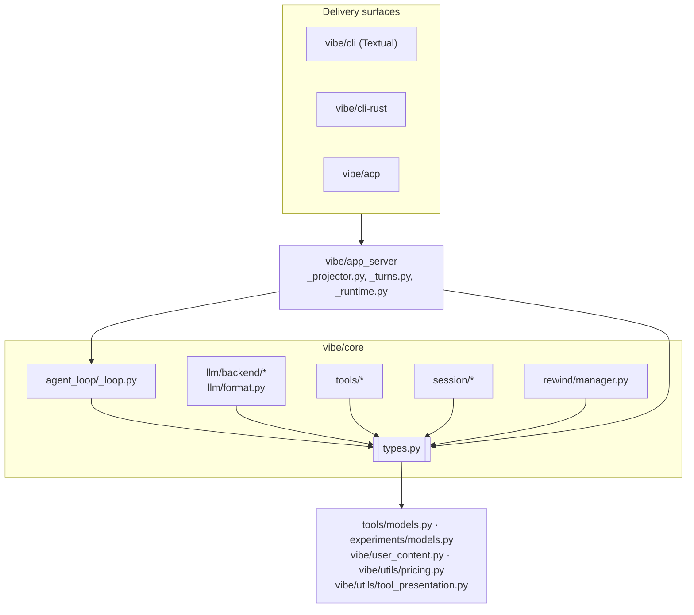
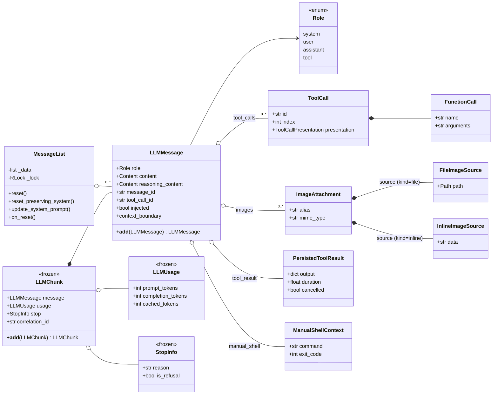
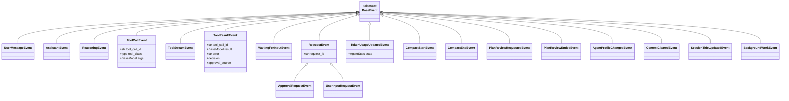
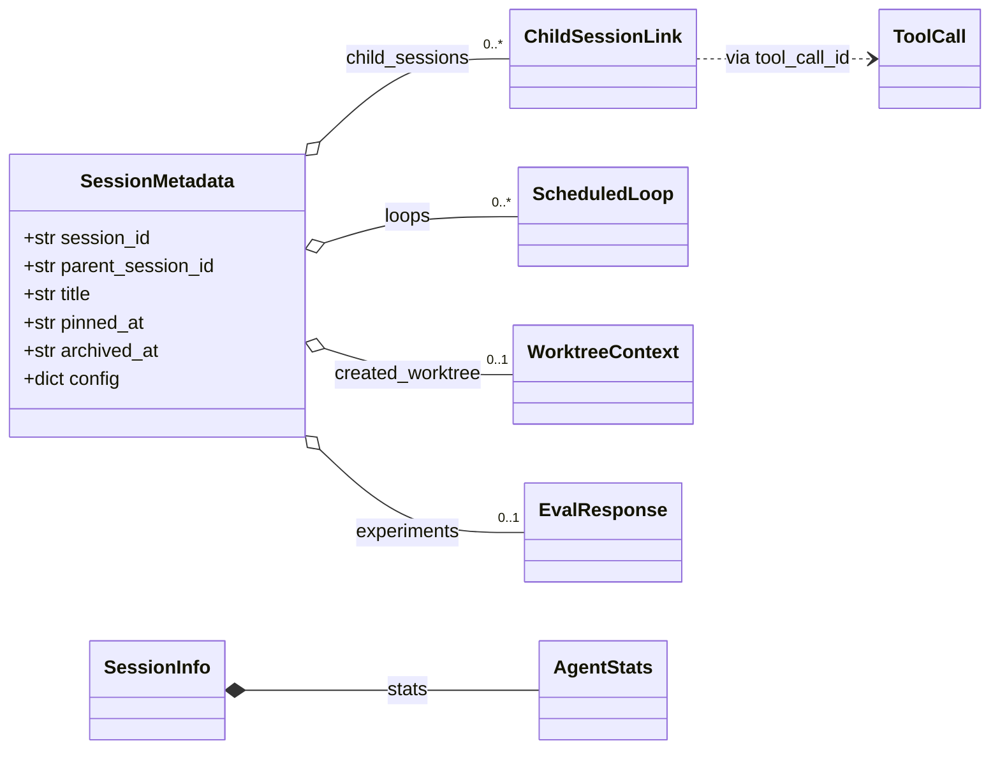

# Understanding `vibe/core/types.py` — the shared data model of the engine

> Source studied: [`vibe/core/types.py`](../../vibe/core/types.py) (798 lines) at commit `5e931ff3` (v2.26.1).
> Report produced with the help of an AI coding agent; every claim below was checked against the code
> (file and line links are given so the reader can verify them). See [§10 Method](#10-method-and-limits) for what was and was not verified.

## Table of contents

1. [Summary](#1-summary)
2. [Where the module sits in the architecture](#2-where-the-module-sits-in-the-architecture)
3. [Catalogue of the types](#3-catalogue-of-the-types)
4. [Entity relationships](#4-entity-relationships)
5. [Life of a turn, seen through the types](#5-life-of-a-turn-seen-through-the-types)
6. [Key code excerpts, explained](#6-key-code-excerpts-explained)
7. [Detailed specifications](#7-detailed-specifications)
8. [Design and architecture](#8-design-and-architecture)
9. [Quality, tests and findings](#9-quality-tests-and-findings)
10. [Method and limits](#10-method-and-limits)

---

## 1. Summary

`types.py` is not a feature you can run; it is the **vocabulary** the rest of the engine speaks.
It defines, mostly as [Pydantic](https://docs.pydantic.dev/) models, the objects that travel between the
LLM backends, the agent loop, the tools, the session logger and the app server:

| Concern | What `types.py` provides |
|---|---|
| Talking to the model | `LLMMessage`, `Role`, `ToolCall`, `FunctionCall`, `AvailableTool`, `StrToolChoice` |
| Receiving streamed answers | `LLMChunk`, `LLMUsage`, `StopInfo`, `StopReason` — all *addable* with `+` |
| Telling the UI what happens | `BaseEvent` and 19 event subclasses (assistant text, tool calls, approvals, compaction…) |
| Holding the conversation | `MessageList`, a thread-aware sequence of `LLMMessage` |
| Persisting sessions | `SessionMetadata`, `ChildSessionLink`, `WorktreeContext`, `ScheduledLoop`, `PersistedToolResult` |
| Counting tokens and money | `AgentStats` (with change listeners and computed cost) |
| Reporting backend failures | `RateLimitError`, `ContextTooLongError`, `ResponseTooLongError`, `RefusalError` |

Its importance is visible in the numbers: **84 source files and 144 test files import from it**
(`grep -rl "from vibe.core.types import"`). A change here ripples through the whole code base.

---

## 2. Where the module sits in the architecture

Mistral Vibe separates a reusable engine (`vibe/core`) from delivery surfaces (Textual CLI, Rust CLI, ACP),
with `vibe/app_server` in between ([ADR 0002](../adr/0002-core-engine-and-delivery-surfaces.md)).
`types.py` sits at the very bottom of `vibe/core`: almost everything depends on it, and it depends on very little.



### Outgoing dependencies (what `types.py` imports)

From [types.py:13-33](../../vibe/core/types.py#L13-L33):

| Import | Used for |
|---|---|
| `vibe.core.tools.base.BaseTool` (**only under `TYPE_CHECKING`**) | type of `ToolCallEvent.tool_class` |
| `vibe.core.tools.models.RequiredPermission` | `ApprovalRequestEvent.required_permissions` |
| `vibe.core.experiments.models.EvalResponse` | `SessionMetadata.experiments` |
| `vibe.user_content.UserDisplayContent`, `UserResource` | rich user input on `LLMMessage` / `UserMessageEvent` |
| `vibe.utils.pricing.session_token_cost` | `AgentStats.session_cost` |
| `vibe.utils.tool_presentation.ToolCallPresentation`, `ToolResultPresentation` | UI hints carried by tool calls/results |

The `BaseTool` import trick deserves attention:

```python
if TYPE_CHECKING:
    from vibe.core.tools.base import BaseTool
else:
    BaseTool = Any
```

`tools/base.py` itself needs `types.py`, so a real import would create a **circular import**. Under the type
checker (`pyright`) `BaseTool` is the real class; at runtime it is `Any`, which is why `BaseEvent` enables
`arbitrary_types_allowed=True`.

### Main modules that use it

| Module | Role with respect to `types.py` |
|---|---|
| [`core/agent_loop/_loop.py`](../../vibe/core/agent_loop/_loop.py) | **Main producer**: creates the `MessageList`, aggregates `LLMChunk`s, yields almost every event, raises the backend errors, owns `AgentStats` |
| [`core/agent_loop/_request_broker.py`](../../vibe/core/agent_loop/_request_broker.py) | builds `ApprovalRequestEvent` / `UserInputRequestEvent` |
| [`core/llm/backend/`](../../vibe/core/llm/backend/) (`mistral.py`, `generic.py`, `anthropic.py`, `openai_responses.py`, `reasoning_adapter.py`) | **produce** `LLMChunk`s from provider responses |
| [`core/llm/format.py`](../../vibe/core/llm/format.py) | turns tools into `AvailableTool` declarations for the model |
| [`core/session/session_logger.py`](../../vibe/core/session/session_logger.py) | serialises `LLMMessage` and `SessionMetadata` to disk |
| [`core/rewind/manager.py`](../../vibe/core/rewind/manager.py) | subscribes to `MessageList.on_reset` |
| [`core/tools/builtins/read_file.py`](../../vibe/core/tools/builtins/read_file.py), `experimental_bash.py`, [`core/subagents.py`](../../vibe/core/subagents.py) | emit `ToolStreamEvent` progress |
| [`app_server/_projector.py`](../../vibe/app_server/_projector.py) | **main consumer**: `match`es on core events and projects them into public client updates |
| [`app_server/_turns.py`](../../vibe/app_server/_turns.py) | answers `ApprovalRequestEvent` / `UserInputRequestEvent` through client callbacks |
| [`app_server/_runtime.py`](../../vibe/app_server/_runtime.py) | restores sessions with `MessageList.reset_preserving_system` |
| [`app_server/_shell_requests.py`](../../vibe/app_server/_shell_requests.py) | builds `ManualShellContext` for user-typed `!` shell commands |

---

## 3. Catalogue of the types

All line numbers refer to [`vibe/core/types.py`](../../vibe/core/types.py).

### 3.1 Conversation messages

| Type | Line | Kind | Purpose |
|---|---|---|---|
| `Role` | [271](../../vibe/core/types.py#L271) | `StrEnum` | `system`, `user`, `assistant`, `tool` (values are lower-case strings, via `auto()`) |
| `Content` | [268](../../vibe/core/types.py#L268) | annotated `str` | a string that also accepts provider-style lists of parts and flattens them |
| `LLMMessage` | [346](../../vibe/core/types.py#L346) | model | one message of the conversation — the central type of the module |
| `FunctionCall` | [241](../../vibe/core/types.py#L241) | model | `name` + JSON `arguments` *string* (may be partial while streaming) |
| `ToolCall` | [246](../../vibe/core/types.py#L246) | model | a tool call requested by the model: `id`, stream `index`, `function`, UI `presentation` |
| `ImageAttachment` | [300](../../vibe/core/types.py#L300) | model | an image attached to a message; its `source` is a *discriminated union* of… |
| `FileImageSource` / `InlineImageSource` | [283](../../vibe/core/types.py#L283) / [290](../../vibe/core/types.py#L290) | model | …an image on disk (`kind="file"`) or base64 in memory (`kind="inline"`, never persisted) |
| `PersistedToolResult` | [321](../../vibe/core/types.py#L321) | model | the structured result of a tool, stored on the `tool` message |
| `ManualShellContext` | [330](../../vibe/core/types.py#L330) | model | a shell command the *user* ran themselves (stdout, stderr, exit code…) |
| `MessageList` | [670](../../vibe/core/types.py#L670) | plain class | the conversation history (see [§6.5](#65-messagelist-a-small-amount-of-locking-in-the-right-places)) |

### 3.2 Model I/O

| Type | Line | Kind | Purpose |
|---|---|---|---|
| `AvailableFunction`, `AvailableTool` | [230](../../vibe/core/types.py#L230), [236](../../vibe/core/types.py#L236) | model | the JSON-schema description of a tool, as sent to the model |
| `StrToolChoice` | [227](../../vibe/core/types.py#L227) | `Literal` | `"auto" \| "none" \| "any" \| "required"` |
| `LLMChunk` | [502](../../vibe/core/types.py#L502) | frozen model | one streamed piece of answer: `message` + optional `usage`, `stop`, `correlation_id` |
| `LLMUsage` | [472](../../vibe/core/types.py#L472) | frozen model | `prompt_tokens`, `completion_tokens`, `cached_tokens` (cached ⊂ prompt) |
| `StopInfo`, `StopReason` | [491](../../vibe/core/types.py#L491), [487](../../vibe/core/types.py#L487) | frozen model, `StrEnum` | why the stream stopped; `is_refusal` is true when `reason == "refusal"` |
| `Backend` | [46](../../vibe/core/types.py#L46) | `StrEnum` | `mistral` or `generic` backend family |

### 3.3 Events (the agent loop → app server contract)

All inherit from `BaseEvent` ([522](../../vibe/core/types.py#L522)), an abstract Pydantic model.

| Event | Emitted when | Main producer |
|---|---|---|
| `UserMessageEvent` | a user message enters the turn | `_loop.py` |
| `AssistantEvent` | a piece of assistant text is streamed (addable with `+`) | `_loop.py` |
| `ReasoningEvent` | a piece of model "thinking" is streamed | `_loop.py` |
| `ToolCallEvent` | the model asked for a tool and its args were parsed | `_loop.py` |
| `ToolStreamEvent` | a running tool reports progress | tools, `subagents.py` |
| `ToolResultEvent` | a tool finished, failed, was skipped or cancelled — also records *how* it was approved | `_loop.py`, `agent_loop_hooks.py` |
| `RequestEvent` → `ApprovalRequestEvent` | the user must approve a tool call | `_request_broker.py` |
| `RequestEvent` → `UserInputRequestEvent` | a tool (e.g. *ask user question*) needs an answer | `_request_broker.py` |
| `WaitingForInputEvent` | a task waits for input (with optional predefined answers) | *no producer found — see [§9.3](#93-findings)* |
| `TokenUsageUpdatedEvent` | token stats changed | *unused — see [§9.3](#93-findings)* |
| `CompactStartEvent` / `CompactEndEvent` | context compaction starts / ends | `_loop.py` |
| `PlanReviewRequestedEvent` / `PlanReviewEndedEvent` | plan mode hands a plan to the user / review closes | `_loop.py` |
| `AgentProfileChangedEvent` | the active agent profile changes mid-turn | `_loop.py` |
| `ContextClearedEvent` | the context was cleared after accepting a plan | `_loop.py` |
| `SessionTitleUpdatedEvent` | an automatic title was generated | `_loop.py` |
| `BackgroundWorkEvent` | background work (today only `"session_title"`) `started` / `finished` | `_loop.py` |

Two callback aliases complete the picture: `SwitchAgentCallback` and `ClearContextCallback`
([665-667](../../vibe/core/types.py#L665-L667)), written with the Python 3.12 `type X = ...` syntax.

### 3.4 Session and statistics

| Type | Line | Purpose |
|---|---|---|
| `SessionMetadata` | [185](../../vibe/core/types.py#L185) | everything stored about a session besides its messages: git state, environment, title, pin/archive/seen timestamps, experiments, config snapshot, children, loops, worktree |
| `SessionInfo` | [155](../../vibe/core/types.py#L155) | a light summary (id, start, count, stats, save dir) |
| `ChildSessionLink` | [163](../../vibe/core/types.py#L163) | links a parent session to a subagent session through the `tool_call_id` that spawned it |
| `WorktreeContext` | [175](../../vibe/core/types.py#L175) | git worktree created for the session |
| `ScheduledLoop` | [36](../../vibe/core/types.py#L36) | a recurring prompt (`/loop`) with interval and next fire time |
| `AgentStats` | [51](../../vibe/core/types.py#L51) | cumulative and per-turn tokens, tool-call counters, speed, pricing, computed cost |

### 3.5 Errors

| Exception | Raised by | User-facing message |
|---|---|---|
| `RateLimitError` | `_loop.py` (from backend errors) | "Rate limits exceeded…" |
| `ContextTooLongError` | `_loop.py` | suggests `/rewind` then `/compact` |
| `ResponseTooLongError` | `_loop.py` | "…exceeded the maximum output token limit." |
| `RefusalError` | `_loop.py` when `StopInfo.is_refusal` | includes the provider's `category` and `explanation` |

All four store `provider` and `model`, so the app server can map them to client errors
([`app_server/_utils.py:136`](../../vibe/app_server/_utils.py#L136)).

---

## 4. Entity relationships

### 4.1 Messages, chunks and tools



A `tool` message points back to the assistant's `ToolCall` through `tool_call_id == ToolCall.id`. That is a
*logical* link (matched by id), not an object reference.

### 4.2 Event hierarchy



`ToolCallEvent`, `ToolStreamEvent`, `ToolResultEvent`, `ApprovalRequestEvent`, `UserInputRequestEvent` and the
two compaction events all carry a `tool_call_id`, which lets a client group everything that belongs to one tool
call. (For compaction this is an admitted workaround; see [§8.4](#84-documented-workarounds).)

### 4.3 Session records



---

## 5. Life of a turn, seen through the types

The sequence below follows one user prompt that makes the model call a tool. It is reconstructed from
[`_loop.py:3377-3420`](../../vibe/core/agent_loop/_loop.py#L3377-L3420), the request broker and the projector.

```mermaid
sequenceDiagram
    autonumber
    participant UI as Client (CLI / ACP)
    participant APP as app_server
    participant LOOP as AgentLoop
    participant BE as LLM backend
    participant ML as MessageList

    UI->>APP: prompt
    APP->>LOOP: act(prompt)
    LOOP->>ML: append(LLMMessage role=user)
    LOOP-->>APP: UserMessageEvent
    LOOP->>BE: complete_streaming(messages, tools=[AvailableTool…])
    loop for each streamed piece
        BE-->>LOOP: LLMChunk(message, usage?, stop?)
        Note over LOOP: chunk_agg = chunk_agg + chunk<br/>(text, reasoning and tool-call<br/>argument fragments are merged)
        LOOP-->>APP: AssistantEvent / ReasoningEvent
    end
    alt stop.is_refusal
        LOOP-->>APP: raise RefusalError
    end
    LOOP->>ML: append(chunk_agg.message) — assistant + tool_calls
    LOOP-->>APP: ToolCallEvent(tool_call_id, args)
    opt permission is "ask"
        LOOP-->>APP: ApprovalRequestEvent(request_id)
        APP->>UI: approval callback
        UI-->>APP: yes / no
        APP-->>LOOP: answer
    end
    LOOP-->>APP: ToolStreamEvent* (progress)
    LOOP->>ML: append(LLMMessage role=tool, tool_result=PersistedToolResult)
    LOOP-->>APP: ToolResultEvent(decision, approval_source)
    Note over LOOP: next model call with the tool result…
    APP->>UI: projected public updates (_projector.py)
```

What each type contributes:

1. **`AvailableTool`** tells the model which tools exist (built in [`llm/format.py`](../../vibe/core/llm/format.py)).
2. **`LLMChunk`** carries each piece of the answer; **`+`** rebuilds the full message.
3. **`LLMMessage`** with `tool_calls` is what gets stored in **`MessageList`** and later written to disk
   by the session logger with `model_dump(exclude_none=True, mode="json")`
   ([`session_logger.py:442`](../../vibe/core/session/session_logger.py#L442)).
4. **Events** are the only thing the app server sees; the app server never reads the loop's private state
   ([ADR 0003](../adr/0003-event-driven-agent-loop.md)).
5. **`AgentStats`** is updated from the summed **`LLMUsage`**.

---

## 6. Key code excerpts, explained

### 6.1 `LLMMessage._from_any` — accept almost anything, always give it an id

[types.py:367-399](../../vibe/core/types.py#L367-L399)

```python
@model_validator(mode="before")
@classmethod
def _from_any(cls, v: Any) -> dict[str, Any] | Any:
    if isinstance(v, dict):
        v.setdefault("content", "")
        v.setdefault("role", "assistant")
        if v.get("message_id") is None and v.get("role") != "tool":
            v["message_id"] = str(uuid4())
        if v.get("reasoning_message_id") is None and v.get("reasoning_content"):
            v["reasoning_message_id"] = str(uuid4())
        return v
    role = str(getattr(v, "role", "assistant"))
    ...
```

This "before" validator runs before Pydantic checks the fields. It does three things:

- **Defaults**: a missing `role` becomes `"assistant"` and a missing `content` becomes `""`.
- **Identity**: every non-`tool` message gets a fresh UUID `message_id`. The rewind feature and the app server
  use these ids to find messages again. `tool` messages are identified by `tool_call_id`, so they get none
  (tested in [`tests/test_message_id.py`](../../tests/test_message_id.py)).
- **Duck typing**: if `v` is not a dict, for example a provider SDK object, its attributes are read with
  `getattr`. Any object that looks like a message can therefore be validated into an `LLMMessage`.

### 6.2 `LLMMessage.__add__` — rebuilding a streamed message

[types.py:401-469](../../vibe/core/types.py#L401-L469). Streaming APIs send a message in many fragments. Text is
simply concatenated, but **tool calls are fragmented too**: the first fragment usually carries the `id` and the
`name`, and later ones carry pieces of the JSON `arguments`. Fragments are grouped by their stream `index`:

```python
tool_calls_map = OrderedDict[int, ToolCall]()
for tool_calls in [self.tool_calls or [], other.tool_calls or []]:
    for tc in tool_calls:
        if tc.index is None:
            raise ValueError("Tool call chunk missing index")
        if tc.index not in tool_calls_map:
            tool_calls_map[tc.index] = copy.deepcopy(tc)
        else:
            ...
            new_args = (tool_calls_map[tc.index].function.arguments or "") + (
                tc.function.arguments or ""
            )
            tool_calls_map[tc.index].function.arguments = new_args
```

Example:

| Fragment | `index` | `name` | `arguments` |
|---|---|---|---|
| chunk 1 | 0 | `bash` | `{"comm` |
| chunk 2 | 0 | — | `and": "ls"}` |
| **sum** | 0 | `bash` | `{"command": "ls"}` |

Rules worth knowing:

- Adding messages with a different `role`, `name` or `tool_call_id` raises `ValueError`.
- The docstring warns *"this is not commutative!"*. The left operand wins for `message_id`, `name` and
  `tool_call_id`, and for `images`, `user_display_content`, `input_text` and `resources` unless they are `None`.
- `copy.deepcopy` keeps the `+` operation from mutating the fragments it was given.

### 6.3 `LLMChunk.__add__` and `LLMUsage.__add__` — a small monoid

[types.py:479-519](../../vibe/core/types.py#L479-L519)

```python
def __add__(self, other: LLMChunk) -> LLMChunk:
    if self.usage is None and other.usage is None:
        new_usage = None
    else:
        new_usage = (self.usage or LLMUsage()) + (other.usage or LLMUsage())
    return LLMChunk(
        message=self.message + other.message,
        usage=new_usage,
        correlation_id=other.correlation_id or self.correlation_id,
        stop=other.stop or self.stop,
    )
```

Because chunks can be summed, the agent loop's streaming code stays very short:
`chunk_agg = processed_chunk if chunk_agg is None else chunk_agg + processed_chunk`
([`_loop.py:3394-3398`](../../vibe/core/agent_loop/_loop.py#L3394-L3398)). Here the **right** operand wins
for `stop` and `correlation_id`, because the latest chunk is the most informative. Message merging works the
other way: the left operand wins.

### 6.4 Tolerating old and foreign shapes

Two validators make the types accept data written in other shapes:

```python
def _content_before(v: Any) -> str:          # line 254
    if isinstance(v, str):
        return v
    if isinstance(v, list):                  # e.g. [{"type":"text","text":"a"}, ...]
        ...
        return "\n".join(parts)
    return str(v)

Content = Annotated[str, BeforeValidator(_content_before)]
```

```python
@model_validator(mode="before")              # ImageAttachment, line 307
@classmethod
def _migrate_flat_source(cls, value: Any) -> Any:
    # Accept and migrate the legacy flat shape `{path|data, ...}` from older
    # session transcripts.
```

`Content` normalises OpenAI/Anthropic-style *content parts* into one string. `_migrate_flat_source` is a
**lazy migration**: old session files stored `{"path": ..., "alias": ...}`, and they are converted to the
new `{"source": {"kind": "file", "path": ...}}` shape whenever they are read. The file on disk is not rewritten.
This is the approach [ADR 0006](../adr/0006-local-sessions.md) asks for ("tolerant of old transcript shapes
through migrations"). `SessionMetadata.unseen_at` / `seen_at` follow the same idea
([types.py:210-213](../../vibe/core/types.py#L210-L213)).

### 6.5 `MessageList` — a small amount of locking in the right places

[types.py:670-745](../../vibe/core/types.py#L670-L745). The conversation is not a plain `list`. It is a
`Sequence[LLMMessage]` with a re-entrant lock, because a *deferred-initialisation thread* may insert the system
prompt while the main thread is already working with the list.

```python
def __iter__(self) -> Iterator[LLMMessage]:
    # Snapshot under the lock: only __iter__ hands element-by-element
    # control back to Python, so the deferred-init thread's insert(0)
    # could shift indices mid-iteration. Other read dunders are single
    # C-level ops and stay atomic under the GIL without locking.
    with self._lock:
        return iter(list(self._data))
```

The design is deliberately minimal. It locks only the operations that read and then write
(`reset`, `reset_preserving_system`, `update_system_prompt`) and iteration, which hands control back to Python
between elements. Single operations (`append`, `len`, `[i]`) rely on the GIL and take no lock.

`update_system_prompt` **inserts** a system message at position 0 when there isn't one yet, rather than
overwriting slot 0. Under deferred initialisation, slot 0 may already hold a user message.

`on_reset(hook)` is a tiny observer mechanism. The `RewindManager` registers itself
([`rewind/manager.py:37`](../../vibe/core/rewind/manager.py#L37)) so that it can drop its checkpoints whenever
the history is replaced.

### 6.6 `AgentStats` — a model that notifies listeners

[types.py:74-96](../../vibe/core/types.py#L74-L96)

```python
_listeners: dict[str, Callable[[AgentStats], None]] = PrivateAttr(default_factory=dict)

def __setattr__(self, name: str, value: Any) -> None:
    super().__setattr__(name, value)
    if name in self._listeners:
        self._listeners[name](self)
```

Assigning a field calls the listener registered for that field name. `create_fresh(previous)` builds blank
stats that **keep the listeners**. It is used when history is cleared or a session is loaded
([`_loop.py:3629`, `3700`](../../vibe/core/agent_loop/_loop.py#L3629)), so subscribers keep working.
`session_cost` is a Pydantic `computed_field`: it appears in `model_dump()` but is never stored. Its docstring
accepts a known approximation: if the model changes mid-session, the *current* price is applied to every token.

---

## 7. Detailed specifications

### 7.1 `LLMMessage` fields

| Field | Type | Default | Meaning |
|---|---|---|---|
| `role` | `Role` | `"assistant"` (via validator) | author of the message |
| `content` | `Content \| None` | `""` (via validator) | text; list-of-parts input is flattened |
| `images` | `list[ImageAttachment] \| None` | `None` | attached images |
| `injected` | `bool` | `False` | added by the system, not typed by the user (e.g. the compaction summary); rewind skips these ([`rewind/manager.py:57`](../../vibe/core/rewind/manager.py#L57)) |
| `reasoning_content` | `Content \| None` | `None` | model "thinking" text |
| `reasoning_payloads` | `list[dict] \| None` | `None` | opaque provider reasoning blobs to send back unchanged |
| `reasoning_message_id` | `str \| None` | UUID if `reasoning_content` | id for the reasoning block |
| `tool_calls` | `list[ToolCall] \| None` | `None` | tools requested by an assistant message |
| `name` | `str \| None` | `None` | tool name, on `tool` messages |
| `tool_call_id` | `str \| None` | `None` | on `tool` messages, links back to `ToolCall.id` |
| `tool_result` | `PersistedToolResult \| None` | `None` | structured tool output |
| `message_id` | `str \| None` | UUID unless `role == tool` | stable identity |
| `user_display_content` | `UserDisplayContent \| None` | `None` | rich original user input for re-display |
| `input_text` | `str \| None` | `None` | the raw text the user typed |
| `resources` | `list[UserResource] \| None` | `None` | files/links attached by the user |
| `manual_shell` | `ManualShellContext \| None` | `None` | a `!command` the user ran |
| `context_boundary` | `"compaction" \| None` | `None` | marks the compaction summary; model requests start from the latest one ([ADR 0006](../adr/0006-local-sessions.md)) |

Unknown keys are **ignored** (`extra="ignore"`), so a transcript written by a newer version still loads.

### 7.2 Invariants enforced by the code

| # | Invariant | Where |
|---|---|---|
| I1 | Every non-tool `LLMMessage` has a `message_id` after validation | `_from_any` |
| I2 | `reasoning_message_id` exists whenever `reasoning_content` is non-empty | `_from_any` |
| I3 | Only messages with identical `role`, `name`, `tool_call_id` can be added | `LLMMessage.__add__` |
| I4 | Every tool-call fragment being merged has an `index` | `LLMMessage.__add__` |
| I5 | Two fragments with the same `index` cannot have different non-empty names | `LLMMessage.__add__` |
| I6 | `LLMUsage`, `StopInfo`, `LLMChunk` cannot be modified after creation (frozen; shallow) | `ConfigDict(frozen=True)` |
| I7 | `PersistedToolResult.duration ≥ 0`, `ManualShellContext.duration_ms ≥ 0` | `Field(ge=0)` |
| I8 | An `ImageAttachment.source` is exactly one of `file` / `inline` | discriminated union on `kind` |
| I9 | `MessageList.update_system_prompt` never overwrites a non-system message | method body |
| I10 | `reset_preserving_system` keeps *all* current system messages, then the new tail | method body |

### 7.3 Validation policies at a glance

| Policy | Types | Effect |
|---|---|---|
| `extra="forbid"` | `ScheduledLoop`, `ChildSessionLink`, `WorktreeContext`, `PersistedToolResult`, `ManualShellContext` | unknown key → validation error (strict records written only by Vibe) |
| `extra="ignore"` | `LLMMessage`, `ImageAttachment` + sources, `StopInfo` | unknown key dropped (forward compatible, tolerant of provider data) |
| `frozen=True` | `LLMUsage`, `StopInfo`, `LLMChunk` | immutable values, safe to share between stream consumers |
| `arbitrary_types_allowed` | `BaseEvent` (all events) | allows `type[BaseTool]`, arbitrary `BaseModel` args |
| default | the rest | Pydantic default (ignore extras) |

---

## 8. Design and architecture

### 8.1 Why one shared types module?

- **A single vocabulary.** The backends, the loop, the session logger and the app server exchange the same
  objects, so no translation layer is needed inside the engine. Translation happens once, at the edge, in
  `app_server/_projector.py` (core events → public updates) and in the backends (provider format → `LLMChunk`).
- **Surface neutrality.** Nothing in `types.py` imports Textual, ACP or a UI module, which is what
  [ADR 0002](../adr/0002-core-engine-and-delivery-surfaces.md) requires ("Keep core events and models surface-neutral").
  The only presentation-flavoured fields are the `presentation` hints (`ToolCallPresentation`, `ToolResultPresentation`).
  They are plain data from `vibe/utils` and contain no widgets.
- **Typed events instead of callbacks.** [ADR 0003](../adr/0003-event-driven-agent-loop.md) prefers "adding or
  extending typed events over adding surface-specific callbacks". The 19 event classes are that contract.
  The projector consumes them with exhaustive `match` statements; `_notice_data` ends with `assert_never(event)`
  ([`_projector.py:828`](../../vibe/app_server/_projector.py#L828)), so pyright reports any event the projector
  forgot to handle.

### 8.2 Techniques used

| Technique | Example | Benefit |
|---|---|---|
| Pydantic models | almost every class | validation, JSON (de)serialisation for sessions for free |
| `StrEnum` | `Role`, `Backend`, `StopReason`, `ApprovalResponse` | values serialise as plain strings (`"user"`, `"y"`) |
| `Literal` types | `StrToolChoice`, `ToolResultEvent.approval_source` | closed sets checked by pyright |
| Discriminated union | `ImageAttachment.source` | unambiguous parsing on `kind` |
| `BeforeValidator` / `model_validator(mode="before")` | `Content`, `_from_any`, `_migrate_flat_source` | normalisation and lazy migration |
| Operator overloading (`__add__`) | `LLMMessage`, `LLMChunk`, `LLMUsage`, `AssistantEvent` | streaming aggregation in one expression |
| `computed_field` | `AgentStats.session_cost` | derived values in dumps without stored duplicates |
| `TYPE_CHECKING` import | `BaseTool` | breaks a circular import while keeping static types |
| PEP 695 `type` aliases | `SwitchAgentCallback` | modern, lazily evaluated aliases (Python 3.12+) |

### 8.3 Comments that explain *why*

The module's comments mostly explain design decisions rather than restate the code. For example:

- `WorktreeContext` is session state rather than a message "because the worktree is created before the session
  has a first turn" ([types.py:172-174](../../vibe/core/types.py#L172-L174)).
- `pinned_at` is "a timestamp rather than a flag so the pinned shelf can be ordered by when each pin was made"
  ([types.py:204-206](../../vibe/core/types.py#L204-L206)).
- `experiments` are persisted per session, but plan/org attributes are "deliberately NOT persisted here" so a
  resumed session never reports a stale plan ([types.py:214-218](../../vibe/core/types.py#L214-L218)).

### 8.4 Documented workarounds

`CompactStartEvent` and `CompactEndEvent` carry a `tool_call_id` even though compaction is not a tool:

```python
# WORKAROUND: Using tool_call to communicate compact events to the client.
# This should be revisited when the ACP protocol defines how compact events
# should be represented.
```

ACP has no standard representation for compaction yet, so it is shown to clients as a pseudo tool call.

---

## 9. Quality, tests and findings

### 9.1 Tests that target `types.py` directly

| Test file | What it covers |
|---|---|
| [`tests/core/test_message_list.py`](../../tests/core/test_message_list.py) | 7 tests: `update_system_prompt` (replace / insert / empty), `reset_preserving_system`, and **two concurrency tests** with a racing thread |
| [`tests/core/test_llm_message_merge.py`](../../tests/core/test_llm_message_merge.py) | 6 tests: which side wins for `images` and `user_display_content` in `__add__` |
| [`tests/test_message_id.py`](../../tests/test_message_id.py) | 17 tests: id generation per role, uniqueness, preservation through dicts, `+` and JSON round-trips; event ids |
| [`tests/agent_loop/test_agent_stats.py`](../../tests/agent_loop/test_agent_stats.py) | ~40 tests: pricing, cached-token cost, `reset_context_state`, listeners surviving clear/reload/compact |
| [`tests/agent_loop/test_agent_observer_streaming.py`](../../tests/agent_loop/test_agent_observer_streaming.py) | `test_act_merges_streamed_tool_call_arguments`: tool-call fragment merging, end to end |
| [`tests/agent_loop/test_agent_backend.py`](../../tests/agent_loop/test_agent_backend.py) | refusal via `StopInfo(reason="refusal")` |

On top of these, the types are exercised indirectly by the whole suite: 144 test files import from the module.
Test doubles in [`tests/mock/utils.py`](../../tests/mock/utils.py) build `LLMChunk`s for fake backends.

### 9.2 Gaps in direct testing

These behaviours have no dedicated unit test, based on a search of `tests/`:

- the legacy image migration `ImageAttachment._migrate_flat_source`;
- `_content_before` flattening list-of-parts content;
- the `ValueError` paths of `LLMMessage.__add__` (role/name/id mismatch, missing index, conflicting names);
- `LLMChunk.__add__`'s "right side wins" rule for `stop` and `correlation_id`;
- the `RefusalError` message format with and without `category` / `explanation`.

Each of these is small and pure, so it would be a cheap, valuable test to add.

### 9.3 Findings

These come from reading the code (see [§10](#10-method-and-limits)). They are observations, not confirmed bugs.

| # | Observation | Evidence | Impact |
|---|---|---|---|
| F1 | **`TokenUsageUpdatedEvent` is never used.** No file in `vibe/`, `harness/` or `tests/` constructs or matches it. | `grep -rn TokenUsageUpdatedEvent` returns only its definition | dead code; candidate for removal |
| F2 | **`WaitingForInputEvent` is consumed but never produced.** The projector handles it ([`_projector.py:142`, `799`](../../vibe/app_server/_projector.py#L799)), but nothing in `vibe/` creates one. | grep for `WaitingForInputEvent(` | dead branch, or a producer that was removed |
| F3 | **`LLMMessage.__add__` drops `injected` and `manual_shell`.** The returned `LLMMessage(...)` does not pass them, so they fall back to `False` / `None`. | [types.py:448-469](../../vibe/core/types.py#L448-L469) | latent only: `+` is used in production just for streamed *assistant* messages ([`_loop.py:3398`](../../vibe/core/agent_loop/_loop.py#L3398)), which never carry these fields |
| F4 | **`_from_any` mutates the caller's dict.** It calls `v.setdefault(...)` and `v["message_id"] = ...` on the input itself. | [types.py:370-377](../../vibe/core/types.py#L370-L377) | a dict validated twice keeps the *first* generated id (arguably desirable), but callers may be surprised to see their dict changed |
| F5 | **One listener per field in `AgentStats`.** `_listeners` is a `dict[str, Callable]`, so a second `add_listener("x", ...)` silently replaces the first. | [types.py:87-90](../../vibe/core/types.py#L87-L90) | fine with one subscriber; a trap if a second appears |
| F6 | **Two classes named `RefusalError`.** `vibe/acp/exceptions.py:125` defines another one, which ACP maps the core one into. | grep | not a bug, but confusing when reading imports |
| F7 | **`frozen` is shallow.** `LLMChunk` is frozen, but its `message: LLMMessage` is mutable. | [types.py:502-507](../../vibe/core/types.py#L502-L507) | immutability is a convention, not a guarantee |
| F8 | **The module is large and mixes concerns** (wire types, events, session records, stats, errors). | 798 lines, 50+ public names, no `__all__` | splitting it (e.g. `events.py`, `session_types.py`) would make ownership clearer; AGENTS.md asks `__init__` files to expose an `__all__`, but this module has none |

### 9.4 Usage statistics

Number of files that mention each name, computed with `grep -rlw <name>` (excluding `types.py` itself). Generic
names such as `Role`, `Backend` or `ToolCall` can also match unrelated identifiers, so read these as orders of
magnitude.

| Type | Source files (`vibe/`) | Test files (`tests/`) |
|---|---:|---:|
| `LLMMessage` | 33 | 56 |
| `Role` | 27 | 65 |
| `ToolResultEvent` | 23 | 32 |
| `ImageAttachment` | 20 | 16 |
| `ToolStreamEvent` | 20 | 8 |
| `LLMChunk` | 12 | 14 |
| `AvailableTool` | 12 | 4 |
| `StrToolChoice` | 12 | 0 |
| `SessionMetadata` | 10 | 4 |
| `BaseEvent` | 9 | 14 |
| `MessageList` | 7 | 8 |
| `ToolCallEvent` | 6 | 24 |
| `AgentStats` | 6 | 6 |
| `AssistantEvent` | 4 | 17 |
| `UserMessageEvent` | 3 | 15 |
| `ManualShellContext` | 4 | 0 |
| `WaitingForInputEvent` | 1 | 0 |
| `TokenUsageUpdatedEvent` | 0 | 0 |

`LLMMessage`, `Role` and the tool events are the backbone. `ManualShellContext` and `StrToolChoice` are used in
production code but never mentioned in tests.

### 9.5 History

`git log -- vibe/core/types.py` shows the file changing in almost every release tag (v2.24.2, v2.24.4, v2.25.0,
v2.25.5, v2.25.8…). It is a living file: new features such as worktrees, pinned/archived sessions, manual shell
and scheduled loops have each added a field or a type.

---

## 10. Method and limits

- **How this report was made.** An AI coding agent read `types.py` in full, then traced each type with `grep`
  through `vibe/` and `tests/`. It also read the relevant parts of `agent_loop/_loop.py`, `app_server/_projector.py`,
  `rewind/manager.py`, the session logger, the test files listed above, and ADRs 0002, 0003 and 0006. Code
  excerpts are copied verbatim, with line numbers taken at commit `5e931ff3`.
- **What was verified.** Line references, which modules construct and consume each type, the test inventory, and
  the findings in §9.3, all by reading the source.
- **What was not verified.** The code was **not executed**: the analysis machine had no `uv` environment. The
  behaviours in §6 and §9.3 come from reading the code, not from running it. Usage counts are word matches, not a
  semantic call graph.
- **Not covered.** How each LLM backend builds `LLMChunk`s from its provider's format, and the public types the
  app server projects events into. Both deserve their own reports and would link well with this one.
