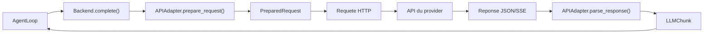

# Synthèse du module Backend LLM

Module : `vibe/core/llm/backend/`
Fork : `rrobbes/mistral-vibe`

---

## Rôle du module

Le module `vibe/core/llm/backend/` gère la communication entre Mistral Vibe et les fournisseurs de modèles de langage (Mistral, OpenAI, Anthropic, Vertex AI). Il fournit une interface unique permettant d'interagir avec différents providers sans gérer leurs spécificités individuellement.

## Architecture

```
AgentLoop
    |
    v
Backend (complete / complete_streaming)
    |
    v
APIAdapter (prepare_request / parse_response)
    |
    v
Requete HTTP -> API du provider
    |
    v
Reponse -> LLMChunk
```



## Composants

### BackendLike

Protocol defini dans `vibe/core/llm/types.py`. Definit l'interface que tout backend doit implementer :

- `__aenter__` / `__aexit__` : context manager asynchrone
- `complete()` : requete synchrone, retourne un `LLMChunk`
- `complete_streaming()` : requete en streaming, retourne un generateur de `LLMChunk`

### APIAdapter

Classe abstraite dans `vibe/core/llm/backend/base.py`. Responsable de la traduction entre le format interne de Vibe et le format de l'API externe :

- `prepare_request()` : convertit les `LLMMessage` au format de l'API
- `parse_response()` : convertit la reponse de l'API en `LLMChunk`
- `parse_stream()` : parsing des reponses streamées

Cinq adapters existent : OpenAIAdapter, AnthropicAdapter, ReasoningAdapter, OpenAIResponsesAdapter, VertexAnthropicAdapter.

### Backends

Deux implementations concretes :

| Backend | Fichier | Technologie |
|---------|---------|-------------|
| GenericBackend | `generic.py` | httpx (HTTP direct) |
| MistralBackend | `mistral.py` | SDK mistralai |

GenericBackend est utilise pour les providers sans SDK officiel. MistralBackend utilise le SDK Mistral pour les modeles Mistral.

### Factory

`factory.py` fournit `create_backend()` qui selectionne le backend approprie selon le `ProviderConfig`. Les imports sont differes (lazy loading) pour ne pas ralentir le demarrage.

## Utilisation

```python
from vibe.core.llm.backend.factory import create_backend
from vibe.core.config import ProviderConfig
from vibe.core.types import Backend

provider = ProviderConfig(
    name="mistral",
    backend=Backend.MISTRAL,
    api_base="https://api.mistral.ai/v1",
    api_key_env_var="MISTRAL_API_KEY",
)

backend = create_backend(provider=provider)

async with backend:
    chunk = await backend.complete(
        model=model,
        messages=messages,
        temperature=0.2,
    )
```

## Paramètres de configuration

| Paramètre | Valeur par defaut | Description |
|-----------|-------------------|-------------|
| timeout | 720.0 s | Timeout global d'une requete |
| retry_max_elapsed_time | 300.0 s | Budget total pour les retries |
| connect_timeout | 10.0 s | Timeout de connexion TCP |
| write_timeout | 30.0 s | Timeout d'ecriture |
| pool_timeout | 10.0 s | Timeout d'obtention d'une connexion du pool |

Source : `vibe/core/config/_defaults.py`

## Resilience

Le module gere les erreurs recuperables :

- Codes HTTP 429, 500, 502, 503, 504
- Erreurs reseau (httpx.NetworkError, httpx.TimeoutException)

La strategie de retry utilise un backoff exponentiel avec un budget temporel defini par `retry_max_elapsed_time`. Un `AdaptivePacer` ajuste le rythme des requetes apres un rate limit.

## Statistiques factuelles

- 9 fichiers Python
- 3203 lignes de code
- 34 classes
- 2 backends (GenericBackend, MistralBackend)
- 5 adapters
- 1 protocol (BackendLike)
- 1 classe abstraite (APIAdapter)

## Documentation detaillee

Les fichiers de documentation complets se trouvent dans le repertoire `docs/` :

- `01-OVERVIEW.md` : vue d'ensemble
- `02-ARCHITECTURE.md` : principes de conception
- `03-FOUNDATIONS.md` : BackendLike et APIAdapter
- `04-FACTORY.md` : pattern factory
- `05-GENERIC_BACKEND.md` : GenericBackend
- `06-MISTRAL_BACKEND.md` : MistralBackend
- `07-ADAPTERS.md` : les adapters
- `08-IMAGES.md` : gestion des images
- `09-FLOWS.md` : flux de donnees
- `10-RESILIENCE.md` : strategies de resilience
- `11-DIAGRAMS.md` : diagrammes
- `12-USAGE.md` : guide d'utilisation
- `13-ADVANCED.md` : sujets avances
